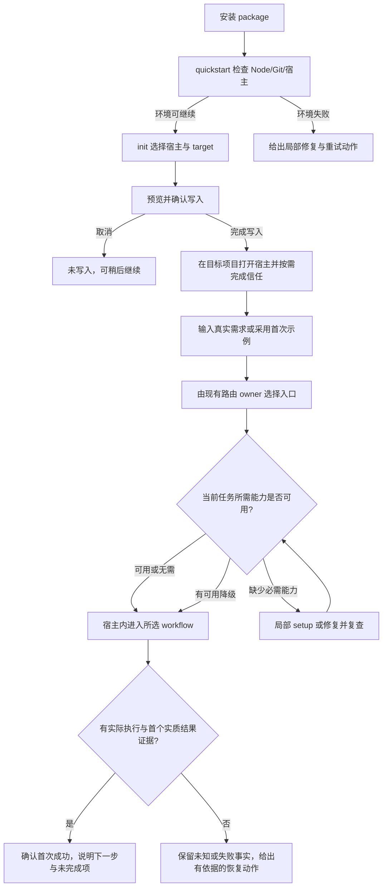
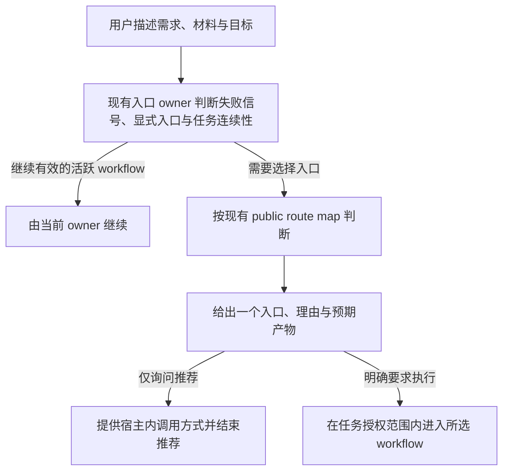
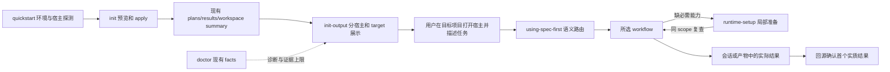

# 首次上手与日常 Workflow 路由体验 - Plan

## Goal Capsule

- **目标**：让用户从安装 `spec-first` 到宿主内第一次成功启动合适的 workflow 有一条可理解、可恢复的路径；之后面对研发需求时，能用同一套语言判断下一步入口。
- **产品权威**：当前用户确认产品目标与取舍；项目 source（CLI、README、skill contract）约束事实和边界；宿主会话负责实际加载和执行 workflow。
- **推荐实现**：扩展现有 init 输出和路由提示，复用 doctor/setup facts；不新增持久化上手状态、自动遥测或脚本语义路由。
- **本轮交付**：在保留 Product Contract 的基础上补充技术方案、四个实施单元与验证合同；本轮只规划，不实施 CLI、skill 或 generated runtime。
- **决策与验证重点**：提示必须绑定实际宿主及 target；失败与取消出口优先验证；路由语义通过 fresh-source 场景验证，真实宿主执行与用户收益另行验证。
- **最大风险**：现有 verification evidence 不足以自动确认首次 workflow 成功，不能把 doctor 的聚合 verified 映射成逐宿主或首个结果成功。
- **停止条件与后续 owner**：产品范围变化、新执行证据协议或未授权宿主写入返回方案 owner；后续由 `spec-work` 执行 U1-U4，真实试用须另有授权。`implementation-ready` 表示代码工作可规划执行，不表示实现、独立审查或现场收益已通过。

## Product Contract

### Summary

本方案将 onboarding 从“初始化命令列表”改为“当前状态 + 唯一下一步”的引导，并把日常 workflow 入口从 skill 清单改为基于用户意图和手头产物的路由。用户始终能区分配置写入、宿主加载、runtime readiness 和 workflow 执行证据，避免把其中一个阶段误认为整条链路已成功。

本次优化沿用两段旅程，优先减少错误就绪提示、无关 setup 和选错入口。以下新增默认是模型提出的产品方案，不代表用户已逐项批准，也不代表行为已实现。

### Problem Frame

当前 `quickstart` 能检查 Node.js、Git 和宿主 CLI，并把选择交给 `init`；`init` 能预览并写入 runtime projection，但 CLI 无法替用户在宿主会话中执行 `spec-*` workflow。初始化成功提示同时给出重启宿主、运行 `spec-runtime-setup` 和运行 doctor 等动作，用户需要自行判断顺序和必要性。

README 已区分 shell CLI 与宿主会话 workflow，也列出 `spec-brainstorm`、`spec-plan`、`spec-work`、`spec-debug` 的适用场景。但这种能力地图要求用户先理解项目的完整阶段模型，再把自然语言需求映射到入口；首次使用和日常使用都容易出现“选错 workflow、重复 setup、把 projection 写入当成可执行”的认知成本。

问题不是缺少更多 workflow，而是缺少一层面向任务的状态解释和入口决策。改进必须保留现有 source/runtime 边界：脚本提供确定性状态和 reason code，LLM/用户判断需求语义，宿主提供实际执行证据。

### Key Decisions

1. **区分配置、加载、readiness 和 workflow 结果。** 初始化成功不能代表宿主加载或 workflow 已运行；现有 CLI 也明确声明加载和 readiness 尚未验证。 Governs R1, R2, R5。
2. **按状态突出一个主要下一步。** doctor、完整诊断和高级修复仍可访问，但不与主路径并列竞争。 Governs R1, R2, R5。
3. **以“我手里有什么 / 我现在卡在哪里”组织入口。** 用户从需求和已有材料开始，不必先记住完整 skill 目录。 Governs R3, R4。
4. **Runtime Setup 按能力需求触发。** 普通工作在 direct source evidence 足够时可以继续；已选能力缺少必需 readiness 时才进入 setup 或降级路径。 Governs R2, R5, R6。
5. **“首次成功”以宿主内 workflow 启动并产生可观察结果为准。** 写入 projection、重启宿主或 setup 完成均只能作为中间状态。 Governs R2, R5。
6. **示例固定，真实任务动态路由。** 无任务的新用户可采用 brainstorm 示例；已有需求的用户直接描述自己的任务，不先做示例。 Governs R2, R3。
7. **先用人工试用建立基线。** 首版不引入自动本地事件记录或匿名外发遥测；仅在获授权的试用中记录必要观察。 Governs R2, R4。

### Actors

- **新用户**：安装后第一次配置宿主，需要知道是否成功以及下一步做什么。
- **日常研发用户**：带着自然语言需求、已有 PRD/requirements、implementation plan、明确工作项或失败证据进入项目。
- **`spec-first` CLI**：检查环境、写入 source 派生的 runtime projection、展示状态事实和下一步建议；不执行宿主会话 workflow。
- **宿主会话**：重新加载 runtime，运行 `spec-*` workflow，并产生真实执行/产物证据。
- **workflow 路由器（宿主中的 `using-spec-first`）**：根据用户意图、artifact 类型和失败信号选择一个 public entrypoint，不创建中心化状态机。
- **项目 owner**：确认需求语义、授权副作用，并判断 workflow 产物是否满足项目目标。

### Product State Model

以下是独立证据维度，不是执行状态机，也不要求用户依次通过所有维度。

| 维度 | 可显示的结论 | 证据与限制 |
|---|---|---|
| 配置写入 | 未配置、已写入、部分写入或异常 | 来自 init/projection 检查；不能证明宿主加载 |
| 宿主加载 | 已验证、未验证或已发现加载问题 | 需要当前项目与宿主的加载证据；重启、新开会话和完成信任只是操作 |
| 当前任务能力 | 已验证可用、无需该能力、未验证、降级或阻塞 | 绑定已选任务及能力，不能以未请求能力缺失阻断普通工作 |
| Workflow 结果 | 未启动、已启动、首个结果已确认、失败或未验证 | 需要实际 workflow 执行与结果证据；不等于整个研发任务完成 |

状态必须保留宿主、target、适用能力及新鲜度。未知状态不得显示为 ready；修复只更新受影响维度，不清空其他有效证据。仅缺少加载探针时，仍可尝试宿主支持的调用并用实际执行证据验证；已知 trust/loader 问题则先处理该问题。

### Requirements

#### 初始化后的状态与下一步

R1. 初始化结果必须解释“已完成什么、未验证什么”。`quickstart`/`init` 的成功输出应将 projection 写入、宿主加载、runtime readiness 和 workflow 执行分开表达，并为当前宿主、workspace target 和语言提供一致的状态名称。

R1.1. 初始化输出必须提供一个主行动。主行动根据当前状态选择重启/新开宿主、修复 projection、按需运行 Runtime Setup 或进入轻量 workflow；doctor 和 verbose 诊断作为次级行动。

R1.2. 主行动必须可恢复。用户中断、关闭终端或宿主未启动后，可在目标目录运行只读 `spec-first doctor` 从当前 facts 重新得到接续建议，不要求重新运行会写入的 init；建议应带 `reason_code` 或等价可回源依据。重跑 init 只用于用户明确要修改/修复 projection 的情况，不能作为唯一恢复入口。未知加载状态保持未验证。

R1.3. 输出必须区分 CLI 与宿主会话。shell 命令（如 `spec-first doctor`）和宿主内 workflow（如 `spec-brainstorm`）不能共享会被误复制的调用形式；文案需说明执行位置。

R1.4. 每个主行动必须说明执行位置、目标目录和完成后如何继续；首版提供该宿主支持的调用文本，不承诺自动执行或一键复制控件。

R1.5. 环境失败、未检测到宿主 CLI、多宿主和取消预览必须有明确出口；未检测到 CLI 只表示探测结果，取消预览不得写入。

#### 首次成功 workflow

R2. 首次体验必须提供一条从安装到 workflow 结果的最小充分路径。路径包括环境检查、宿主选择、初始化预览与写入、宿主激活、需求输入、入口选择、按需能力准备、workflow 启动和结果确认。

R2.1. 路径必须按能力需求决定是否 setup。轻量、可用 direct source evidence 的 workflow 可以在不完成完整 Runtime Setup 时继续；只有当前任务或选定能力明确需要 setup 时才把 setup 提升为主行动或阻断项。

R2.2. 首次成功必须同时确认实际进入目标 workflow 和得到与输入任务相关的首个实质结果；欢迎语、推荐入口、setup facts 或仅报告无法启动均不计成功。

R2.3. 失败时必须保留阶段位置。如果宿主未重新加载、runtime 只完成部分投影、setup 处于 degraded，用户看到的建议应指向最近的可修复阶段，不要求重新从安装开始。

R2.4. 首次示例采用“我想减少项目中重复出现的需求澄清，请帮我明确使用场景、范围和成功标准”，进入 `spec-brainstorm`；结果应含问题定义、范围、成功标准与待确认项，无需默认写入示例文件。

R2.5. 有真实任务的用户必须能跳过示例；首次结果确认所需证据至少包含宿主、项目 target、入口、发生时间、实际结果和证据来源，不能只依据 agent 的完成声明。

R2.6. 首个实质结果可以是可回源的会话输出或产物；debug 中有依据的诊断可以计入，尚未定位或仅报告环境阻塞不计入，并保留任务未完成的事实。

#### 基于意图的 workflow 路由

R3. 路由入口必须先识别用户手头的输入和目标。路由提示或入口说明至少覆盖：模糊想法、已有需求/PRD、实现方式未定、已定计划或明确工作项、失败/回归/异常、代码审查、已验证经验沉淀等状态。

R3.1. 核心四入口必须有一句可执行判别；它们是高频示例，不是穷尽路由。

| 用户输入或目标 | 默认入口 | 判别句 |
|---|---|---|
| 想法模糊，范围或成功标准未定 | `spec-brainstorm` | 先把问题和目标收敛成可审查需求 |
| 需求已明确，实现方式或影响面未定 | `spec-plan` | 先形成 implementation-ready plan |
| 计划/brief/工作项已定，要改代码并验证 | `spec-work` | 直接执行既定工作并留下证据 |
| 有失败、回归、报错或根因不明 | `spec-debug` | 先定位根因和修复证据 |

R3.2. 路由必须优先处理失败信号。同一请求同时包含“帮我改”和失败/回归/报错信号时，优先进入 `spec-debug`，不能因为用户使用了“实现/修一下”而绕过诊断入口。

R3.3. 路由必须返回一个主入口和一个理由。在低置信度时最多提出一个会改变入口的问题；不得同时要求用户打开多个 workflow，也不得把完整 skill 清单当成选择题。

R3.4. 有效的显式入口和活跃 workflow 的继续请求必须按现有入口合同处理；发现新的失败信号或入口冲突时说明原因，不静默改选。

R3.5. 代码/diff/PR 审查进入 `spec-code-review`，文档审查进入 `spec-doc-review`；从零探索方向、PRD 编写、环境配置等其他意图由现有 public route map 判断，不硬塞进四入口。

#### 日常使用的统一语言

R4. 日常入口必须支持“输入物 → 目标 → 入口 → 产物”的表达。每个推荐示例说明用户已有的材料、想达成的结果、建议的 workflow 和预期产物，且使用与 onboarding 相同的术语。

R4.1. 说明必须支持“我不知道该选什么”。用户可以只描述研发需求，由路由器根据内容给出一个入口、理由和下一步；不要求先浏览 README 的全量能力地图。

R4.2. 入口说明必须标注非线性。`spec-plan`、`spec-doc-review`、`spec-debug` 等可按任务插入，不得暗示每个任务都必须从 brainstorm 顺序走完整链路。

R4.3. 入口说明必须提示产物和边界。workflow 可能产生文档、代码变更或诊断证据；产物存在不等于语义正确、真实模型验证或 field outcome 已确认。

R4.4. 引导必须区分推荐入口与执行入口；仅问“该选哪个”时给出推荐和可用调用方式，明确请求处理任务时在授权范围内进入所选 workflow，不把推荐当作已执行。

#### 异常、降级与诚实反馈

R5. 所有面向用户的 ready/成功文案必须与证据级别匹配。`doctor` 的 `status`、`reason_code`、`next_action`、workflow runnability 和 freshness 信息应能支撑对应结论；未知、模拟、preview、degraded 或未验证不得显示为完整 ready。

R5.1. 每个阻塞或降级状态必须给出最小修复范围。文案说明受影响的宿主、workspace/repo、能力和下一步，不要求用户盲目执行完整 init 或 setup。

R5.2. 修复后必须回到同一验证点。用户执行 bounded repair 后，产品应引导重新检查同一 scope，而不是以“命令成功”直接关闭问题。

#### 多宿主与 workspace

R6. 多宿主初始化必须保留宿主差异。当用户选择多个宿主时，主路径应按宿主分别说明重载方式、setup 需求和证据上限；不能用一个“全部 ready”替代每个宿主的状态。

R6.1. workspace target 必须在建议中可见。父 workspace、子 Git repo、非 Git folder 和 `--repo`/`--all-repos` 的作用域应出现在状态和修复建议中，避免用户在错误目录重复初始化。

R6.2. preview/degraded 宿主必须显示能力上限。Cursor、OpenCode、ZCode、Pi 等当前存在 loader、trust 或执行证据限制的宿主，应明确说明“已生成 projection”与“宿主可运行 workflow”之间的差距。

### Key Flows

#### Flow A：首次上手



图展示典型引导，不强制所有任务经过全部节点。宿主打开后不自动声称已加载；有明确加载问题时先修复，没有独立探针时由实际调用结果补充证据。修复失败或用户取消时停止当前依赖动作，不自动循环重试。

主路径的用户问题顺序是：“配置写入了吗？”→“我应在哪个项目和宿主继续？”→“我想做什么？”→“该从哪个入口开始？”→“这项任务缺什么能力？”→“首个实质结果是什么？”

#### Flow B：日常需求路由



高频判别见 R3.1；其他意图见 R3.5。流程由 LLM 判断语义，图不定义优先级算法，也不允许脚本按关键词硬编码入口。

### Acceptance Examples

| 场景 | 用户应看到/得到 | 不应发生 |
|---|---|---|
| 新机器执行 `spec-first quickstart`，检测到唯一宿主 | 检查结果、初始化写入结果、明确“请重启宿主/新开会话”，以及完成后如何启动首个 workflow | 把 `quickstart` 输出当成 workflow 已执行 |
| Node/Git 检查失败 | 显示失败项、局部修复和重试位置，停止初始化 | 写入后才报告前置环境失败 |
| PATH 未检测到宿主 CLI | 说明未能自动探测，允许交互选择已有宿主；确实没有宿主时给出安装后继续的路径 | 把探测不到当成确认未安装 |
| 检测到多个宿主 | 用户选择本次要使用的宿主，交互提示说明只勾选当前要用的宿主、其他宿主以后可再初始化；非交互模式要求显式目标 | 默认全选被误解为必须初始化所有宿主，或自动猜选单一宿主 |
| 用户取消初始化预览 | 明确未写入，可重新选择并继续 | 把取消显示为配置成功 |
| `init` 写入成功但宿主未重启 | 状态为“已写入，宿主加载未验证”，主行动为重启/新开会话 | 显示完整 ready 或要求先跑所有 setup |
| Pi 新开会话但项目未信任 | 说明尚未加载项目 skill，主行动为完成项目信任后再尝试 | 因新开会话就显示已加载 |
| 宿主无独立加载探针，但实际 workflow 已产生结果 | 按实际证据确认该次执行，其他能力保持原状态 | 由一次执行外推全部能力 ready |
| 宿主已加载，用户只想整理一个模糊想法 | 推荐 `spec-brainstorm`，理由指出范围/成功标准未定 | 让用户从几十个 skill 名称中自行猜选 |
| 用户已有明确需求，但不知道如何实现 | 推荐 `spec-plan`，说明产物是 implementation-ready plan | 直接进入 `spec-work` 并自行发明实现方式 |
| 用户说“测试刚失败，帮我改一下” | 优先推荐 `spec-debug`，理由指出失败信号 | 直接推荐 `spec-work` |
| 用户已有批准的 plan 和明确任务 | 推荐 `spec-work`，说明会执行计划并验证 | 再要求重复走 brainstorm/plan |
| 用户要求审查当前 diff | 进入 `spec-code-review`，预期得到代码风险与验证缺口 | 按“已有材料”推荐实现或文档审查 |
| 用户继续活跃 workflow，未出现新冲突 | 当前 owner 继续，沿用已有产物和任务范围 | 重启路由并重复收集上下文 |
| 用户只问“该选哪个” | 一个入口、理由和宿主调用方式 | 自动执行或声称已有 workflow 结果 |
| 用户在首次示例中得到欢迎语或环境阻塞提示 | 保留未成功，并说明下一步 | 因存在文本输出就计首次成功 |
| 用户选了需要 helper/MCP 的能力但 setup 未完成 | 只对该能力提示 `spec-runtime-setup` 或降级路径 | 把 setup 缺失泛化为所有普通工作都不可继续 |
| 选择多个宿主或父 workspace | 每个宿主和 target 分别显示状态及证据上限 | 用一个总状态掩盖某个宿主或子仓未就绪 |
| Cursor/OpenCode/Pi 只有 projection/trust/loader 证据 | 显示 preview/degraded/未验证及下一步 | 声称宿主 workflow 已验证可运行 |
| 用户运行 doctor 后修复一项问题 | 引导复查同一 scope，并保留 reason_code 变化 | 只因修复命令退出 0 就显示全部 ready |

### Success Criteria

以下指标通过获授权的人工观察和访谈建立基线，再定目标值；首版不新增自动事件采集：

1. **首次路径完成率**：开始 `quickstart` 的新用户中，能在同一项目内实际进入 workflow 并获得符合 R2.2 的首个实质结果的比例。
2. **阶段误判率**：用户将 projection 写入、setup 完成或命令退出 0 误认为 workflow 已运行的比例。
3. **首个入口命中率**：日常需求首次推荐入口属于项目 owner 根据意图、材料和合同确认的可接受入口集合的比例。
4. **入口绕过率**：存在失败/回归信号时直接进入 `spec-work` 或 Direct Lane 的比例。
5. **恢复成功率**：遇到 action-required/degraded 状态的用户，在不重复完整初始化的情况下完成同一 scope 修复并重新验证的比例。
6. **认知成本信号**：首次用户完成安装到首个 workflow 的时间、重复运行无效命令次数、因选错入口产生的返工次数和“该运行什么”类求助量。

不把 token 数、workflow 数、projection 文件存在或静态文案测试通过作为用户收益指标。机制、静态测试和 mock 可以证明结构行为，不能单独证明上述 field outcome。

### Trial And Evaluation

试用是未来验证设计，本轮未执行，也不因文档写入而获得联系参与者或采集数据的授权。

- **试用范围**：第一轮建议邀请 5 名首次用户，在其选定宿主各完成一次安装到首个结果；另用不少于 12 个日常任务覆盖核心四入口、代码/文档审查、显式入口、任务继续和 readiness 请求。小样本只定位问题，不宣称跨宿主统计收益。
- **比较方式**：安装旅程采用背景相近的不同参与者体验当前与优化后的引导，避免学习效应；日常路由使用相同任务比较两版，隐藏版本标签，由项目 owner 按意图、材料和合同判定可接受入口集合。
- **最少观察**：记录阶段耗时、首次推荐、是否改选、无效重复操作、实际结果是否满足 R2.2，以及失败时恢复范围。默认只保存人工记录中的去标识摘要，不保存代码、完整 prompt、凭证或会话原文；试用前约定访问者和保留期限。
- **决策条件**：发现错误 ready、失败信号被绕过或副作用越界时先修正，不扩大试用。其余结果按成功率、时间和返工原因比较；没有足够数据时继续保留收益未验证，不用单次更快宣称改进。
- **目标值收敛**：产品 owner 在首轮基线后、扩大试用前确定目标值和观察窗口。首次完成率限定为同一项目、同一次试用中得到首个实质结果；取消和中断分别报告，不从分母静默剔除。

### Delivery Priorities

| 顺序 | 产品交付范围 | 验收依据 |
|---|---|---|
| 第一批：减少误导 | 独立状态语义、宿主/target 可见、一个主行动、环境与取消出口 | R1、R5、R6；不出现越过证据的 ready |
| 第二批：完成首个任务 | 宿主接续文本、可跳过的示例、任务先于 setup、首次成功判据 | R2；成功与阻塞均能说明结果与恢复位置 |
| 第三批：提高选路效率 | 复用现有路由、核心示例、审查入口、显式入口与任务连续性 | R3、R4；无需浏览完整 skill 清单 |

这是最小交付顺序，不是独立架构或自动串联 workflow。实现文件、证据 schema 复用、跨宿主验证与迁移由 `spec-plan` 定义；自动遥测、快捷控件和宿主自动执行不进入首版。

### Scope Boundaries

**本轮包含**

- onboarding 状态语义、主下一步、恢复提示和首次 workflow 示例的产品行为定义；
- 基于用户输入物、目标和失败信号的 workflow 路由语言与判别规则；
- 多宿主、workspace target、preview/degraded 和证据上限的用户可见边界；
- 面向后续实现的验收场景、事件/指标定义和证据限制。

**本轮不包含**

- 新增中心化 workflow 状态机或替宿主重建 agent、session、tool、MCP 等 primitive；
- 强制所有普通工作先运行完整 `spec-runtime-setup`；
- CLI 自动打开/控制宿主会话，或未经授权执行宿主内 workflow；
- 把 generated runtime mirror 作为 source 修改；
- 本轮直接改代码、skill、README、runtime projection、测试或提交；
- 以静态评测、mock、单次模型输出或本地配置完整性宣称真实用户收益。

### Dependencies / Assumptions

- `quickstart`、`init`、`doctor` 的现有事实输出继续由脚本/CLI 负责；产品层不重新推断宿主探测、projection 或 readiness 事实。
- `using-spec-first` 继续是 workflow 入口路由 owner；各下游 workflow 保留自己的语义判断和产物合同。
- `spec-runtime-setup` 继续维护 setup-owned facts，并对未请求能力采用 advisory/non-blocking 或 documented degraded 语义。
- 宿主可能无法提供等价的加载或执行证据；产品必须显示能力上限，不能承诺 feature parity。
- 首版评估依赖获授权的人工试用；自动事件采集为后续独立范围，不默认授权写入本地跟踪记录或外发用户代码、prompt 内容。

### Outstanding Questions

1. **规划时核实**：现有 verification evidence contract 能否逐宿主支持 R2.5 的最低证据？不能支持的宿主保留未验证，明确人工试用可以确认什么；不新建跨宿主事件协议来掩盖缺口。
2. **规划时核实**：各宿主的调用文本、信任步骤和 resume 方式哪些有当前源码/宿主证据支持？引导只提供受支持动作，缺证据时明确限制。
3. **试用前确定**：参与者、宿主覆盖、人工观察的访问者与保留期限。试用由后续授权启动，本轮没有参与者招募或数据采集。
4. **基线后确定**：完成率、耗时、误判与返工的目标值及扩大试用条件；未建立基线前不宣称用户收益。

### Sources / Research

- `src/cli/commands/quickstart.js`：`quickstart` 复用环境探测和 `init`，不执行宿主会话内的 `spec-*` workflow。
- `src/cli/commands/init.js`：初始化负责宿主、身份、语言、workspace target、预览、确认和写入。
- `src/cli/commands/init-output.js:916-1005`：初始化输出已说明 projection 写入、宿主重启、Runtime Setup、doctor 及多宿主差异，但当前为并列 next steps。
- `src/cli/commands/doctor.js:164-248, 853-963, 1266-1503`：doctor 已有 `status`、`reason_code`、`next_action`、workflow runnability 和证据新鲜度等结构化事实。
- `README.zh-CN.md`：已区分 shell CLI 与宿主 workflow，并列出 `spec-brainstorm`、`spec-plan`、`spec-work`、`spec-debug` 的适用关系。
- `skills/spec-runtime-setup/SKILL.md:9-23, 82, 117-137, 197, 259-262`：Runtime Setup 负责确定性 readiness facts；普通 workflow 可在 direct source evidence 下继续；缺能力时需保留 reason code、scope 和 degraded 边界。
- `skills/using-spec-first/SKILL.md` 与 `skills/using-spec-first/references/public-route-map.md`：入口路由 owner、失败优先原则、单一推荐入口和低置信度最多一个澄清问题。

**证据限制**：以上是当前源码和合同的结构/行为证据，不证明真实宿主加载、真实模型路由准确率、首次成功率、field outcome 或发布状态。规划阶段必须补充跨宿主可运行性、现有 verification evidence schema 和真实任务试用设计。

## Planning Contract

### Implementation Scope Boundaries

技术实现覆盖原 Product Contract 两段旅程，不缩减为只改 README。目标是让实际输出、路由和使用说明一致；不新增 CLI 子命令、图形界面、宿主控制、provider 或事件采集。Product Contract 内“本轮”措辞属于上游产品方案的生成上下文，本次保留不改；后续代码工作范围由本节及 U1-U4 约束。

纳入 `quickstart/init/doctor` 的人类可读输出、现有入口 governor 与 public route map、三份 README 和快速开始手册，以及对应聚焦验证。setup 的安装实现、通用 evidence producer、JSON schema、宿主 adapter 的生成行为保持原合同；发现相关确定性缺陷时另行定位，不能为本方案扩大实现范围。

### Source Baseline

下列结论来自 2026-10-08 的当前工作区源码，包含未提交的产品方案；历史文档或 Graphify 输出仅作导航。执行者开始前检查这些 owner 是否变化；若变化影响下列决策，更新方案后再实施。

| 当前事实 | 源码依据 | 对实现的影响 |
|---|---|---|
| 普通 next steps 只收到 platforms/lang，且部分 topology 分支跳过该输出 | `src/cli/commands/init.js`，`src/cli/commands/init-output.js` | 应从现有 plans/results 提取 target 与结果，统一成功、partial 和 topology 的行动层级 |
| 成功摘要写作“宿主 ready”；普通 next steps 要求完整 setup；all-repos 成功 handoff 也直接要求 setup | `src/cli/init-i18n.js`，`src/cli/commands/init-output.js` | 三处一起修改，避免尾部文案纠正不了前部错误印象 |
| `hostMcpSetupCommand(platform)` 当前对所有宿主返回同一个裸入口名 | `src/cli/commands/init-args.js` | 不能把它当作已经验证的逐宿主 native 调用转换器 |
| runnability 读取项目级 verification 文件，结合聚合 runtime checks 判断 verified/simulated/not_verified | `src/cli/commands/doctor.js` 的 `computeWorkflowRunnability`、`readWorkflowVerificationEvidence` | 保留机器字段，补充人类可读适用范围；不输出逐宿主首次成功结论 |
| doctor 以当前 cwd 为检查 target；默认 formatter 在 verbose 证据概要前返回，健康 scope 未必有 next_action | `src/cli/commands/doctor.js` 的 `runDoctor`、`formatDoctorHumanReport` | R1.2 不能靠现有诊断文案自动兑现；U3 必须补只读 continuation，且不自动发现或切换到其他 target |
| quickstart 检测到唯一宿主时直接选择该宿主 | `src/cli/commands/quickstart.js` | 真实旅程验证应记录实际选择，不能把固定 Codex 验证外推为用户的默认路径 |
| verification schema 要求时间、来源、verifier、artifact 等，但未强制要求宿主、target、入口或任务相关结果 | `docs/contracts/verifiers/verification-evidence.schema.json` | 无法覆盖 R2.5；人工回源确认，缺任一必要事实保留未验证 |
| host receipt 固定 producer 为 setup.cjs，入口固定为 spec-runtime-setup | `docs/contracts/verification/host-invocation-receipt.schema.json` | 可解释加载事实，不能把 setup receipt 当 brainstorm/work/debug 的结果证据 |
| public route map 已覆盖主链路、审查与 on-ramps | `skills/using-spec-first/SKILL.md`、`skills/using-spec-first/references/public-route-map.md` | extend 现有语言，不创建第二个路由器或关键词分类脚本 |

已运行一次 Graphify query 定向；输出截断且含历史节点，没有作为实现事实使用。上表结论均由直接源码确认；未刷新 graph、探测真实宿主或调用外部模型。

### Key Technical Decisions

**KTD1：输出由现有 owner 扩展，事实与建议分开。** Governs R1-R1.5、R5-R6.2。将 `plans/results` 与现有 workspace summary 组合成一次调用期间的展示数据；在 `init-output.js` 内保持小型纯 helper，不新建持久化 registry、ledger 或 public schema。脚本只能按写入/异常/取消等确定性事实选择操作性下一步，不能猜测用户要 brainstorm 还是 work。

**KTD2：一条 scope 一个主要操作，任务输入先于 setup。** Governs R1.1、R2-R2.3、R6。成功写入的主要操作是“在该 target 打开或新开所选宿主会话”；其后给出需求输入文本与首个结果判据，setup/doctor 属于条件或次级动作。多个宿主各自有一条主操作，不合成为“全部 ready”；无当前任务时不判断能力已就绪或必需 setup。

**KTD3：extend 入口 governor，LLM 保留语义 ownership。** Governs R3-R4.4。沿用现有失败优先、有效显式入口、活跃任务继续和 public route map；仅补足输入物、推荐理由、推荐/执行边界。公共四入口是示例，不删减其他路由；不用 regex、评分阈值或硬状态图实现语义分类。

**KTD4：首次结果不新增自动判定。** Governs R2.2-R2.6、R5。现有 evidence 可提供线索，但没有等价的逐宿主成功合同。将最低证据作为会话内回源确认清单和未来人工试用记录要求；不自动创建 verification-evidence、不填入猜测字段、不据 agent 完成声明升格状态。运行证据与结果充分性分别判断；前者来自日志/会话/产物，后者由 LLM/owner 判断是否与任务相关。

**KTD5：兼容既有机器接口，修正面向人的含义。** Governs R1、R5-R6.2。不改 flags、exit codes、setup receipts、workspace summary schema 或 doctor JSON 字段/枚举。把 init 的 ready 文案明确限定为 projection 写入，不将 doctor 聚合 `verified` 宣称为加载了每个宿主或完成了首次任务。现有 tests 中“固定四行、禁止 workflow 引导”的断言随产品行为迁移，仍检查输出紧凑且历史目录存在与否不改变建议。

### High-Level Technical Design

下图描述 ownership 和信息流，不规定用户必须顺序执行所有 workflow。



CLI 展示生命周期仅跟随一次调用事实；下表是输出选择规则，不是新状态机。日常路由图沿用 Product Contract Flow B，四个证据维度沿用 Product State Model，不重复定义流程协议。

| 输入事实/模式 | 主要输出 | 后续与边界 |
|---|---|---|
| Node/Git error | 局部环境修复与同一 quickstart 重试 | 不调用 init，不增加新退出码 |
| 未检测到/多个宿主 | 交互选择，或非交互显式目标说明 | 未检测到不等于未安装；沿用现有拒绝规则 |
| dry-run/取消 | 预览或未写入事实，以及重新发起的位置 | 不显示“初始化完成”或宿主启动成功 |
| 单 repo/非 Git folder 成功 | 指定 target、host、projection 已写入、加载未验证；打开目标宿主会话 | 进入后描述真实任务；无任务用固定示例 |
| parent-only 成功 | 只确认父 workspace；在父级工作时继续父级会话 | 在子仓工作时再显式选择子仓，不能因 pending 就要求全部初始化 |
| all-repos 成功 | 父级及子仓写入范围，逐宿主激活说明 | 选择实际工作 target；不要求对所有子仓运行 setup |
| 某宿主/子仓 partial 或异常 | 已成功范围保留，失败 scope 和既有 reason/修复动作突出 | 成功 scope 可继续；失败 scope 修复后复查，不静默重新 apply 全部 |
| Pi projection 成功 | target 内打开 Pi 并完成现有项目信任流程 | 操作完成不代表技能执行已验证；不自动执行 pi -a |
| language/profile/summary 更新失败 | 单列实际失败的共享范围和退出状态 | 不将该失败改称 projection 未写入；不对所有宿主重复 setup |

### Interface Contracts

| 接口 / posture | Owner 与 consumers | 输入、输出与兼容性 | 验证 owner |
|---|---|---|---|
| init 文本输出 / evolution | `init-output.js`、`init-i18n.js`；CLI 用户、quickstart、文本 tests | 既有 apply facts → 分 scope 状态与主要操作；文案行为变化，不改变写入结果或退出码；旧文本断言须迁移 | U1 的 init guidance/workspace/失败 tests |
| init 私有展示上下文 / extend | `init.js` → `init-output.js` | 复用 plan.platform、projectRoot/workspaceRoot、mode、topology 及 results；包含 scope、projection outcome、依据和操作；不持久化，不导出新公共协议 | U1 的 caller 与输出集成验证 |
| topology handoff / evolution | `init-output.js` 的 `printInitTopologyHandoffs`、`printParentOnlyInitHandoff`、`printAllReposInitHandoff`；workspace 用户 | 使用同一 host/target/action 展示规则；parent-only 仅确认父级，子仓动作有条件；all-repos 与 partial 保留逐 scope 结果，避免与普通 next steps 重复 | U1 的 parent-only/all-repos/partial 分支验证 |
| doctor 文本解释 / evolution | `doctor.js`；终端用户、输出 tests | 默认摘要明确“配置检查不等于宿主已加载或首次任务成功”；verbose 显示证据路径、时间范围/缺失、新鲜度与适用限制；复用既有 report/basis，不改变 JSON、不推导 first_success | U3 的 default/verbose doctor output tests |
| doctor 只读 continuation / extend | `doctor.js` 的人类层 formatter；中断后恢复的终端用户 | 当前 cwd、已选择/检测的 host、现有 projection/check facts → 每个可判定 scope 的一个主要操作、执行位置、绝对 target 与事实依据；JSON/schema 不变，不 apply、不写 profile/runtime；事实不足时明确未知并链接手册 | U3 的 formatter 与新进程命令级零写入验证 |
| public route 语义合同 / extend | `skills/using-spec-first/`；宿主与下游 workflow | 用户请求与现有产物 → 一个入口及理由，或继续原 owner；保留推荐/执行授权边界 | U2 的入口检查与 fresh-source eval |
| verification/host receipt / reuse | 原 schema 与 producer；doctor/setup | 原字段不变；不在本次新增 first-success 字段或一般 workflow receipt | U3 保持原合同回归，缺证据仍未验证 |

展示上下文只在内存存活，重跑从当前 facts 重建，不读取“用户上次做到第几步”。成功写入后若用户关闭终端，恢复入口是在目标目录运行只读 `spec-first doctor`；它根据当前宿主与 target facts 展示状态和继续位置，不重新 apply。doctor 不具备足够事实时，应指向快速开始手册中的固定恢复步骤，并明确未知项。事实缺失时明确未知并显示 source scope，不猜测历史。已有 reason_code 优先透传；若需新增展示层原因，只定义局部常量并解释来源，不伪装成 producer 的机器 reason_code。

R1.2 在本实现中的最小合同是：即使没有 attention item，projection 检查足够支持继续的 scope 也应显示“在该 target 打开/新开该宿主会话，并描述任务”，同时保留加载与首次结果未验证。已确认异常优先展示既有 bounded repair；可用降级或未知事实只说明其范围，不自行判断任务所需能力。多个宿主按 scope 展示，不擅自替用户选择。父 workspace 与 child repo 分别从各自目录检查，不新增 doctor target flags、递归恢复或历史进度推断；只有已有 workspace facts 明确支持时才引用子 scope，否则引导用户进入实际 child target 后复查。

**宿主调用策略**：首版统一以宿主内自然语言文本作为跨宿主回退，例如“请使用 spec-brainstorm，帮我明确……”，明确这是会话输入而非 shell 命令；这是请求执行入口，能否识别仍由真实加载/执行证据确认。宿主原生 slash/skill 调用只有在当前 adapter/template 合同及版本证据支持时才展示；不从宿主名字拼接语法，不假设裸 `spec-*` 是可执行命令。Pi 现有 `/skill:name` 文本不能包装为已现场验证的调用能力；不新增统一 native invocation schema。`hostMcpSetupCommand` 的裸名只作入口标识，不再充当“复制即能执行”的保证。

**target 与命令安全**：复用已解析路径，不用 display label 代替绝对 target。诊断 shell 命令在明确目录运行；带空格、引号、Unicode 的路径只用经过验证的 quoting helper，或分别展示目录与不带路径的命令，不用字符串拼接发明转义。parent-only 的子仓建议明确是条件动作；不把父 scope 的证据外推给子 scope。

### Failure, Migration And Rollback

- 先统一普通 init、parent-only、all-repos 和 partial 的行动层级，再更新文档，避免两个分支同时输出竞争的“下一步”。保留现有详细写入摘要，行动层不重复完整文件清单。
- 未加载技能、trust 未完成或 invocation 不可用时返回该宿主/target 的加载修复位置；不会自动补完整 setup 或把 welcome/error 算作结果。
- 无 setup facts 或无 task context 时显示未验证；已知能力必需却不可用时由当前 workflow/setup owner 负责降级或局部修复。init 不解析任务语义或 provider 内部实现。
- 所有已支持宿主从 `getSupportedPlatforms()` 枚举检查，当前包含 Claude、Codex、Cursor、Kiro、Qoder、OpenCode、ZCode、Pi。preview/trust/loader 说明来自现有 source，真实探针缺失必须保留限制。
- 无数据迁移或证据升级。CLI-only 修改不要求 runtime regeneration；U2 修改 canonical skill 后，只有获授权时才用 `spec-first init` 生成测试 target 的 runtime，不手改 mirror。
- 回滚只撤回本次 CLI/skill/docs 变更与对应 tests，保留已有用户文件和 evidence；已生成 target 如需回退，恢复 source 后按授权重新生成。规划不执行 commit、安装、发布或用户环境重写。

### Assumptions And Deferred Work

**A1**：自然语言入口请求足以作为不虚构 native 语法的调用文本；宿主识别率仍是 U2/U4 真实验证问题，未知不作 ready 承诺。

**A2**：R2.5 最低证据可通过实际会话与产物联合回源，在人工观察中确认单次成功；CLI 不需要保存 onboarding 进度。无法获取宿主或 target 的平台只能记未验证，不用人工推测补齐。

**A3**：先交付可维护引导，再在获授权试用中建立基线。参与者、访问范围、保留期和收益阈值由试用 owner 在启动前确定；不阻塞 U1-U4 本地实现，但阻塞任何 field outcome/采用收益声明。

通用 execution receipt、doctor runnability 的逐宿主协议升级、自动分析用户任务、自动事件采集与宿主快捷控件均暂缓。只有人工试用确认这些缺口造成高频失败，且新协议 owner/授权明确时重新立项，不在本次暗中实现。

## Implementation Units

### U1. 统一 init 与 quickstart 的事实和行动输出

- **Goal / Requirements**：用户知道哪些 scope 已写入、在哪个宿主和目录继续；覆盖 R1-R1.5、R2.1/R2.3、R5.1/R5.2、R6-R6.2，遵循 KTD1/KTD2/KTD5。
- **Files**：`src/cli/commands/init.js`、`init-output.js`（含普通 next steps 与三个 topology handoff 函数）、`init-args.js`、`init-input.js`（仅多宿主选择提示，不改预选算法）、`quickstart.js`（仅必要提示）、`src/cli/init-i18n.js`；`tests/unit/init-runtime-readiness-guidance.test.js`、`init-workspace-contract.test.js`、`init-apply-failure.test.js`、`init-ux-improvements.test.js`、`init-input-profile-validation.test.js`、`quickstart-command.test.js`、`quickstart-language.test.js`、`tests/smoke/cli-smoke.test.js`（已知成功摘要断言随文案迁移）。
- **Approach**：从 plans/results 传入 scope，展示 helper 复用现有结果；projection 摘要消除无范围 ready；同一行动层处理 topology 和 partial。成功主行动为宿主激活与任务输入，setup 按条件展示，doctor 次级。多宿主选择提示说明只选本次要使用的宿主，其他宿主可稍后初始化；保留现有预选算法，不改变默认值或写入范围。两种 CLI 语言保持一致含义，不增探测或写入副作用。长路径按 scope 分行展示，诊断命令与所在目录分行输出，不依赖固定宽度对齐。
- **Test Scenarios**：单宿主成功；两个宿主不同结果；父级不覆盖子仓；all-repos 成功及一个子仓失败；非 Git folder；有空格的 target；Node/Git error；0/多宿主交互及非交互拒绝；检测到多个宿主时提示解释勾选范围且用户可取消非当前宿主；取消/dry-run 零写入；Pi trust；language/profile/summary 失败不抹去成功 projection；未知结果不显示 ready；历史目录存在与否不改变建议。
- **Topology 验收**：普通成功、parent-only、all-repos 成功及 partial 分支分别断言 host、绝对 target、主要行动、恢复 doctor 的执行目录与依据；parent-only 不把子仓 pending 当作父级阻塞，all-repos 不要求所有 target setup，partial 不隐藏成功 scope 或扩大修复范围；普通 next steps 与 handoff 不重复竞争。
- **Verification**：运行上述聚焦 Jest 文件，保留既有 exit-code、取消写入与 scope 断言。输出检查应验证行为层级和证据上限，避免将所有句子固定成快照；人工扫描八宿主输出紧凑性。
- **Dependencies**：无。执行先读现有 tests 建立行为基线，再迁移旧文案断言；不为纯措辞堆新测试。

### U2. 补足任务路由与推荐/执行边界

- **Goal / Requirements**：用户描述任务即可选择正确入口；覆盖 R2.1、R3-R4.4，遵循 KTD3。
- **Files**：`skills/using-spec-first/SKILL.md`、`skills/using-spec-first/references/public-route-map.md`；相关入口治理 tests 只在合同实际变化时调整，不改 runtime mirror 或所有下游 skill。
- **Approach**：复用已有 fast-path/显式入口/任务连续性规则，在现有相关段落补充输入物 → 目标 → 主入口 → 产物与理由；有任务先路由、后判断所需能力。纯推荐不进入执行；明确任务请求不能仅给菜单。最多一个能改变入口的问题，不重复现有规则形成新 router。另补一条常设规则承接 Flow A 收口：用户得到首个实质结果后，按 public route map 给出下一入口与未完成项说明；确认本身仍按 R2.5 人工回源，不新增自动判定（KTD4）。
- **Test Scenarios**：模糊想法→brainstorm；已定 WHAT/HOW 未定→plan；明确工作项→work；“测试失败帮我实现”→debug；diff→code-review；文档→doc-review；从零方向→ideate；已验证经验沉淀→compound（按 public route map，对应 R3 最低覆盖状态）；继续活跃任务不重启；有效显式入口不静默替换；新失败信号解释冲突；只问推荐不写入；无关能力缺失不先 setup；必需能力缺失按已有 owner 处理。
- **Verification**：`npm run lint:skill-entrypoints`；按当前 `docs/contracts/workflows/fresh-source-eval-checklist.md` 在新会话注入当前 source 评估上述场景，记录 source hash、实际模型/宿主、输出、路由及授权判断。dispatch 不可用或未获相应调用授权时记录 not_run，不能用静态关键词 tests 替代语义通过。
- **Dependencies**：可与 U1 独立实施，交付前与 U1 的会话输入、setup 条件保持一致。

### U3. 明确 doctor 与首次结果的证据上限

- **Goal / Requirements**：用户不会因 doctor/setup 成功误判首次任务成功，且中断后无需重新 apply 即可恢复；覆盖 R1.2/R1.3/R1.4、R2.2-R2.6、R5-R5.2、R6-R6.2，遵循 KTD4/KTD5。
- **Files**：`src/cli/commands/doctor.js`；`tests/unit/doctor-output.test.js`、`doctor-runtime-assets.test.js`、`doctor-workspace-readiness.test.js`，以及 `tests/integration/doctor-continuation.test.js`（新进程恢复测试；若已有等价命令级 owner 则复用）；`docs/05-用户手册/01-快速开始.md` 的结果确认与诊断说明。verification/receipt schemas 只读。
- **Approach**：doctor 默认摘要明确说明配置检查不等于宿主加载或首次 workflow 成功；verbose 证据概要解释现有 runnability 的 project 聚合范围、evidence path/source/freshness 和未绑定宿主/任务的限制。复用现有 facts 提供只读恢复建议，不新增 first-success 状态、不改变 JSON 判定算法。手册提供关闭终端后的恢复步骤及会话回源清单：宿主、target、实际入口、时间、首个实质结果、来源。区分 setup receipt、实际执行和任务产物语义，不要求为示例写文件。默认摘要新增内容设预算上限：证据上限声明一句，continuation 每 scope 一条主操作，其余证据细节进 verbose，保持紧凑性断言可迁移。该回源清单同时是 Flow A「确认首次成功」节点的承接面：会话输出或产物可回源即确认证据，下一入口由 U2 路由语言按 public route map 给出。
- **Continuation 实施**：只在人类层 formatter 组合当前 report 与已解析 cwd；健康但未加载/执行的 scope 仍有会话继续操作，异常使用现有 repair，无法确认 host/target/projection 时走明确未知与手册 fallback。默认与 verbose 均可恢复，不依赖持久进度或 attention item，不推断用户应选哪个 workflow。
- **Test Scenarios**：默认与 verbose 输出都表达证据上限；verbose missing/invalid/stale/fresh evidence 均显示其实际上限；fresh 通用证据或 setup receipt 不能被解释成首次结果；多宿主聚合 verified 不逐宿主扩散；成功 init 后关闭终端，在新进程从目标目录运行 doctor 得到继续建议且不触发写入；partial 后仅修复失败 scope；真实会话结果可以确认该次执行，其他能力仍未验证；欢迎语、仅推荐、环境阻塞均不计成功；有依据 debug 诊断可计首个结果但仍保留未修复。
- **命令级恢复场景**：在临时 target 准备 source 派生 projection 后，以新 Node 进程运行 CLI doctor；分别从普通 target、父 workspace、child repo 运行，并覆盖多宿主与 partial。断言默认输出绑定当前 cwd/host、给出 continuation 或有依据的 fallback，成功 scope 可继续而失败 scope 只给局部 repair；比较检查前后 runtime/profile/summary 的内容与文件清单，断言无新增/修改/删除，并在单元层断言未调用 `applyInitPlan` 或相关写入 owner。fixture 准备的写入不计入 doctor 行为。
- **Verification**：doctor output/runtime/workspace 聚焦 Jest、命令级恢复集成测试，并用现有 JSON contract tests 证明字段/枚举未变；手册场景审阅仅证明判据明确，真实结果须按 Verification Contract 单独记录。
- **Dependencies**：与 U1 共用证据术语，U4 复用本单元的首次成功判据。

### U4. 同步使用入口、示例与交付证据

- **Goal / Requirements**：用户从 README 与 CLI 得到一致路径；覆盖 R2/R2.4/R2.5、R4-R4.4、R6-R6.2，遵循 KTD2/KTD4/KTD5。
- **Files**：`README.md`、`README.zh-CN.md`、`README.en.md`、`docs/05-用户手册/01-快速开始.md`、`CHANGELOG.md`；本 plan 的完成记录。英文 README 更新时以该文档维护授权明确保留其语言，面向当前用户的报告仍中文。
- **Approach**：把“首次必须 runtime setup”改为任务驱动的条件准备；快速开始展示激活、真实任务/固定示例、一个入口、首个实质结果及恢复。新增高频输入物示例，保留其他入口链接与非线性说明；按宿主说明调用位置与限制，不展示假定通用 slash 语法。
- **Test Scenarios**：无任务的新用户按固定示例得到问题/范围/成功标准/待确认项；有真实需求跳过示例；只求推荐不执行；需能力才 setup；用户在父级与子级能找到正确 target；错误/trust/取消场景能恢复；所有调用文本不会误当 shell 子命令。
- **Verification**：相对链接、术语与 source 一致性检查；在隔离 target 运行 CLI smoke 验证读到的文档路径可操作。若真实宿主/用户试用未执行，交付标记实现验证与 field 验证各自状态，不能外推完成率。
- **Dependencies**：U1-U3 合并后同步。只修本方案涉及段落，不翻新整本手册或迁移旧资产。

建议执行顺序为 U1 → U2/U3 → U4；这是依赖说明，不授权并行 Agent、外部调用、提交或发布。

## Verification Contract

### Evidence Layers And Exit Conditions

| 层级 | 执行内容 | 能确认 / 不能确认 |
|---|---|---|
| V0 本轮方案检查 | Product Contract hash、结构、路径与 whitespace；一次 producer 自审 | 方案可执行性与边界；不能确认任何实现行为 |
| V1 本地实现 | U1/U3 focused tests、语法与入口治理、CLI smoke | 确定性输出/兼容性/零额外写入；不能确认真实加载或语义路由 |
| V2 fresh-source 语义评估 | U2 的全部关键场景，直接使用当前 source | 该模型/会话中的路由、授权与能力判断；不能确认每个宿主或现场收益 |
| V3 真实宿主与任务 | 以隔离环境中 quickstart 实际选择的宿主为基线，记录检测结果与选择依据；当前环境优先 Codex。在同一 host/target 实际加载入口并完成固定示例与真实任务 | 仅所测组合的真实执行和单次首个结果；无证据保持未验证。不同宿主独立记录，不混用证据或声明 parity |
| V4 获授权人工试用 | Product Contract 人工场景、参与者/访问/保留期与指标基线 | 受测样本收益；不自动代表普遍收益或已发布 |

所有 hard exit：取消/preview 不写入；已有 init flags/退出码/JSON 合同兼容；失败 scope 不被成功摘要隐藏；聚合 evidence 不外推；路由不得绕过失败诊断或突破只读推荐授权。关键负例存在回归时不得声明对应单元完成。

### Implementation Commands

以下为后续执行命令，本轮未运行。若源码期间变化使测试名/命令失效，由执行 owner 回源更新，不盲目照抄。

```bash
npm run test:jest -- --runInBand tests/unit/init-runtime-readiness-guidance.test.js tests/unit/init-workspace-contract.test.js tests/unit/init-apply-failure.test.js tests/unit/init-ux-improvements.test.js tests/unit/init-input-profile-validation.test.js tests/unit/quickstart-command.test.js tests/unit/quickstart-language.test.js
npm run test:jest -- --runInBand tests/unit/doctor-output.test.js tests/unit/doctor-runtime-assets.test.js tests/unit/doctor-workspace-readiness.test.js
npm run test:jest -- --runInBand tests/integration/doctor-continuation.test.js
npm run typecheck
npm run lint:skill-entrypoints
npm run test:smoke
```

多宿主 scope 或公共 CLI 输出的影响超出 focused 覆盖时补 `npm run test:integration`；修改 generator/schema 才增加相应 contract 验证并先更新范围。全部通过后不重复扩大测试。后续如发布，另按 release 合同验包/治理；本计划不以 `npm run build` 或包安装成功证明 workflow 执行。

### Runtime And Field Verification

在隔离测试项目验证，不对用户当前 runtime 默认 apply。V3 基线必须是该环境 quickstart 实际选中的宿主，保留检测结果、交互或唯一宿主自动选择的依据；当前环境优先验证 Codex，但不修改 quickstart 的选择算法来配合验证。Codex 不可用而选中 Claude 等宿主时，只能报告该宿主的基线结果，Codex 保持 not_run；无可用宿主或无法获取必要证据时保持 `runtime-validation-pending`。不同宿主的固定示例与真实任务不能拼成一份完成证据。

真实探针每份证据注明 source revision/hash、host/version、target、调用文本、时间、加载路径及触发证据（如 Codex SessionStart hook）、实际入口识别、结果来源与限制。同一基线宿主至少完成一次固定示例及一次真实任务，均满足 R2.2/R2.5/R2.6；缺版本、加载或入口识别证据时不确认闭环。再分别验证 Pi trust 与 workspace target 等关键差异。八宿主全部接受 V1 文本与 scope 检查，未实测宿主列 not_run/未验证，不能借基线结果声明 parity；adapter 配置或 projection 存在不替代实际加载。

first-success 必须同时满足 R2.2/R2.5/R2.6。完整输出或产物可回源，来源只证明完成声明的记录不能充当结果证据。field 记录不要求与 doctor JSON 同构，也不新增生产 telemetry；试用授权确定前不采集。

当前 proof-intent：V1/V2/V3/V4 均 planned/not_run；没有真实成功率证据。最大的未证明风险是宿主能否实际识别会话入口并产生实质结果，其次是提示改变后用户是否更少误判；由后续 V3/V4 owner 负责，不以文档自审关闭。

## Definition of Done

- **本轮技术方案完成**：Product Contract 字节保持一致；Planning Contract、U1-U4、Verification Contract 和本节落盘；路径/whitespace 检查通过；审查方式和缺口公开。`implementation-ready` 只表示技术规划可交执行，不表示任务实现完成。
- **U1 完成**：普通、parent-only、all-repos、partial/取消逐分支验证实际 host/target、主要行动与恢复位置，无重复竞争建议；projection 成功不显示无限定 ready，父 scope 不覆盖子 scope；多宿主提示能解释选择范围且不改变预选/写入默认；聚焦验证通过，未新增写入或退出码变化。
- **U2 完成**：canonical 路由提示遵守失败/显式入口/任务连续性合同，推荐与执行授权分明；静态检查通过并有 fresh-source 评估结果。未评估只能报告源码已改、语义未验证。
- **U3 完成**：doctor 默认输出包含证据边界及绑定当前 cwd/host 的只读 continuation 或明确 fallback，verbose/手册提供证据细节；新进程普通/父级/子级/partial 场景证明恢复与零写入，不以 formatter 单测代替命令级验证；不将现有 evidence 当作首个成功证明；原 JSON/schema 兼容检查通过，证据缺失与新鲜度限制可见。
- **U4 完成**：README 与手册、CLI/路由 source 同义，固定示例/真实任务/恢复路径完整；Changelog 与单元完成记录准确。
- **本地实现完成**：U1-U4 的必要本地验证与语义评估均完成，清理废弃尝试，保留必要证据，明确 runtime regeneration 状态；该称谓只代表 V1/V2，不代表首次上手路径已由真实宿主验证。
- **首次上手路径验证完成**：V3 在 quickstart 实际选中的同一基线宿主与隔离 target 完成固定示例与真实任务，均满足 R2.2/R2.5/R2.6；检测/选择、版本、实际加载与入口识别、结果证据完整可回源。报告必须点名所测宿主；V3 未执行或必要证据缺失时标记 `runtime-validation-pending`，只能报告本地实现完成；Codex 或其他未测宿主仍为 not_run/未验证。
- **实现交付完成**：本地实现完成且首次上手路径验证完成；缺少必要能力或 V3 证据时整体保留 partial/pending，而非用 docs、静态 tests 或主宿主结果代替验证。
- **产品收益确认**：另需授权人工试用并建立基线，才可判断 Product Contract 指标。未授权/未执行不阻塞本轮方案交付，不代表 field outcome 完成，也不自动触发提交或发布。

### Plan Review Record

本方案经历一次多角色只读审查，覆盖一致性、可实现性和体验设计；意见经方案与源码回源核实后，补充恢复入口、doctor 默认证据提示、首发宿主验证门槛及多宿主选择提示。关于 topology tests、doctor basis 字段、U2 未评估 DoD 的意见核实为已有覆盖，不作为修订项。本次修订只更新计划，不代表实现或真实宿主已经验证。

2026-10-09 复核确认仍有 1 个 P1（doctor 恢复承诺缺少明确人类层 continuation）和 3 个 P2（命令级恢复测试 owner、topology handoff 实施合同、固定 Codex 与动态 quickstart 选择不一致）。本次将它们分别落到 Interface/U3、命令级零写入验证、U1 逐分支验收和 V3 基线宿主政策。问题在方案中已处理，实际行为与真实宿主证据仍由实施阶段确认；没有把现有 topology tests 或 basis 字段误判为缺失。

- `review_source: three-role-review-with-source-verification`
- `review_status: findings-addressed-in-plan`
- `independent_review: not_performed`（三角色审查继承上下文，后续由 producer 回源复核）
- `fixes_applied: initial-4-clarifications-plus-4-followup-contract-fixes-plus-6-doc-review-fixes`
- `p0_p1_actionable_count: 0`（仅指本次方案复核；不代表实现问题已修复）
- **Coverage**：要求与实施映射、CLI/doctor 可恢复性、首次交付验证口径、多宿主选择提示、测试范围和证据限制。
- **Limitations**：角色审查继承当前会话上下文，不是隔离盲审；本轮仅修订方案，未实现、未运行实施测试、未执行 fresh-source 或真实宿主/用户试用。产品收益仍待授权试用验证。

2026-10-09 LFG 规划入口复核：复用当前文件作为本轮写入的 canonical plan，确认 active、implementation-ready、execution: code 与 U1-U4 合同完整；Product Contract 保持原文。此次由 producer 作有界复核，未新增独立文档审查；不扩大产品范围，后续实现与真实宿主验证仍按 V1-V3 执行。

2026-10-09 三角色隔离审查（coherence/feasibility/design-lens，feasibility 对照源码核验）与优化复盘后，落地 6 项方案修复：Implementation Commands 补入 U1 缺失的 `tests/unit/init-input-profile-validation.test.js`；U2 测试场景补「已验证经验沉淀→compound」（Product Contract 的 R3.5 措辞不动以维持字节一致，路由去向在 U2 层落地）；U2/U3 显式承接 Flow A「确认首次成功」收口时刻；U3 默认摘要新增内容设预算上限；KTD5 术语统一为「历史目录」；U1 补宽度策略并将 `tests/smoke/cli-smoke.test.js` 成功摘要断言列入迁移清单。本轮仅修订方案文本，未实现、未运行实施测试、未执行 fresh-source 或真实宿主验证。
