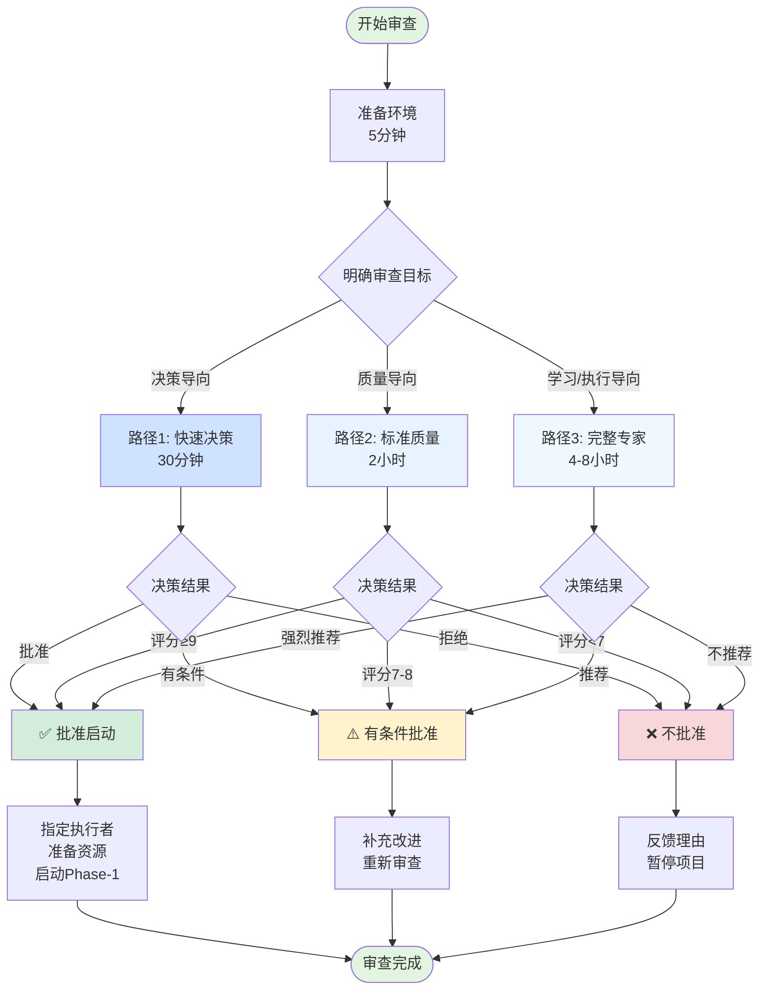
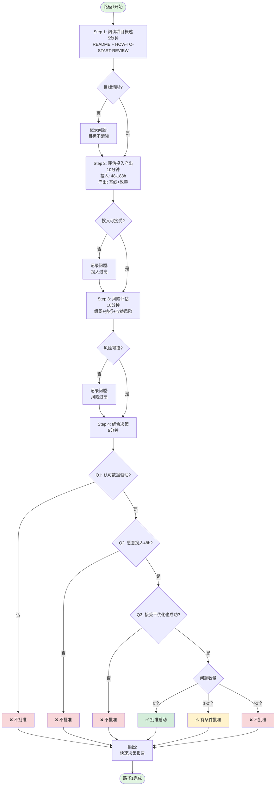
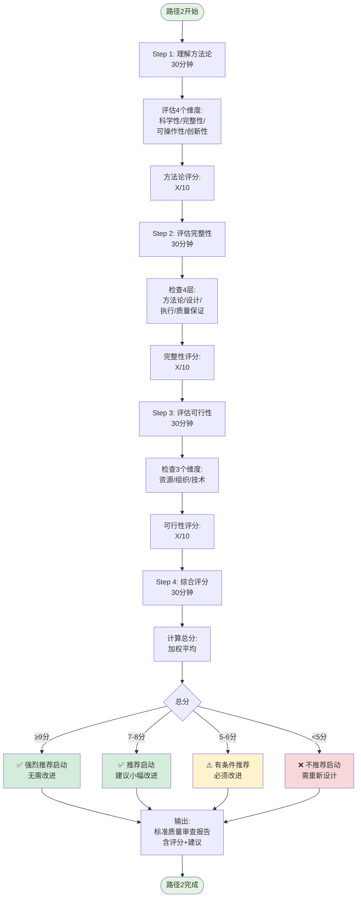
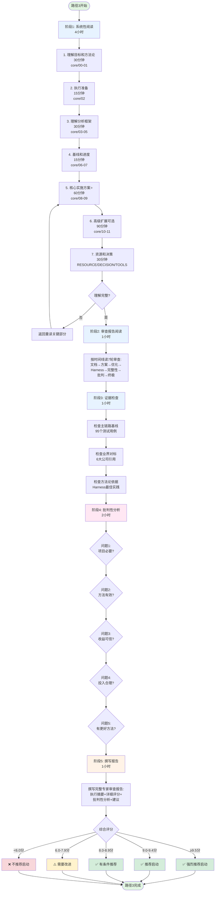
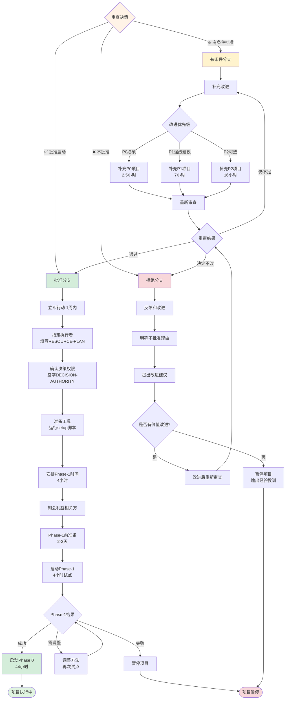
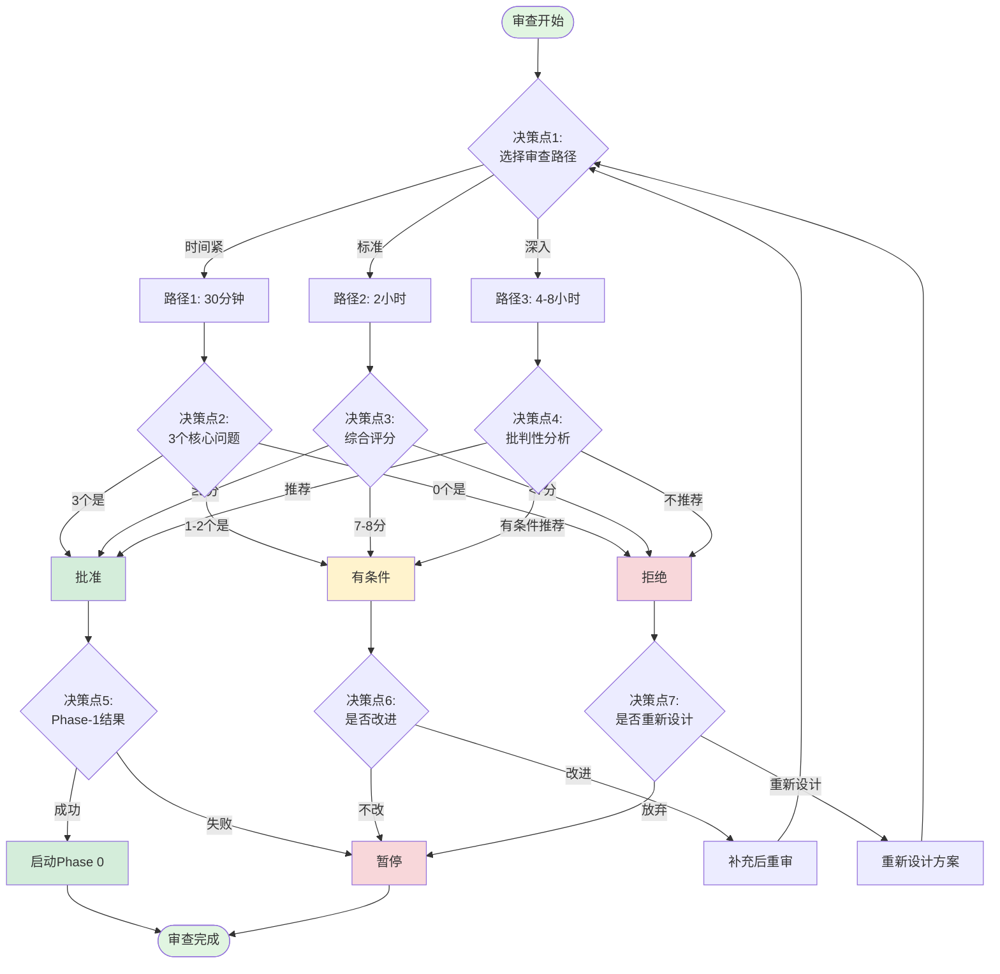
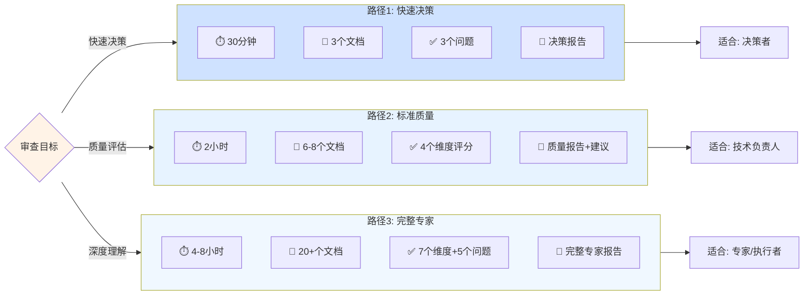
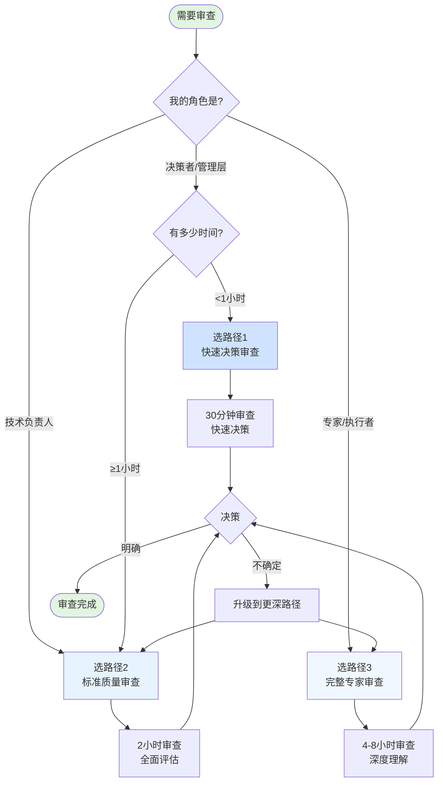

# 审查执行 Workflow 流程图

**文档版本**：v1.0  
**创建日期**：2026-11-03  
**目的**：通过流程图清晰展示审查执行逻辑

---

## 🎯 总体流程图



---

## 📊 路径 1：快速决策审查（30分钟）



**执行逻辑**：
1. **线性评估**：按顺序检查 4 个维度
2. **问题累积**：每个维度记录问题
3. **三问决策**：3 个核心问题判断
4. **问题计数**：根据问题数量决策

---

## 🔍 路径 2：标准质量审查（2小时）



**执行逻辑**：
1. **分层评估**：4 个步骤，每步独立评分
2. **量化评分**：每个维度打分（1-10）
3. **加权计算**：根据权重计算总分
4. **分级决策**：根据总分区间决策

---

## 🎓 路径 3：完整专家审查（4-8小时）



**执行逻辑**：
1. **5 个阶段**：系统阅读 → 审查报告 → 证据检查 → 批判分析 → 撰写报告
2. **深度优先**：每个阶段深入理解
3. **批判性思维**：5 个关键问题
4. **综合评价**：多维度评分 + 专家判断

---

## 🔄 决策后续流程



**执行逻辑**：
1. **三分支决策**：批准/有条件/拒绝
2. **批准分支**：7 步准备 → Phase -1 → Phase 0
3. **有条件分支**：补充改进 → 重新审查 → 递归决策
4. **拒绝分支**：反馈 → 评估价值 → 改进或暂停

---

## 🎯 关键决策点流程



**7 个关键决策点**：
1. **DP1**：选择审查路径（根据时间和目标）
2. **DP2**：3 个核心问题（快速决策）
3. **DP3**：综合评分（标准质量）
4. **DP4**：批判性分析（完整专家）
5. **DP5**：Phase -1 结果（是否继续）
6. **DP6**：是否补充改进（有条件批准）
7. **DP7**：是否重新设计（拒绝后）

---

## 📊 审查路径对比



---

## 🔍 执行逻辑总结

### 1. 三路径并行设计

**设计理念**：
- 不同角色有不同需求
- 时间投入和产出匹配
- 质量标准一致（都能做出正确决策）

**路径特点**：
| 路径 | 时间 | 深度 | 适用场景 | 输出质量 |
|---|---|---|---|---|
| 路径1 | 30分钟 | 浅 | 快速决策 | 决策准确 |
| 路径2 | 2小时 | 中 | 质量评估 | 全面客观 |
| 路径3 | 4-8小时 | 深 | 深度理解 | 专家级 |

---

### 2. 分阶段评估机制

**阶段设计**：
```
准备阶段 → 评估阶段 → 决策阶段 → 执行阶段
    ↓           ↓           ↓           ↓
  明确目标   收集数据   做出判断   采取行动
```

**每个阶段**：
- 有明确的输入和输出
- 有检查点验证完成度
- 可以回溯到上一阶段

---

### 3. 量化决策机制

**量化标准**：
- 路径1：3 个二元问题（是/否）
- 路径2：4 个维度评分（1-10）
- 路径3：7 个维度评分 + 5 个批判性问题

**决策规则**：
```
路径1: 3个"是" → 批准
路径2: ≥9分 → 强烈推荐
路径3: 综合判断（评分+批判性分析）
```

---

### 4. 递归改进机制

**改进循环**：
```
审查 → 发现问题 → 补充改进 → 重新审查
  ↑                                    ↓
  └────────────── 循环直到通过 ──────────┘
```

**终止条件**：
- 通过审查（批准启动）
- 决定不改进（暂停项目）
- 改进 3 次仍不通过（放弃）

---

### 5. 风险控制机制

**多层防护**：
1. **审查层**：3 种路径，多维度评估
2. **决策层**：量化标准，减少主观性
3. **执行层**：Phase -1 试点验证
4. **反馈层**：可以暂停、调整、重新审查

**止损机制**：
- 审查阶段：评分过低直接拒绝
- 改进阶段：评估改进价值，可放弃
- 执行阶段：Phase -1 失败可暂停

---

## ✅ 使用建议

### 选择路径的决策树



---

**文档版本**：v1.0  
**创建日期**：2026-11-03  
**工具**：Mermaid 流程图  
**配合文档**：REVIEW-EXECUTION-WORKFLOW.md
