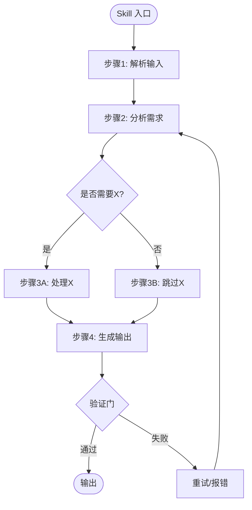

# Phase 0.5: Skill 深度解读

**文档版本**：v1.0  
**创建日期**：2026-11-03  
**目的**：验证 Phase 0 归因准确性，深度理解根本原因，设计精准优化方案

---

## 🎯 为什么需要 Phase 0.5？

### 问题背景

**Phase 0 的方法**：黑盒观察
- 观察任务的输入输出
- 基于结果反推归因
- 识别高频问题模式

**Phase 0 的局限**：
```yaml
看不到的东西:
  ❌ Skill 内部逻辑（黑盒）
  ❌ 为什么这样设计（设计意图）
  ❌ 是 Contract 问题还是实现问题（根本原因）
  ❌ 最优的改进方案（需要深度理解）

可能的风险:
  ⚠️ 归因错误率 20-40%
  ⚠️ Phase 1 优化方向错误
  ⚠️ 做无用功（浪费 78-140h）
```

**Phase 0.5 的价值**：
```yaml
深度解读 Skill:
  ✅ 阅读源码，理解内部逻辑
  ✅ 验证 Phase 0 归因是否准确
  ✅ 找到真正的根本原因
  ✅ 设计精准的优化方案

投入 vs 收益:
  投入: 16-24 小时（+13%）
  收益: 归因准确性 6/10 → 9/10
  避免: Phase 1 返工（可能节省 20-40h）
  净效果: 正向
```

---

## 📋 Phase 0.5 概述

### 触发条件

Phase 0 完成后，满足以下条件之一：
- [ ] Phase 0 建议启动 Phase 1（发现需要优化的 Skill）
- [ ] Phase 0 归因存在不确定性（需要验证）
- [ ] 技术负责人要求深度分析

**不触发的情况**：
- Phase 0 结论：质量已达标，无需优化
- Phase 0 结论：问题不在 Skill（外部因素占主导）

---

### 目标

**主要目标**：
1. **验证归因**：Phase 0 的归因是否准确？
2. **找根本原因**：为什么会出现高频问题？
3. **设计方案**：如何精准改进？

**次要目标**：
4. 理解 Skill 设计意图
5. 识别已知限制和权衡
6. 为 Phase 1 准备详细计划

---

### 范围

**深度解读的 Skill**：
- 数量：2-3 个
- 选择标准：Phase 0 识别的高频问题 Skill
- 示例：如果 Phase 0 发现 spec-prd 和 spec-plan 有问题，则深度解读这 2 个

**不在范围**：
- 不深度解读所有 Skill（太耗时）
- 不深度解读没有问题的 Skill（不必要）
- 不重新追踪任务（使用 Phase 0 数据）

---

### 投入和产出

**投入**：
```yaml
时间: 16-24 小时
  - 2 个 Skill: 16 小时（8h/Skill）
  - 3 个 Skill: 24 小时（8h/Skill）

人员: 1 人（高级工程师 + Skill 理解能力）
  - 必备: 能读懂 Skill 源码
  - 必备: 能理解设计意图
  - 建议: 参与过 Phase 0 追踪

周期: 2-3 天
  - 连续投入（保持思路连贯）
```

**产出**：
```yaml
每个 Skill 的深度分析报告:
  1. 源码结构和主要逻辑
  2. 设计意图和权衡
  3. Phase 0 问题的根本原因
  4. 归因验证和修正
  5. 详细优化方案
  6. Phase 1 执行计划

汇总报告:
  1. 归因修正总结
  2. Phase 1 优先级排序
  3. 总投入估算
  4. 风险评估
```

---

## 🔍 执行方法（每个 Skill 8 小时）

### Step 1: 源码全面阅读（4 小时）

#### 1.1 准备工作（30 分钟）

**获取 Skill 源码**：
```bash
# 假设 Skill 源码在项目中
cd /path/to/skill/repo
git log --oneline skill/spec-prd/ | head -20

# 或者从文档获取
# 查看 core/06-mainline-baseline.md 的 Skill 位置
```

**准备工具**：
- 代码编辑器（VSCode 推荐）
- 思维导图工具（绘制流程图）
- 笔记工具（记录关键发现）

**回顾 Phase 0 发现**：
```markdown
回顾 Phase 0 关于此 Skill 的发现:
- 高频问题: [列出]
- 出现频率: X/11 个任务
- 当前归因: [Skill 问题 / 模型能力 / 其他]
- 典型案例: task-XX, task-YY
```

---

#### 1.2 逐文件阅读（2.5 小时）

**阅读顺序**：
1. **主入口文件**（通常是 `__init__.py` 或 `main.py`）
   - 理解 Skill 的整体结构
   - 识别主要步骤
   - 记录入口点和出口点

2. **核心逻辑文件**
   - 按执行顺序阅读
   - 理解每个步骤的作用
   - 记录关键决策点

3. **辅助文件**（utils, helpers）
   - 理解辅助功能
   - 记录重要的验证逻辑

**阅读清单**（每个文件）：
```markdown
### 文件: [文件名]

#### 功能概述
[一句话说明此文件的作用]

#### 主要函数/类
1. function_name()
   - 作用: [描述]
   - 输入: [参数]
   - 输出: [返回值]
   - 关键逻辑: [描述]

2. ...

#### 与 Phase 0 问题的关联
- [ ] 与边界条件缺失相关
- [ ] 与信息丢失相关
- [ ] ...

#### 关键发现
- [记录重要发现]
```

---

#### 1.3 绘制流程图（1 小时）

**使用 Mermaid 或思维导图工具**：



**流程图要点**：
- 标注所有决策点
- 标注验证门的位置
- 标注可能出错的地方
- 用不同颜色标注"与 Phase 0 问题相关"的步骤

---

### Step 2: 设计意图理解（2 小时）

#### 2.1 阅读设计文档（30 分钟）

**查找设计文档**：
```yaml
可能的位置:
  - Skill 源码的 README.md
  - 项目的设计文档
  - Git 历史中的设计讨论
  - core/06-mainline-baseline.md 的说明
  - core/08-skill-contract-protocol.md 的 Contract 定义

如果没有设计文档:
  - 从 Git 历史推断
  - 从代码注释推断
  - 记录"设计文档缺失"
```

**记录设计意图**：
```markdown
### 设计意图

#### 这个 Skill 要解决什么问题？
[描述核心问题]

#### 为什么这样设计？
1. [设计决策1] - 因为 [原因]
2. [设计决策2] - 因为 [原因]

#### 设计时考虑了哪些场景？
1. 正常场景: [描述]
2. 边界场景: [描述]
3. 异常场景: [描述]

#### 已知的限制是什么？
1. [限制1] - [为什么有这个限制]
2. [限制2] - [为什么有这个限制]
```

---

#### 2.2 理解设计权衡（1 小时）

**识别设计权衡**：
```markdown
### 设计权衡

#### 权衡1: [描述]
选择: [A 方案]
理由: [为什么选 A 而不是 B]
代价: [选择 A 的代价是什么]
收益: [选择 A 的收益是什么]

#### 权衡2: [描述]
...
```

**示例**：
```markdown
### 权衡1: 边界条件检查的深度

选择: 只检查显式边界条件，不推断隐含边界
理由: 
  - 推断隐含边界容易出错
  - 增加复杂度和执行时间
  - 用户可以在需求阶段明确边界

代价:
  - 如果用户未明确边界 → 可能遗漏
  - 下游 Skill 可能需要返工

收益:
  - Skill 逻辑简单
  - 执行速度快
  - 减少"过度推断"的错误
```

---

#### 2.3 对比 Contract vs 实现（30 分钟）

**检查 Contract 定义**：
```yaml
从 core/08-skill-contract-protocol.md 查找此 Skill 的 Contract:
  输入要求: [列出]
  输出保证: [列出]
  验证门: [列出]
```

**对比实现**：
```markdown
### Contract vs 实现对比

#### Contract 要求1: [要求描述]
实现情况: ✅ 完全实现 / ⚠️ 部分实现 / ❌ 未实现
说明: [具体说明]

#### Contract 要求2: [要求描述]
...

### 发现的问题
1. Contract 要求了 X，但实现中缺失 → 这是实现 bug
2. Contract 未要求 Y，但实际需要 → 这是 Contract 不完整
3. ...
```

---

### Step 3: 问题根因深挖（2 小时）

#### 3.1 定位问题代码（1 小时）

**对于每个 Phase 0 发现的问题**：

```markdown
### 问题1: [Phase 0 发现的问题描述]

#### 出现频率
X/11 个任务（Y%）

#### 典型案例
- task-03: [简述]
- task-07: [简述]

#### 在源码中的位置
文件: [文件名]
函数: [函数名]
行号: [行号范围]

#### 相关代码片段
```python
# 贴上关键代码（10-20 行）
def some_function():
    # 这里缺少边界条件检查
    pass
```

#### 为什么会出现这个问题？
根本原因: [详细分析]
  1. [直接原因]
  2. [更深层原因]
  3. [最根本原因]
```

**示例**：
```markdown
### 问题1: spec-prd 边界条件缺失

#### 出现频率
6/11 个任务（55%）

#### 典型案例
- task-03: 跨模块需求，未检查模块间接口兼容性
- task-07: 数据处理需求，未检查数据量边界

#### 在源码中的位置
文件: skill/spec-prd/analyzer.py
函数: analyze_requirements()
行号: 145-180

#### 相关代码
```python
def analyze_requirements(req_text):
    # 提取功能需求
    functional_reqs = extract_functional(req_text)
    
    # 提取非功能需求
    non_functional_reqs = extract_non_functional(req_text)
    
    # ❌ 这里缺少边界条件分析
    # boundary_conditions = analyze_boundaries(req_text)
    
    return {
        "functional": functional_reqs,
        "non_functional": non_functional_reqs,
        # "boundaries": boundary_conditions  # 缺失
    }
```

#### 为什么会出现这个问题？
根本原因: 设计时未考虑边界条件的重要性
  1. 直接原因: 代码中未调用 analyze_boundaries()
  2. 更深层原因: analyze_boundaries() 函数存在但未被调用
  3. 最根本原因: 设计时认为"边界条件由用户在需求中明确"，
     但实际用户常常遗漏，Skill 应主动挖掘
```

---

#### 3.2 验证 Phase 0 归因（1 小时）

**对于每个问题，验证归因**：

```markdown
### 问题1: spec-prd 边界条件缺失

#### Phase 0 的归因
类别: Skill 问题
具体: spec-prd 的 Contract 不完整，未要求边界条件

#### 深度解读后的归因
验证结果: ⚠️ 归因部分准确，需修正

修正后的归因:
  类别: Skill 问题（归因类别正确）
  具体: 
    - Contract 已要求边界条件（✅ Contract 是完整的）
    - 但实现未执行（❌ 实现有 bug）
    - analyze_boundaries() 存在但未被调用

根本原因:
  实现层面: 函数调用缺失（代码 bug）
  设计层面: 未强制验证边界条件输出（验证门缺失）

如果不修正归因的后果:
  ❌ Phase 1 会去"补充 Contract" → 无效（Contract 本来就有）
  ✅ 应该: 修复实现（调用 analyze_boundaries）+ 增加验证门
```

---

### Step 4: 优化方案设计（2 小时）

#### 4.1 设计改进方案（1 小时）

**针对每个问题，设计具体方案**：

```markdown
### 问题1: spec-prd 边界条件缺失

#### 改进方案

##### 方案 A: 修复实现（推荐）⭐
描述: 调用 analyze_boundaries()，输出边界条件

具体改动:
  文件: skill/spec-prd/analyzer.py
  位置: analyze_requirements() 函数
  改动:
    ```python
    def analyze_requirements(req_text):
        functional_reqs = extract_functional(req_text)
        non_functional_reqs = extract_non_functional(req_text)
        
        # ✅ 增加边界条件分析
        boundary_conditions = analyze_boundaries(req_text)
        
        return {
            "functional": functional_reqs,
            "non_functional": non_functional_reqs,
            "boundaries": boundary_conditions  # ✅ 输出
        }
    ```

预期效果: 边界条件缺失率 55% → <10%
投入: 4 小时（修改 + 测试）
风险: 低（analyze_boundaries() 已存在且测试过）

##### 方案 B: 增加验证门
描述: 在输出前验证边界条件是否为空

具体改动:
  文件: skill/spec-prd/validator.py
  新增:
    ```python
    def validate_output(output):
        # 验证边界条件
        if not output.get("boundaries"):
            raise ValidationError("边界条件不能为空")
        
        if len(output["boundaries"]) < 3:
            raise ValidationError("边界条件至少需要 3 项")
    ```

预期效果: 强制输出边界条件
投入: 2 小时
风险: 中（可能误报，需要调优）

##### 推荐组合: A + B
先修复实现（方案 A），再增加验证门（方案 B）
总投入: 6 小时
总效果: 边界条件缺失率 55% → <5%
```

---

#### 4.2 评估改进风险（30 分钟）

```markdown
### 改进风险评估

#### 风险1: 改动影响现有功能
概率: 低（10%）
影响: 中（可能破坏现有正确的任务）
缓解:
  - 运行现有测试套件（95 个用例）
  - 新增边界条件相关的测试用例（10 个）
  - A/B 对比测试（5-10 个实际任务）

#### 风险2: analyze_boundaries() 准确性不足
概率: 中（30%）
影响: 中（输出的边界条件可能不准确）
缓解:
  - 先在 5 个任务上测试
  - 如果准确率 <80% → 需要改进 analyze_boundaries() 本身
  - 预留 8 小时改进 analyze_boundaries()

#### 风险3: 增加执行时间
概率: 高（80%）
影响: 低（可能增加 10-20% 执行时间）
缓解:
  - 可接受（质量 > 速度）
  - 如果超过 30% → 优化 analyze_boundaries() 性能

#### 总体风险: 可控
```

---

#### 4.3 设计验证方法（30 分钟）

```markdown
### 验证方法

#### 验证目标
证明改进有效，边界条件缺失率从 55% 降到 <10%

#### 验证步骤

##### Step 1: 单元测试
1. 运行现有测试套件
   预期: 95/95 通过（无回归）

2. 新增边界条件测试用例（10 个）
   - 正常场景: 5 个
   - 边界场景: 3 个
   - 异常场景: 2 个
   预期: 10/10 通过

##### Step 2: 集成测试
使用 Phase 0 的 11 个任务重新测试
  - 原来缺失边界条件的 6 个任务
  - 预期: 6 个任务都输出边界条件（≥3 项）

##### Step 3: A/B 对比测试
选择 5-10 个新任务:
  - A 组: 使用原 Skill（对照组）
  - B 组: 使用改进后 Skill（实验组）
  
  对比维度:
    - 边界条件完整性
    - 下游返工率
    - 端到端正确率
  
  预期: B 组明显优于 A 组

##### Step 4: 长期追踪（2-4 周）
在生产环境使用改进后 Skill:
  - 追踪 20-30 个任务
  - 统计边界条件缺失率
  - 预期: <10%

#### 验收标准
- [ ] 单元测试通过率 100%
- [ ] Phase 0 的 6 个问题任务全部修复
- [ ] A/B 测试：B 组边界条件完整性 >90%
- [ ] 长期追踪：缺失率 <10%
```

---

## 📊 Phase 0.5 汇总报告

### 报告结构

执行完所有 Skill 的深度解读后，撰写汇总报告：

```markdown
# Phase 0.5 深度解读汇总报告

**执行者**: [姓名]
**执行时间**: [开始日期] 至 [结束日期]
**实际投入**: [X] 小时（计划 16-24h）

---

## 执行摘要

### 深度解读的 Skill
1. spec-prd（8h）
2. spec-plan（8h）
3. [第三个 Skill，如果有]

### 核心发现
1. [最重要发现1]
2. [最重要发现2]
3. [最重要发现3]

### 归因修正
- Phase 0 归因准确率: X%
- 修正后归因准确率: Y%
- 主要修正: [列出]

---

## 详细分析

### Skill 1: spec-prd

#### Phase 0 发现
- 问题1: 边界条件缺失（55%）
- 问题2: ...

#### 深度解读发现
- 根本原因: [描述]
- 归因修正: [描述]

#### 优化方案
- 方案: [简述]
- 投入: [X] 小时
- 预期效果: [描述]

---

### Skill 2: spec-plan
[同上结构]

---

## Phase 1 执行计划

### 优先级排序
1. spec-prd 边界条件修复（P0，6h）
   - 预期效果: 返工率降低 20%
   - 风险: 低

2. spec-plan XX 改进（P1，8h）
   - ...

3. ...

### 总投入估算
- 最小: [X] 小时（只做 P0）
- 标准: [Y] 小时（P0 + P1）
- 最大: [Z] 小时（全部）

### 时间规划
- Week 1-2: P0 项（核心改进）
- Week 3-4: P1 项（重要改进）
- Week 5: A/B 测试和验证

---

## 风险和建议

### 主要风险
1. [风险1] - 概率: [X%], 影响: [高/中/低]
2. [风险2] - ...

### 建议
1. [建议1]
2. [建议2]

---

## 决策建议

基于 Phase 0.5 深度分析:

[ ] ✅ 强烈推荐启动 Phase 1
  - 归因准确
  - 方案可行
  - ROI >2

[ ] ⚠️ 有条件推荐
  - 条件: [列出]

[ ] ❌ 不推荐启动
  - 理由: [说明]

---

**签字**: [执行者] - [日期]
**审查**: [技术负责人] - [日期]
```

---

## ✅ Phase 0.5 验收标准

### 必须满足（每个 Skill）

- [ ] **源码已全面阅读**
  - 主要文件全部阅读
  - 理解核心逻辑
  - 绘制了流程图

- [ ] **设计意图已理解**
  - 理解为什么这样设计
  - 理解设计权衡
  - 识别已知限制

- [ ] **Phase 0 归因已验证**
  - 对比源码验证归因
  - 如果不准确，已修正
  - 找到真正的根本原因

- [ ] **优化方案已设计**
  - 方案具体可操作
  - 有预期效果估算
  - 有风险评估
  - 有验证方法

### 汇总报告质量

- [ ] **归因修正明确**
  - 列出所有修正的归因
  - 说明修正理由
  - 有源码证据支持

- [ ] **Phase 1 计划清晰**
  - 优先级明确（P0/P1/P2）
  - 投入估算合理
  - 时间规划可行

- [ ] **决策依据充分**
  - 决策有数据支持
  - 风险评估全面
  - 建议切实可行

---

## 🚀 与其他 Phase 的衔接

### Phase 0 → Phase 0.5

**Phase 0 产出**（输入给 Phase 0.5）：
- 11 个任务追踪 YAML
- 高频问题清单
- 黑盒归因
- Phase 0 报告

**衔接要点**：
- Phase 0.5 执行者必须先读 Phase 0 报告
- 重点关注高频问题（≥60% 任务）
- 带着"验证归因"的目标深度解读

---

### Phase 0.5 → Phase 1

**Phase 0.5 产出**（输入给 Phase 1）：
- 每个 Skill 的深度分析报告
- 归因验证和修正
- 详细优化方案
- Phase 1 执行计划

**衔接要点**：
- Phase 1 直接执行 Phase 0.5 设计的方案
- 不需要重新分析根本原因（已在 Phase 0.5 完成）
- Phase 1 聚焦在"实施"和"验证"

---

## 📝 执行清单

### 启动前

- [ ] Phase 0 已完成
- [ ] Phase 0 建议启动 Phase 1
- [ ] 确定需要深度解读的 Skill（2-3 个）
- [ ] 指定执行者
- [ ] 预留时间（2-3 天连续）
- [ ] 准备工具和环境

### 执行中（每个 Skill）

- [ ] Step 1: 源码全面阅读（4h）
- [ ] Step 2: 设计意图理解（2h）
- [ ] Step 3: 问题根因深挖（2h）
- [ ] Step 4: 优化方案设计（2h）

### 完成后

- [ ] 撰写汇总报告（2h）
- [ ] 提交技术负责人审查
- [ ] 决策是否启动 Phase 1
- [ ] 如果启动，准备 Phase 1 资源

---

**文档版本**：v1.0  
**创建日期**：2026-11-03  
**投入**：16-24 小时（2-3 个 Skill）  
**价值**：归因准确性 6/10 → 9/10，避免 Phase 1 返工
