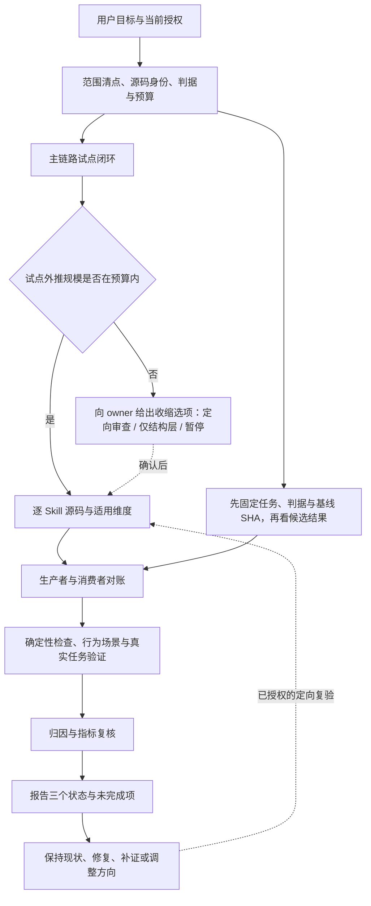
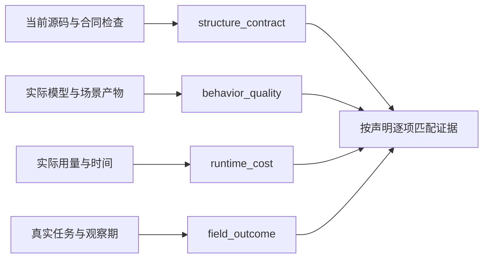
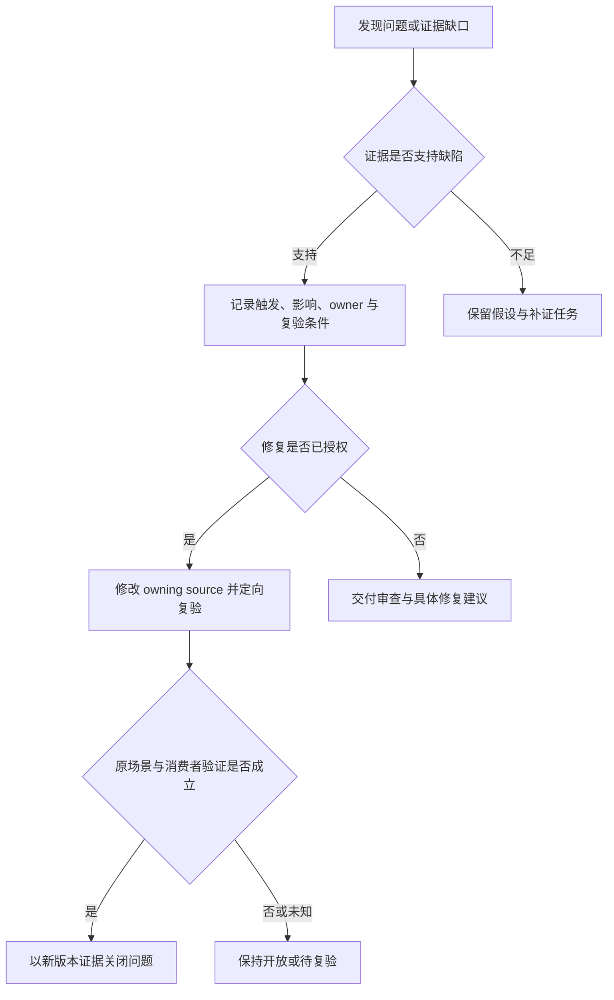

# Skill 审查流程图

版本：v2.0 · 更新日期：2026-11-04

本页是 [Skill 审查 Workflow](REVIEW-EXECUTION-WORKFLOW.md) 的导航视图，不增加硬状态机、权限或通过标准。步骤可按依赖交错执行，出口仍需证据。

## 从范围到交付

## 证据与声明边界

四层各自判断。静态检查不能替代行为，fresh-source 注入不能证明自然入口路由，fixture 不能冒充现场结果；没有上层证据就缩小声明。

## 三个结束状态

| 观察 | 审查执行 | 被审对象 | 收益 |
|---|---|---|---|
| 所有承诺检查充分执行，确认关键缺陷 | complete | 不通过 | 按独立证据判断 |
| 必需行为或真实任务没有证据 | partial；依赖动作受阻时可 blocked | 无确认阻断缺陷时为证据不足 | 未验证 |
| 明确定向源码审查完成且无问题 | complete，仅限约定范围 | 仅源码范围通过 | 不适用或未验证 |
| 完整审查各项成立、无阻断缺陷、收益证据充分 | complete | 通过；有接受残余则有条件通过 | 仅对证据覆盖范围已验证 |

## 补证与修复

独立工作不因单项缺口全部停下。已授权的动作不重复询问；新的费用、数据外发或其他重要副作用只确认新增部分。流程图中的分支不会自动发起外部动作。
