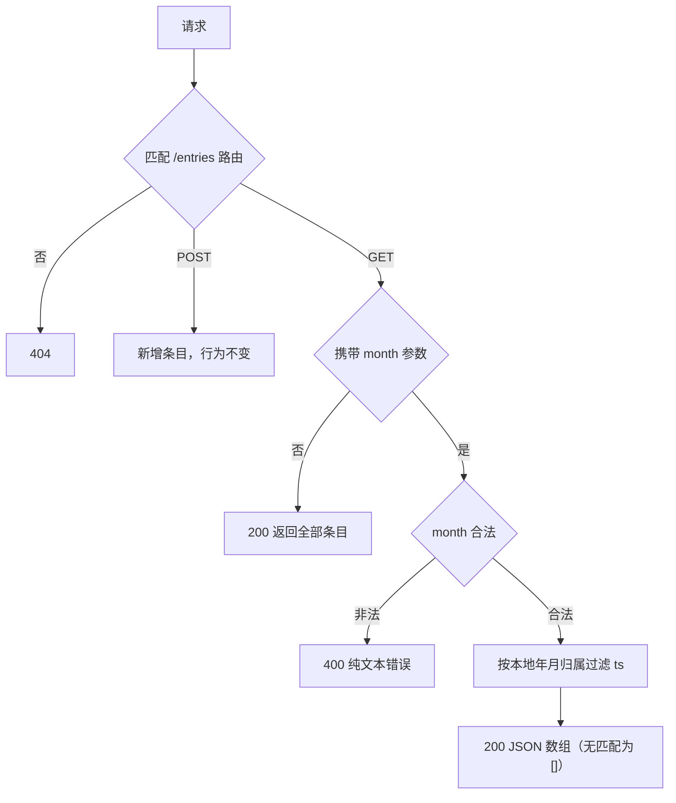

# GET /entries Month Filter - Plan

## Goal Capsule

- Objective: MiniLedger 使用者可以通过 `GET /entries?month=YYYY-MM` 只查看指定自然月的支出，不带参数时行为与现状完全一致。
- Recommended approach: 在现有单文件服务 `src/server.js` 内扩展：以 Node 内置 `URL` 解析请求并按 `pathname` 路由，month 校验与月份归属抽成可导出的纯函数；additive 可选参数，零新增运行时依赖，用内置 `node:test` 覆盖。
- Authority hierarchy: WHAT 由本 Product Contract（bootstrap）约束；HOW 由 Planning Contract 的 KTD 约束；实施与验证归执行 owner（caller 侧 `spec-work`）。
- Decision focus: month 参数格式与校验（KTD2）、时区基准（KTD3）、可测试性接缝（KTD4）。
- Verification focus: `node --test` 契约场景逐条对应 R1-R4 与 AE1-AE3，另加一次真实进程冒烟。
- Largest risk / boundary: 路由放宽（带查询串的 URL 不再 404）与服务器本地时间的月边界；仓库既有测试设施状态未知。
- Stop conditions: caller 否定 `YYYY-MM` 格式、400 语义或本地时区基准时，计划退回修订，不进入实施。
- Execution profile / tail ownership: 3 个实施单元，核心改动集中单文件；tail（实施、验证、收尾）由 `spec-work` 持有。

---

## Product Contract

### Summary

`GET /entries` 增加可选查询参数 `month`，取值 `YYYY-MM`；提供时仅返回时间戳落在该自然月的条目，未提供时保持现有全量返回。

### Problem Frame

条目持续累积后，一次性返回全部数据难以按月查看花销。README 已把"没有汇总视图"列为已知粗糙点，按月筛选是其中最小、最先落地的一步。数据在内存中，条目形如 `{id, amount, note, ts}`，`ts` 由服务端以 `Date.now()` 生成（毫秒时间戳）。

### Requirements

- R1. 不带查询参数的 `GET /entries` 返回全部条目，状态码与响应体与现状一致。
- R2. `GET /entries?month=YYYY-MM` 仅返回 `ts` 落在该自然月的条目；无匹配时返回空数组，状态码 200。
- R3. `month` 存在但不是合法 `YYYY-MM`（如 `2026-13`、`2026-1`、`abc`）时返回 400 及说明性错误信息。
- R4. 路由按路径匹配：携带任意查询串的 `/entries?...` 请求进入 entries 处理器；`month` 以外的未知查询参数被忽略。

### Scope Boundaries

- 不改动 `POST /entries` 的请求/响应形状。
- 不引入持久化、分页、分类或汇总端点（见 Implementation Scope Boundaries 的 Deferred）。
- 不新增运行时依赖。

### Acceptance Examples

- AE1. **Covers R2.** Given 条目分别落在 2026-10 与 2026-11，When `GET /entries?month=2026-11`，Then 仅返回 2026-11 的条目。
- AE2. **Covers R3.** When `GET /entries?month=2026-13`，Then 400。
- AE3. **Covers R1, R4.** Given 已有条目，When `GET /entries` 或 `GET /entries?foo=1`，Then 200 返回全部条目。

---

## Planning Contract

### Key Technical Decisions

- KTD1. URL 解析与 pathname 路由：每个请求用 Node 内置 `URL`（固定基址解析相对请求地址）解析一次，POST/GET 均按 `pathname` 匹配 `/entries`。理由：零依赖、标准库，符合现有无依赖风格；手工切分字符串的替代方案被否（不处理编码、易错）。
- KTD2. 严格校验与纯文本 400：`month` 必须整体匹配 `^\d{4}-(0[1-9]|1[0-2])$`（零填充两位月份），非法时以纯文本 400 响应并说明原因。理由：与现有 `404 'not found'` 纯文本错误风格一致；JSON 错误体留作后续演进。
- KTD3. 时区基准为服务器本地时间：月份归属用 `ts` 对应 `Date` 的本地年/月判断。理由：个人记账 demo，条目与服务同机生成，本地日历符合直觉；测试同样以本地 getter 构造期望值保证时区无关。已知限制：部署时区与用户时区不同时月边界会偏移。
- KTD4. 可测试性接缝：`server.listen(3000)` 移入 require-main 守卫，并导出 server 与月份归属纯函数。理由：`POST /entries` 写死 `ts = Date.now()`，HTTP 层无法构造历史月份；纯函数使跨月逻辑可确定性测试。架构 posture：`extend` —— 现有单文件服务吸收筛选行为与接缝，不新建模块、不复制第二实现。
- KTD5. 验证设施用 Node 内置 `node:test` + `node:assert`：不新增依赖；可选在 `package.json` 增加 `"test": "node --test"` 脚本。理由：仓库当前零依赖、无 test script，引入测试框架与改动规模不成比例。

### Interface Contracts

| 字段 | 内容 |
| --- | --- |
| Interface / mode | HTTP 端点 `GET /entries` — evolution |
| Consumers | 本地使用者/演示客户端；其他消费者未知（仓库无法枚举，见 Evidence & Limitations） |
| Canonical artifact | 无机器可读契约工件；`README.md` 的端点说明为人类可读契约，owner 为本仓库；更新绑定 U3 |
| Contract summary | `GET /entries[?month=YYYY-MM]`；成功恒为 200 + JSON 数组（无匹配为 `[]`）；非法 month 为 400 纯文本；`POST /entries` 不变 |
| Compatibility | additive：无参数行为不变；一处兼容性放宽：带查询串的 URL 由 404 变为按路径路由；回滚 = 还原单文件 |
| Verification | repo 原生检查为 U2 的 `node --test` 契约测试；机器可读 schema parser 不存在，记 `parser_unavailable`（仓库本无 schema 工件，非工具缺失，unblock 条件为未来引入契约工件） |

### High-Level Technical Design

请求处理形状（GET 分支为本计划新增决策点）：

### Assumptions

- A1. `month` 字面格式取 `YYYY-MM`、非法即 400、未知查询参数忽略，均为 pipeline 模式下 planner 的缺省判断（无用户逐项确认）；caller 可在进入实施前覆盖，覆盖即触发退回修订。
- A2. 月份归属以服务器本地时间为基准（承接 KTD3 及其限制）。

### Implementation Scope Boundaries

- Deferred to Follow-Up Work: 汇总视图、分类字段、分页（owner: 后续产品迭代；trigger: 使用者提出需求）。
- Considered and not built: 严格拒绝未知查询参数 —— 无既有契约要求，且会破坏 additive 兼容；改变条件是出现依赖固定参数集的真实消费者。
- Considered and not built: 为 POST 增加 `ts` 注入以便 HTTP 层造历史数据 —— 测试接缝（KTD4）已覆盖该需要，扩大 API 面无理由。

### Evidence & Limitations

- 直接源证据：`src/server.js`（GET 分支以 `req.url === '/entries'` 精确匹配，查询串当前会 404；条目 `ts = Date.now()`；无任何导出）、`README.md`（端点说明与已知粗糙点）、`package.json`（无依赖、无 test script）。读取于 2026-11-06。
- 工具限制：本轮 shell 仅授权基线准备命令，宿主无 Glob/Grep；`docs/plans/` 既有文件与全仓测试文件状态未知，未推断不存在；planning-only，未运行任何实现测试或服务。
- 影响的决策：KTD4（接缝的必要性）、Interface Contracts 的 Consumers 列、Verification Contract 的盲区声明。

---

## Implementation Units

### U1. src/server.js 可测试性接缝

- Goal: 允许 require 该模块而不启动监听，并导出测试所需入口。
- Requirements: 无直接需求归属（为 R1-R4 提供验证路径）。
- Dependencies: 无。
- Files: `src/server.js`
- Approach: 将启动监听移入 require-main 守卫；新增 `module.exports` 导出 server（U2 会扩展导出月份归属纯函数）。`node src/server.js` 行为不变。
- Patterns to follow: 现有 CommonJS 单文件结构，不引入新文件。
- Test scenarios: Test expectation: none -- 行为保持型接缝，由 U2 测试间接覆盖。
- Verification: require 模块不占用端口；直接运行 `src/server.js` 仍监听 3000。

### U2. GET /entries month 筛选

- Goal: 实现可选 `month=YYYY-MM` 过滤、校验与路由放宽。
- Requirements: R1, R2, R3, R4
- Dependencies: U1
- Files: `src/server.js`, `test/entries-month-filter.test.js`（新建）
- Approach: 每请求一次 URL 解析并按 `pathname` 路由（KTD1）；month 严格校验、非法 400 纯文本（KTD2）；导出纯函数按本地年月键判断归属（KTD3、KTD4）；无 month 分支保持原响应路径。未知查询参数忽略。
- Execution note: 先落 AE1-AE3 对应的失败契约测试，再实现过滤与路由放宽。
- Test scenarios:
  - 无参数 `GET /entries` → 200，返回全部条目（Covers AE3.）
  - `GET /entries?foo=1` → 200 全量返回，未知参数被忽略（Covers AE3.）
  - HTTP 层：先 POST 两条当前时间条目，再 `GET /entries?month=<本月>`（本月字符串由测试以本地 getter 计算）→ 200 仅含这些条目（Covers AE1.）
  - 纯函数：本地月首毫秒与月末最后一毫秒均归属该月；次月第一毫秒不归属上月（Covers AE1.）
  - 纯函数：多月份混合输入按月正确分组、互不串月
  - `?month=2026-13` → 400（Covers AE2.）
  - `?month=2026-1` → 400（月份必须零填充两位）
  - `?month=abc` 与 `?month=`（空值）→ 400
  - 空库 + 合法 month → 200 `[]`
- Verification: `node --test` 全绿；HTTP 层场景通过导出的 server 在临时端口发起真实请求断言，不经 mock。

### U3. README 端点文档

- Goal: 把 month 参数与 400 语义写入端点说明。
- Requirements: R2, R3（文档面）
- Dependencies: U2
- Files: `README.md`
- Approach: 在现有 endpoints 描述中补 `GET /entries?month=YYYY-MM` 用法一行，不展开新章节。
- Patterns to follow: README 现有简洁列表风格。
- Test scenarios: Test expectation: none -- docs-only。
- Verification: README 描述与实现行为一致。

---

## Verification Contract

- 命令（repo 根目录）：`node --test`。若宿主 Node 版本过旧不支持该入口，实施期核对版本并改用等价内置调用方式——属实施期待核对项，不是本计划的未决问题。
- 覆盖单元：U2（全部场景）；U1 由 U2 间接覆盖；U3 docs-only。
- Product Contract confirmation: AE1-AE3 由 U2 场景直接覆盖；R1-R4 逐条映射到 U2 场景。
- Largest unproven risk: 真实进程 `node src/server.js` 的冒烟（监听 3000、POST 后按月查询）——单测走导出的 server，不覆盖进程启动路径；实施期补一次手动冒烟。
- Repo contract tests: 无法枚举既有测试（工具限制见 Evidence & Limitations）；实施期发现任何既有测试文件须一并运行并在结果中报告，不得静默跳过。
- Blind spots（按命令类）：`node --test` 不能确认 3000 端口真实监听、并发请求行为、跨时区部署边界——均不在本计划范围。
- 无优化型目标；不适用 `release:validate` 与 behavioral skill evaluation。

---

## Definition of Done

- 全局: R1-R4 全部满足且被 U2 场景验证；`node --test` 全绿；README 已更新；改动仅限 `src/server.js`、`test/entries-month-filter.test.js`、`README.md`（可选 `package.json` 的 test script）；无遗留实验代码或死分支。
- U1: require 不占用端口、直接运行仍监听 3000。
- U2: 全部测试场景通过，含 400 与空结果边界。
- U3: README 与实现行为一致。
