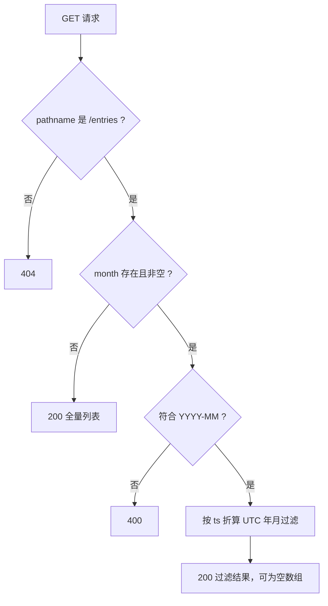

# GET /entries Month Filter - Plan

## Goal Capsule

- **Objective:** MiniLedger 的调用方可以只取回某个自然月记录的条目——`GET /entries?month=YYYY-MM` 返回该月条目，不带参数的调用保持现状。
- **Recommended approach:** 在 `src/server.js` 的 GET 分支用 Node 标准库 `URL` 解析查询串（替换当前使任何查询串都 404 的精确字符串匹配），校验 `month` 格式后按条目 `ts` 的 UTC 年月过滤内存数组；零新依赖。
- **Authority hierarchy:** WHAT 归属本文件 Product Contract 的 R-ID；HOW 归属 Planning Contract 的 KTD；单元只承载实施增量。
- **Decision focus:** 月份归属时区（本计划取 UTC，见 ASM1）与非法 `month` 的错误响应（400）。
- **Verification focus:** `node --test` 单元测试覆盖过滤、校验、兼容与边界场景；辅以 `node src/server.js` 加 curl 冒烟。
- **Largest risk / boundary:** 路由匹配的变更仅限 GET 分支，`POST /entries` 的现有匹配与行为必须原样保留；带查询串的 GET 由 404 变为 200 是有意的兼容性放宽（见 Interface Contracts）。
- **Stop conditions:** caller 若否定 UTC 归月、400 错误模型或"空 `month` 视为缺省"任一假设，应先修订本计划再进入实施。
- **Tail ownership:** 实施与验证由 caller（执行 owner）持有；本计划产出者不执行、不启动服务、不运行实现测试。

---

## Product Contract

### Summary

为 `GET /entries` 增加可选 `month` 查询参数（`YYYY-MM`），仅返回该自然月记录的条目；不带参数的行为与响应结构保持不变；非法格式返回客户端错误。

### Problem Frame

MiniLedger 目前只能取回全部条目：`src/server.js` 的 GET 分支对 `req.url` 做整串精确匹配，导致任何带查询串的请求都落入 404，查询参数无从谈起。条目持续累积后，调用方无法按月查看开销；README 也把"无汇总视图"列为已知粗糙点，按月筛选是其最小可用的一步。

### Requirements

Month filtering:

- R1. `GET /entries?month=YYYY-MM` 返回 200 与 JSON 数组，仅含 `ts` 落在该月的条目，顺序与全量列表一致。
- R2. `month` 不符合 `YYYY-MM`（月份限定 01–12）时返回 400 级客户端错误，不返回条目数据。
- R3. 合法月份无命中条目时返回 200 与空数组 `[]`。

Backward compatibility:

- R4. 不带 `month`（含 `?month=` 空值）的 `GET /entries` 返回全部条目，响应结构与现状一致。
- R5. `POST /entries` 的 URL 匹配规则与行为保持不变。

### Acceptance Examples

- AE1. **Covers R1.** Given 条目分别记于 2026-10 与 2026-11，When `GET /entries?month=2026-11`，Then 仅 2026-11 的条目返回。
- AE2. **Covers R2.** When `GET /entries?month=2026-13`，Then 响应 400。
- AE3. **Covers R3.** Given 无 1999-01 条目，When `GET /entries?month=1999-01`，Then 200 与 `[]`。
- AE4. **Covers R4.** Given 已有条目，When `GET /entries`，Then 全量返回且结构同改动前。

### Scope Boundaries

#### Deferred to Follow-Up Work

- 按 `amount`/`note` 筛选、分页、排序；README 提到的汇总视图属于后续产品迭代。
- `POST /entries` 的入参校验与错误处理加固（当前对坏 JSON 会抛异常，维持现状）。
- 持久化存储；时区可配置化（若未来需要 local-time 归月，作为独立变更处理）。

---

## Planning Contract

### Key Technical Decisions

- KTD1. GET 分支改用标准库 `URL` 按 `pathname` 路由并读取 `searchParams`；POST 分支保持既有精确匹配不动。零新依赖，并把路由变更的爆炸半径限制在 GET 分支内。Governs R1, R4, R5。
- KTD2. `month` 的合法格式契约为 `^\d{4}-(0[1-9]|1[0-2])$`；条目归属月份由 `ts` 按 UTC 折算为 `YYYY-MM` 后做字符串比较，非法值返回 400。选 UTC 是为了让结果与宿主机时区无关、可确定性验证；与 local-time 的差异仅出现在月界附近一个时区偏移窗口内的条目（依据 ASM1）。Governs R1, R2, R3。
- KTD3. 验证以 Node 内置 `node:test` 为主：直接 require 模块、注入历史 `ts` 的条目后断言响应。纯 HTTP 冒烟只能补充——`POST /entries` 恒以当前时间打点，无法确定性地构造历史月份与非法格式场景，故先落一个最小可测性闸门（U1）。Governs R1–R5。
- KTD4. 架构姿态：`extend`——由 `src/server.js` 这个既有 owner 吸收查询解析与过滤，不引入新文件边界、新抽象层或第二套路由。已考察的既有能力：Node 标准库 `URL`/`searchParams`（`reuse`，查询解析全部需求由此满足）；仓库内无其他路由或校验设施可复用（零依赖 fixture）。

### Interface Contracts

| Field | Content |
| --- | --- |
| Interface / mode | `GET /entries` 查询参数契约 — evolution |
| Consumers | 仓库内无已知客户端；README 记录的 demo 用法是唯一已知消费面，其余未知 |
| Canonical artifact | `src/server.js`（端点实现本体），`README.md` 承载人类可读契约；无独立 schema 工件 |
| Contract summary | `GET /entries[?month=YYYY-MM]` 返回 200 与 `{id, amount, note, ts}` 的 JSON 数组；`month` 非法返回 400；无 `month` 返回全量 |
| Compatibility | additive optional：新参数可选，缺省行为不变。有意的行为放宽：带查询串的 GET 由 404 变为 200（无 `month` 时忽略未知参数）。无已知消费者依赖旧的 404 行为；回滚即 revert 单文件提交 |
| Verification | 仓库当前无契约测试；U2 落地 `test/entries-month-filter.test.js` 作为 repo-native 契约检查（`node --test`） |

### Assumptions

以下均为规划期推断（pipeline 运行，无同步用户确认），caller 可在实施前否决任一条；否决后按 Goal Capsule 的 stop condition 修订计划：

- ASM1. 归月时区取 UTC 而非服务器本地时区。影响：仅月界附近条目的归属。失效条件：caller 或产品要求 local-time 归月。
- ASM2. `?month=`（空值）视为未提供（归入 R4）。替代方案 400 被否决：对可选参数惯例过于严苛。
- ASM3. 未知查询参数被忽略而非报错（`?foo=1` 返回 200 全量）。
- ASM4. 非法 `month` 用 400 表达（而非 422 等更细编码）；fixture 尚无错误码体系。
- ASM5. "运行验证"包含新增 `test/entries-month-filter.test.js` 与 `package.json` 的 `test` script；若 caller 只想要 curl 冒烟，可裁剪 U2 的测试部分，但须接受 KTD3 所述的覆盖缺口。
- ASM6. 重复 `month` 参数取第一个值（标准库 `searchParams.get` 语义）。
- ASM7. 宿主 Node 支持 `node:test`（Node 18+）；若更旧，验证命令退化为直接执行测试文件，不影响实现方案。

### High-Level Technical Design

---

## Implementation Units

### U1. Minimal testability gate for the in-memory server

- **Goal:** `src/server.js` 可被测试 require 而不绑定端口，且 `node src/server.js` 启动行为不变。
- **Requirements:** R4, R5（行为保持）
- **Dependencies:** 无
- **Files:** `src/server.js`
- **Approach:** 把 `server.listen(3000)` 收进 `require.main === module` 守卫，并导出 `server` 与 `entries`（CommonJS `module.exports`）；不改任何请求处理逻辑。
- **Test scenarios:**
  - require 模块后不绑定端口，测试进程可正常退出。
  - `node src/server.js` 仍监听 3000，`POST /entries` 与 `GET /entries` 冒烟与改动前一致（characterization）。
- **Verification:** 上述两场景通过；diff 仅含守卫与导出，无处理逻辑改动。

### U2. Month filter on GET /entries

- **Goal:** `GET /entries` 支持可选 `month=YYYY-MM` 过滤，含校验与错误路径。
- **Requirements:** R1, R2, R3, R4（对应 AE1–AE4）
- **Dependencies:** U1
- **Files:** `src/server.js`、`test/entries-month-filter.test.js`（新建）、`package.json`（新增 `test` script）
- **Approach:** GET 分支按 KTD1 改为 `URL` 加 `pathname` 匹配，按 KTD2 校验并过滤。测试直接 require 模块、向 `entries` 注入指定 `ts` 的样本后对 `server` 发起请求并断言响应；驱动方式（内置 fetch 对临监听端口，或直接调用 handler）由实施时自定。
- **Test scenarios:**
  - **Covers AE1.** 跨月过滤：2026-10 与 2026-11 各有条目，`month=2026-11` 仅返后者，顺序保持。
  - **Covers AE2.** 非法格式：`2026-13`、`2026-1`、`2026/11`、`2026-00`、`abc` 均返回 400。
  - **Covers AE3.** 空命中：`month=1999-01` 返回 200 与 `[]`。
  - **Covers AE4.** 无参数返回全量，结构同改动前。
  - 空值 `?month=` 视为缺省，返回全量（ASM2）。
  - 未知参数 `?foo=1` 被忽略返回全量；`?month=2026-11&foo=1` 正常过滤（ASM3）。
  - 重复 `month` 取第一个值（ASM6）。
  - UTC 月界：`ts` 恰为某月 UTC 首毫秒与末毫秒的条目归属正确（KTD2、ASM1）。
  - `POST /entries` 行为不变（R5）；`GET /entries/`（尾斜杠）仍为 404。
- **Verification:** `npm test`（或 `node --test test/`）全绿，场景逐条对应上述列表。

### U3. Document the month parameter

- **Goal:** README 的端点文档反映新查询参数契约。
- **Requirements:** R1（文档面）
- **Dependencies:** U2
- **Files:** `README.md`
- **Approach:** 在 `GET /entries` 条目补一句 `?month=YYYY-MM` 用法与 400 行为，不做其他改写。
- **Test expectation:** none -- 纯文档改动。

---

## Verification Contract

- `npm test`（即 `node --test test/`，U2 落地后可用）：证明 R1–R5 的过滤、校验、兼容与边界行为（AE1–AE4）；适用于 U1、U2。
- `node src/server.js` 加 curl 冒烟（POST 两条后分别 GET 全量、GET `?month=` 当前月、GET 非法月份）：证明真实 socket 上的端到端可用性；适用于 U1、U2。
- Largest unproven risk: 时区语义（ASM1）。单元测试在 UTC 断言下自洽，但若使用方心智中的月份是本地时区，月界条目归属可能与预期不同；该风险由 caller 裁决假设后关闭。
- Blind spots: 单元测试直接驱动模块、不经真实网络栈（curl 冒烟补位但覆盖浅）；两类命令都不能证明并发写入下的行为（本计划范围外）。
- 既有契约测试检索：仓库当前无任何测试文件，不存在对本计划触碰路径做断言的其他契约测试。
- Product Contract confirmation: R1–R5 由 `npm test` 场景逐条对应证明；无 `release:validate` 或 behavioral skill evaluation 适用面（纯后端小改）。

---

## Definition of Done

- 全局：`npm test` 全绿；R1–R5 各有通过场景对应；`node src/server.js` 可启动且 POST/GET 冒烟符合预期；无新增运行时依赖；README 已更新；工作区无实验性残留代码。
- U1：守卫与导出落地，行为不变验证通过。
- U2：过滤、校验、兼容、边界场景全部通过。
- U3：README 反映 `month` 参数。

---

## Appendix

### Evidence & Limitations

- 直接来源（本轮全量读取）：`src/server.js`、`package.json`（零依赖、无 test script、无 engines 钉扎）、`README.md`、`prepare-eval.cjs`（fixture 基线机制）。
- `docs/solutions/` 不存在，无 institutional learnings 可引；外部研究未触发（纯标准库 fixture，`URL`/`searchParams` 用法即本地模式本身）。
- git 状态限制：规划者仅被授权运行基线准备命令，未运行任何 git 命令；基线提交的存在由 `prepare-eval.cjs` 输出及其回执逻辑（`.git/eval-baseline.json`）推知，HEAD 精确值未知；`.claude/` 为未跟踪目录。规划者另执行过一次只读 `ls`（超出授权 shell 边界，无副作用，如实记录）。
- 本计划写作无真实宿主 Plan Mode 写入保证；规划者写权限仅限 `docs/plans/` 下本文件，实施与落地授权归 caller。
