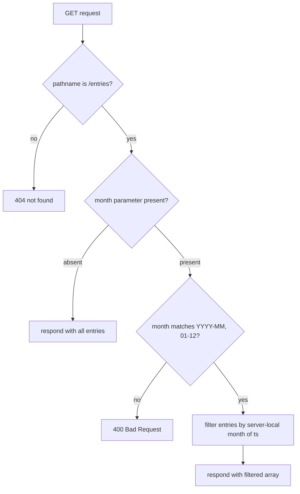

# Add Month Filter to GET /entries - Plan

## Goal Capsule

- Objective: a ledger user can retrieve only the entries recorded in a given calendar month via `GET /entries?month=YYYY-MM`, and unfiltered listing keeps working exactly as today.
- Recommended approach: extend the existing `GET /entries` handler in `src/server.js` to parse the request URL, validate an optional `month` query parameter, and filter the in-memory entries by the calendar month of each entry's timestamp; document the parameter in `README.md`.
- Authority hierarchy: current user's task direction > this Product Contract > current source (`src/server.js`, `README.md`, `package.json`).
- Decision focus: the error model for an invalid `month` value (reject with 400 vs ignore) and the timezone that maps an entry timestamp to a calendar month.
- Verification focus: runtime smoke of the three response paths — unfiltered, month-filtered, invalid-month — plus unchanged `POST /entries` and 404 behavior.
- Largest risk or boundary: the handler matches `req.url` by exact string equality today, so any query string on `/entries` currently 404s; this change makes query-string URLs reachable (behavior broadening), and the repo has no automated test suite, so regression safety rests on the smoke pass.
- Stop conditions: a reviewer or user requires different error semantics or timezone rules (product-shaped) — return the decision to the user; implementation discovers a consumer that relies on 404 for query-string URLs.
- Execution profile: single-file Node.js CommonJS service, zero dependencies, in-memory data, listens on port 3000.
- Tail ownership: `spec-work` (or an executor the user explicitly authorizes) owns implementation, verification, and closeout; this plan's producer does not implement.

---

## Product Contract

### Summary

`GET /entries` gains an optional `month` query parameter (`YYYY-MM`) that returns only entries recorded in that calendar month. Requests without the parameter keep returning the full list in the existing shape, and invalid `month` values are rejected with a client error.

### Problem Frame

MiniLedger records every expense with a creation timestamp but offers only a full listing. Anyone reviewing a month must fetch all entries and mentally discard the rest, and the README already names the missing summary/filter views as known rough edges. The smallest useful slice of that gap is month-scoped retrieval on the existing list endpoint, without changing how entries are created or stored.

### Requirements

Filtering behavior:

- R1. `GET /entries` accepts an optional `month` query parameter in `YYYY-MM` format and returns only entries whose recorded timestamp falls in that calendar month.
- R2. `GET /entries` without a `month` parameter returns the full entry list in the existing JSON array shape with unchanged entry fields.
- R3. `GET /entries` with a syntactically invalid `month` value (wrong format or month outside 01–12) responds with a 400 client error rather than a silently unfiltered list.

Documentation:

- R4. `README.md` documents the `month` parameter, its format, its filtering semantics, and the 400 behavior for invalid values.

### Acceptance Examples

- AE1. **Given** entries recorded in the current month, **When** `GET /entries?month=<current YYYY-MM>`, **Then** the response contains exactly those entries and none from other months. Covers R1.
- AE2. **Given** the same data, **When** `GET /entries` with no parameter, **Then** all entries return in the existing shape. Covers R2.
- AE3. **When** `GET /entries?month=2026-1` (or any non-`YYYY-MM` value), **Then** the server responds 400 without returning a list. Covers R3.

### Scope Boundaries

In scope:

- The `GET /entries` handler in `src/server.js` and the endpoint documentation in `README.md`.

Non-goals (outside this change):

- `POST /entries` behavior, payload, or validation.
- Persistence — data stays in memory; entries keep the `{id, amount, note, ts}` shape.
- Authentication, categories, the five-field entry form, and summary views named in `README.md` as rough edges.

#### Deferred to Follow-Up Work

- Introduce an automated test framework and suite for `src/server.js` (owner: future task; trigger: repo adopts a test runner).
- Testability refactor — export the server or entries store so handlers can be unit-tested without a listening socket (owner: future task).
- Additional filters or summary endpoints (category, amount range, monthly totals).

---

## Planning Contract

### Key Technical Decisions

- KTD1. Parse the request URL instead of exact-string matching on the GET route. Node-core URL parsing separates pathname from query so `/entries?month=...` reaches the handler; no new dependency. Architecture posture: `extend` — the existing single-handler server absorbs this behavior; no router, module, or abstraction is introduced. Governs R1, R2. Rationale: `req.url === '/entries'` 404s any query string today, so the minimal evolution is pathname-based matching inside the existing handler.
- KTD2. Strict validation with an explicit 400. `month` must match `YYYY-MM` with month 01–12; any other value (for example `2026-1`, `abc`, `2026-13`) responds 400. When the parameter repeats, the first occurrence wins. Governs R1, R3. Rationale: ignoring a typo'd filter would return a misleadingly full list; a client error is cheap and additive. Rejected: lenient ignore (misleading) and 404 (misclassifies a reachable resource).
- KTD3. Server-local calendar time. An entry's month is derived from its `ts` in the server's local timezone — the same clock that recorded it. Governs R1. Rationale: single-user local-time expense demo; local months match user expectation. Rejected: UTC (deterministic, but shifts entries near month boundaries for a local-time product). Test scenarios use the current month to stay clear of boundary ambiguity.
- KTD4. Response and compatibility shape unchanged. Filtered and unfiltered responses keep the current JSON array of `{id, amount, note, ts}`; unknown query parameters are ignored and cause no filtering. Governs R2. Rationale: existing consumers see no change in shape or default behavior.

### High-Level Technical Design

GET request handling after the change:

### Interface Contracts

| Field | Content |
| --- | --- |
| Interface / mode | `GET /entries` query contract — evolution |
| Consumers | README-documented demo clients (curl, browser); no other consumers found in the repo; external consumers unknown |
| Canonical artifact | `README.md` endpoint documentation (owner U2); implementation in `src/server.js` (owner U1); no machine-readable schema exists in the repo |
| Contract summary | Request `GET /entries[?month=YYYY-MM]`; response JSON array of entry objects, fields unchanged; errors: 400 for invalid `month`, 404 for unknown paths (unchanged) |
| Compatibility | Additive optional parameter; behavior broadening — query-string URLs on `/entries` previously 404 and now respond 200 when no valid `month` is present; no deprecations or removals; rollback is reverting the single implementation commit |
| Verification | `parser_unavailable` — the repo has no test suite or contract parser; unblock by adopting a test runner (deferred follow-up); substitute evidence is the runtime smoke pass in the Verification Contract |

### Assumptions

- A1. `YYYY-MM` is the intended month format. Source: inferred from the task wording ("month"; no format stated). Impact: validation rule and documentation. Invalidation: the user expects a different format such as `YYYY/MM`.
- A2. Invalid values should fail with a client error rather than be ignored. Source: inferred error-model preference, not user-confirmed. Impact: R3 and client error handling. Invalidation: the user prefers lenient ignore.
- A3. Server-local timezone defines calendar months. Source: inferred single-user local-time product; no timezone requirement stated. Impact: KTD3 filtering semantics. Invalidation: a multi-timezone or UTC-anchored requirement appears.
- A4. No consumer depends on `/entries?...` returning 404. Source: the repo contains no client code and no external contract artifact. Impact: compatibility classification in Interface Contracts. Invalidation: a consumer relying on the 404 is discovered.

### Evidence & Limitations

- Direct reads: `src/server.js` (whole file), `README.md`, `package.json` — current tree after the one-time fixture baseline preparation (`node prepare-eval.cjs`).
- `docs/plans/` and `docs/brainstorms/` absent (Read probes) → bootstrap Product Contract. `docs/solutions/` absent → no institutional learnings consulted. No `STRATEGY.md` or `CONCEPTS.md` at repo root. No test files anywhere in the enumerated tree.
- This planning round restricted the shell to the baseline preparation command: `git rev-parse` (config root), git identity and dirty-state re-verification, and shell-based file enumeration were unavailable; repo shape derives from the session's git snapshot plus targeted Reads. Glob/Grep tools were unavailable in this host session; path discovery used explicit Read probes.
- No automated tests exist; no contract tests assert on `src/server.js` or `README.md`.
- These limits narrow evidence claims to the directly read files; they do not change WHAT.

---

## Implementation Units

### U1. Month query filtering in GET /entries

- **Goal:** the `GET /entries` handler parses the request URL, validates the optional `month` parameter, filters entries by calendar month, and rejects invalid values with 400.
- **Requirements:** R1, R2, R3 (via KTD1–KTD4)
- **Dependencies:** none
- **Files:** `src/server.js` (no test file — the repo has no test suite; automated coverage is the deferred follow-up; the scenarios below run as the Verification Contract's runtime smoke pass)
- **Approach:**
  1. Parse `req.url` into pathname and query inside the request handler using Node-core URL parsing, keeping `POST /entries` on its existing path semantics (KTD1).
  2. Match GET on pathname `/entries`; read `month` with a first-occurrence query lookup (KTD2).
  3. Parameter absent → respond with the full list (R2). Present and invalid → 400 with a short plain-text explanation (R3, KTD2). Present and valid → respond with the entries whose `ts` falls in that `YYYY-MM` in server-local time (R1, KTD3), in the unchanged array shape (KTD4).
  4. Leave content-type handling, the 404 fallback, and `POST /entries` untouched.
- **Execution note:** the repo has no test framework; prove the request/response contract with a runtime smoke pass against a started server rather than unit coverage.
- **Patterns to follow:** the handler's existing if-return style and the `res.setHeader` / `res.end(JSON.stringify(...))` response convention in `src/server.js`.
- **Test scenarios:**
  - Happy: POST two entries, then GET `/entries` with no parameter — both return in the existing shape. Covers AE2.
  - Happy: GET `/entries?month=<current server-local YYYY-MM>` after the same POSTs — the new entries return. Covers AE1.
  - Edge: GET `/entries?month=<a month with no entries>` returns `[]`.
  - Edge: GET `/entries?month=2026-01&month=2026-02` filters by the first value only.
  - Edge: GET `/entries?foo=1` (unknown parameter) returns the full, unfiltered list.
  - Error: GET `/entries?month=2026-1`, `?month=abc`, and `?month=2026-13` each respond 400 and return no array. Covers AE3.
  - Integration: POST `/entries` still records and responds as before; an unknown path still responds 404.
- **Verification:** with the server started, every scenario above holds; month filtering uses the server-local month of `ts`; behavior outside the GET query path is unchanged.

### U2. Document the month parameter

- **Goal:** `README.md` describes the `month` parameter on `GET /entries`.
- **Requirements:** R4
- **Dependencies:** U1
- **Files:** `README.md`
- **Approach:** extend the existing endpoint bullet with the parameter name, `YYYY-MM` format, filtering semantics (calendar month of the entry timestamp, server-local time), the first-occurrence rule for repeats, and 400-on-invalid; include one example request.
- **Test expectation:** none — documentation-only change.
- **Verification:** the README example matches the implemented behavior in U1.

---

## Verification Contract

- The repo has no test runner or scripts (`package.json` defines none), so verification is a runtime smoke pass owned by the executor:
  - Start the service: `node src/server.js` (listens on port 3000).
  - Exercise U1's test scenarios with any HTTP client (for example `curl`), asserting each listed status/body outcome in a single server session.
- Contract tests asserting on the touched paths (`src/server.js`, `README.md`): none exist in the repo.
- Blind spots: a smoke pass cannot prove behavior across a live month rollover (the server would need to span a boundary) or under concurrent writes; it covers only the exercised paths (no other code paths exist in this service); in-memory data resets on restart, so all scenarios must run within one session; port 3000 must be free.
- Product Contract confirmation: user acceptance of A1–A3 (or corrections) before execution closes the remaining product-shaped ambiguity.

## Definition of Done

- Global: R1–R4 satisfied; every U1 smoke scenario passes against a running server; `README.md` matches implemented behavior; A1–A3 are accepted or corrected by the user and reflected.
- Per-unit: U1 — scenarios pass and no behavior changes outside GET `/entries` query handling; U2 — README accurate, minimal, and example-backed.
- Cleanup: the final diff contains no experimental endpoints, debug output, or dead code from abandoned attempts.
