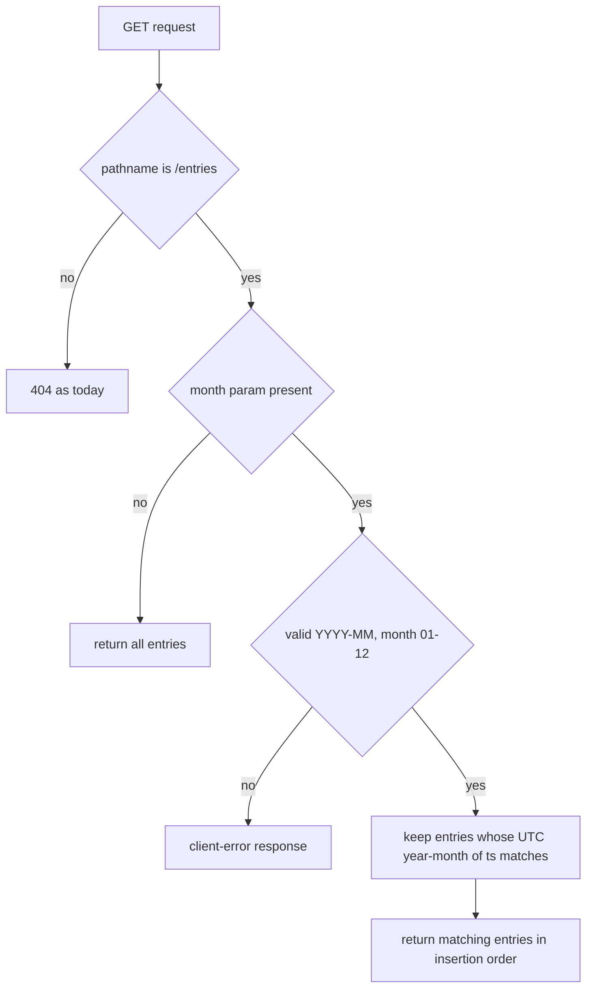

# GET /entries Month Filter - Plan

## Goal Capsule

- **Objective:** A caller of the MiniLedger demo API can list only one calendar month of expenses via `GET /entries?month=YYYY-MM`; every existing behavior stays as it is today.
- **Recommended approach:** Extend the existing raw-`http` route in `src/server.js` — make the GET branch query-aware (pathname match), validate `month`, and filter the in-memory list by the UTC year-month of each entry's `ts`.
- **Decision focus:** invalid `month` handling (A1: reject with a client error) and the month basis (A2: UTC, not server-local time).
- **Verification focus:** unfiltered GET and POST stay unchanged; filter correctness at UTC month boundaries; malformed `month` rejected; query strings on GET no longer 404.
- **Largest risk / boundary:** the GET route currently exact-matches the raw URL, so any query string now returns 404; making it query-aware is a compatible behavior change (unknown params ignored, full list returned — A3).
- **Stop conditions:** a user override of A1 or A2 reopens KTD2/KTD3 and the affected test scenarios before execution.
- **Execution profile:** single-file change plus a scenario test script and one README line; `spec-work` owns engine selection and the shipping tail.

---

## Product Contract

### Summary

Add an optional `month=YYYY-MM` filter to `GET /entries` so callers can retrieve one calendar month of expenses. Requests without the parameter, and `POST /entries`, behave exactly as before.

### Problem Frame

MiniLedger keeps expenses in memory behind two endpoints (see `README.md`). The list endpoint returns everything; a caller wanting one month's expenses must filter client-side. The entry timestamp (`ts`, epoch milliseconds set at insert time) already carries what a server-side filter needs, so the gap is a query parameter on the existing list endpoint — not a new endpoint, persistence, or a framework.

### Requirements

- R1. `GET /entries` accepts an optional `month` query parameter in `YYYY-MM` format and returns only entries whose `ts` falls in that UTC calendar month, in insertion order.
- R2. `GET /entries` without `month` returns the full list with the unchanged entry shape `{id, amount, note, ts}`.
- R3. A `month` value that is not a valid `YYYY-MM` calendar month (months 01–12) is rejected with a client-error response; it never falls back to the unfiltered list.
- R4. `POST /entries` behavior and the stored entry shape are unchanged.

### Scope Boundaries

Non-goals for this change:

- No other filters (year, category, amount range), no pagination, no sorting.
- No persistence, database, or web framework; no new dependencies.
- No change to `POST /entries` input validation.

#### Deferred to Follow-Up Work

- Harden `POST /entries` body parsing against malformed JSON — separate concern, existing behavior today.

---

## Planning Contract

### Key Technical Decisions

- KTD1. Query-aware routing on the GET branch only (extend). The GET branch matches the pathname of the parsed request URL instead of the raw exact string; `POST /entries` keeps its exact match. Today any query string on `GET /entries` returns 404, so this is the required, compatible enabler for R1/R2. Posture: `extend` — the existing route table in `src/server.js` absorbs the change; no new routing layer.
- KTD2. Month basis is UTC. An entry matches when the UTC year-month of its `ts` equals the requested value (ISO 8601 UTC date prefix). Epoch timestamps carry no timezone; a server-local interpretation would return different results per host. Governs R1; assumes A2.
- KTD3. Strict `month` validation before filtering. Accept only `YYYY-MM` with month 01–12; reject anything else — including an empty value — with a plain-text client-error response consistent with the endpoint's existing plain-text replies. Governs R3; assumes A1.
- KTD4. In-memory array filtering. The filter runs over the existing `entries` array; no query engine, index, or caching. Governs R1.

### Interface Contracts

| Field | Decision |
| --- | --- |
| Interface / mode | `GET /entries` HTTP endpoint — evolution (additive optional query parameter) |
| Consumers | The demo app itself; no external consumers known. `README.md` is the human-facing contract doc (U2 keeps it accurate) |
| Canonical artifact | `src/server.js` route implementation; `README.md` endpoint description |
| Contract summary | Optional `month=YYYY-MM`; absent → full list unchanged; malformed → client error (KTD3); month window = UTC (KTD2) |
| Compatibility | Additive. Side effect of KTD1: a query string on `GET /entries` no longer 404s — unknown params are ignored and the full list is returned (A3). No deprecation; rollback = revert `src/server.js` |
| Verification | `parser_unavailable` — the repo has no test runner, scripts, or schema parser. Substitute: U1 scenario checks; owner: `spec-work` at execution; unblock: U1 adds the scenario script |

### Assumptions

Recorded under this run's autonomous planning authorization; none is user-confirmed.

- A1. Invalid `month` is rejected with a client error rather than ignored. Source: planning judgment — a silent unfiltered list on bad input is the worse failure mode. Impact: R3, KTD3. Invalidated if the user prefers lenient ignore-and-return-all.
- A2. Months are interpreted in UTC, not server-local time. Source: planning judgment — deterministic across machines. Impact: R1, KTD2. Invalidated if the user wants local calendar months.
- A3. Unknown extra query parameters on `GET /entries` are ignored (full list returned), not rejected. Source: consequence of KTD1. Impact: compatibility row above. Invalidated if a strict query whitelist is wanted.

### High-Level Technical Design

### Evidence & Limitations

- Direct source: full read of `src/server.js`, `package.json`, and `README.md` on 2026-11-05; untracked working tree whose baseline commit was created by the preparation command only (task commits not authorized this run).
- Shell was restricted to the baseline preparation command, so the installed Node version and git identity were not verified by command; U1's runner choice defers to the installed runtime.

---

## Implementation Units

### U1. Month filter on `GET /entries`

- **Goal:** `GET /entries?month=YYYY-MM` returns only that UTC month's entries; all other behavior is unchanged.
- **Requirements:** R1, R2, R3, R4
- **Dependencies:** none
- **Files:** `src/server.js`; `test/month-filter.test.js` (new)
- **Approach:**
  1. In the GET branch, parse the request URL with the standard WHATWG URL parser (base supplied) and match the pathname `/entries` instead of the raw exact string (KTD1).
  2. Read `month` from the parsed query; absence means no filter (R2).
  3. Validate the value as `YYYY-MM` with month 01–12; on failure respond with a plain-text client error (KTD3, A1).
  4. Keep entries whose UTC year-month of `ts` equals the requested month and respond with the filtered array (KTD2, KTD4).
- **Execution note:** Cover the routing regression first — any query string on `GET /entries` currently 404s; add the no-param and unknown-param compatibility scenarios alongside the filter scenarios.
- **Patterns to follow:** the existing method-plus-URL if-chain in `src/server.js`; the plain-text non-JSON replies both endpoints already use.
- **Test scenarios** (runner chosen at execution: built-in `node:test` if the installed Node supports it, else a plain assert script run directly):
  1. No query string → all entries returned, insertion order, unchanged shape.
  2. `?month=` a month that has entries → only that month's entries, insertion order preserved.
  3. `?month=` a valid month with no entries → empty array.
  4. Malformed values → client error: `2026-1`, `2026-13`, `abc`, empty `month=`, `2026/11`.
  5. UTC boundaries: entries at the first and last millisecond of the target UTC month are included; the first millisecond of the next month is excluded.
  6. Unknown query params (e.g. `?foo=1`) → full list returned (previously 404).
  7. `POST /entries` still stores an entry and `GET /entries` without filter still lists it (regression).
- **Verification:** every scenario above passes under the chosen runner; no other endpoint or response shape changed.

### U2. Document the `month` parameter

- **Goal:** the README endpoint list names the optional `month` parameter and its `YYYY-MM` format.
- **Requirements:** R1, R2
- **Dependencies:** U1
- **Files:** `README.md`
- **Approach:** extend the existing `GET /entries` bullet with one clause covering the optional parameter, its format, and the UTC meaning; no other README content changes.
- **Test expectation:** none — documentation-only unit.
- **Verification:** README matches the behavior implemented in U1.

---

## Verification Contract

| Gate | Evidence | Applies to | Blind spot |
| --- | --- | --- | --- |
| Scenario checks | No repo commands exist (`package.json` has no scripts, no CI). Run U1's scenarios with a runner chosen at execution — built-in `node:test` when the installed Node supports it, else a plain assert script executed directly | U1 | Does not exercise malformed `POST /entries` bodies (existing rough edge, out of scope) |
| Contract-doc check | Manual read of `README.md` against implemented behavior | U2 | No automated doc lint exists |

The repo has no existing test suite asserting on `src/server.js` or `README.md`, so no pre-existing contract tests join these gates. The installed Node version was not verified this run; `spec-work` confirms the runner choice against the actual runtime.

## Definition of Done

- All U1 scenarios pass; `GET /entries` without `month` and `POST /entries` behave exactly as before.
- README documents the parameter; no other behavior, file, or dependency changed.
- Defaults from A1–A3 are applied unless the user overrides them before execution.
- No experimental or dead-end code is left in the diff.
