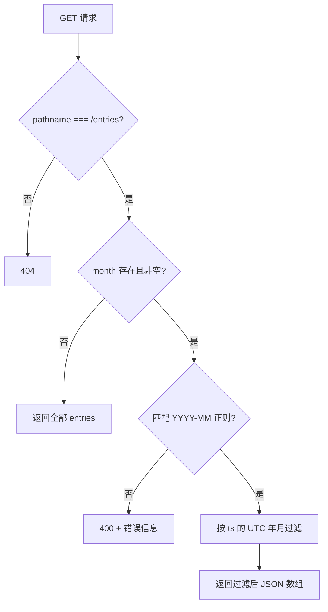

# GET /entries month 筛选 - Plan

## Goal Capsule

- 目标：调用方可以在 `GET /entries` 上按自然月筛选花销记录；不带筛选参数时取到与现状完全一致的全量列表。
- 推荐方案：在 `src/server.js` 现有 GET 分支内解析查询串，按记录 `ts` 的 UTC 年月过滤；additive 可选参数，零新增依赖。
- 权威层级：Product Contract（R1–R5）> Planning Contract（KTD）> Implementation Units；规划期假设（A1–A4）未经用户逐项确认，与之冲突的用户新指示优先。
- 决策焦点：参数格式与非法值语义（KTD2，假设 A1/A2）、月份划分基准（KTD3，假设 A3）。
- 验证焦点：无参数回归不变，叠加命中/未命中/非法值三类筛选分支（见 Verification Contract）。
- 最大风险/边界：现有 GET 路由以 `req.url` 严格相等匹配，任何查询串都会落入 404——路由必须改为按 pathname 匹配，否则筛选参数进不到处理逻辑。
- 停止条件：执行阶段若发现 `GET /entries` 存在本计划未知的既有消费方，且其依赖查询串的既有 404 语义或非 `YYYY-MM` 月份格式，停止实施并回报重议 A1/A2。
- 执行概况：单文件、单实现单元（U1）。
- Tail ownership：`spec-work`（或用户明确选择的执行 owner）。

---

## Product Contract

### Summary

为 `GET /entries` 增加可选 `month` 查询参数：提供时仅返回该自然月内创建的花销记录；不提供时返回全部记录，现有行为不变。

### Problem Frame

MiniLedger 目前只能整表拉取 `GET /entries`（`src/server.js`，内存数组）。记录增多后，调用方无法只看某个月的开销；`README.md` 也将"没有汇总视图"列为已知粗糙点。按月筛选是其中最小、可直接落地的一步。

### Requirements

- R1. `GET /entries` 接受可选查询参数 `month`，语义为"只返回该自然月内创建的记录"。
- R2. `month` 取值合法时，响应只包含该月的记录；无匹配记录时返回空数组。
- R3. 请求不带 `month`（或值为空）时，响应与现状一致：返回全部记录。
- R4. `month` 取值非法时明确拒绝该请求，不得以未过滤数据冒充筛选结果（拒绝的具体格式与状态码由 KTD2 定义，属规划期假设）。
- R5. `POST /entries` 的行为与响应不受本次改动影响。

### Scope Boundaries

- 本次不做：POST 支持自定义时间戳、分页、分类、汇总统计、持久化存储、认证、路由框架化、时区可配置化。
- Deferred to Follow-Up Work：`README.md` 列出的其余已知粗糙点（录入体验、分类、汇总视图）是后续独立工作。

---

## Planning Contract

### Key Technical Decisions

- KTD1. 查询串路由：GET 分支由 `req.url === '/entries'` 改为 URL 解析后按 pathname 匹配（Node 内建 `URL`，以 `http://localhost` 为基址）。原因：现有严格相等使 `/entries?month=...` 直接落入 404，筛选无法生效。替代方案：引入路由库——拒绝，项目零依赖且仅两个端点。POST 分支维持现状（R5）。
- KTD2. `month` 参数契约：格式 `YYYY-MM`，校验正则 `^\d{4}-(0[1-9]|1[0-2])$`；缺失或空串等同未提供（不过滤）；非法值返回 400 与简短错误信息。替代方案：非法时忽略筛选返回全量——拒绝，调用方拼写错误会静默拿到全量数据，比明确报错更难发现。〔依据假设 A1、A2〕
- KTD3. 月份匹配基准：按记录 `ts`（Unix 毫秒）的 UTC 年月与参数比较（`toISOString()` 前 7 位）。替代方案：服务器本地时区——拒绝，结果随部署环境时区漂移、不可复现。〔依据假设 A3〕
- KTD4. 零新增依赖：仅用 Node 内建模块，不引入框架或查询串库（项目现状为零依赖 CommonJS）。
- 架构姿态：`extend`——由既有 owner `src/server.js` 的 GET 分支吸收该行为，不新增抽象或接缝（单文件有界变更，无需 composition 决策）。

### Assumptions

以下为规划期推断，未经用户逐项确认；执行阶段收到相反的用户指示时以用户为准并回写本计划：

- A1. `month` 格式为 `YYYY-MM`（如 `2026-11`）。失效条件：用户或已知消费方需要 `YYYYMM`、月份区间或其他粒度。
- A2. 非法格式返回 400 错误响应。失效条件：用户偏好宽松容错（忽略非法值返回全量）。
- A3. 月份按 UTC 划分。失效条件：用户按特定业务时区对账（如 Asia/Shanghai），需改为固定时区。
- A4. "不带参数返回全部"为既定兼容语义（由本次变更为 additive 可选参数推断）。

### High-Level Technical Design

GET 分支处理流：

### Interface Contracts

| 字段 | 内容 |
| --- | --- |
| Interface / mode | `GET /entries` HTTP 查询契约 — evolution（additive 可选参数） |
| Consumers | 未知；仓库内未见消费方（未知不等于不存在） |
| Canonical artifact | 无独立契约文件；契约由 `src/server.js` 实现与 `README.md` 描述承载，owner 为执行者 |
| Contract summary | `GET /entries[?month=YYYY-MM]`；成功 = JSON 数组（全量 / 子集 / 空数组）；错误 = 非法 `month` → 400 |
| Compatibility | additive：不带参数行为不变；无版本窗口需求；回滚 = 还原 `src/server.js` |
| Verification | `parser_unavailable`：仓库无测试设施与契约解析器（package.json 无 test 脚本）；owner = 执行阶段 spec-work/用户；unblock = 按 Verification Contract 的 API 级场景验证 |

### Implementation Scope Boundaries

- 不改 `POST /entries` 的路由匹配与行为（含是否接受查询串——维持现状的 404 兜底语义）。
- 不做错误响应格式统一或框架化（现有端点均为纯文本简短响应，400 错误体保持同风格）。

### Evidence & Limitations

- 直接证据：`src/server.js`（全文 25 行）、`package.json`（无 scripts、无依赖）、`README.md`；会话起始 git 快照的未跟踪集合为 `.claude/`、`README.md`、`package.json`、`prepare-eval.cjs`、`src/`。
- 工具限制：本轮无可用且获授权的目录枚举工具——`docs/plans/`、测试文件、`docs/solutions/` 状态未知；上游 Product Contract 发现已按不可用处理（bootstrap 路由），不代表不存在。测试文件状态未知不影响本计划：U1 场景自含，执行阶段若发现既有测试需一并运行。
- 命令限制：本轮 shell 仅授权 `node prepare-eval.cjs`（已执行一次）；规划阶段未启动服务、未运行测试、未做 git 身份核对。
- 调研边界：worker dispatch 未获授权（`dispatch_authorization_missing`，capability unknown），调研全部内联完成；外部研究未执行且非必需（全部相关源码已直接读取）。
- 影响：readiness 判断仅依赖已读源码（项目仅此一源文件），证据充分；未知项未承载 load-bearing 结论。

---

## Implementation Units

### U1. GET /entries month 筛选实现

- **Goal:** GET 分支解析 `month` 查询参数并按自然月过滤；无参数时行为与现状一致。
- **Requirements:** R1、R2、R3、R4、R5
- **Dependencies:** 无
- **Files:** `src/server.js`（修改）
- **Approach:**
  1. GET 分支按 KTD1 改为 URL 解析 + pathname 匹配；POST 分支与 404 兜底不动。
  2. `month` 缺失或空串 → 走现有全量返回路径（R3）。
  3. 不匹配 KTD2 正则 → 400 与简短错误信息（R4）。
  4. 合法 → 按 KTD3 以 `ts` 的 UTC 年月过滤后返回 JSON 数组（R1/R2）。
- **Execution note:** 仓库无自动化测试设施；实现后按 Verification Contract 以 API 级场景验证，先跑无参数回归，再跑筛选与错误分支。测试数据接缝：POST 以 `Date.now()` 打点，因此"命中月"场景用执行当天所在月份构造，"未命中月"用远离当前日期的月份（如 `2000-01`），不依赖未实现的造数能力。
- **Patterns to follow:** 沿用 `src/server.js` 现有风格（内建 http、无框架、纯文本简短响应）。
- **Test scenarios**（执行阶段以 HTTP 请求逐条验证）:
  - 无参数回归：POST 两条后 `GET /entries` 返回全部两条（R3、R5）。
  - 命中月：`GET /entries?month=<执行当天的 YYYY-MM>` 返回刚创建的记录（R1、R2）。
  - 未命中月：`GET /entries?month=2000-01` 返回 `[]`（R2）。
  - 非法格式：`GET /entries?month=2026-1` → 400（R4）。
  - 非法月份：`GET /entries?month=2026-13` → 400（R4）。
  - 空值：`GET /entries?month=` 返回全部（R3）。
  - POST 回归：`POST /entries` 仍返回 `ok` 且新记录可见（R5）。
  - 未知路径回归：其他路径仍 404。
- **Verification:** 上述场景全部通过；无参数与 POST 行为与改动前一致；未引入新依赖。

---

## Verification Contract

| 项 | 内容 |
| --- | --- |
| 仓库测试命令 | 无——package.json 无 scripts，无已知测试设施；测试文件状态未知（本轮无枚举授权） |
| 执行方式 | 启动 `src/server.js`（固定监听 3000，注意端口占用），按 U1 场景逐条发起 HTTP 请求核对（curl 或 node 单行脚本，由执行阶段按当时授权选择） |
| 门槛 | U1 全部场景通过；无参数回归与 POST 回归一致 |
| 盲区 | 手工 API 场景无法覆盖并发行为；UTC 基准（A3）未在跨时区部署下验证；无自动化回归网，后续改动无护栏 |
| 本轮状态 | 规划阶段未运行任何服务或测试（授权限制）；以上均为执行阶段待执行项 |

---

## Definition of Done

- 全局：U1 完成且其全部场景通过；`GET /entries` 无参数行为与 `POST /entries` 行为与改动前一致；零新增依赖；除 `src/server.js`（及可选的 `README.md` 一行参数说明）外无文件改动。
- 清理：不保留实验性或被否决的残留代码（如多余的过滤辅助函数）。
- U1：见其 Verification。
- Landing：计划产出轮次未授权任务 commit/push/PR；提交与落地由后续授权决定。
