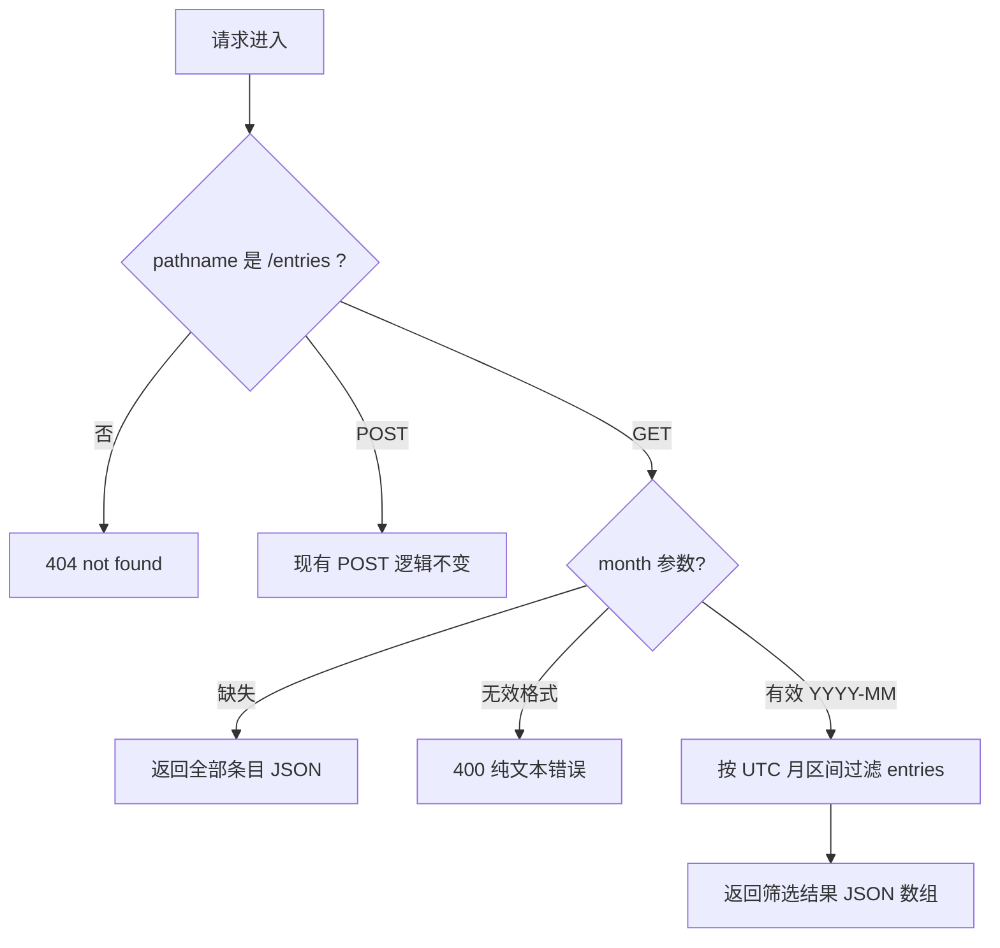

# GET /entries 月份筛选 - Plan

## Goal Capsule

- **目标:** 用户可以按自然月查看支出条目——`GET /entries?month=YYYY-MM` 仅返回该月条目,不带筛选参数时行为与现状完全一致。
- **推荐方案:** 在 `src/server.js` 现有 GET 处理器内做增量演进——用 Node 内置 `URL` 做 pathname 匹配,把 `month` 解析为 UTC 月起止区间后对内存数组按 `ts` 过滤。
- **决策焦点:** `month` 参数契约(格式、无效输入响应、时区归属)与 URL 匹配语义从全字符串相等改为 pathname 的兼容性边界。
- **验证焦点:** month 契约测试——筛选命中、无参数全量回归、无效格式 400、命中月为空返回 `[]`。
- **最大风险/边界:** pathname 匹配使此前返回 404 的带查询字符串请求变为有效请求(行为超集);UTC 时区归属是未经 caller 确认的规划期假设(AS2)。
- **停止条件:** 若 caller 对 month 语义、时区或错误响应模型另有产品决策,停止实施并返回本计划修订。
- **执行画像:** implementation-ready 代码计划;实施与验证尾部归 caller(spec-work)所有,本轮规划不执行实现。

---

## Product Contract

### Summary

为 MiniLedger 的 `GET /entries` 增加可选 `month` 查询参数,支持按月筛选支出条目;不带参数的调用保持现有全量返回行为。

### Problem Frame

README 记录的已知粗糙点之一是"无汇总视图"。条目只会累积,用户无法把视图缩小到某个月份;当前 `GET /entries`(src/server.js 的 GET 分支)只能全量返回内存数组。按月筛选是最小的第一步,不引入持久化或其他筛选维度。

### Requirements

- R1. `GET /entries` 支持可选查询参数 `month`,取值为 `YYYY-MM`(年份 4 位数字,月份 `01`-`12`);提供时仅返回该月创建的条目。
- R2. 未提供 `month` 时,`GET /entries` 返回全部条目,响应与现状一致。
- R3. `month` 格式无效时返回状态码 400 与错误指示,不返回条目列表。
- R4. 筛选月份没有任何条目时返回空 JSON 数组 `[]`。
- R5. `POST /entries` 的现有请求-响应行为保持不变,唯例外是按 KTD1 此前 404 的带查询字符串请求变为接受。

### Scope Boundaries

非目标(本轮不做):

- 其他筛选维度(年份、分类、金额区间)与分页。
- 时区配置或按用户时区归属;月份归属固定按 UTC 解释 `ts`(见 AS2)。
- 数据持久化或外部存储。

#### Deferred to Follow-Up Work

- `POST /entries` 对无效 JSON body 的健壮性:当前 `JSON.parse` 异常未被捕获(src/server.js 的 POST 分支),畸形请求会导致进程异常。与本月筛选拆离;建议后续单独任务处理。触发条件:任何针对 POST 输入可靠性的后续工作。

---

## Planning Contract

### Key Technical Decisions

- KTD1. 请求匹配从 `req.url === '/entries'` 全字符串相等改为用 Node 内置 `URL` 解析后按 pathname 匹配,GET 与 POST 统一。现有关键行为全部保留;此前因带查询字符串而 404 的请求(如 `/entries?x=1`)变为按 pathname 接受、忽略未知参数——增量演进,非破坏。Governs R1, R2, R5。
- KTD2. `month` 过滤实现为闭开区间比较:把 `YYYY-MM` 解析为 `[该月第一毫秒, 下月第一毫秒)` 的 UTC 毫秒值,与 `entry.ts` 数值比较。月末最后一毫秒正确归属;避免对每条 entry 做字符串切片带来的时区歧义。Governs R1, R4。
- KTD3. 错误模型沿用现有纯文本风格:无效 `month` 返回 400 与简短文本错误信息,不引入 JSON 错误 envelope(现有 404 即纯文本 `not found`)。Governs R3。
- KTD4. 零新增依赖;测试使用 Node 内置 `node:test` 运行器,不引入测试框架。Governs R1-R4;依赖假设 AS3。

### High-Level Technical Design

### Interface Contracts

| 字段 | 内容 |
| --- | --- |
| Interface / mode | `GET /entries` 查询参数契约 — evolution |
| Consumers | README 读者与手工 HTTP 客户端;仓库内无下游引用,其他消费方 unknown |
| Canonical artifact | 人读契约:`README.md`;实现:`src/server.js`;owner:本计划实施 owner(U1 变更契约,U3 同步 README) |
| Contract summary | 可选 `month=YYYY-MM`;缺失→全量 JSON 数组;无效→400 纯文本;有效→该月条目 JSON 数组;未知查询参数忽略 |
| Compatibility | additive optional:现有无参数调用行为不变;带查询字符串请求从 404 变为接受(行为超集);无版本化窗口需要 |
| Verification | U2 的 `node:test` 契约测试;仓库无机器可读 schema(无 OpenAPI 等),repo-native parser 不适用,契约由测试与 README 双载体承担 |

### Assumptions

规划期假设(pipeline 模式下按推荐默认取值,未经 caller 逐项确认;caller 纠正任一条时同步修订对应 R/KTD/U):

- AS1. `month` 采用 ISO 风格 `YYYY-MM` 严格校验(正则 `^\d{4}-(0[1-9]|1[0-2])$`,不 trim),无效输入返回 400 而非忽略——caller 未指定格式与错误行为。
- AS2. 月份归属按 UTC 解释 `ts`:仓库无时区基础设施,服务器本地时区会随部署环境漂移,UTC 是可预测的最小选择。影响:临近月边界的条目归属可能与用户本地感知相差最多约一天。
- AS3. 运行时 Node ≥ 18(`node:test` 与全局 `URL` 可用)。本用例 shell 授权不含 `node --version`,版本未经规划轮核实;实施 owner 应先确认,若 <18 改用无框架断言脚本或 curl 冒烟(见 Verification Contract 替代路径)。
- AS4. 未知查询参数忽略;重复 `month` 参数取第一个值;`POST /entries` 忽略查询字符串。

### Implementation Scope Boundaries

- 不改动 `POST /entries` 的解析与存储逻辑,即使其健壮性问题已知(见 Deferred to Follow-Up Work)。
- 不为筛选引入索引、缓存或排序;entries 顺序维持现有插入序。

---

## Implementation Units

### U1. GET /entries 支持 month 查询参数

- **Goal:** `GET /entries?month=YYYY-MM` 返回该月条目;缺失参数返回全量;无效格式返回 400。
- **Requirements:** R1, R2, R3, R4, R5
- **Dependencies:** 无
- **Files:** `src/server.js`(修改);契约测试文件见 U2(`test/entries-month.test.js`)
- **Approach:**
  1. 请求分发改为 `URL` 解析后按 pathname 匹配 `/entries`(KTD1),GET 与 POST 统一。
  2. GET 分支读取查询参数 `month`,按 AS1 正则校验:缺失→现有全量响应;无效→400 纯文本(KTD3)。
  3. 有效值按 KTD2 换算 UTC 月区间,过滤 `entries` 后以 JSON 返回,保持 `content-type: application/json` 与插入序。
  4. POST 分支除匹配方式外不动(R5)。
- **Execution note:** 项目无既有测试,请求-响应契约是本单元的全部行为面;优先先写 U2 的失败契约测试再实现。
- **Patterns to follow:** 现有处理器内联分支风格(src/server.js 的 GET/POST 分支);不新增模块文件。
- **Test scenarios:** 无参数返回全量(R2);有效月筛选命中(R1);月首/月末边界毫秒归属(KTD2);无效格式 400(R3);空月返回 `[]`(R4)——完整场景表见 U2。
- **Verification:** U2 契约测试覆盖上述分支并全绿;`GET /entries`(无参数)响应与改动前一致。

### U2. month 契约测试(node:test)

- **Goal:** 用可重复的自动化测试固化 month 契约,防止回归。
- **Requirements:** R1, R2, R3, R4
- **Dependencies:** U1
- **Files:** `test/entries-month.test.js`(新建)
- **Approach:** 测试内以随机可用端口启动被测 server;月份边界用预置固定 `ts` 的数据构造,不依赖真实时钟。若需把 `src/server.js` 改为可注入端口或延迟启动以获得可测句柄,允许做该最小结构调整,对外行为不变。
- **Test scenarios:**
  - Happy path:预置跨月条目后 `?month=2026-01` 仅返回 1 月条目(R1)。
  - 回归:无参数返回全部条目且为插入序(R2)。
  - 边界:月首第一毫秒与月末最后一毫秒归属所选月,下月第一毫秒不归属(KTD2)。
  - 边界:合法月份无条目返回 `[]`(R4)。
  - 错误路径:`month=2026-1`、`month=2026-13`、`month=abc`、`month=2026-01-01`、带尾随空格的值各返回 400(R3、AS1)。
  - 错误路径:`?month=2026-01&month=abc` 取第一个值返回 200(AS4)。
  - 兼容:`/entries?other=1` 忽略未知参数返回全量(KTD1)。
  - 集成:`POST /entries` 创建条目后,紧接的 `GET /entries?month=<该条目月>` 能取回该条目(R5 邻接行为)。
- **Verification:** `node --test test/` 全绿;上表场景逐条覆盖。

### U3. README 端点文档同步

- **Goal:** README 中 `GET /entries` 的描述与实现一致。
- **Requirements:** R1, R2, R3
- **Dependencies:** U1
- **Files:** `README.md`(修改)
- **Approach:** 为 `GET /entries` 补充可选 `month=YYYY-MM` 参数、无效输入 400 与 UTC 归属的说明;不改写其他内容。
- **Test expectation:** none -- 纯文档变更,无行为面;由 caller 审阅确认与实现一致。
- **Verification:** README 与 `src/server.js` 实际行为逐句一致。

---

## Verification Contract

| 命令/路径 | 适用单元 | 说明与盲区 |
| --- | --- | --- |
| `node --test test/` | U1, U2 | 前提 AS3(Node ≥ 18,规划轮未核实);覆盖 month 契约全部场景。盲区:不能证明部署环境 Node 版本、长时间运行稳定性、并发行为。 |
| curl 冒烟(替代路径) | U1, U2 | 若 Node < 18:启动服务后按 U2 场景表逐条手工验证并记录。盲区:非自动化,不可回归。 |
| README 对照 | U3 | 人读对照;盲区:无自动化校验。 |

- 仓库契约测试核对:仓库现无任何测试文件,`src/server.js`、`README.md` 无既有契约测试需要纳入(规划轮完成 cross-set reconciliation)。
- 职责边界:以上验证归实施 owner(caller/spec-work)执行;本轮规划未运行任何实现验证。
- 最大未证风险:UTC 归属(AS2)是否符合 caller 的产品预期只能由 caller 判断,测试无法证明。

---

## Definition of Done

- 全局:U1、U2、U3 完成;`node --test test/` 全绿(Node < 18 时替代 curl 冒烟全场景通过并记录);README 与实现一致;diff 中无废弃实验代码或临时代码残留。
- U1:全量/筛选/400 三分支行为与 R1-R5 一致,无参数响应与改动前一致。
- U2:场景表全绿。
- U3:README 更新且仅更新与 month 相关的内容。
