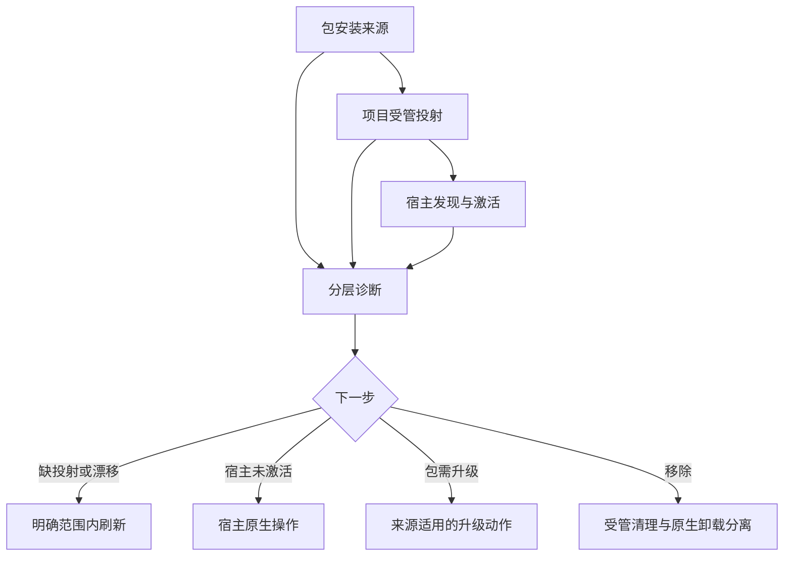
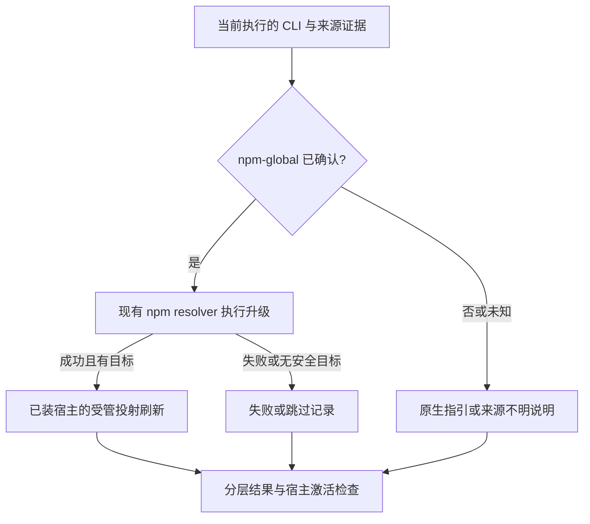
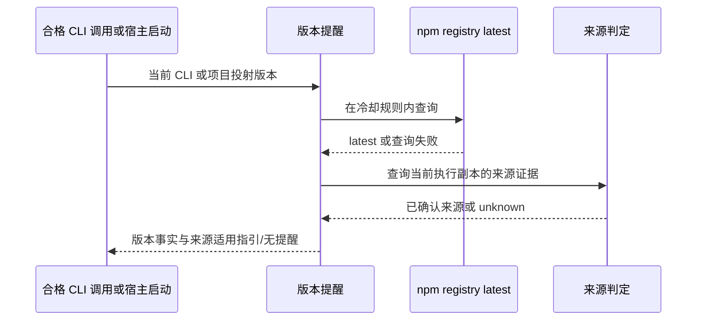

# Spec-First 安装生命周期 - Plan

## Goal Capsule

- **目标：** 让开发者和团队能够识别当前安装来源，安全完成首次启用、升级、项目投射刷新、诊断修复与卸载，并知道宿主是否真正可用。
- **产品权威：** 本轮用户已在比较现行行为与替代方案后选择 `update` 按安装来源分流；其余范围与验收依据本文列示的既有需求和来源。
- **产品决定：** 对非 npm-global 或来源不明的安装，`update` 不再静默安装全局副本；此行为改变了历史策略，详见 Product Contract 的来源分流决策。
- **建议方案：** 复用现有投射、诊断、清理与远程提醒链路；抽出当前 CLI 来源证明的共享边界，按已确认来源决定升级和提醒指引。
- **技术焦点：** 证明正在执行的 CLI 确实来自 npm 全局安装；证据不足即不执行全局安装或把项目投射标为已刷新。
- **验证焦点：** 插件、本地、`npx`、多仓和部分失败的行为回归，并区分包、投射、宿主激活的证据。
- **最大风险与停止条件：** 来源误判导致额外全局副本或错误刷新；若实施时无法可靠识别来源、确认资产归属或保持宿主兼容，则停止依赖动作并回到计划/产品 owner。
- **执行边界：** 本文规划代码实施，不表示代码已实施；`spec-work` 负责实施与验证，源文件是权威，宿主 runtime 为派生物，包管理器和插件状态仍由各自 owner 管理。

---

## Product Contract

### Summary

建立分层的安装生命周期体验：包的取得、项目 runtime 的投射、宿主的激活与验证分别可见，失败可恢复。
保留项目级受管投射作为跨宿主默认；软链接只作为受限开发实验，不替代正式投射。

### Problem Frame

当前产品已具备 npm 包、`init --dry-run`、`update`、`doctor --json` 和逐宿主 `clean --dry-run`，但它们覆盖不同的所有权边界。
在全局 npm、项目安装、宿主插件或工作区混用时，“包已升级”“文件已投射”“宿主已加载”不是同一事实；把其中一个成功表述为整体可用会使修复与卸载指引失准。

此前 `update` 方案曾明确选择无条件执行全局 npm 安装；当前代码又在升级后尝试刷新可定位项目的受管投射。现有版本提醒可查询 npm 发布版本，但提醒入口和安装来源判断并不等于包与宿主都已升级。
本轮用户在了解并存副本与兼容性取舍后选择按安装来源分流，取代上述历史升级策略。

### Key Decisions

- **三层状态分开呈现。** 包安装、项目投射、宿主激活分别提供证据与下一步；Governs R1, R4, R6, R10, R14。任一层的成功不能证明另两层成功。
- **保持项目投射为正式默认。** 跨宿主默认使用受管、可预览的 source→runtime 投射，而不是从可变全局路径软链接整个 runtime；Governs R3, R8。当前投射需按宿主转换内容，链接仅在部分宿主的部分资源上有官方支持。
- **不替宿主或包管理器越权。** 卸载一个宿主的受管投射不卸载 npm 包，也不撤销其他宿主的共享使用；Governs R7, R9。安装来源、项目使用范围与底层包的所有者可能不同。
- **`update` 按安装来源分流。** 只对确认由 npm 全局安装的 CLI 执行包升级；其他或未知来源不新增全局 npm 副本，提供适用的原生指引或说明无法确认。(session-settled: user-directed — chosen over 无条件全局 npm 升级及将包升级完全移出 update：避免为非全局来源新增副本，同时保留已确认 npm 全局用户的一步升级。) Governs R1, R5, R15。此选择取代 `docs/plans/2026-06-12-003-feat-update-perform-upgrade-plan.md:13-44` 的历史策略；如何可靠识别来源由规划阶段决定。

### Actors

- A1. 本地开发者：在单仓或多仓工作区安装、升级、刷新、诊断或卸载。
- A2. 团队维护者：提供可复现的项目启用说明，识别版本与投射漂移。
- A3. 宿主与包管理器：各自负责加载及包的安装状态；其输出不是 spec-first 的可伪造保证。

### Requirements

**安装与首次启用**

- R1. 首次启用前，用户能区分 CLI 包是否可用、目标仓库和宿主是否已选择、项目投射是否存在，以及安装来源和宿主激活状态是否可确认。
- R2. 首次启用应先展示受影响项目、宿主、受管资源和破坏性变更，再由明确目标范围的操作产生副作用。
- R3. 正式安装应使项目投射可从产品包与项目 source 重建；用户自有资产不因安装被纳入受管集合。

**升级、更新与刷新**

- R4. 用户能看到当前 CLI 版本、目标项目投射状态以及可证实的宿主加载状态，并区分未知、未验证与失败。
- R5. `update` 仅在确认 CLI 来源为 npm 全局安装时执行包升级；对插件、本地安装或来源不明者不新增全局副本，并提供对应原生升级指引或说明无法确认。
- R6. 包升级后应明确报告项目 runtime 刷新为成功、失败、跳过或未尝试，并给出只影响已选目标的恢复动作；不得把包升级成功等同于完整升级成功。

**诊断、修复和卸载**

- R7. 用户可在不写入的条件下查看逐宿主投射漂移、缺失、来源不确定与可执行的修复指引。
- R8. 修复或刷新应限制在用户已选择且由 spec-first 管理的项目与宿主范围；对损坏状态、用户修改、未知来源与软链接逃逸采用保守处理。
- R9. 卸载应分清项目投射清理与包/宿主插件卸载，先展示预期移除范围；只移除可确认归属的受管资产，保留共享消费者和自有配置。
- R10. 操作结束时报告每层结果与剩余动作；离线、权限不足或宿主未激活不能被包装为整体成功。

**跨环境与兼容**

- R11. 单仓、多仓父目录与子仓操作遵循明确目标范围；不因在父目录执行而把未安装过的宿主投射进兄弟仓库。
- R12. 既有安装可诊断、可迁移或给出受限恢复步骤；升级和卸载失败时不推断拥有未知资产，不自动做破坏性清理。
- R13. Linux、macOS、Windows 的正式体验应有适用性标记和实测证据；未验证宿主只能标记为降级，不能称为功能等价。

**新版本提醒**

- R14. npm 将新版本标记为 `latest` 后，后续合格的本地 CLI 或宿主启动检查应提示有更新；离线、查询失败、未触发检查或仍在冷却期时不得声称已是最新。
- R15. 更新提醒应区分当前 CLI 副本与项目 runtime 版本，并指向已确认来源的升级入口；插件、本地或未知来源不得被引导以全局 npm 升级替代原有安装。

### Key Flows

- F1. 首次安装与启用：A1 取得 CLI → 指定项目与宿主 → 查看投射预览 → 执行安装 → 检查受管文件与宿主激活 → 得到分层结果。覆盖 R1–R3, R10。
- F2. 升级与项目刷新：A1 从交互式 CLI 或宿主启动提醒获知可用版本 → 核对来源与当前版本 → 对确认的全局 npm 安装执行包升级，其他来源取得对应指引 → 在明确项目范围内刷新适用的既有投射 → 核查宿主加载及未完成步骤。覆盖 R4–R6, R10–R11, R14–R15；安装来源策略由 Key Decisions「`update` 按安装来源分流」持有。
- F3. 故障恢复：A1 查看只读诊断 → 对安全可确认的目标预览修复 → 仅刷新受管范围 → 复查或保留受限恢复指引。覆盖 R7–R8, R10, R12。
- F4. 卸载：A1 确认目标项目和宿主 → 预览清理 → 移除受管投射 → 分别决定是否使用原包管理器或宿主自己的卸载入口 → 核查共享资产和残留。覆盖 R9–R10, R12。

### Acceptance Examples

- AE1. **Covers R1–R3.** 给定一个未启用的项目，当用户预览两个宿主安装时，应先看到目标和受管/破坏性范围；未执行前不改变项目，执行后能分别判断两宿主的投射与激活状态。
- AE2. **Covers R4–R6, R10.** 给定 npm 全局包升级成功而项目刷新失败，当用户读取结果时，应看到包成功、投射失败及明确重试步骤，不得看到“全部完成”。
- AE3. **Covers R5, R15.** 给定 CLI 来自插件、本地安装或无法确认来源，当用户请求 `update` 时，不会启动全局 npm 安装；结果应给出来源适用的原生升级指引或如实说明无法确认，而不声称原副本已升级。
- AE4. **Covers R7–R8, R12.** 给定受管文件被修改、状态损坏或存在越界软链接，当用户执行诊断或修复时，应保留未知归属内容，报告风险和可恢复操作，不追随越界链接写入。
- AE5. **Covers R9–R10.** 给定两个宿主共享一个投射根，当用户仅卸载一个宿主时，另一宿主仍使用的资产被保留；npm 包和个人配置不被该项目清理动作删除。
- AE6. **Covers R11.** 给定多仓父目录只有一个子仓安装过宿主 runtime，当用户从父目录运行升级时，不会为其他子仓静默新增相同宿主。
- AE7. **Covers R6, R10, R13.** 给定版本查询离线或宿主尚未重载，当用户完成适用的包升级时，应将在线版本检查或宿主加载声明为未知/待验证，不把受管文件存在表述成宿主可用。
- AE8. **Covers R2, R9, R12.** 给定 legacy 状态无法确认归属，当用户预览卸载时，流程不直接删除未知资源；给出可检查的迁移或人工恢复路径。
- AE9. **Covers R4, R14.** 给定 npm 已发布带 `latest` 标签的较新版本，当本地交互式 CLI 或支持启动提醒的宿主完成一次合格检查时，应提示可用新版本及所比较的本地层；没有触发检查、冷却期内或联网失败时，不承诺即时通知，也不把未知写成“已是最新”。
- AE10. **Covers R5, R15.** 给定插件受管 runtime 版本低于 npm `latest`，当宿主启动提醒显示时，用户应看到 npm 已有较新版本、但插件渠道是否已发布仍待宿主确认，并得到插件原生检查指引；不得将其误导为全局 npm 升级。来源不明的本地副本也不得被误判为 npm 全局安装。

### Success Criteria

- 对上述 AE1–AE10，每条结论都有可复现的命令输出、测试或宿主检查支撑；静态合同通过不等同于宿主实测通过。
- 默认流程中不出现“CLI 包升级成功却被报告为宿主已升级”或“清理一个宿主却删除其他消费者共享资源”的误导性完成声明。
- 用户从安装、升级、卸载任一入口都能确定负责下一动作的 owner，而不必猜测 `init`、`clean`、原生包管理器或宿主插件谁负责。

### Scope Boundaries

- 不把全局软链接或单一共享可变 runtime 设为正式默认；Claude Code 的单 skill 目录软链接可另做受限、可回退的开发试验。
- 不实现通用 npm/pnpm/yarn/插件包管理器，不代替宿主的插件市场和激活流程。
- 不自动更新所有已知项目、跨机器同步配置，或在 `postinstall` 阶段写入项目文件。
- 不修改生成的 `.claude/`、`.codex/`、`.agents/skills/` 等 runtime 镜像作为产品 source 修复。
- 不把本方案扩展为新的中心化安装服务、遥测采集、强制联网或全宿主功能对等承诺。

### Dependencies / Assumptions

- 当前优先保障 repo-local source 和受管投射的可重建性；用户真实安装来源的分布、重复安装发生率和升级失败率尚无现场数据。
- 宿主发现能力、插件行为及版本随宿主变化；外部文档给的是能力边界，不是本仓库所有宿主的真机验收结果。
- 当前分支存在与本方案无关的删除及未跟踪文件；后续规划与实施不得吸收这些改动。

### Outstanding Questions

**Deferred to Planning**

- 如何证明 CLI 确由 npm 全局安装，以及如何避免把 `npx`、本地依赖或非标准插件路径误归类为全局安装？未知来源按 R5 保守处理，不由规划阶段改变该产品边界。

- 哪些宿主的“激活”可通过原生命令实测，哪些只能报告投射已存在或降级？以当前 `getSupportedPlatforms()`、宿主官方文档和版本矩阵确定。
- 既有 state、受管命名空间和用户修改的迁移/回滚机制应如何复用？以当前 `init`/`clean`/`doctor` 实现和测试为准，不在需求阶段规定 schema。
- “只更新变化文件”是否改善真实耗时与漂移噪音？先度量，再决定是否纳入实现；不把文件数当成价值指标。

### Sources / Research

**项目事实（2026-11-05，分支 `leo-2026-10-27-update`，HEAD `eeda5a6d2`；变更后需重查）：**

- `package.json:2-8,39-80`：包有 CLI bin，分发 `skills/`、`templates/` 等资产；不能由此推出当前用户都通过 npm-global 安装。
- `src/cli/plugin-sync.js:210-275,702-751`：项目 skill 按宿主规划清理、复制和内容转换，并对投射与预期内容做完整性比对；据此不能把“软链接只需改路径”视作兼容事实。
- `src/cli/commands/init-output.js:64-99,131-164`：`init` 有摘要/详细预览、风险与漂移披露。
- `src/cli/commands/update.js:20-42,109-166,198-205,298-355`：现行 `update` 无条件执行全局 npm 安装，再尝试刷新当前可定位的投射；此行为是本次已确认决策要改变的兼容基线。
- `src/cli/version-reminder.js:7-15,37-116,143-233,537-554,709-743`、`src/cli/index.js:48-53,101-125`：已有 npm registry 版本检查、交互式 CLI 与部分宿主启动提醒、冷却/失败重试及环境跳过；当前启动提醒统一建议 `spec-first update`，而 CLI 安装来源识别将非插件路径均归为 npm，不能作为“已证实 npm-global”依据。
- `src/cli/commands/doctor.js:30-77,1395-1415`：诊断支持 JSON；内容和部分宿主状态是不同证据层，不能仅据报告字段推断所有宿主已真机激活。
- `src/cli/commands/clean.js:67-164,567-572`、`src/cli/state.js:675-695`：按宿主和受管 state 预览清理，状态不可读时保守退出；写入路径有项目根 containment 检查。
- `docs/plans/2026-06-12-003-feat-update-perform-upgrade-plan.md:13-44`：历史用户选择“不识别安装方式、无条件 npm 升级”；其原方案的“只提示 init”不是当前源码最终行为。
- `docs/methodology/结构化项目角色契约.md:47-55,68-82`：source/runtime 权威、跨宿主降级与证据相称原则。

**外部依据（2026-11-05 查阅；宿主更新后需重验）：**

- [Claude Code Skills 文档](https://code.claude.com/docs/en/skills#where-skills-live)：项目、用户与插件分别发现；普通 skill 目录允许软链接，但插件资源另有规则。仅支持 Claude 的相应 skill 发现结论，不支持全宿主整体链接结论。
- [Claude Code 插件安装文档](https://code.claude.com/docs/en/plugins/install)：插件安装分 user/project/local scope；安装、更新、卸载由宿主入口管理；磁盘更新与当前会话生效可能分离。
- [npm outdated 文档](https://docs.npmjs.com/cli/v11/commands/npm-outdated/)：`latest` 是 registry 的分发标签，不保证是版本号最高或最近发布时间最新的版本；因此 R14 仅针对带 `latest` 标签的可升级版本，不承诺所有发布都立即触发提醒。
- [npm link 文档](https://docs.npmjs.com/cli/link)：链接适于本地迭代测试；不能视作可复现的生产项目投射机制。
- [npm ci 文档](https://docs.npmjs.com/cli/v11/commands/npm-ci/)：锁文件约束的干净安装适合自动化环境；这是“可复现包取得”的类比，不意味着应将 spec-first 自身改成项目依赖或自动运行 `npm ci`。

**研究局限与重评条件：** 本轮为直接源码和官方文档核对；未做新装/升级/卸载的跨平台真实用户旅程、性能基准、宿主激活矩阵或独立审查。现有提醒在无合格调用、查询失败或冷却期内不会即时获知发布；未对各宿主真实启动链路做实测。若宿主新增统一原生分发，需重新评估投射范围和软链接试验价值。

---

## Planning Contract

本轮审查修订仅触及 Planning Contract、Implementation Units 与 Verification Contract，未改写上游 Product Contract。此前“byte-preserved upstream source slice”声明缺少可复核的规划起点基线，本计划不再将其作为已验证事实；若后续需要证明跨阶段逐字节保留，须从上游需求稿的明确版本/提交重新建立基线。

### Key Technical Decisions

- KTD1. **来源证明采用共享、保守的当前进程判定（`new`，复用现有解析器）。** 在 `src/cli/install-origin.js` 统一输出 `npm-global`、`claude-plugin`、`local` 或 `unknown` 加证据/原因；当前执行的包根目录必须与 `npm root -g` 下经身份、入口及真实路径核验的包一致，且全局包根不可是指向源码 checkout 的链接；不能只凭全局包存在、`PATH` 命中或非插件路径判断为 npm-global。复用 `src/cli/commands/update.js` 已有全局包入口验证及 `src/cli/version-reminder.js` 的路径线索，但将二者的来源语义收敛到一处；插件/本地只能在证据足够时正向识别，其他情况归 `unknown`。这是新增共享边界，而非新增包管理器或持久安装登记；npm/link、`npx`、符号链接解析失败和多份副本均按保守规则处理。Governs R1, R5, R15。
- KTD2. **包升级与投射刷新分开记账（`extend`）。** `src/cli/commands/update.js` 在 KTD1 确认 npm-global 后沿用现有 npm resolver 和升级后全局 CLI bin 刷新路径；其他来源只给原生指引与独立 `init` 刷新步骤，不以本次未升级的旧 CLI 自动重写项目。保留按已装宿主和目标仓库选择、失败时跳过或降级的现有边界；升级成功后也仅能报告投射操作结果，不能证明宿主加载。Governs R4–R6, R8, R10–R12, R15。
- KTD3. **提醒复用拉取与冷却机制，纠正比较对象和行动指引（`extend`）。** `src/cli/version-reminder.js` 与 `src/cli/index.js` 继续在现有合格调用/启动检查点查询 npm `latest`，不建常驻服务或推送通道；交互式 CLI 提醒比较当前执行 CLI 包版本，其升级指引使用该 CLI 的来源判定。宿主启动提醒比较目标项目投射的受管版本；它不得把调用提醒的 CLI 来源当作该 runtime 或插件的安装来源。只有宿主上下文能可靠识别 runtime 渠道时才给对应原生升级入口；插件渠道无法确认时仅报告 npm 版本事实、渠道待核实，并指向宿主插件管理界面检查，不推荐全局 npm 升级。未知来源不得说成已是最新；维持离线、超时、环境跳过与冷却的非阻塞语义。Governs R4, R14–R15。
- KTD4. **安装、诊断和清理复用现有项目投射 owner（`extend`）。** `init` 的目标/破坏性预览、`doctor` 的投射与宿主证据区分、`clean` 的逐宿主受管清理保持各自权威；只补齐生命周期结果与缺失的恢复指引，不新增中央安装状态或软链接投射模式。状态缺失、用户改写、越界链接和多仓父目录仍由现有规划/防护路径保守处理；宿主是否加载须由可运行的原生检查或真实会话证明。Governs R1–R3, R7–R13。

### Interface Contracts

- **CLI `update` 与交互式 CLI 提醒（evolution）：** owner 为 `src/cli/commands/update.js`、`src/cli/version-reminder.js`，消费者为交互式开发者；输入是当前执行 CLI 来源，输出分别披露包升级、项目刷新、宿主激活的成功/失败/跳过/未知和适用指引。
- **宿主启动提醒（evolution）：** owner 为各宿主 session-start hook 与 `src/cli/version-reminder.js`；提醒对象是项目受管 runtime，而非 hook 借 PATH 调用的 CLI 副本。输入包含目标 runtime 版本及可核实的宿主/插件渠道上下文；若无法区分插件安装与普通项目投射，则只报告 npm `latest` 与本地 runtime 的版本差异和渠道未知，不给 `spec-first update` 或全局 npm 安装指引，指向宿主插件管理界面核实渠道。该降级不能误称插件渠道已有新版本。
- 上述来源分流是有意的行为不兼容：历史非全局来源会失去自动全局 npm 安装，须在发布说明和帮助文本明示；回退仅能通过显式原生包管理器操作，不能以静默恢复旧策略作运行时 fallback。`tests/unit/update-command-spawn.test.js`、`tests/unit/version-reminder-hardening.test.js` 和 CLI smoke 检查输出与副作用。
- **来源判定（greenfield，U1 创建）：** `src/cli/install-origin.js` 是共享内部契约，由 `update` 和交互式 CLI 提醒消费；输入限当前 CLI 路径及可核实的包/全局 npm 根证据，输出有限分类、可解释的 `reason_code`，探测失败归 `unknown` 且不触发安装。宿主 runtime 渠道使用独立证据，不复用 CLI 来源分类；无外部持久 schema、无新配置键。U1 用 `tests/unit/install-origin.test.js` 验证平台路径及拒绝误判；若实际源码显示已有等价 owner，实施时合并回该 owner 而不叠加第二事实源。

### High-Level Technical Design

**三层操作与证据流：**

**提醒与操作解耦：**

**受管资产生命周期：** 包取得、目标仓库投射和宿主加载分别持有证据；`init`/`doctor`/`clean` 只在已确认目标及归属内操作，原生包与插件卸载不由项目清理执行。部分成功时保留可诊断状态并给出下一动作，不将后续宿主启动当作本次 CLI 的已验证结果。

### Implementation Scope Boundaries

- 只扩展现有 CLI、投射与文档边界；不新建插件市场集成、后台轮询、自动更新全部仓库、跨宿主软链接同步或遥测服务。
- 不重写无关的 `init`/`clean`/`doctor` 内部结构，也不改变用户管理的文件；若现有投射已满足某条验收，以测试和说明证明，而非为凑功能新增机制。
- 对“仅更新变化文件”先不纳入主动改动：现有需求只要求安全可恢复，缺耗时收益证据；取得真实耗时和漂移数据后再评估。

### Evidence & Limitations

- 当前树为 `leo-2026-10-27-update`、HEAD `fd315042f`，本计划及 `CHANGELOG.md` 已有未提交修改，其他任务亦有改动；U 单元不得吸收无关 diff。需求稿的源码快照指向较早 HEAD，实施前须以当前工作树重查。
- `src/cli/commands/update.js` 现有全局 npm 安装/全局 bin 解析和多仓刷新、`src/cli/version-reminder.js` 的插件路径二分及启动提醒，是 KTD1–KTD3 的直接依据；`tests/unit/update-command-spawn.test.js`、`tests/unit/version-reminder-hardening.test.js` 确认现有测试锁定旧行为，迁移必须显式修订断言而非让测试失效。
- Product Contract 的来源分流由用户在比较两种策略后确认；其余产品边界继承该文档，未由独立产品 owner 逐项复核。外部 npm/宿主文档来自需求阶段且会变化；本轮没有新增外部访问或跨平台真机执行，不能据此声称插件渠道发布、新版即时送达或宿主已加载。

---

## Implementation Units

### U1. 证明当前执行副本的安装来源

- **Goal:** 建立供 `update` 和提醒共同使用的可解释来源判定，未知即保守退出包升级。
- **Requirements:** R1, R5, R15；F2；AE3, AE10；KTD1。
- **Dependencies:** 无。
- **Files:** `src/cli/install-origin.js`（或重查后确定的既有等价 owner）、`src/cli/commands/update.js`、`src/cli/version-reminder.js`、`tests/unit/install-origin.test.js`、`tests/unit/version-reminder-hardening.test.js`。
- **Approach:** 核对当前进程入口、包根、npm 全局根和真实路径的一致性；插件、本地来源只在可证实时分类，`npx`、开发 `npm link`、无可用 npm、冲突副本及链接越界均不得提升为 npm-global。复用已有全局包身份/入口检查而非复制另一套规则，保持探测无副作用。
- **Patterns to follow:** `src/cli/commands/update.js` 的全局包入口解析和 `src/cli/version-reminder.js` 的渠道判断/`reason_code` 风格。
- **Test scenarios:**
  - Covers AE3. 当前执行入口与有效的 npm 全局包入口为同一真实文件时，判为 npm-global；仅有另一份全局包而当前运行本地副本时，不执行全局安装资格判定。
  - Covers AE10. 插件标准路径能识别为插件；非标准插件路径证据不足时返回 unknown，不借“非标准路径”推断 npm-global。
  - 本地依赖、`npx` 临时目录、`npm link` 源码链接和 Windows 大小写/路径分隔符边界不会被误判为已确认 npm-global。
  - npm 根解析失败、manifest 错误、bin 越界或真实路径解析失败时返回原因且无安装副作用。
- **Verification:** 来源分类和错误路径具有可复现单测，未知态不越权进入包升级。

### U2. 按来源执行升级并保留目标投射边界

- **Goal:** 仅为已确认 npm-global 的当前 CLI 执行包升级，并分别报告包/投射/宿主结果。
- **Requirements:** R4–R6, R8, R10–R12, R15；F2；AE2, AE3, AE6, AE7；KTD1–KTD2。
- **Dependencies:** U1。
- **Files:** `src/cli/commands/update.js`、`src/cli/commands/update-messages.js`（仅在现有消息 owner 适用时）、`tests/unit/update-command-spawn.test.js`、`tests/integration/workspace-graph-lifecycle.integration.test.js`。
- **Approach:** 在调用既有 npm resolver 前核实来源；非全局来源只输出对应原生升级与后续 `init` 刷新指引，不用旧 CLI 冒充升级后 runtime。全局升级成功时沿用经身份校验的新全局 bin、仅刷新目标中已装宿主；失败、无安全目标、无可刷新投射均保留独立状态与恢复动作。
- **Patterns to follow:** `src/cli/commands/update.js` 的 npm 执行器、全局 bin 解析和既有多仓/无状态 runtime 降级；`src/cli/commands/init.js` 的目标预览。
- **Test scenarios:**
  - Covers AE2. 全局升级成功但项目刷新失败，输出包成功/投射失败/宿主未验证并给出重试指引，不声称整体完成。
  - Covers AE3. 插件、本地及 unknown 分别请求 `update` 时 npm 安装调用次数为零；输出保留各来源适用或未知说明。
  - Covers AE6. 多仓父目录仅一子仓有 runtime 时不向兄弟仓新增宿主；子目录调用定位仓库根并保留选中的平台集合。
  - Covers AE7. npm 升级成功但无法定位新全局 bin、离线或宿主未重载时，不调用旧代码进行伪刷新，也不声称宿主已加载。
  - npm 升级失败、没有目标仓库、状态缺失或 runtime 为无状态残留时，不生成裸 `init -y` 或扩大写入范围。
- **Verification:** Windows 安全 spawn、来源分流、分层状态与多仓边界的单测/集成检查通过。

### U3. 修正远程版本提醒及来源适用指引

- **Goal:** 在现有合格检查点让用户获知 npm `latest` 与本地版本差异，同时分别按当前 CLI 副本来源和被提醒 runtime 的渠道提供指引。
- **Requirements:** R4, R14–R15；F2；AE9–AE10；KTD1, KTD3。
- **Dependencies:** U1, U2（CLI 来源语义与 `update` 输出）。
- **Files:** `src/cli/version-reminder.js`、`src/cli/index.js`（仅在触发点/输出需要时）、各受影响的 `templates/*/hooks/*` session-start source、`tests/unit/version-reminder.test.js`、`tests/unit/version-reminder-hardening.test.js`、`tests/unit/qoder-runtime-lifecycle.test.js`（仅在投射触发点受影响时）、受影响 session-start hook 对应的现有测试文件（实施时定位；必要时新增聚焦测试）。
- **Approach:** 共用 CLI 来源判定与交互式 CLI 行动文本，但不把该分类外推到启动 hook 提醒的 runtime。宿主启动提醒应以目标项目的受管 runtime 版本比较；宿主上下文明确提供 plugin identity 时用宿主原生插件管理入口，若 hook 仅知道项目受管投射或通过 PATH 调用了 CLI，则不得推断插件渠道或 npm-global 来源。插件渠道不明时只报告 npm 上游版本事实与渠道未核实，给宿主界面检查指引，不推荐全局 npm 升级。保持查询超时、成功/失败冷却、环境跳过和非阻塞主命令；非交互或未触发检查没有即时推送。
- **Patterns to follow:** `src/cli/version-reminder.js` 的 registry lookup、版本比较和冷却状态；现有 host session-start hook 的低阻塞输出和失败降级。
- **Test scenarios:**
  - Covers AE9. 模拟 registry `latest` 高于当前 CLI 或项目投射版本且合格检查触发时，提醒标明比较层；无检查、仍在冷却期或未联网时不宣称“已是最新”。
  - Covers AE10. 插件 runtime 落后于 npm `latest`、但启动 hook 由 PATH 调用了全局 CLI 时，不将 CLI 的 npm-global 来源误作插件来源，不给全局 npm 升级指引；只报告 npm 版本差异与插件渠道待核实，并指向宿主插件管理界面。
  - 对能够明确识别插件 identity 的宿主上下文，给原生插件更新/检查指引；对普通项目投射不误报成插件安装或插件渠道已发布。
  - unknown/local CLI 不提示全局 npm 升级；非 TTY、CI、测试环境、显式关闭提醒、错误版本响应及超时均不阻断主命令或打印不可信版本文本。
  - 成功检查约 24 小时冷却、失败约 1 小时重试及并发抢占保持原有约束，不把 registry 错误包装成安装失败。
- **Verification:** 版本提醒与受影响 hook/template 单测覆盖触发层、runtime 渠道证据、混装场景、指引和冷却；宿主启动链路在可用宿主上另以真实会话验证，不由 mock 单测替代。

### U4. 固化安装、诊断、修复与卸载的分层体验

- **Goal:** 用现有 CLI owner 交付其余生命周期验收，补齐缺失的分层输出与安全恢复指引。
- **Requirements:** R1–R4, R7–R13；F1, F3–F4；AE1, AE4–AE5, AE8；KTD4。
- **Dependencies:** U1（来源语义）、U2（分层状态词汇）；可与 U3 的独立提醒用例并行。
- **Files:** `src/cli/commands/init.js`、`src/cli/commands/init-output.js`、`src/cli/commands/doctor.js`、`src/cli/commands/clean.js`、`src/cli/state.js`（仅现有路径防护不足时）、`tests/unit/init-preview.test.js`、`tests/unit/init-runtime-readiness-guidance.test.js`、`tests/unit/cli-clean-workspace-graph.test.js`、`tests/unit/init-apply-failure.test.js`。
- **Approach:** 先表征既有预览、归属、防越界和报告行为；仅补验收缺口。安装、修复与清理以显式项目/宿主目标和可确认的受管资产为界；未知资产保留，包和插件卸载归原生 owner，诊断投射存在不等于宿主激活。
- **Patterns to follow:** `src/cli/commands/init-output.js` 的摘要/详细预览、`src/cli/commands/doctor.js` 的分层报告及 `src/cli/commands/clean.js` 的保守清理。
- **Test scenarios:**
  - Covers AE1. 未启用项目的双宿主 dry-run 显示项目与破坏性范围且不写入；应用后可分别报告投射状态与未验证宿主激活。
  - Covers AE4. 用户改写受管文件、损坏 state 或越界软链接时，诊断只读，修复不追随越界链接且保留未知归属内容。
  - Covers AE5. 两宿主共享资源而只清理一个时另一宿主可用资源、npm 包与个人设置均保留。
  - Covers AE8. legacy 归属不明时清理预览不将其列为可自动删除；失败或中断后可复查并恢复。
  - 单仓/子仓目标和无目标父目录遵循明确范围，不因为诊断发现兄弟仓而写入它。
- **Verification:** 聚焦单测证明预览无写入、归属保守及分层文案；项目真机旅程验证宿主加载，不从静态文件推出可用性。

### U5. 文档、兼容提示与跨环境交付验证

- **Goal:** 使全局 CLI、插件及本地来源的升级/清理路径和兼容性变化对用户可见。
- **Requirements:** R6, R9–R15；F1–F4；AE1–AE10；KTD1–KTD4。
- **Dependencies:** U2–U4。
- **Files:** `README.md`、`README.en.md`、`README.zh-CN.md`（有实际用户行为差异时）、`docs/user-guide/01-快速开始.md`、`docs/user-guide/04-常见问题.md`、`docs/user-guide/06-本地源码安装.md`、`CHANGELOG.md`、`tests/smoke/cli-smoke.test.js`。
- **Approach:** 公示 `update` 对非全局来源不再静默安装全局副本、npm `latest` 与插件发布边界，以及原生卸载和 `init` 刷新职责；对 Linux/macOS/Windows 及目标宿主标注已验证或降级，不用文档代替真机证明。修改既有用户指南，不新增并列说明源。
- **Patterns to follow:** 当前 README 的安装入口、`docs/user-guide/` 的恢复步骤和仓库 CHANGELOG 格式。
- **Test scenarios:**
  - Covers AE3, AE10. 发布包/CLI smoke 分别以已确认全局与非全局来源核查升级指引；非全局场景不产生全局副本。
  - Covers AE1, AE5, AE8. 临时项目走预览→安装→诊断→清理，比较清理前后受管/共享/用户资产，并单独检查原生包或插件卸载说明。
  - Covers AE7, AE9. 在可用宿主真实启动检查提醒与加载，离线和无启动支持的环境标注未验证/降级，不从测试桩宣称真机通过。
- **Verification:** 文档中的命令与实际 CLI 输出一致，包内容与当前 source 一致；每个平台/宿主的实测结果或未测限制在交付时列明。

---

## Verification Contract

**最大未证风险：** 将插件、本地或 `npx` 当前副本误认成全局 npm 安装，从而产生重复全局副本并用错误二进制刷新用户项目。确认状态：来源分流为 `confirmed`（本轮用户选定，Product Contract Key Decisions）；其余验收为 `inherited`（需求稿，尚无独立产品复核）。实施者不得以同一代理的自审充当独立产品验收。

**真实 npm-global 正向路径与副本冲突（U1–U2）：** 在隔离临时目录建立真实 npm prefix，将当前项目 tarball 安装到该 prefix 的 global 区域，并从安装后的 CLI 入口运行 `update`。记录入口路径、包根、`npm root -g`、判定结果、spawn 参数及输出；必须判为 `npm-global` 并触发预期升级动作。随后从独立本地副本入口运行，必须判为 `local` 或 `unknown` 且不触发全局安装；`npm link` 或指向 checkout 的链接不得误判为正式全局安装。所有操作限于临时 prefix 和隔离工作目录，不改用户全局 npm 状态。若环境无法完成该真实路径验证，该证明保持阻塞，mock 不可替代，相关来源升级行为不得标为完成。

| 证明意图 | 状态 | 具体检查与证据上限 |
| --- | --- | --- |
| 来源识别与副作用边界（U1–U2） | required | 运行 `npx jest --runTestsByPath tests/unit/install-origin.test.js tests/unit/update-command-spawn.test.js --runInBand`，并通过上述隔离真实 npm-global/local 双入口验证；mock 不能替代真实安装正向路径。 |
| 提醒、冷却、宿主入口（U3） | required | 运行 `npx jest --runTestsByPath tests/unit/version-reminder.test.js tests/unit/version-reminder-hardening.test.js tests/unit/qoder-runtime-lifecycle.test.js --runInBand`，并覆盖实际受影响的启动 hook template 测试；混装场景还需以真实宿主会话核对输出。模拟 registry 不能证明线上标签或插件渠道同步。 |
| 投射、归属、恢复及多仓（U2, U4） | required | 运行 `npx jest --runTestsByPath tests/unit/init-preview.test.js tests/unit/init-runtime-readiness-guidance.test.js tests/unit/init-apply-failure.test.js tests/unit/cli-clean-workspace-graph.test.js tests/integration/workspace-graph-lifecycle.integration.test.js --runInBand`；临时项目断言不能证明所有宿主实际发现。 |
| CLI 与发布包契约（U1–U5） | required | 运行 `npm run typecheck`、`npm run test:smoke`、`npm run build`；语法、smoke 与打包清单不能替代用户机器上的安装来源和宿主激活验证。 |
| 受触及文件的间接契约 | required | 对 `tests/unit/brand-presentation.test.js`、`tests/unit/host-flag-registry-derivation.test.js`、`tests/unit/plugin-modules.test.js`、`tests/unit/init-workspace-contract.test.js` 和相关 adapter 测试做变更后定向检查；其绿灯仅支持这些合同断言，不证明跨宿主完全等价。 |
| 真实宿主与平台 | required（对声称已验证的组合） | 至少在交付时逐项登记已实测的系统/宿主、版本、命令输出与真实会话发现；没有设备或渠道权限的组合标 `deferred`（owner：实施者/宿主维护者；unblock：可用的目标环境），不得宣称已验证或功能对等。 |
| 无线上写入的计划阶段 | not applicable | 当前只写计划，不运行实施命令；以上命令均是实施期 proof intents，不是本轮通过记录。 |

**证据归属与收口：** 脚本/测试提供 exit code、文件范围和包内容等机械事实，LLM/审查者判断结果是否覆盖需求；实施记录应同时绑定最终源码修订和实际执行日志。每个 required intent 在交付时须对应结果、明确不适用理由、带 owner 的延期或阻塞限制；全部命令变绿仍不能替代误判防护与真实宿主验收。需要发布前再按仓库适用性评估 `release:validate`，不把未执行的发布控制声称为通过。

---

## Definition of Done

- U1–U5 对应的行为、失败路径、文档及兼容说明均落实到项目 source，Product Contract 的 R/F/AE 与测试结果可以反向追溯。
- 已确认 npm-global 可升级；真实隔离 npm prefix 正向路径、独立本地副本与 `npm link`/checkout 链接的来源区分均有可复核运行记录。无法运行真实来源验证时，相关完成声明保持阻塞，不以 mock 代替。
- 宿主启动提醒不会把 PATH 调用的 CLI 来源当作目标 runtime/plugin 来源；渠道不能确认时不提供全局 npm 升级指引，并有启动 hook 测试或真实宿主记录覆盖该混装场景。
- 插件、本地、`npx` 和 unknown 不会因 `update` 静默新增全局副本；提醒只陈述已核实的 npm 发布与来源事实。
- 安装/刷新/诊断/清理均在明确的项目及宿主归属范围内；包、投射、宿主激活结果分开报告，部分失败可定位与恢复。
- Verification Contract 的 required proof intents 经最终修订对照，测试失败、未运行或真机缺口明确记录且不冒充通过；达到发布/完成声明所需的必需证据后方可宣称完成。
- 更新 `CHANGELOG.md` 和所有受影响的用户文档；无关工作树改动及 generated runtime 不纳入 source 修复，本次试验遗留代码、临时文件与无效引用已清理。
