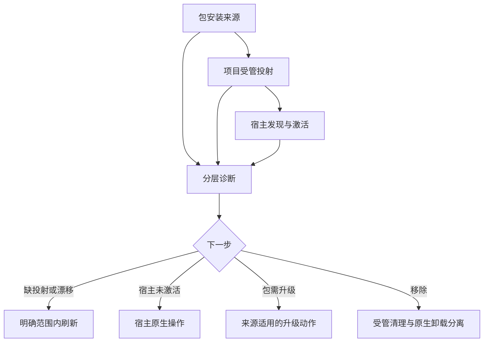

# Spec-First 安装生命周期 - Plan

## Goal Capsule

- **目标：** 让开发者和团队能够识别当前安装来源，安全完成首次启用、升级、项目投射刷新、诊断修复与卸载，并知道宿主是否真正可用。
- **产品权威：** 本文提出待确认的目标行为；当前用户要求完整方案，但未逐项批准变更既有 `update` 行为。
- **待决阻塞：** 升级来源待决问题 决定是否改变 `update` 对非 npm-global 安装的既有行为；依赖该决定的升级策略不能由规划阶段自行选择。
- **边界：** 这是需求与验收合同，不是可执行技术计划；项目 source 是权威，宿主 runtime 是可重建投射，第三方包管理器和宿主插件的状态仍由各自 owner 管理。

---

## Product Contract

### Summary

建立分层的安装生命周期体验：包的取得、项目 runtime 的投射、宿主的激活与验证分别可见，失败可恢复。
保留项目级受管投射作为跨宿主默认；软链接只作为受限开发实验，不替代正式投射。

### Problem Frame

当前产品已具备 npm 包、`init --dry-run`、`update`、`doctor --json` 和逐宿主 `clean --dry-run`，但它们覆盖不同的所有权边界。
在全局 npm、项目安装、宿主插件或工作区混用时，“包已升级”“文件已投射”“宿主已加载”不是同一事实；把其中一个成功表述为整体可用会使修复与卸载指引失准。

此前 `update` 方案曾明确选择无条件执行全局 npm 安装，即使非全局 npm 用户会产生冲突副本；当前代码又在升级后尝试刷新可定位项目的受管投射。
本轮重新讨论完整生命周期，不自动抹去该历史决策，也不将它提升为适用于所有安装来源的最佳实践。

### Key Decisions

- **三层状态分开呈现。** 包安装、项目投射、宿主激活分别提供证据与下一步；Governs R1, R4, R6, R10。任一层的成功不能证明另两层成功。
- **保持项目投射为正式默认。** 跨宿主默认使用受管、可预览的 source→runtime 投射，而不是从可变全局路径软链接整个 runtime；Governs R3, R8。当前投射需按宿主转换内容，链接仅在部分宿主的部分资源上有官方支持。
- **不替宿主或包管理器越权。** 卸载一个宿主的受管投射不卸载 npm 包，也不撤销其他宿主的共享使用；Governs R7, R9。安装来源、项目使用范围与底层包的所有者可能不同。
- **升级命令的安装来源策略待 升级来源待决问题 裁决。** 保留现行行为作为兼容基线；只有用户确认产品行为变化后，才能将“识别来源后分流或阻断”纳入执行范围；Governs R5。既有历史方案 `docs/plans/2026-06-12-003-feat-update-perform-upgrade-plan.md:13-44` 明确选择不识别安装方式，不能把本轮建议冒充该选择已被撤销。

### Actors

- A1. 本地开发者：在单仓或多仓工作区安装、升级、刷新、诊断或卸载。
- A2. 团队维护者：提供可复现的项目启用说明，识别版本与投射漂移。
- A3. 宿主与包管理器：各自负责加载及包的安装状态；其输出不是 spec-first 的可伪造保证。

### Requirements

**安装与首次启用**

- R1. 首次启用前，用户能区分 CLI 包是否可用、目标仓库和宿主是否已选择、项目投射是否存在及宿主是否已激活。
- R2. 首次启用应先展示受影响项目、宿主、受管资源和破坏性变更，再由明确目标范围的操作产生副作用。
- R3. 正式安装应使项目投射可从产品包与项目 source 重建；用户自有资产不因安装被纳入受管集合。

**升级、更新与刷新**

- R4. 用户能看到当前 CLI 版本、目标项目投射状态以及可证实的宿主加载状态，并区分未知、未验证与失败。
- R5. `update` 的包升级动作不得被描述成所有安装来源的通用升级；是否对非 npm-global 来源改变现行执行行为由 升级来源待决问题 决定。
- R6. 包升级后应明确报告项目 runtime 刷新为成功、失败、跳过或未尝试，并给出只影响已选目标的恢复动作；不得把包升级成功等同于完整升级成功。

**诊断、修复和卸载**

- R7. 用户可在不写入的条件下查看逐宿主投射漂移、缺失、来源不确定与可执行的修复指引。
- R8. 修复或刷新应限制在用户已选择且由 spec-first 管理的项目与宿主范围；对损坏状态、用户修改、未知来源与软链接逃逸采用保守处理。
- R9. 卸载应分清项目投射清理与包/宿主插件卸载，先展示预期移除范围；只移除可确认归属的受管资产，保留共享消费者和自有配置。
- R10. 操作结束时报告每层结果与剩余动作；离线、权限不足或宿主未激活不能被包装为整体成功。

**跨环境与兼容**

- R11. 单仓、多仓父目录与子仓操作遵循明确目标范围；不因在父目录执行而把未安装过的宿主投射进兄弟仓库。
- R12. 既有安装可诊断、可迁移或给出受限恢复步骤；升级和卸载失败时不推断拥有未知资产，不自动做破坏性清理。
- R13. Linux、macOS、Windows 的正式体验应有适用性标记和实测证据；未验证宿主只能标记为降级，不能称为功能等价。

### Key Flows

- F1. 首次安装与启用：A1 取得 CLI → 指定项目与宿主 → 查看投射预览 → 执行安装 → 检查受管文件与宿主激活 → 得到分层结果。覆盖 R1–R3, R10。
- F2. 升级与项目刷新：A1 查看来源和当前版本 → 执行适用的包升级动作 → 在明确项目范围内刷新已有投射 → 核查宿主加载及未完成步骤。覆盖 R4–R6, R10–R11；包升级动作受 升级来源待决问题 约束。
- F3. 故障恢复：A1 查看只读诊断 → 对安全可确认的目标预览修复 → 仅刷新受管范围 → 复查或保留受限恢复指引。覆盖 R7–R8, R10, R12。
- F4. 卸载：A1 确认目标项目和宿主 → 预览清理 → 移除受管投射 → 分别决定是否使用原包管理器或宿主自己的卸载入口 → 核查共享资产和残留。覆盖 R9–R10, R12。

### Acceptance Examples

- AE1. **Covers R1–R3.** 给定一个未启用的项目，当用户预览两个宿主安装时，应先看到目标和受管/破坏性范围；未执行前不改变项目，执行后能分别判断两宿主的投射与激活状态。
- AE2. **Covers R4–R6, R10.** 给定 npm 全局包升级成功而项目刷新失败，当用户读取结果时，应看到包成功、投射失败及明确重试步骤，不得看到“全部完成”。
- AE3. **Covers R5.** 给定 CLI 来自插件或来源无法确认，当用户请求 `update` 时，输出不得声称该来源已升级；实际是否继续运行全局 npm 安装由 升级来源待决问题 决定。
- AE4. **Covers R7–R8, R12.** 给定受管文件被修改、状态损坏或存在越界软链接，当用户执行诊断或修复时，应保留未知归属内容，报告风险和可恢复操作，不追随越界链接写入。
- AE5. **Covers R9–R10.** 给定两个宿主共享一个投射根，当用户仅卸载一个宿主时，另一宿主仍使用的资产被保留；npm 包和个人配置不被该项目清理动作删除。
- AE6. **Covers R11.** 给定多仓父目录只有一个子仓安装过宿主 runtime，当用户从父目录运行升级时，不会为其他子仓静默新增相同宿主。
- AE7. **Covers R6, R10, R13.** 给定离线环境或宿主尚未重载，当用户完成包升级时，应将在线版本检查或宿主加载声明为未知/待验证，不把受管文件存在表述成宿主可用。
- AE8. **Covers R2, R9, R12.** 给定 legacy 状态无法确认归属，当用户预览卸载时，流程不直接删除未知资源；给出可检查的迁移或人工恢复路径。

### Success Criteria

- 对上述 AE1–AE8，每条结论都有可复现的命令输出、测试或宿主检查支撑；静态合同通过不等同于宿主实测通过。
- 默认流程中不出现“CLI 包升级成功却被报告为宿主已升级”或“清理一个宿主却删除其他消费者共享资源”的误导性完成声明。
- 用户从安装、升级、卸载任一入口都能确定负责下一动作的 owner，而不必猜测 `init`、`clean`、原生包管理器或宿主插件谁负责。

### Scope Boundaries

- 不把全局软链接或单一共享可变 runtime 设为正式默认；Claude Code 的单 skill 目录软链接可另做受限、可回退的开发试验。
- 不实现通用 npm/pnpm/yarn/插件包管理器，不代替宿主的插件市场和激活流程。
- 不自动更新所有已知项目、跨机器同步配置，或在 `postinstall` 阶段写入项目文件。
- 不修改生成的 `.claude/`、`.codex/`、`.agents/skills/` 等 runtime 镜像作为产品 source 修复。
- 不把本方案扩展为新的中心化安装服务、遥测采集、强制联网或全宿主功能对等承诺。

### Dependencies / Assumptions

- 当前优先保障 repo-local source 和受管投射的可重建性；用户真实安装来源的分布、重复安装发生率和升级失败率尚无现场数据。
- 宿主发现能力、插件行为及版本随宿主变化；外部文档给的是能力边界，不是本仓库所有宿主的真机验收结果。
- 当前分支存在与本方案无关的删除及未跟踪文件；后续规划与实施不得吸收这些改动。

### Outstanding Questions

**Resolve Before Planning**

- **升级来源策略：** `update` 对插件、项目本地包或无法确认来源的 CLI 应保持现行“无条件全局 npm 安装并给出提示”，还是改为“先识别来源，仅对确认的 npm-global 执行包升级，其余给出原生操作/阻断”？这改变既有用户选择和命令副作用。**下一最高影响问题。** 来源尝试：`src/cli/commands/update.js:80-166,198-205` 与 `docs/plans/2026-06-12-003-feat-update-perform-upgrade-plan.md:13-44`；写回位置：Product Contract / Key Decisions「升级命令的安装来源策略」、R5、F2、AE3。

**Deferred to Planning**

- 哪些宿主的“激活”可通过原生命令实测，哪些只能报告投射已存在或降级？以当前 `getSupportedPlatforms()`、宿主官方文档和版本矩阵确定。
- 既有 state、受管命名空间和用户修改的迁移/回滚机制应如何复用？以当前 `init`/`clean`/`doctor` 实现和测试为准，不在需求阶段规定 schema。
- “只更新变化文件”是否改善真实耗时与漂移噪音？先度量，再决定是否纳入实现；不把文件数当成价值指标。

### Sources / Research

**项目事实（2026-11-05，分支 `leo-2026-10-27-update`，HEAD `eeda5a6d2`；变更后需重查）：**

- `package.json:2-8,39-80`：包有 CLI bin，分发 `skills/`、`templates/` 等资产；不能由此推出当前用户都通过 npm-global 安装。
- `src/cli/plugin-sync.js:210-275,702-751`：项目 skill 按宿主规划清理、复制和内容转换，并对投射与预期内容做完整性比对；据此不能把“软链接只需改路径”视作兼容事实。
- `src/cli/commands/init-output.js:64-99,131-164`：`init` 有摘要/详细预览、风险与漂移披露。
- `src/cli/commands/update.js:109-166,198-205,298-355`：现行 `update` 执行全局 npm 安装，再尝试刷新当前可定位的投射；多仓子仓单独受限。
- `src/cli/commands/doctor.js:30-77,1395-1415`：诊断支持 JSON；内容和部分宿主状态是不同证据层，不能仅据报告字段推断所有宿主已真机激活。
- `src/cli/commands/clean.js:67-164,567-572`、`src/cli/state.js:675-695`：按宿主和受管 state 预览清理，状态不可读时保守退出；写入路径有项目根 containment 检查。
- `docs/plans/2026-06-12-003-feat-update-perform-upgrade-plan.md:13-44`：历史用户选择“不识别安装方式、无条件 npm 升级”；其原方案的“只提示 init”不是当前源码最终行为。
- `docs/methodology/结构化项目角色契约.md:47-55,68-82`：source/runtime 权威、跨宿主降级与证据相称原则。

**外部依据（2026-11-05 查阅；宿主更新后需重验）：**

- [Claude Code Skills 文档](https://code.claude.com/docs/en/skills#where-skills-live)：项目、用户与插件分别发现；普通 skill 目录允许软链接，但插件资源另有规则。仅支持 Claude 的相应 skill 发现结论，不支持全宿主整体链接结论。
- [Claude Code 插件安装文档](https://code.claude.com/docs/en/plugins/install)：插件安装分 user/project/local scope；安装、更新、卸载由宿主入口管理；磁盘更新与当前会话生效可能分离。
- [npm link 文档](https://docs.npmjs.com/cli/link)：链接适于本地迭代测试；不能视作可复现的生产项目投射机制。
- [npm ci 文档](https://docs.npmjs.com/cli/v11/commands/npm-ci/)：锁文件约束的干净安装适合自动化环境；这是“可复现包取得”的类比，不意味着应将 spec-first 自身改成项目依赖或自动运行 `npm ci`。

**研究局限与重评条件：** 本轮为直接源码和官方文档核对；未做新装/升级/卸载的跨平台真实用户旅程、性能基准、宿主激活矩阵或独立审查。若目标用户以插件或非 npm-global 为主，升级来源待决问题 的优先级与默认方案需要重估；若宿主新增统一原生分发，需重新评估投射范围和软链接试验价值。
