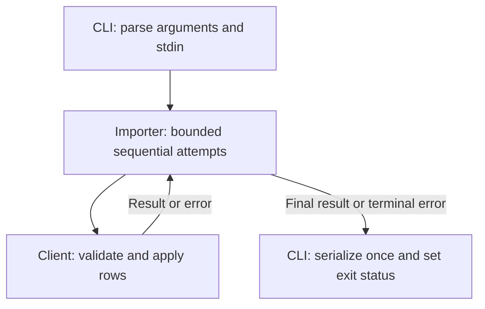
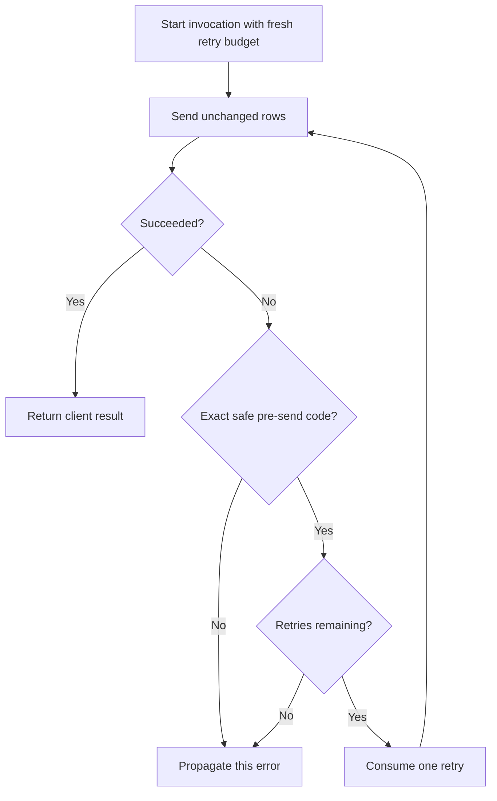

# Safe Order Import Retries - Plan

## Goal Capsule

- **Objective:** Operators can finish an order import after a recoverable temporary failure without manually restarting the batch.
- **Recommended approach:** Extend the existing importer with bounded, sequential retries for the fixture’s explicitly safe pre-send error.
- **Authority:** The unchanged Product Contract owns the requirements. The supplied synthetic `CONTRACT.md` and inspected client/CLI source establish the local replay and compatibility boundaries.
- **Decision focus:** Retry only `TRANSIENT_BEFORE_SEND`, permit one initial attempt plus three retries, and preserve the final error.
- **Verification focus:** Attempt limits, application counts, invocation isolation, and exact CLI stdout/stderr/exit behavior.
- **Largest risk:** Replaying an operation whose response was lost after application could duplicate orders.
- **Stop condition:** Revisit this plan if the retryable error can occur after application or if implementation targets a real service instead of the supplied fixture.
- **Execution boundary:** This is a plan-only delivery. No implementation, test execution, filesystem mutation, or release is authorized by this artifact. The caller owns saving the returned Markdown and any later execution decision.

**Target repository:** `spec-first`.

**Assigned fixture root:** `docs/validation/ce-skill-optimization-2026-10-29/remaining-27-acceptance/follow-up-20261031/plan-inputs/`.

Short source references such as `src/client.js` below identify files beneath that fixture root, not the repository’s production CLI. Implementation file lists use complete repository-relative paths. The original plan’s date and active lifecycle are retained; this enrichment uses the supplied 2026-10-31 synthetic contract.

---

<!-- PRODUCT_CONTRACT_START -->
## Product Contract

### Problem Frame

批量订单导入在一次临时网络错误后整体失败，运营人员只能手工重跑整批任务。

### Requirements

- **R1:** 临时网络错误最多重试 3 次。
- **R2:** 校验错误必须立即失败，不得重试。
- **R3:** 保持现有 CLI 成功与失败输出兼容。

### Actors

- **A1:** 运行批量导入的运营人员。

### Key Flows

- **F1:** 运营人员提交有效订单；首次请求遇到临时网络错误；系统重试并成功返回。

### Acceptance Examples

- **AE1:** 给定前两次请求返回临时网络错误，第三次成功时，导入成功且总调用次数为 3。
- **AE2:** 给定输入校验失败时，导入立即失败且只调用一次。

### Scope Boundaries

- 不引入持久化队列或后台任务系统。
- 不改变 CLI 输出字段。
<!-- PRODUCT_CONTRACT_END -->

---

## Planning Contract

Product Contract unchanged (byte-preserved upstream source slice)

### Summary

Extend the existing importer’s single-send path. Keep row validation and application semantics in the client, and retain CLI serialization in the CLI. The implementation adds no persistence, retry service, dependency, or production integration.

This is a Standard plan because retry safety and process-visible compatibility require explicit failure-path coverage despite the small implementation surface.

### Key Technical Decisions

- KTD1. **Extend the importer; reuse the client and CLI.** `src/order-importer.js` already owns the invocation boundary and currently returns `client.send(rows)`. It is the focused extension point for retry sequencing. `src/client.js` remains authoritative for validation, error timing, and application; `src/cli.js` remains authoritative for process output. A generic retry wrapper would add an unnecessary boundary. Governs R1–R3.

- KTD2. **Use the exact safe error code as the allowlist.** `TRANSIENT_BEFORE_SEND` is the only retryable code. The inspected client throws it before `applied.push`, and `CONTRACT.md` explicitly permits repeating the input after this error. Validation, authentication, unknown, and ambiguous outcomes terminate immediately. Generic timeout, message matching, or “network error” inference would exceed the supplied replay permission. Governs R1 and R2.

- KTD3. **Count retries separately from the initial attempt.** Each invocation may make at most four sends: one initial attempt and three retries. Calls are sequential, stop at first success, and reuse the supplied rows without importer mutation. Retry accounting belongs to the invocation, never to a module-global variable or the client’s diagnostic attempt counter. The supplemental contract resolves the bound explicitly. Governs R1 and F1.

- KTD4. **Preserve the successful result and terminal rejection.** Return the client result without adding metadata. On a nonretryable failure or exhaustion, propagate the actual terminal error rather than wrapping it, returning an earlier error, or inventing partial success. The final error’s identity, code, and message should remain observable to direct callers. Governs R2 and R3.

- KTD5. **Preserve CLI formatting while allowing recovery to change the outcome.** Success remains a single JSON result line on stdout with empty stderr and exit 0. Failure remains a single JSON error line on stderr with empty stdout and exit 1. The `transient` scenario is expected to become successful because its injected sequence contains one transient failure and then defaults to success. That outcome change is required behavior, not an output compatibility regression. Governs R1 and R3.

- KTD6. **Retain foreground completion and terminal visibility.** The CLI continues awaiting the import in the same invocation. The research return’s KD-1 rejects background scheduling, consistent with the preserved scope boundary. “Synchronous import” here means foreground completion, not blocking JavaScript I/O. No compensation is attempted after `OUTCOME_UNKNOWN`: the fixture has already applied the rows and supplies no reversal capability. Governs R1–R3.

### Interface Contracts

**Importer/client boundary — evolution.** The canonical descriptive contract is fixture `CONTRACT.md`; the executable owners are `src/order-importer.js` and `src/client.js`. Known consumers are the fixture CLI and its tests. Preserve the existing inputs and promise-based result/error behavior while changing the number of sends only as KTD2–KTD4 permit. This is a contract-authorized recovery change with unchanged result fields. U1 owns implementation and importer contract tests.

**CLI boundary — evolution.** `src/cli.js` and fixture `CONTRACT.md` own argument handling, stdin parsing, output channels, JSON serialization, and exit status. The operator A1 and subprocess tests are the known consumers. No new public option, output field, schema version, or compatibility window is needed. U2 owns real-process verification.

**Validation boundary.** Continue delegating row validation to the client. Invalid rows must still reach one send and fail before application. Do not introduce importer prevalidation that changes AE2’s call count or copies client rules.

**Error boundary.** Only the declared pre-send error authorizes replay. An absent or unfamiliar code carries no retry permission. The supplied contract makes no remote idempotency, timeout, deduplication, or exactly-once guarantee.

### High-Level Technical Design

The component responsibilities remain:

The importer’s decision path is:

There is at most one outstanding send per invocation. A terminal outcome ends that invocation; no subsequent outcome from the client’s injector is consumed.

### Assumptions

- **Planning-time assumption:** Immediate sequential retries are adequate for this local failure injector. No delay, jitter, timing SLA, or rate-limit policy is specified. Production retry pacing requires separate service evidence and is not established here.
- **Planning-time assumption:** Callers do not concurrently mutate the rows during an import. The importer will not clone, normalize, or mutate them.
- The supplied fixture is the entire implementation target. Readiness does not extend to an unseen production client or historical CLI.

These assumptions are not user-approved or session-settled decisions.

### Implementation Scope Boundaries

In scope: the fixture importer, focused tests, and updating fixture documentation to distinguish the historical characterization baseline from implemented retry behavior.

Out of scope: production order services, real network providers, persistence, queues, background tasks, idempotency keys, deduplication storage, automatic compensation, new CLI flags, configurable retry budgets, and unrelated spec-first source or generated runtime changes.

The inspected files are supplied fixture source. Host runtime mirrors are neither implementation targets nor evidence for this change.

### Evidence & Limitations

- **Direct source inspection:** `src/order-importer.js` contains a single send with no retry loop. Its original unit test checks forwarding only.
- **Direct client evidence:** Validation and `TRANSIENT_BEFORE_SEND` happen before application. `OUTCOME_UNKNOWN` happens after application. Exhausting the injected sequence defaults to success, so exhaustion tests must inject at least four transient outcomes.
- **Direct CLI evidence:** `src/cli.js` awaits the importer, writes the result with one trailing newline, and serializes a caught error’s code/message unchanged. Argument validation precedes stdin parsing.
- **Attributed research:** Fixture `research-return.md` reports parent inspection, not independent research. Its C-1 finding matches the inspected importer. Its KD-1 is a synthetic fixture decision, not a project-owner approval.
- **Supplied execution evidence:** `docs/validation/ce-skill-optimization-2026-10-29/remaining-27-acceptance/follow-up-20261031/plan-contract-verification.json` records exit code 0 for the two fixture test files. Its named log, `.spec-first/workflows/spec-work/spec-first/ce-opt-followup-20261031/logs/plan-contracts.log`, reports 15 passing tests and no failures.
- **Evidence authority:** Those test results are parent-supplied characterization evidence. I inspected the receipt and log but did not run the command. The receipt contains no final-source fingerprint, so it does not bind future implementation results to a final revision.
- **Freshness and scope:** The client/CLI contract was newly authored on 2026-10-31. It does not establish historical production behavior, production safety, or readiness of an earlier trial.
- **Research limits:** No network research, repository-wide history, current runtime, or independent research worker was used. Worker dispatch was prohibited (`dispatch_authorization_missing`); inline source analysis was used instead.
- **Workspace limits:** Git identity and dirty state were not inspected within this bounded assignment. A later authorized implementation owner must recheck source freshness and protect unrelated changes before editing.

---

## Implementation Units

### U1. Implement bounded safe retries and importer regression coverage

**Goal:** Recover from permitted pre-send failures without replaying terminal outcomes.

**Requirements:** R1, R2, R3; F1; AE1 and AE2. Apply KTD1–KTD4 and KTD6.

**Dependencies:** None.

**Files:**

- `docs/validation/ce-skill-optimization-2026-10-29/remaining-27-acceptance/follow-up-20261031/plan-inputs/src/order-importer.js`
- `docs/validation/ce-skill-optimization-2026-10-29/remaining-27-acceptance/follow-up-20261031/plan-inputs/tests/order-importer.test.js`
- `docs/validation/ce-skill-optimization-2026-10-29/remaining-27-acceptance/follow-up-20261031/plan-inputs/tests/client-cli.test.js`

**Approach:** Extend the existing importer in place. Keep the retry budget local, await each send before another starts, and preserve final values. Reuse the real synthetic client for application-state assertions; use small controlled clients where error identity or overlapping calls must be observed.

**Execution note:** Establish the retry and non-replay assertions before changing the importer. Replace the existing test named “the original importer still performs one attempt without implementing retries” with the intended recovery expectation; retaining it unchanged would contradict R1.

**Patterns to follow:** CommonJS exports, `node:test`, `node:assert/strict`, the existing injected `send` seam, and the client’s `attempts`/`applied` diagnostics.

**Test scenarios:**

1. Immediate success performs one send and returns the exact supplied result; the existing forwarding case remains valid.
2. Covers F1 / AE1. Two transient failures followed by success produce three sends and exactly one application of each input row.
3. Three transient failures followed by success consume the last permitted retry: four sends and one application.
4. Four distinct transient errors followed by an unused success exhaust the budget after four sends. Assert rejection with the fourth error object and no application.
5. Covers AE2. Invalid rows fail after one send with `INVALID_ORDER` and no application, even when the injected outcome would otherwise be transient or ambiguous.
6. `AUTH_FAILED` and `UNCLASSIFIED` each terminate after one send with no application.
7. `OUTCOME_UNKNOWN` terminates after one send with rows applied exactly once; a subsequent injected success must remain unused.
8. A transient failure followed by a nonretryable failure stops after the second send and preserves that second error. Include an ambiguous second outcome and assert one application.
9. An error without a code is propagated unchanged after one send.
10. Empty input succeeds with `imported: 0`; multiple valid rows retain their order and identities.
11. Verify the same rows object reaches every retry and the importer does not mutate it.
12. Separate sequential invocations each receive a fresh budget, including when reusing a client.
13. Interleave two imports with controlled asynchronous clients. Each retains its own budget, and neither invocation starts a second send while its previous send remains pending.

**Verification:** Focused tests establish the four-send ceiling, exact terminal propagation, no replay after ambiguous application, and invocation-local state. Update only baseline expectations invalidated by the intentional behavior change.

### U2. Verify CLI compatibility through the real process path

**Goal:** Preserve the operator-visible interface while allowing recovered imports to succeed.

**Requirements:** R3, R1; A1 and F1. Apply KTD4 and KTD5.

**Dependencies:** U1.

**Files:**

- `docs/validation/ce-skill-optimization-2026-10-29/remaining-27-acceptance/follow-up-20261031/plan-inputs/tests/client-cli.test.js`

**Approach:** Keep `src/cli.js` unchanged unless a directly demonstrated compatibility defect requires a scoped correction. Update the transient subprocess expectation to success. Preserve exact-byte assertions for all other existing cases.

For an exhausted retry sequence, use a subprocess-local test bootstrap that supplies the existing client factory with four transient outcomes before loading the actual CLI. Keep this injection inside the test process; do not add public flags or duplicate CLI serialization in a test replacement.

**Patterns to follow:** Existing `spawnSync` tests using the current Node executable, JSON stdin, and separate assertions for stdout, stderr, and status.

**Test scenarios:**

1. Default success produces exactly `{"imported":1}\n`, empty stderr, and exit 0.
2. The existing transient scenario recovers and produces the same success bytes, without intermediate diagnostics.
3. Auth, unknown, and ambiguous scenarios retain their existing exact error bytes, empty stdout, and exit 1.
4. Exhausted transient retries exercise the real CLI handler and produce exactly `{"error":{"code":"TRANSIENT_BEFORE_SEND","message":"Request not sent"}}\n`, empty stdout, and exit 1.
5. Invalid rows retain `INVALID_ORDER` / `Invalid order rows`.
6. Invalid JSON retains `INPUT_JSON` / `Invalid JSON input`.
7. Unsupported arguments retain `USAGE` / `Unsupported arguments`.
8. Empty and multi-row successful imports preserve the existing result shape and correct imported count.

**Verification:** Actual child-process results prove channel, newline, JSON field, and exit compatibility. Importer tests supply the associated attempt/application proof; stdout alone is not evidence of duplicate prevention.

### U3. Align fixture documentation and close the evidence record

**Goal:** Make implemented behavior and its proof distinguishable from the original characterization baseline.

**Requirements:** R1–R3 and the preserved scope boundaries.

**Dependencies:** U1 and U2.

**Files:**

- `docs/validation/ce-skill-optimization-2026-10-29/remaining-27-acceptance/follow-up-20261031/plan-inputs/CONTRACT.md`
- `docs/validation/ce-skill-optimization-2026-10-29/remaining-27-acceptance/follow-up-20261031/plan-inputs/docs/plans/2026-07-31-001-feat-order-import-plan.md`

**Approach:** Once implementation is verified, update current-tense claims that the importer is unchanged or single-send. Preserve the synthetic origin and historical characterization provenance. Document the intentional transient recovery result and remaining terminal behavior. Keep the Product Contract untouched.

The execution owner records actual commands, exits, relevant assertions, and source identity in its completion evidence. The supplied parent receipt and original log remain historical evidence and must not be rewritten to imply they tested retries.

**Test expectation:** No new behavioral test solely for documentation. Reconcile the documentation against U1/U2 results and verify Product Contract preservation.

**Verification:** Readers can identify what was characterized before implementation, what was verified afterward, and which claims remain restricted to the synthetic fixture.

---

## Verification Contract

### Required Proof

| Intent | Status | Proof owner | Required outcome |
|---|---|---|---|
| Recovery and retry ceiling | Required; not run | U1 | AE1 passes; success on attempt four is allowed; attempt five never occurs |
| Validation and terminal failures | Required; not run | U1 | AE2 passes; auth, unknown, absent-code, and ambiguous failures stop immediately |
| Replay safety | Required; not run | U1 | Transient attempts apply nothing; success or ambiguous outcome applies rows once |
| Invocation isolation | Required; not run | U1 | Sequential and overlapping imports have independent retry budgets |
| CLI compatibility | Required; not run | U2 | Exact stdout, stderr, newline, JSON fields, and exit status match the declared outcomes |
| Fixture documentation and Product Contract | Required; pending save/implementation | Caller and U3 | Original Product Contract slice remains unchanged; evidence provenance is accurate |
| Production network safety | Not applicable to this fixture | Future service owner | Separate service contract and application-timing proof required before production adoption |

**Product Contract confirmation:** Inherited from the assigned `spec-brainstorm` artifact. No independent human approval is asserted.

**Largest unproven risk:** The future implementation might retry after application or exceed the allowed attempt count. Existing characterization checks do not prove the future loop is correct.

### Execution-Time Checks

The fixture’s declared test command is `npm test`, run with the assigned fixture root as the working directory. It expands to `node --test tests/*.test.js`.

The narrow test selection is `node --test tests/order-importer.test.js tests/client-cli.test.js` from the same directory. These are future verification commands, not commands run during planning.

The test runtime must support the existing `node:test` and `Object.hasOwn` usage. No additional test framework, build, dependency installation, production service, or release validation is required for this synthetic change.

### Evidence Reconciliation

At implementation closeout, every required proof above must have an actual result tied to the implemented source, or remain explicitly unverified. A green historical receipt cannot close a new proof intent.

Preserve exact failures and distinguish assertions about invocation counts from assertions about applied state. Do not describe local fixture tests as real network, production idempotency, or deployment evidence.

This reconciliation is a workflow-level semantic exit check, not a claimed runtime-enforced gate.

### Planning Review Status

Confidence check passed for the bounded fixture: retry classification, attempt count, error preservation, consumer compatibility, and source ownership are grounded in supplied source and contract evidence.

A single producer self-review checked requirement traceability, scope, dependency order, terminal outcomes, and plan completeness. Independent review was not run because this assignment prohibited delegation and other workflow invocation.

- `review_source: producer-self-review`
- `review_status: degraded`
- `reason_code: spec_doc_review_capability_unavailable`
- `independent_review: not_run`
- `mutation_policy: report-only`
- `fixes_applied: 0`
- Independent reviewer counts and coverage: unknown.
- Known blocking planning findings: none identified within the supplied fixture scope.

No files or tests were changed or executed by the planner. The returned Product Contract was copied from the supplied source; a saved-file byte comparison remains the caller’s responsibility because this assignment permits chat delivery only.

---

## Risks and Operational Boundaries

- **Duplicate application:** Fail closed on all outcomes except the explicitly safe pre-send error. An ambiguous result is a visible terminal failure even though application occurred.
- **Misleading exhaustion tests:** The client defaults to success after its injected sequence ends. Provide four transient outcomes to test exhaustion and an additional sentinel outcome to detect a forbidden fifth send.
- **Compatibility regression disguised as test cleanup:** Only the single-send importer characterization and transient CLI outcome should change because of retry recovery. Preserve unrelated terminal cases.
- **Unbounded time:** Four attempts bound calls, not elapsed time. No timeout or cancellation contract is supplied. Do not invent a wall-clock guarantee.
- **Fixture-to-production extrapolation:** Before any real integration, the service owner must establish error timing, idempotency needs, retry pacing, and ambiguous-outcome recovery. This plan does not approve that integration.
- **Rollback:** A later implementation owner can revert the focused retry change and its new expectations to restore single-send behavior. This stops future automatic retries; it cannot undo rows already applied by an ambiguous request. No automatic manual-rerun recommendation is safe for that outcome.

---

## Definition of Done

- U1 satisfies the retry budget, safe classification, terminal propagation, and invocation-isolation scenarios.
- U2 verifies the actual CLI process with exact output-channel and exit assertions, including recovery and exhaustion.
- U3 accurately distinguishes the old characterization baseline from newly verified implementation behavior.
- R1–R3 and F1/AE1/AE2 are covered by concrete results.
- The Product Contract region remains byte-for-byte unchanged in the saved plan.
- Required-proof reconciliation is complete for the implemented source.
- No unrelated source, generated runtime, client application semantics, CLI output fields, or public flags changed.
- Abandoned code and test scaffolding without continuing value are removed.
- Completion claims remain limited to the synthetic fixture.
- Implementation and verification are not claimed complete by this planning delivery.

---

## Sources

The following sources were inspected within the assigned fixture:

- `src/order-importer.js`
- `src/client.js`
- `src/cli.js`
- `tests/order-importer.test.js`
- `tests/client-cli.test.js`
- `package.json`
- `CONTRACT.md`
- `research-return.md`
- `docs/plans/2026-07-31-001-feat-order-import-plan.md`

Supplied characterization evidence:

- `docs/validation/ce-skill-optimization-2026-10-29/remaining-27-acceptance/follow-up-20261031/plan-contract-verification.json`
- `.spec-first/workflows/spec-work/spec-first/ce-opt-followup-20261031/logs/plan-contracts.log`
