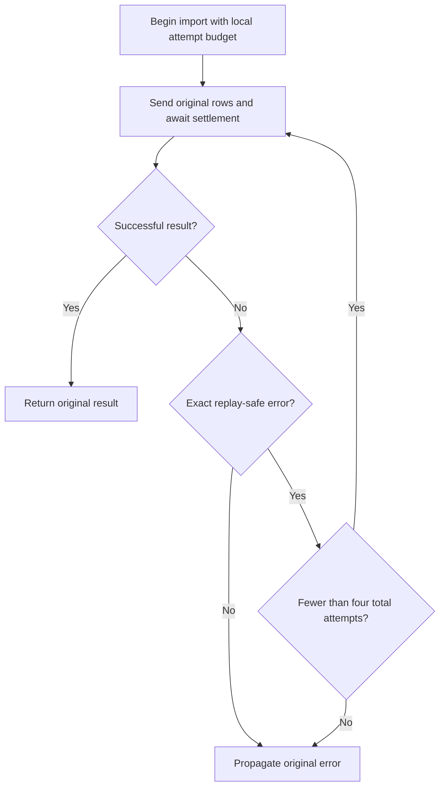

# Safe Order Import Retries - Plan

## Goal Capsule

Enable operators to complete an order import despite a recoverable pre-send failure.

- **Approach:** Extend the existing importer with bounded, sequential retries using the synthetic client's explicit replay-safe error.
- **Authority:** The preserved Product Contract owns the requested behavior. The supplied synthetic contract and executable source constrain implementation. Planning judgment selects the implementation structure.
- **Decision focus:** Retry eligibility, the four-attempt ceiling, invocation-local state, and unchanged terminal error propagation.
- **Verification focus:** Recovery, exhaustion, validation, ambiguous application, invocation isolation, and exact CLI stdout/stderr/exit behavior.
- **Largest risk:** Replaying an operation that already applied rows. `OUTCOME_UNKNOWN` must terminate without another send.
- **Stop conditions:** Revisit readiness if the client no longer guarantees that the allowlisted error occurs before application, the CLI contract changes, or the target expands beyond the supplied fixture.
- **Execution profile:** Standard-depth, local CommonJS implementation with Node's built-in test runner. Implementation and testing require a subsequent authorized execution task.
- **Tail ownership:** This producer returns Markdown for parent-mediated saving. The caller owns persistence and any subsequent execution, acceptance, or landing.

**Target repository:** `spec-first`.

**Implementation boundary:** `docs/validation/ce-skill-optimization-2026-10-29/remaining-27-acceptance/follow-up-20261031/plan-inputs/`.

The plan retains its existing filename and lifecycle status. Planning enrichment is dated 2026-10-31. Readiness applies only to this newly authored synthetic input; it makes no historical or production-readiness claim.

---

<!-- PRODUCT_CONTRACT_START -->
## Product Contract

### Problem Frame

批量订单导入在一次临时网络错误后整体失败，运营人员只能手工重跑整批任务。

### Requirements

- **R1:** 临时网络错误最多重试 3 次。
- **R2:** 校验错误必须立即失败，不得重试。
- **R3:** 保持现有 CLI 成功与失败输出兼容。

### Actors

- **A1:** 运行批量导入的运营人员。

### Key Flows

- **F1:** 运营人员提交有效订单；首次请求遇到临时网络错误；系统重试并成功返回。

### Acceptance Examples

- **AE1:** 给定前两次请求返回临时网络错误，第三次成功时，导入成功且总调用次数为 3。
- **AE2:** 给定输入校验失败时，导入立即失败且只调用一次。

### Scope Boundaries

- 不引入持久化队列或后台任务系统。
- 不改变 CLI 输出字段。
<!-- PRODUCT_CONTRACT_END -->

---

## Planning Contract

Product Contract unchanged (byte-preserved upstream source slice)

### Summary

The importer currently forwards one call to the injected client. Extend that owner to retry only failures explicitly authorized by the synthetic client contract. Keep client validation, application semantics, and CLI serialization in their existing owners.

### Key Technical Decisions

- KTD1. **Extend the importer; reuse the client and CLI.** The importer already owns the call boundary and receives its client as an argument. It can absorb the bounded retry policy without a shared retry framework, wrapper, queue, or new dependency. The client remains authoritative for validation and application timing; the CLI remains authoritative for process-visible output. This implements R1–R3 without duplicating domain validation.

- KTD2. **Retry only `TRANSIENT_BEFORE_SEND`.** The supplied contract authorizes replay for this exact code, and the client source throws it before appending rows. Authentication errors, validation errors, unclassified errors, and ambiguous outcomes are terminal. Do not infer retryability from message text, generic timeout/network codes, or an error's apparent severity. This is a fixture-specific guarantee, not an idempotency guarantee for a remote service.

- KTD3. **Use one initial attempt plus at most three retries.** The synthetic contract resolves R1's attempt-count interpretation. Await each send before deciding whether another is allowed. A success on the fourth call is valid; four consecutive retryable failures propagate the fourth failure without a fifth call. Budget state belongs to one importer invocation and resets for the next invocation.

- KTD4. **Preserve the successful value and terminal error.** Return the client's successful result without adding metadata. Propagate the terminal error object unchanged, including its code and message. When a retry is followed by a permanent or ambiguous error, stop at that error immediately. No fallback success, error wrapper, compensation, or automatic batch restart is permitted.

- KTD5. **Preserve CLI serialization while updating recovery expectations.** R3 preserves output fields, stream placement, newline, and exit status for the resulting outcome. The existing `transient` scenario injects one transient failure and then defaults to success, so its expected result changes from failure to success under R1. Other terminal cases retain their exact current output. CLI exhaustion coverage uses test-only subprocess injection rather than a new production flag.

The supplied `research-return.md` attributes KD-1 to the fixture owner: retain completion within the caller's import operation rather than introduce a background queue. That decision is consistent with the Product Contract. It is not recorded as a new user-approved production decision.

### Interface Contracts

**Importer/client boundary — evolution.** The importer is consumed by the CLI and importer tests. Its contract authority is the synthetic `CONTRACT.md`, grounded in the importer and client source listed under Sources. Input rows remain forwarded to the existing client; successful output remains `{ imported: rows.length }` for that client. Validation remains client-owned. The compatible behavior change is recovery from the one declared pre-send error. No signature, schema version, dependency, or new public option is required.

**CLI boundary — evolution.** The CLI is consumed by its operator and process-level tests. The canonical baseline is the supplied `CONTRACT.md`, grounded in the CLI source. Success writes exactly one JSON result line to stdout, leaves stderr empty, and exits 0. Terminal failure writes no stdout, writes exactly one JSON error line to stderr, and exits 1. U2 owns executable consumer verification.

No interface is removed, so a deprecation window is unnecessary. Rollback restores the previous single-send importer and its corresponding transient expectations; it cannot undo rows already applied by a client.

### High-Level Technical Design

The call boundary remains CLI → importer → client. The retry decision stays inside the importer.

The client may apply rows before returning an ambiguous error. The terminal branch deliberately leaves that application state intact; the importer has neither a reconciliation API nor authority to undo it.

### Assumptions

- Immediate sequential retries are sufficient for this local fault injector. No delay or backoff requirement was supplied. This is a bounded planning assumption, not a production latency or load-management decision.
- Callers do not mutate the rows while an import is in flight. The importer preserves the existing forwarding behavior rather than introducing cloning or snapshot semantics.
- A future execution owner will re-read the fixture before editing. The planning session did not establish a Git revision or inspect unrelated worktree changes because its read scope was restricted.

These assumptions do not resolve missing production contracts. Any real-provider application requires a separate assessment of replay safety, request identity, load, and ambiguous-outcome recovery.

### Implementation Scope Boundaries

Active work covers R1–R3 in the supplied fixture and their direct importer/CLI tests.

- No persistent queue, background worker, retry library, client-side duplicate store, or additional validation layer.
- No CLI fields, retry messages, progress output, public retry controls, or new scenario flags.
- No change to authentication or authorization behavior.
- No production service integration, rollout, telemetry system, or automatic recovery of an ambiguous application.
- No changes to spec-first workflow source or generated host runtime.

### Evidence & Limitations

Direct source inspection established:

1. The importer returns a single `client.send(rows)` call; it has no retry loop.
2. The client increments `attempts` on each send, validates rows before application, and applies rows before throwing `OUTCOME_UNKNOWN`.
3. The client exposes `applied` as a copied diagnostic array; it provides no deduplication mechanism.
4. The CLI constructs a client with one selected outcome. An exhausted outcome sequence defaults to success.
5. The original importer test checks forwarding only. The newer characterization suite covers client timing and process-visible CLI behavior, including an explicit assertion that retries are not yet implemented.

The supplied research return is parent-authored source inspection, not independent research. Its C-1 finding was re-grounded in the supplied importer and tests.

The named parent receipt, `docs/validation/ce-skill-optimization-2026-10-29/remaining-27-acceptance/follow-up-20261031/plan-contract-verification.json`, records `exit_code: 0` for the two supplied test files. This is **transcribed parent characterization evidence**. It does not prove the planned retry behavior and does not identify a final implementation revision. The linked raw log was not inspected.

No tests, builds, implementation probes, network requests, helper execution, or writes were performed by this plan producer. Independent worker research was prohibited: `dispatch_authorization_missing`. External research was also prohibited and is unnecessary to define this closed synthetic contract.

The new client and CLI are 2026-10-31 synthetic inputs. They must not be presented as previously omitted historical source, production compatibility evidence, or retroactive proof of another plan's readiness.

### Risks and Recovery

| Risk | Consequence | Control and proof |
|---|---|---|
| Broad error classification | Duplicate application after an ambiguous result | Exact allowlist; verify one send and one application for `OUTCOME_UNKNOWN` |
| Off-by-one attempt counting | Excess sends or premature failure | Test success on call four and exhaustion before call five |
| Shared retry state | One import consumes another import's allowance | Sequential and interleaved invocation tests |
| Error wrapping | Changed caller identity or CLI message | Assert terminal error identity and exact process output |
| Obsolete characterization assertions | Correct recovery fails the old suite, or broad test deletion hides regressions | Replace only single-send/transient expectations; retain permanent-failure characterizations |

Final failure remains observable to the caller. For an ambiguous result, an operator must not infer that nothing applied or blindly replay the batch. This fixture exposes no operational reconciliation procedure. Production recovery remains outside this plan.

---

## Implementation Units

### U1. Implement bounded retries at the existing importer boundary

**Goal:** Recover replay-safe failures while preserving terminal outcomes and application safety.

**Requirements:** R1, R2, R3; A1, F1, AE1, AE2; KTD1–KTD4.

**Dependencies:** None.

**Files:**

- Modify `docs/validation/ce-skill-optimization-2026-10-29/remaining-27-acceptance/follow-up-20261031/plan-inputs/src/order-importer.js`.
- Extend `docs/validation/ce-skill-optimization-2026-10-29/remaining-27-acceptance/follow-up-20261031/plan-inputs/tests/order-importer.test.js`.
- Update the superseded importer-baseline case in `docs/validation/ce-skill-optimization-2026-10-29/remaining-27-acceptance/follow-up-20261031/plan-inputs/tests/client-cli.test.js`.

**Approach:**

1. Keep retry bookkeeping inside each importer invocation.
2. Await each send and apply the eligibility and budget decisions from KTD2–KTD3.
3. Forward the same rows and retain the existing client method receiver.
4. Return or propagate exactly as KTD4 specifies.
5. Replace the test asserting that the importer never retries with the new recovery assertion. Preserve direct-client timing and permanent-failure characterization tests.

**Execution note:** Establish failing behavior tests before changing the importer. Use the real synthetic client for application-state evidence and narrow injected clients for exact error identity and controlled interleaving.

**Patterns to follow:** Existing CommonJS exports, dependency injection, `node:test`, and strict assertions in the supplied files.

**Test scenarios:**

- Immediate success: one call, original result returned, original rows forwarded, and rows applied once.
- Covers F1 / AE1. Two transient failures followed by success: three calls, successful result, and one application of each input row.
- Three transient failures followed by success: four calls and one application.
- Four transient failures followed by an otherwise available success: four calls, no application, and the fourth error propagated unchanged; the fifth outcome is never consumed.
- Covers AE2. Invalid rows: one call, `INVALID_ORDER`, and no application.
- Each of `AUTH_FAILED`, `UNCLASSIFIED`, and `OUTCOME_UNKNOWN` on the first call: one call and the original error. Application is empty for the first two and occurs exactly once for the ambiguous outcome.
- A transient error followed by each terminal class: stop on the second call; do not consume a later success. Include validation failure through an injected client without adding importer validation.
- A generic network-looking error, missing error code, or non-Error rejection: no retry and no replacement classification error.
- Empty valid input: one successful call returning an imported count of zero.
- A completed or exhausted invocation followed by another invocation: the second invocation gets its full independent allowance.
- Two interleaved invocations with independently controlled clients: each receives its own budget, and no invocation starts overlapping sends.
- Distinct retryable error objects: exhaustion returns the exact final object, rather than the first failure or a wrapper.

**Verification:** The importer tests establish the retry ceiling, safe replay boundary, error preservation, and independent state. The characterization suite contains no remaining assertion that incorrectly requires the importer to fail after a recoverable first attempt.

### U2. Verify CLI compatibility across recovered and terminal outcomes

**Goal:** Prove R3 at the actual process boundary after U1.

**Requirements:** R3; R1, R2, F1, AE1, AE2; KTD4–KTD5.

**Dependencies:** U1.

**Files:**

- Modify `docs/validation/ce-skill-optimization-2026-10-29/remaining-27-acceptance/follow-up-20261031/plan-inputs/tests/client-cli.test.js`.
- Read and preserve the serializer in `docs/validation/ce-skill-optimization-2026-10-29/remaining-27-acceptance/follow-up-20261031/plan-inputs/src/cli.js`.

**Approach:**

1. Retain the existing subprocess assertion pattern.
2. Replace the transient scenario's old failure expectation with the recovered success expectation.
3. Retain exact success and terminal-failure checks for other scenarios.
4. Exercise repeated transient exhaustion through a subprocess-local test override of the client factory before loading the real CLI. Keep the real importer, stdin parsing, serializer, and exit handling. Do not expose a production option merely to drive this test.

**Test scenarios:**

- Ordinary success with one row: stdout `{"imported":1}\n`, empty stderr, exit 0.
- The existing transient scenario: the same success output, empty stderr, exit 0; no intermediate error line.
- Four injected transient failures: empty stdout, stderr `{"error":{"code":"TRANSIENT_BEFORE_SEND","message":"Request not sent"}}\n`, exit 1.
- Authentication, ambiguity, and unknown scenarios: their exact baseline error code/message, empty stdout, exit 1.
- Invalid rows: `INVALID_ORDER` / `Invalid order rows`, empty stdout, exit 1.
- Invalid JSON: `INPUT_JSON` / `Invalid JSON input`, empty stdout, exit 1.
- Unsupported arguments: `USAGE` / `Unsupported arguments`, empty stdout, exit 1.
- Empty valid input: stdout `{"imported":0}\n`, empty stderr, exit 0.

**Verification:** The real CLI process preserves stream separation, exact JSON shape, trailing newline, and exit status. The only intended baseline outcome change is recovery of the eligible transient failure. Test injection stays inside the test process.

### U3. Align the synthetic contract and close acceptance evidence

**Goal:** Leave documentation and final evidence consistent with the implemented fixture.

**Requirements:** R1–R3; KTD1–KTD5.

**Dependencies:** U1, U2.

**Files:**

- Update `docs/validation/ce-skill-optimization-2026-10-29/remaining-27-acceptance/follow-up-20261031/plan-inputs/CONTRACT.md`.
- Preserve the Product Contract in `docs/validation/ce-skill-optimization-2026-10-29/remaining-27-acceptance/follow-up-20261031/plan-inputs/docs/plans/2026-07-31-001-feat-order-import-plan.md`.

**Approach:** Update statements describing the importer as unchanged and single-send once that is no longer true. Preserve the synthetic origin and original characterization attribution. Explain the recovered transient CLI outcome without changing the terminal-output contract. Record new implementation verification separately from the historical parent receipt.

**Test expectation:** No additional behavioral test solely for prose changes. U1 and U2 own behavioral coverage.

**Verification:** Documentation matches final source, the upstream Product Contract remains byte-identical, and final results clearly distinguish newly executed checks from the supplied baseline receipt.

---

## Verification Contract

**Product Contract confirmation:** `inherited`, from the supplied requirements-only artifact. No independent Product Owner or human approval occurred during this planning run.

**Largest unproven risk:** The future retry implementation might replay an applied operation or permit a fifth send. Source inspection establishes the synthetic failure semantics; only execution against the changed importer can prove the implementation respects them.

The future executor must run the fixture's own test script, not substitute the unrelated repository-wide test suite:

`npm --prefix docs/validation/ce-skill-optimization-2026-10-29/remaining-27-acceptance/follow-up-20261031/plan-inputs test`

The supplied package maps this to `node --test tests/*.test.js`. This command was **not run by the plan producer**.

| Proof intent | Requirement | Owner | Current status | Required result |
|---|---|---|---|---|
| Successful recovery and attempt ceiling | Required | U1 | Not run for new behavior | AE1, fourth-call success, and no fifth call all pass |
| Permanent failure and ambiguous application | Required | U1 | Parent baseline only | Immediate stop, unchanged error, and expected application state |
| Invocation isolation and sequential sends | Required | U1 | Not run | Independent budgets and no overlapping sends within an invocation |
| Exact CLI compatibility | Required | U2 | Parent baseline only | Process-level output and exit assertions pass, including recovery and exhaustion |
| Contract/document alignment | Required | U3 | Planned | Final prose matches source; Product Contract comparison succeeds |
| Real-provider safety and production rollout | Not applicable | Outside fixture scope | Not run | No production claim is made |

Final verification must bind results to the executed fixture state through a revision, fingerprint, or equivalent source identity and retain command, exit code, and raw result location. A passing baseline receipt cannot satisfy post-change proof.

Required-proof reconciliation is a workflow-level semantic exit gate, not a claimed runtime enforcement mechanism. Before declaring implementation complete, account for every required row with actual evidence. Any unresolved required proof prevents a complete or verified implementation claim.

---

## Definition of Done

- U1 satisfies its recovery, ceiling, terminal-failure, identity, and isolation scenarios.
- U2 proves exact stdout, stderr, newline, and exit behavior using the real CLI process.
- U3 removes obsolete single-send descriptions while retaining the fixture's synthetic provenance.
- The fixture test suite passes against the final implementation state.
- The Product Contract between its markers is unchanged byte-for-byte.
- No retry framework, queue, new public output field, production retry flag, or generated runtime edit was introduced.
- Abandoned experimental code and disposable test artifacts are removed; unrelated files remain untouched.
- Final evidence identifies the tested source state and reconciles every required proof intent.
- Completion is described as synthetic fixture implementation and verification, without extrapolation to production or historical trials.

---

## Sources

All paths below are relative to the `spec-first` repository.

- `docs/validation/ce-skill-optimization-2026-10-29/remaining-27-acceptance/follow-up-20261031/plan-inputs/src/order-importer.js` — current single-send extension point.
- `docs/validation/ce-skill-optimization-2026-10-29/remaining-27-acceptance/follow-up-20261031/plan-inputs/src/client.js` — validation, failure timing, application state, and diagnostic counters.
- `docs/validation/ce-skill-optimization-2026-10-29/remaining-27-acceptance/follow-up-20261031/plan-inputs/src/cli.js` — process input, serialization, and exit behavior.
- `docs/validation/ce-skill-optimization-2026-10-29/remaining-27-acceptance/follow-up-20261031/plan-inputs/tests/order-importer.test.js` — original forwarding coverage.
- `docs/validation/ce-skill-optimization-2026-10-29/remaining-27-acceptance/follow-up-20261031/plan-inputs/tests/client-cli.test.js` — client and CLI characterization, including assertions that must evolve.
- `docs/validation/ce-skill-optimization-2026-10-29/remaining-27-acceptance/follow-up-20261031/plan-inputs/package.json` — fixture-native test command.
- `docs/validation/ce-skill-optimization-2026-10-29/remaining-27-acceptance/follow-up-20261031/plan-inputs/CONTRACT.md` — newly authored synthetic compatibility and replay contract.
- `docs/validation/ce-skill-optimization-2026-10-29/remaining-27-acceptance/follow-up-20261031/plan-inputs/research-return.md` — attributed parent inspection and fixture decision.
- `docs/validation/ce-skill-optimization-2026-10-29/remaining-27-acceptance/follow-up-20261031/plan-contract-verification.json` — supplied parent characterization receipt.

---

## Delivery and Review Limitations

The confidence check found the synthetic implementation decisions sufficiently grounded; no further deepening was selected. One bounded producer self-review checked requirement traceability, failure paths, unit dependencies, CLI expectation changes, and the preserved Product Contract text.

- `review_source: producer-self-review`
- `review_status: degraded`
- `reason_code: spec_doc_review_capability_unavailable`
- `independent_review: not_run`
- `mutation_policy: report-only`
- `fixes_applied: 0` filesystem changes
- Independent-review coverage and reviewer-only finding counts: unknown

Independent review invocation and delegation were prohibited for this task. No independent-review success is claimed. The returned Markdown reproduces the original Product Contract, but deterministic comparison of the saved artifact remains the parent's responsibility.

This response is the complete plan for mediated saving. No file was saved, implementation started, or test executed by this producer.
