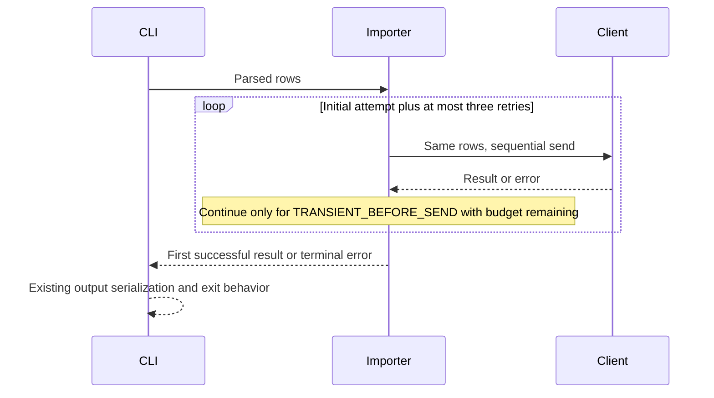
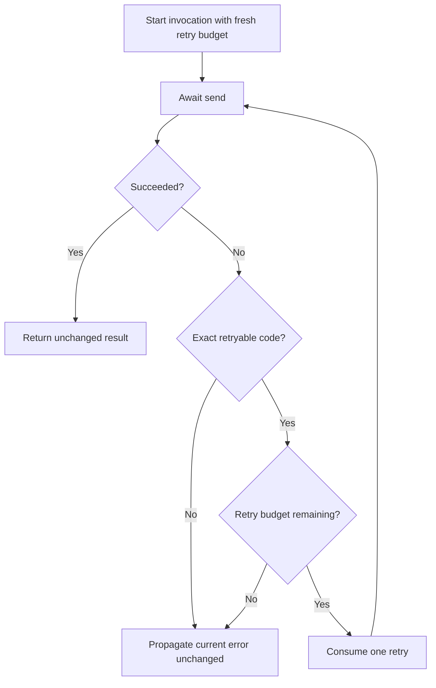

# Safe Order Import Retries - Plan

## Goal Capsule

Enable operators to complete an order import when a recoverable failure occurs before the request is sent.

- **Recommended approach:** Extend the existing importer with a bounded, sequential retry loop using the client’s declared safe-to-retry error.
- **Authority:** The preserved Product Contract owns the requested behavior. The supplied synthetic client, CLI, and `CONTRACT.md` constrain its implementation.
- **Decision focus:** Replay safety, retry exhaustion, invocation isolation, and unchanged CLI serialization.
- **Verification focus:** Exact send counts, actual fixture application state, final-error identity, and stdout/stderr/exit behavior.
- **Largest risk:** Replaying an import whose outcome is unknown can apply orders twice.
- **Scope:** Standard-depth planning for the assigned synthetic fixture only. This is not a production service integration.
- **Stop condition:** If implementation evidence contradicts the client’s before-send guarantee or requires a broader retry policy, return to the contract owner before widening behavior.
- **Execution ownership:** This delivery is a plan only. The parent owns saving it; a subsequently authorized implementation owner owns code changes, verification, and completion.

**Target repository:** `spec-first`.

**Implementation subtree:** `docs/validation/ce-skill-optimization-2026-10-29/remaining-27-acceptance/follow-up-20261031/plan-inputs/`.

All new file references below are repository-relative. The filename retains the existing plan’s date; this enrichment uses supplied fixture evidence dated 2026-10-31.

---

<!-- PRODUCT_CONTRACT_START -->
## Product Contract

### Problem Frame

批量订单导入在一次临时网络错误后整体失败，运营人员只能手工重跑整批任务。

### Requirements

- **R1:** 临时网络错误最多重试 3 次。
- **R2:** 校验错误必须立即失败，不得重试。
- **R3:** 保持现有 CLI 成功与失败输出兼容。

### Actors

- **A1:** 运行批量导入的运营人员。

### Key Flows

- **F1:** 运营人员提交有效订单；首次请求遇到临时网络错误；系统重试并成功返回。

### Acceptance Examples

- **AE1:** 给定前两次请求返回临时网络错误，第三次成功时，导入成功且总调用次数为 3。
- **AE2:** 给定输入校验失败时，导入立即失败且只调用一次。

### Scope Boundaries

- 不引入持久化队列或后台任务系统。
- 不改变 CLI 输出字段。
<!-- PRODUCT_CONTRACT_END -->

---

## Planning Contract

Product Contract unchanged (byte-preserved upstream source slice)

### Summary

Keep retry coordination inside `importOrders`. The client continues to own validation, application, and error classification; the CLI continues to own process-visible serialization. Retry only the explicit pre-send failure and propagate every other failure immediately.

### Key Technical Decisions

- KTD1. **Extend the importer; reuse the client and CLI.** The importer already owns the call boundary between the CLI and client. Extend this owner rather than adding a generic retry service, wrapping the CLI, or duplicating client validation. The client remains authoritative for whether rows were applied. This implements R1–R3 through the existing composition seam.

- KTD2. **Use an exact retry allowlist.** Only `TRANSIENT_BEFORE_SEND` permits replay. The supplied client throws this before application. `INVALID_ORDER`, `AUTH_FAILED`, `OUTCOME_UNKNOWN`, `UNCLASSIFIED`, and errors without the recognized code are terminal. Do not infer retryability from message text, generic network terminology, or a missing response. This implements R1 and R2 without inventing remote idempotency.

- KTD3. **Allow one initial attempt and at most three retries.** Each invocation owns its retry budget. Await each attempt before deciding whether another is allowed; stop immediately on success. Four consecutive retryable failures exhaust the budget. Propagate the final thrown error unchanged, including object identity for direct callers. This follows the supplied `CONTRACT.md` clarification of R1.

- KTD4. **Preserve caller-owned, foreground completion.** Each import returns its eventual result or failure through the existing asynchronous call. No detached work or persistent state is introduced. The supplied `research-return.md` records fixture-owner decision KD-1 rejecting a background queue. That is a synthetic evaluation decision, not evidence of a production owner’s approval or a newly minted session-settled annotation.

- KTD5. **Keep CLI serialization authoritative.** Recovered transient failures become the existing success response. Terminal failures retain their existing error code/message, stream, newline, and exit status. Do not add retry counters, intermediate errors, progress output, or new public flags. R3 protects the output contract; it does not require a recoverable transient scenario to remain a failure.

### Interface Contracts

**Importer/client boundary — evolution**

- **Owners and consumers:** The importer coordinates calls; the supplied client validates and applies rows. Known consumers are the supplied CLI and importer tests. No broader consumer inventory is claimed.
- **Canonical contract:** `docs/validation/ce-skill-optimization-2026-10-29/remaining-27-acceptance/follow-up-20261031/plan-inputs/CONTRACT.md`, interpreted alongside the executable client source.
- **Input/output:** Forward the same rows to the same client without mutation or reordering. Preserve the resolved value returned by the client.
- **Error model:** KTD2 and KTD3 govern retries and final propagation. Client-side validation remains inside `send`, preserving AE2’s one-call behavior.
- **Compatibility:** This is the requested behavioral extension for the declared asynchronous fixture client. No parameter, result-field, or error-envelope migration is needed.
- **Verification owner:** U1 owns importer tests; U2 owns process-level consumer checks.

**CLI boundary — compatible output evolution**

The canonical CLI is `docs/validation/ce-skill-optimization-2026-10-29/remaining-27-acceptance/follow-up-20261031/plan-inputs/src/cli.js`. It is newly authored synthetic input, not a recovered historical interface.

| Outcome | stdout | stderr | Exit |
|---|---|---|---|
| Success, including recovered transient failure | `{"imported":N}\n` | Empty | 0 |
| Invalid rows | Empty | `{"error":{"code":"INVALID_ORDER","message":"Invalid order rows"}}\n` | 1 |
| Authorization failure | Empty | `{"error":{"code":"AUTH_FAILED","message":"Access denied"}}\n` | 1 |
| Unknown application outcome | Empty | `{"error":{"code":"OUTCOME_UNKNOWN","message":"Response unavailable"}}\n` | 1 |
| Unclassified failure | Empty | `{"error":{"code":"UNCLASSIFIED","message":"Unclassified failure"}}\n` | 1 |
| Exhausted transient failures | Empty | `{"error":{"code":"TRANSIENT_BEFORE_SEND","message":"Request not sent"}}\n` | 1 |
| Invalid JSON | Empty | `{"error":{"code":"INPUT_JSON","message":"Invalid JSON input"}}\n` | 1 |
| Unsupported arguments | Empty | `{"error":{"code":"USAGE","message":"Unsupported arguments"}}\n` | 1 |

The existing transient CLI scenario injects one failure and then defaults to success. It will therefore recover after two calls. Exhaustion needs test-only injection of a longer failure sequence; no CLI option change is required.

### High-Level Technical Design



The retry loop terminates as follows:



No compensation is attempted after `OUTCOME_UNKNOWN`. The synthetic client has already applied rows at that point; retaining failure visibility and stopping is the safe boundary.

### Assumptions

- **Timing:** Immediate sequential retries are the bounded technical default for this local failure injector. No delay, jitter, or backoff policy is supplied. This assumption does not establish an acceptable retry cadence for a real service.
- **Input ownership:** The caller keeps the rows stable until the import settles. The importer will not clone, normalize, or mutate the input.
- **Client scope:** Compatibility concerns the supplied asynchronous client and known fixture consumers. Arbitrary clients with synchronous-return or unusual thrown-value contracts have not been established as supported interfaces.

These are planning assumptions, not additional Product Contract requirements or user-approved decisions.

### Implementation Scope Boundaries

Implementation is limited to importer retry behavior, its tests, and the corresponding fixture documentation. Client application semantics and CLI formatting remain the authoritative baselines.

A shared retry framework, new dependencies, generic network-code detection, remote idempotency keys, deduplication storage, telemetry infrastructure, and production rollout are outside this implementation slice.

### Evidence & Limitations

Direct source inspection establishes:

- `importOrders` currently returns one `client.send(rows)` call.
- The original importer test checks forwarding only.
- The client increments its attempt counter, validates rows, and throws the declared transient error before application.
- The ambiguous outcome applies rows before throwing `OUTCOME_UNKNOWN`.
- Client outcome sequences default to success when exhausted.
- The CLI serializes the returned result or caught error and sets failure exit status.
- The package uses CommonJS and the built-in Node test runner.

The attributed research return’s C-1 finding is corroborated by these reads. Its producer was the parent; no independent research worker was involved.

The named parent receipt reports exit code `0` for the existing client/CLI and importer characterization tests. This is **transcribed parent execution evidence**, not a check run by this planner. The receipt contains no final-source fingerprint; it does not prove the proposed retry implementation.

Git revision and dirty state were not inspected under the bounded read scope. External research, broad project navigation, and delegation were excluded. Worker dispatch outcome is `dispatch_authorization_missing`; no worker capability discovery was performed. These limits are nonblocking for this fixture-local plan, but prohibit production compatibility claims.

### Risks and Recovery

- **Duplicate application:** A broad classifier could retry `OUTCOME_UNKNOWN`. U1 must assert both one call and one applied copy after this error.
- **Off-by-one exhaustion:** An incorrect budget could stop at three total attempts or allow five. Tests must cover success on attempt four and failure after four unsuccessful attempts.
- **Shared retry state:** Module-level counters could leak between imports. U1 must prove sequential and concurrent invocation isolation.
- **Stale characterization assertions:** Two current expectations encode the old behavior: importer single-attempt transient failure and CLI transient failure. Update these intentionally while preserving permanent-error and formatting coverage.
- **Rollback:** Reverting the importer change restores single-send behavior. Rollback does not undo already applied orders; ambiguous outcomes must never trigger automatic replay or compensation.
- **Production transfer:** A real service requires an owner-confirmed replay-safety contract and operational policy before this approach can be adopted. That work is deferred to the owner of any future production integration.

---

## Implementation Units

### U1. Implement bounded retries at the existing importer boundary

**Goal:** Deliver safe retry recovery and terminal failure propagation.

**Requirements:** R1, R2, R3; F1; AE1, AE2. Decisions: KTD1–KTD4.

**Dependencies:** Supplied client contract and source remain consistent.

**Files:**

- Modify `docs/validation/ce-skill-optimization-2026-10-29/remaining-27-acceptance/follow-up-20261031/plan-inputs/src/order-importer.js`.
- Extend `docs/validation/ce-skill-optimization-2026-10-29/remaining-27-acceptance/follow-up-20261031/plan-inputs/tests/order-importer.test.js`.
- Update the obsolete importer transient assertion in `docs/validation/ce-skill-optimization-2026-10-29/remaining-27-acceptance/follow-up-20261031/plan-inputs/tests/client-cli.test.js`.

**Approach:**

1. Keep all retry coordination local to an invocation of the importer.
2. Await the existing send operation and apply KTD2–KTD3 to its outcome.
3. Return the client result unchanged or rethrow the current terminal error.
4. Replace the test that intentionally asserts no importer retries with recovery coverage. Retain direct client characterization tests.

**Patterns to follow:** Existing CommonJS exports, `node:test`, strict assertions, and `createClient` diagnostics.

**Execution note:** Establish failing retry and replay-safety tests before modifying the importer. Use the real synthetic client for application-state assertions and narrow scripted clients for result/error identity and interleaving.

**Test scenarios:**

- Immediate success calls the client once and returns the exact resolved value; the original forwarding test remains valid.
- Covers F1 / AE1. Two transient failures followed by success produce three calls and one application of each row.
- Three transient failures followed by success produce four calls and one application.
- Four transient failures followed by a queued success reject after four calls, leave the fifth outcome unused, and apply no rows.
- Distinct transient error objects on each attempt prove that exhaustion propagates the fourth object unchanged.
- Covers AE2. Invalid rows fail on the first client call with `INVALID_ORDER`, with no application.
- Authorization, unclassified, and code-less failures each stop after one call.
- An ambiguous outcome stops after one call while `applied` contains exactly one copy of the submitted IDs.
- A transient failure followed by a terminal error stops on the second call; the remaining retry budget does not override terminal classification.
- An empty array succeeds with `{ imported: 0 }`; several valid rows retain their order and apply once after recovery.
- Each retry receives the same rows reference and preserves client method receiver behavior.
- Two sequential imports each receive a fresh budget.
- Two interleaved imports with separate clients each receive their own budget; a controlled unresolved send confirms no overlapping sends within one invocation.

**Verification:** The targeted importer tests demonstrate the complete call-count and application-state matrix, including both acceptance examples. No terminal failure is converted into success or replayed.

### U2. Verify exact CLI compatibility through the importer

**Goal:** Prove that retry recovery reaches the operator through the existing process contract.

**Requirements:** R3; A1; F1. Decisions: KTD3 and KTD5.

**Dependencies:** U1.

**Files:**

- Extend `docs/validation/ce-skill-optimization-2026-10-29/remaining-27-acceptance/follow-up-20261031/plan-inputs/tests/client-cli.test.js`.
- Inspect without planned behavior changes: `docs/validation/ce-skill-optimization-2026-10-29/remaining-27-acceptance/follow-up-20261031/plan-inputs/src/cli.js`.

**Approach:**

1. Preserve the existing child-process test pattern.
2. Change the transient CLI expectation to the existing success envelope.
3. Keep exact stream, newline, and exit assertions for all terminal paths.
4. Exercise exhaustion with a fresh child process that injects a four-transient synthetic client through a test-only module seam before loading the real CLI. Keep this injection inside the test harness; do not add a production flag or duplicate the CLI serializer.

**Test scenarios:**

- Default success emits exactly `{"imported":1}\n`, no stderr, and exit `0`.
- The existing transient scenario recovers and emits the same success bytes without intermediate failure output.
- Authorization, ambiguous, and unknown scenarios retain their exact existing failure bytes and exit `1`.
- Invalid rows, malformed JSON, and unsupported arguments retain their existing failure behavior.
- Empty valid input produces exactly `{"imported":0}\n`.
- Exhaustion through the injected client emits the exact final transient error envelope, no stdout, and exit `1`.
- The exhaustion harness uses the real CLI entrypoint and importer; its injected sequence is clearly identified as test-only evidence.

**Verification:** Process assertions cover successful recovery and every terminal serialization path. The exhaustion harness proves local integration and formatting, not network behavior.

### U3. Align fixture documentation and completion evidence

**Goal:** Leave the fixture’s documented current behavior consistent with the implemented change.

**Requirements:** R1–R3 and preserved Product Contract boundaries.

**Dependencies:** U1 and U2.

**Files:**

- Update `docs/validation/ce-skill-optimization-2026-10-29/remaining-27-acceptance/follow-up-20261031/plan-inputs/CONTRACT.md`.

**Approach:**

1. Retain the synthetic origin and production-evidence limitations.
2. Distinguish the original single-send baseline from the newly implemented retry behavior.
3. Document the transient CLI scenario’s recovered success and retain the final-error serialization contract.
4. Preserve existing parent characterization receipts and the attributed research return as historical evidence; do not rewrite them to imply they exercised retries.

**Test expectation:** No new behavioral test is required for this documentation-only unit. U1 and U2 supply the relevant executable evidence.

**Verification:** Documentation agrees with actual final-source results and does not claim historical CLI compatibility, production safety, or independently reviewed execution.

---

## Verification Contract

### Required Proof Intents

Product Contract confirmation is **inherited** from the supplied requirements-only artifact. The synthetic supplement provides the fixture’s technical boundaries. No separate human or production-owner confirmation was observed.

The largest unproven implementation risk is replaying an already applied import. Planning resolves the intended rule; execution must prove the implementation follows it.

| Proof intent | Status | Owner | Required evidence |
|---|---|---|---|
| AE1 recovery and four-attempt ceiling | Required; not run for proposed change | U1 | Exact call counts for recovery and exhaustion |
| AE2 immediate validation failure | Required; not run for proposed change | U1 | One send, zero application, original error |
| No replay after ambiguous or permanent failure | Required; not run for proposed change | U1 | Call counts, application state, terminal-error identity |
| Invocation isolation and sequential sends | Required; not run for proposed change | U1 | Sequential and controlled concurrent cases |
| Exact CLI success/failure behavior | Required; baseline parent receipt only | U2 | Child-process stdout, stderr, exit assertions |
| Documentation reflects final source | Required; pending implementation | U3 | Contract-to-source review |
| Production service safety or operational benefit | Deferred | Future production integration owner | Real service contract and operational verification before any production claim |
| Build, deployment, or release validation | Not applicable | Implementation owner | This fixture has no supplied build or deployment target |

### Execution Checks

The following commands are future verification instructions, not actions performed by this planner.

From the target repository, the focused suite is:

```bash
node --test docs/validation/ce-skill-optimization-2026-10-29/remaining-27-acceptance/follow-up-20261031/plan-inputs/tests/order-importer.test.js docs/validation/ce-skill-optimization-2026-10-29/remaining-27-acceptance/follow-up-20261031/plan-inputs/tests/client-cli.test.js
```

The supplied package’s complete test surface is:

```bash
npm --prefix docs/validation/ce-skill-optimization-2026-10-29/remaining-27-acceptance/follow-up-20261031/plan-inputs test
```

These currently cover the same two test files; one final execution is sufficient if the inventory remains unchanged. Re-run after material edits, not merely to accumulate passing runs.

Record the command, exit status, log reference, and final-source revision or fingerprint. The existing parent receipt cannot substitute for this final-source proof.

### Planning Checks and Review Status

This planner read the assigned plan, client, importer, CLI, tests, package, contract supplement, research return, and named parent receipt. No tests, builds, helper scripts, external requests, writes, or delegated reviews were performed.

The confidence check found the fixture-local design sufficiently grounded. A bounded producer self-review checked requirement coverage, retry safety, unit dependencies, output compatibility, and scope limits.

- `review_source: producer-self-review`
- `review_status: degraded`
- `reason_code: spec_doc_review_capability_unavailable`
- `independent_review: not_run`
- `mutation_policy: report-only`
- `fixes_applied: 0`
- Independent-review finding counts and coverage: unknown.

Independent review was excluded by the assignment, not proven absent from the host. No known blocking planning issue remains within the synthetic scope.

The Product Contract is reproduced unchanged in this response. Deterministic byte comparison of the saved artifact remains a parent-owned delivery check because this planner neither saved nor compared files.

---

## Definition of Done

Implementation is complete only when:

- U1 implements the retry and terminal-error rules and supplies all required importer proof.
- U2 proves the exact CLI output contract, including recovered success and exhausted failure.
- U3 documents the resulting fixture behavior without changing the Product Contract.
- Every required proof intent is reconciled to a result bound to final source; missing required proof keeps implementation completion open.
- The saved Product Contract region matches the original bytes.
- No client validation, application, CLI-field, or public-flag expansion has entered the change.
- No queue, persistent retry state, background task, speculative framework, abandoned test harness, or temporary experiment remains.
- Final reporting separates supplied baseline checks from newly executed checks and preserves the synthetic-only limitation.

`artifact_readiness: implementation-ready` describes this plan’s completeness. It does not mean retries are implemented, tests have passed for the change, or production use is approved.

---

## Sources

- Original plan: `docs/validation/ce-skill-optimization-2026-10-29/remaining-27-acceptance/follow-up-20261031/plan-inputs/docs/plans/2026-07-31-001-feat-order-import-plan.md`.
- Importer: `docs/validation/ce-skill-optimization-2026-10-29/remaining-27-acceptance/follow-up-20261031/plan-inputs/src/order-importer.js`.
- Original importer coverage: `docs/validation/ce-skill-optimization-2026-10-29/remaining-27-acceptance/follow-up-20261031/plan-inputs/tests/order-importer.test.js`.
- Client: `docs/validation/ce-skill-optimization-2026-10-29/remaining-27-acceptance/follow-up-20261031/plan-inputs/src/client.js`.
- CLI: `docs/validation/ce-skill-optimization-2026-10-29/remaining-27-acceptance/follow-up-20261031/plan-inputs/src/cli.js`.
- Client and CLI characterization: `docs/validation/ce-skill-optimization-2026-10-29/remaining-27-acceptance/follow-up-20261031/plan-inputs/tests/client-cli.test.js`.
- Synthetic contract: `docs/validation/ce-skill-optimization-2026-10-29/remaining-27-acceptance/follow-up-20261031/plan-inputs/CONTRACT.md`.
- Test command owner: `docs/validation/ce-skill-optimization-2026-10-29/remaining-27-acceptance/follow-up-20261031/plan-inputs/package.json`.
- Attributed parent inspection: `docs/validation/ce-skill-optimization-2026-10-29/remaining-27-acceptance/follow-up-20261031/plan-inputs/research-return.md`.
- Supplied execution receipt: `docs/validation/ce-skill-optimization-2026-10-29/remaining-27-acceptance/follow-up-20261031/plan-contract-verification.json`.
