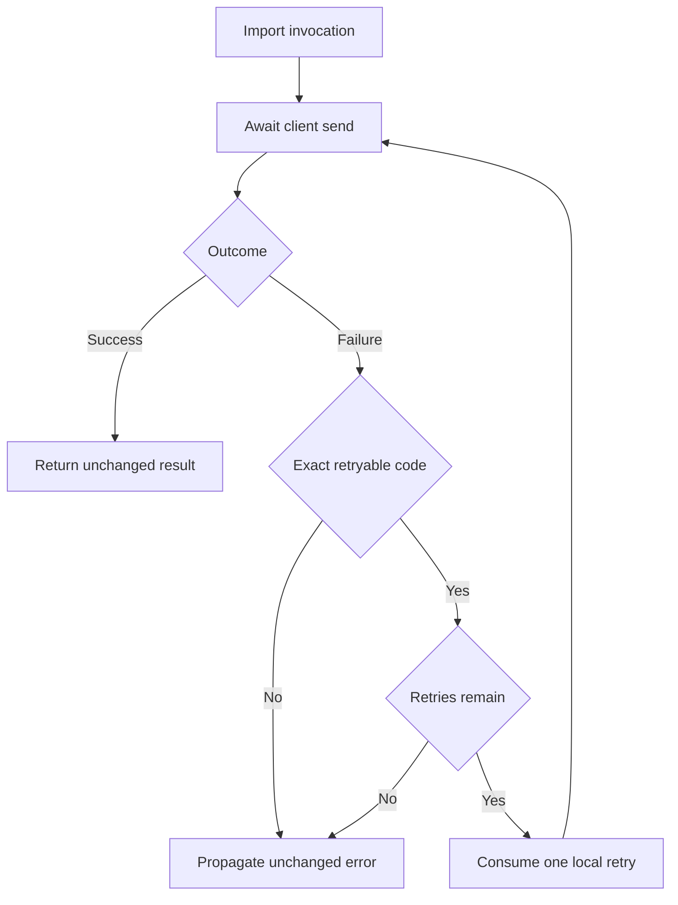
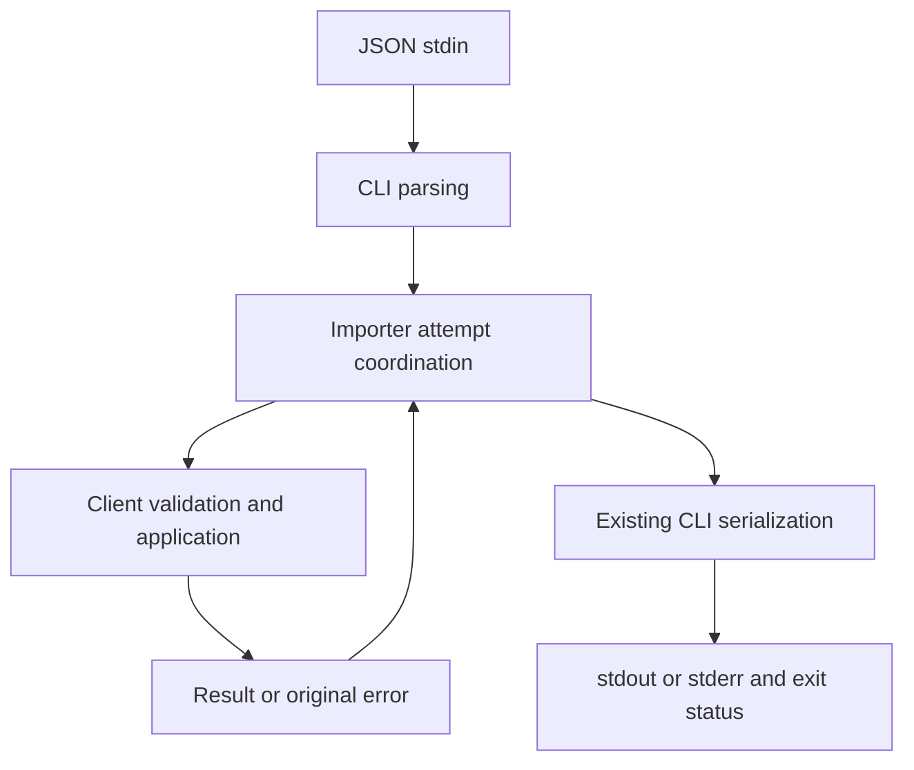

# Safe Order Import Retries - Plan

## Goal Capsule

Enable operators to complete an order import after a recoverable pre-send failure without manually restarting it.

- **Approach:** Extend the existing importer with bounded, invocation-local retries using the supplied client’s explicit safe-retry code.
- **Authority:** The preserved Product Contract owns WHAT. The synthetic `CONTRACT.md`, client source, CLI source, and tests constrain HOW.
- **Decision focus:** Distinguish safe pre-send failure from an unknown outcome after application; interpret the limit as one initial attempt plus three retries.
- **Verification focus:** Prove recovery, exhaustion, immediate terminal failure, unchanged application counts, and exact CLI stdout/stderr/exit behavior.
- **Largest risk:** Replaying an operation that already applied rows. The fixture provides no deduplication or remote idempotency guarantee.
- **Execution boundary:** This is a plan for the supplied synthetic fixture only. No implementation, tests, builds, network requests, or filesystem writes were performed by this planner.
- **Stop condition:** If the client’s failure timing or error contract changes, reassess retry safety before implementation.
- **Ownership:** The caller owns saving this response and any later execution authorization. Implementation readiness describes document completeness, not implemented or production-verified behavior.

**Target repository:** `spec-first`

**Fixture root, relative to the target repository:** `docs/validation/ce-skill-optimization-2026-10-29/remaining-27-acceptance/follow-up-20261031/plan-inputs/`

Short source paths below are relative to that fixture root. They never refer to the enclosing repository’s production `src/` or `tests/` directories. The enrichment target remains `docs/plans/2026-07-31-001-feat-order-import-plan.md` inside the fixture.

---

<!-- PRODUCT_CONTRACT_START -->
## Product Contract

### Problem Frame

批量订单导入在一次临时网络错误后整体失败，运营人员只能手工重跑整批任务。

### Requirements

- **R1:** 临时网络错误最多重试 3 次。
- **R2:** 校验错误必须立即失败，不得重试。
- **R3:** 保持现有 CLI 成功与失败输出兼容。

### Actors

- **A1:** 运行批量导入的运营人员。

### Key Flows

- **F1:** 运营人员提交有效订单；首次请求遇到临时网络错误；系统重试并成功返回。

### Acceptance Examples

- **AE1:** 给定前两次请求返回临时网络错误，第三次成功时，导入成功且总调用次数为 3。
- **AE2:** 给定输入校验失败时，导入立即失败且只调用一次。

### Scope Boundaries

- 不引入持久化队列或后台任务系统。
- 不改变 CLI 输出字段。
<!-- PRODUCT_CONTRACT_END -->

---

## Planning Contract

Product Contract unchanged (byte-preserved upstream source slice)

### Summary

Keep import execution in the caller’s request lifecycle. Add retry coordination to the importer while retaining validation and application semantics in the client and output serialization in the CLI.

Plan depth is **Standard** because a small implementation affects replay safety and process-visible compatibility. The supplied source resolves the planning questions within this synthetic boundary; production adaptation is outside this readiness claim.

### Current Behavior and Evidence

- `src/order-importer.js` directly returns `client.send(rows)`. It contains no retry state or classification.
- `tests/order-importer.test.js` checks forwarding through an asynchronous client; it does not establish retry behavior.
- `src/client.js` increments `attempts` on every send, validates rows, and throws `TRANSIENT_BEFORE_SEND`, `AUTH_FAILED`, or `UNCLASSIFIED` before application. It appends row IDs before throwing `OUTCOME_UNKNOWN`.
- `src/cli.js` awaits the importer, serializes a successful result to stdout, and serializes a rejected error to stderr with exit code 1.
- Each CLI scenario supplies one injected outcome. The client defaults to success when that sequence is exhausted. Consequently, the existing transient CLI scenario will recover after two sends once retries exist.
- `research-return.md` attributes C-1 and KD-1 to parent inspection and a synthetic fixture-owner decision. C-1 is corroborated by source. KD-1 supports retaining caller-owned execution; it is not evidence of a new project-owner approval.

### Key Technical Decisions

- KTD1. **Extend the importer; reuse the client and CLI.** Governs R1–R3. The importer already owns the boundary between caller and send operation. It will coordinate attempts without duplicating row validation, application logic, or output formatting. A generic retry package, wrapper hierarchy, or new queue would add an unnecessary ownership surface.

- KTD2. **Retry only the exact code `TRANSIENT_BEFORE_SEND`.** Governs R1 and R2. `CONTRACT.md` and `src/client.js` establish that this failure precedes all application. Every other rejection is terminal, including missing or unrecognized codes. Message matching, generic timeout detection, HTTP-category inference, and catch-all retry are rejected because they do not prove replay safety.

- KTD3. **Allow four total sends per invocation.** Governs R1 and AE1. The initial send does not consume one of the three retries. Await each attempt before considering another, stop at the first success, and keep the budget inside the individual import call. A failure on attempt four propagates without a fifth send.

- KTD4. **Preserve values, identity, and ownership across attempts.** Governs R2 and R3. Forward the same rows to the same client without mutation, preserve the client method receiver, return the successful result unchanged, and propagate the final error unchanged. Do not wrap errors, replace their code/message, invent partial success, or print intermediate failures.

- KTD5. **Preserve CLI serialization while allowing intended recovery.** Governs R3 and F1. `src/cli.js` remains the output owner. A recovered transient scenario changes from failure to success, as required by R1; terminal and exhausted errors retain the existing failure shape. Do not add retry fields, progress lines, or new public flags.

- KTD6. **Use immediate sequential retries within this fixture.** Governs R1. This is a planning choice under Assumption A-HOW1, not a user-settled decision. The local failure injector has no timing or rate-limit contract. Timers, exponential backoff, cancellation controls, and configurable retry policies would introduce behavior not needed to establish the requested bounded recovery.

### Interface Contracts

**Importer — evolution.** The existing CommonJS export is consumed by `src/cli.js` and both test files. Preserve its existing arguments and promise-consumable result/error behavior. The intended compatible extension is recovery from the specific failure authorized by KTD2. Do not promise preservation of returned Promise identity, which the fixture does not characterize.

**Client — reused without modification.** The canonical local contract is `CONTRACT.md`, grounded in `src/client.js` and `tests/client-cli.test.js`. The client remains authoritative for valid rows, error timing, and application state. An empty array is currently valid and returns `{ imported: 0 }`; retain that behavior.

**CLI — evolution with unchanged output format.** The canonical executable boundary is `src/cli.js`, characterized by `tests/client-cli.test.js`:

- Success: exactly `{"imported":N}\n` on stdout, empty stderr, exit 0.
- Failure: empty stdout, exactly `{"error":{"code":"CODE","message":"MESSAGE"}}\n` on stderr, exit 1.
- Invalid JSON: `INPUT_JSON` / `Invalid JSON input`.
- Unsupported arguments: `USAGE` / `Unsupported arguments`.

No versioned replacement or consumer migration is needed for this fixture. U2 owns process-level compatibility proof. The only expected baseline behavior changes are the importer’s single-transient failure and the CLI transient scenario.

### High-Level Technical Design

The importer introduces one bounded decision loop:

The ownership and data path remain:

For F1 and AE1, two pre-send failures leave `applied` empty; the third send succeeds and applies the batch once. An ambiguous outcome is terminal even if retry budget remains.

### Implementation Scope Boundaries

In scope are importer coordination, targeted unit coverage, process-level regression coverage, and accurate fixture documentation.

Considered and not built:

- **Persistent scheduling:** Excluded by the Product Contract and consistent with synthetic KD-1.
- **Deduplication or idempotency storage:** The supplied safe-retry code establishes no application before retry. An ambiguous outcome is never replayed. A real provider allowing replay after uncertain application would require a separate owner-backed contract.
- **Generic retry infrastructure:** There is one narrow coordination seam; no demonstrated second consumer justifies an abstraction.
- **New production telemetry or CLI diagnostics:** They would expand scope or change R3. Existing fixture `attempts` and `applied` diagnostics suffice for local proof.
- **Production network guarantees:** The fixture contains no network provider, remote service, deployment, or historical CLI contract.

These exclusions are not accepted follow-up work.

### Assumptions

- **A-HOW1 — No delay requirement:** Immediate retries are adequate for the synthetic local injector. Source: `CONTRACT.md` and `src/client.js`. Impact: no timer dependency or latency policy. Invalidate this assumption if a real provider, retry-after requirement, or pacing constraint enters scope.
- **A-HOW2 — Stable input during an invocation:** The importer forwards caller-owned rows without cloning or mutation, matching existing behavior. Concurrent external mutation of the same array is not given transactional semantics. A new input-snapshot requirement would need explicit scope.
- **A-HOW3 — Fixture-only execution:** Any later implementation targets the named fixture. Reusing the plan for a production importer requires fresh source and consumer evidence.

These are planning assumptions, not human approval records. No session-settled provenance label is asserted.

### Evidence and Limitations

The supplied parent receipt is:

`docs/validation/ce-skill-optimization-2026-10-29/remaining-27-acceptance/follow-up-20261031/plan-contract-verification.json`

It records exit code 0 for the two supplied test files. Its named log is:

`.spec-first/workflows/spec-work/spec-first/ce-opt-followup-20261031/logs/plan-contracts.log`

The inspected log reports **15 tests passed, 0 failed**. This is supplied parent characterization evidence, not a test run by this planner. It covers the unchanged single-send importer and newly authored synthetic client/CLI. It neither proves the proposed retry implementation nor establishes production compatibility.

The receipt does not provide a final-implementation revision or content fingerprint. Treat its execution result as caller-supplied and not bound to a future changed source state.

Source inspection was performed against the assigned fixture on 2026-10-31. Git identity, worktree state, broader consumers, institutional learnings, other trials, current runtime mirrors, and external sources were outside the allowed intake. No claim depends on those unread surfaces.

Worker dispatch and external research were explicitly disabled. Research was inline (`dispatch_authorization_missing`); no independent research worker ran.

### Risks, Rollback, and Operational Boundary

The largest risk is duplicate application through overbroad retry classification. U1 must prove that ambiguous outcomes stop immediately, including after an earlier transient failure.

Off-by-one limits and shared counters can cause excess requests or premature exhaustion. U1 tests both boundaries and independent invocations.

Rollback consists of reverting the importer retry change and its corresponding expectations as one coherent fixture change. This restores single-send behavior and sacrifices transient recovery. It does not undo rows already applied, and must not trigger automatic replay of an ambiguous outcome.

No persistent schema or data migration is involved. Production rollout, monitoring, reconciliation, and support ownership are not established by this fixture. Extending scope to a real service requires those decisions before launch.

---

## Implementation Units

### U1. Add bounded retry coordination and safety coverage

**Goal:** Implement KTD1–KTD4 and KTD6 in the existing importer.

**Requirements:** R1, R2, F1, AE1, AE2; R3 error-preservation boundary.

**Dependencies:** The supplied client contract and its pre-send/application timing remain valid.

**Files:**

- Modify `src/order-importer.js`.
- Extend `tests/order-importer.test.js`.
- Update the obsolete single-attempt importer expectation in `tests/client-cli.test.js`.

**Approach:** Keep the retry budget local, await each send, classify failures by KTD2, and preserve result/error values. Use the real fixture client for application-state assertions and small injected clients for error identity, receiver binding, and concurrency coordination.

**Patterns to follow:** Existing CommonJS exports, `node:test`, `node:assert/strict`, and dependency injection through the supplied client argument.

**Execution note:** Establish failing regression cases for recovery, exhaustion, and unsafe replay before changing the importer. Retain the existing forwarding test.

**Test scenarios:**

1. Valid rows with immediate success produce one send and one application; the returned object is the client’s original result.
2. Covers F1 / AE1. Outcomes `transient`, `transient`, `ok` succeed on send three and apply each row once.
3. Three transient failures followed by success succeed on send four.
4. Four transient failures followed by an available success still reject after send four; no rows apply and no fifth send occurs.
5. An injected client emitting distinct errors on each attempt propagates the fourth error object unchanged on exhaustion.
6. Covers AE2. Invalid rows fail through the importer after one client call and no application. Include a non-array input and an object with an empty or whitespace-only ID.
7. `auth`, `unknown`, and `ambiguous` each stop after one send. Application state is respectively empty, empty, and one applied batch.
8. A transient failure followed by any terminal failure stops at send two. In the ambiguous case, the batch applies once and is not replayed.
9. An error without a code, an unfamiliar code, and a misleading transient-looking message do not retry.
10. Empty rows retain successful `{ imported: 0 }` behavior; a multi-row batch preserves all rows and their order without mutation.
11. Repeated imports each receive a fresh budget. Interleaved imports using separate controlled clients do not share counters.
12. No second send begins while the current send is unresolved; a client requiring its method receiver continues to work.

**Verification:** Tests demonstrate the attempt bounds and application effects directly. No client validation logic is copied into the importer, and no intermediate error reaches CLI output.

### U2. Prove CLI compatibility across recovered and terminal outcomes

**Goal:** Verify the changed importer through the existing process boundary.

**Requirements:** R3, A1, F1; integration coverage for R1 and R2.

**Dependencies:** U1.

**Files:**

- Extend `tests/client-cli.test.js`.
- Inspect `src/cli.js` as the unchanged output owner.

**Approach:** Retain `spawnSync` process assertions. Replace the transient scenario’s obsolete failure expectation with exact success output. Keep non-retryable and input-parsing baselines intact.

The public fixture CLI injects only one transient outcome, so it cannot naturally exhaust the retry budget. For exhaustion coverage, use a test-only child-process bootstrap that supplies a client with four transient outcomes before loading the unchanged CLI. Keep this injection inside the existing test file; do not add a public flag or change the client’s production-facing contract.

**Test scenarios:**

1. Default success retains exact stdout, empty stderr, and exit 0.
2. `--scenario transient` returns exact success output and no stderr; it must not print the recovered intermediate error.
3. `auth`, `ambiguous`, and `unknown` retain their existing exact code/message JSON, empty stdout, newline, and exit 1.
4. Invalid rows, invalid JSON, and unsupported arguments retain their existing exact output and exit behavior.
5. Empty-array and multi-row success serialize the correct imported count without extra fields.
6. An exhausted injected client produces only the unchanged final `TRANSIENT_BEFORE_SEND` error JSON, empty stdout, and exit 1.

**Verification:** The process tests exercise the actual CLI serialization and top-level error handler. Unit-level error assertions alone do not substitute for this proof.

### U3. Update fixture documentation and reconcile acceptance evidence

**Goal:** Keep the documented baseline and implementation claims distinguishable after the behavior changes.

**Requirements:** R1–R3 and the synthetic-evidence boundary.

**Dependencies:** U1 and U2.

**Files:**

- Update `CONTRACT.md`.
- Retain `research-return.md` as attributed historical input.
- Use the fixture’s `package.json` test script without adding dependencies.

**Approach:** Preserve the description of the original single-send characterization as historical evidence. Document the new importer behavior and the intended transient CLI recovery separately. Keep the parent receipt and original logs unchanged.

Record future verification results against the changed source identity rather than citing the old 15-test receipt as implementation evidence. If later work is integrated into the enclosing repository, its execution owner must apply the repository’s changelog requirements under that later authorized scope.

**Test expectation:** No new standalone test for prose. U1 and U2 own behavioral proof; review documentation against their final assertions.

**Verification:** Documentation no longer describes single-send behavior as the changed importer’s current contract, and it makes no historical or production claim about the newly authored client/CLI.

---

## Verification Contract

### Proof Intents

Product Contract confirmation is **inherited** from the supplied requirements-only artifact. There is no independently verified product-owner approval in this planning run.

| Proof intent | Requirement | Status | Required evidence |
|---|---|---|---|
| Transient recovery and retry cap | R1, F1, AE1 | Required | U1 recovery, fourth-attempt boundary, exhaustion, and no-fifth-send assertions |
| Immediate validation failure | R2, AE2 | Required | Importer-level one-call/no-application assertions |
| No unsafe replay | R1, R2 | Required | Application-state assertions for ambiguous and mixed failure sequences |
| Independent attempt state | R1 | Required | Repeated and interleaved invocation tests |
| Exact CLI compatibility | R3 | Required | U2 process stdout/stderr/exit assertions, including exhaustion |
| Product Contract preservation | Upstream ownership | Required | Exact comparison of the marked slice after the caller saves the plan |
| Real network and production safety | Outside fixture scope | Not applicable | No such claim may be made from these tests |
| Build or release validation | No fixture build/release surface | Not applicable | `package.json` supplies a test script only |

### Execution-Time Commands

These commands are specified for a later authorized executor; **this planner did not run them**.

From the fixture root:

- `node --test tests/order-importer.test.js` — importer behavior and replay safety.
- `node --test tests/client-cli.test.js` — client characterization and process-visible behavior.
- `npm test` — the final combined fixture suite, as defined by `package.json`.

The parent’s existing characterization command and exit code remain baseline evidence only. Future results must record the actual command, exit code, log reference, and changed-source identity.

### Acceptance Reconciliation

The execution owner must map every required proof intent to an actual result before claiming implementation complete. A missing assertion, skipped test, or source-unbound result stays visible as a limitation; a green summary alone is insufficient.

This is a workflow-level semantic completion check, not a claimed runtime enforcement mechanism.

### Plan Review Status

Confidence check: the bounded fixture has sufficient direct grounding for these implementation decisions; no additional research-dependent strengthening is required.

One bounded producer self-review covered requirement traceability, retry limits, unsafe replay, CLI compatibility, source ownership, and scope. Independent review was not run because downstream invocation and delegation were prohibited.

- `review_source: producer-self-review`
- `review_status: degraded`
- `reason_code: spec_doc_review_capability_unavailable`
- `independent_review: not_run`
- `mutation_policy: report-only`
- `fixes_applied: 0`
- Independent-review counts and coverage: unknown.
- Known limitation: no deterministic comparison of a saved output file was possible in this no-write run. The caller must verify the preserved Product Contract slice after saving.

The returned text contains the copied upstream Product Contract unchanged; no saved artifact or implementation verification is claimed.

---

## Definition of Done

For a later authorized implementation:

- U1 satisfies the recovery, exhaustion, terminal-failure, application-state, input-forwarding, and invocation-isolation scenarios.
- U2 verifies the actual CLI boundary, including recovered transient success and unchanged final error serialization.
- U3 distinguishes the original characterization from implemented behavior and retains the synthetic-only qualification.
- Every required proof intent has current, source-bound evidence or a disclosed unresolved limitation that prevents a completion claim.
- The Product Contract remains byte-identical to the supplied marked region.
- No retries occur after an ambiguous application outcome, and no send occurs after success or budget exhaustion.
- No queue, background worker, persistence, generic retry abstraction, new public option, or output field is introduced.
- Temporary test artifacts and abandoned experimental code are removed; no generated runtime or unrelated repository source is modified.
- The final report distinguishes local fixture completion from production safety, rollout, and user outcome, none of which this plan establishes.

For this planning delivery, the complete Markdown plan is returned to the caller. Saving, post-save byte verification, implementation, and execution-time checks remain caller-owned and were not performed by this planner.
