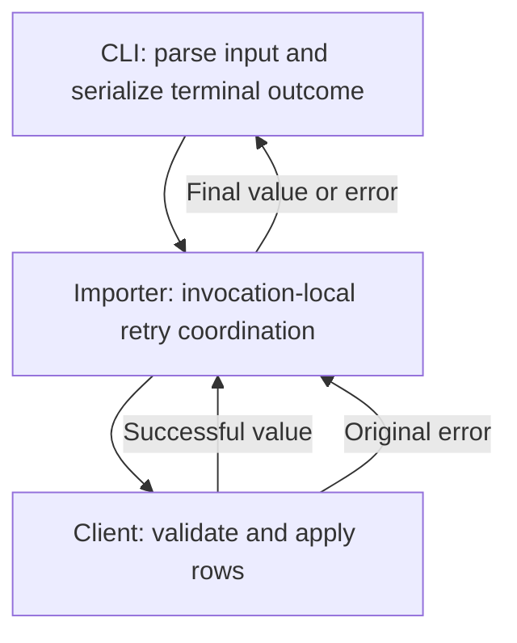
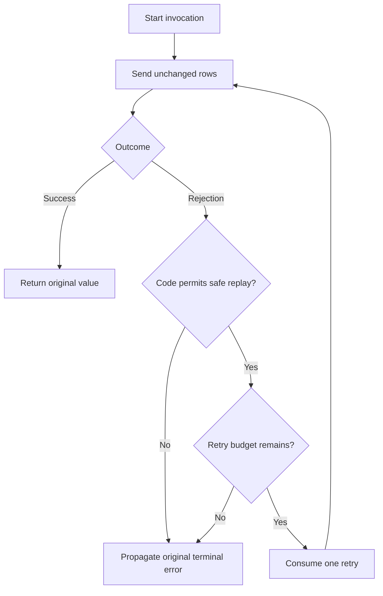

# Safe Order Import Retries - Plan

## Goal Capsule

**Objective:** Operators can complete an order import despite recoverable failures before a request is sent.

**Recommended approach:** Extend the existing importer with bounded, sequential retries using the fixture client's explicit retry permission.

**Authority:** The preserved Product Contract owns WHAT. The supplied synthetic contract and executable client/CLI sources constrain HOW. This plan makes no historical or production compatibility claim.

**Decision focus:** Distinguish safe replay from an unknown outcome; keep retry state within each invocation.

**Verification focus:** Prove attempt limits, unchanged terminal errors, application counts, and exact CLI stdout/stderr/exit behavior.

**Largest risk:** Replaying an import after rows were already applied. `OUTCOME_UNKNOWN` must terminate without replay.

**Stop conditions:** Reassess the plan if the client no longer guarantees that its retryable error precedes application, or if execution is redirected to a real service or another CLI contract.

**Execution profile and ownership:** Standard-depth synthetic fixture change, with tests driving the importer behavior. This delivery is plan-only Markdown for parent-mediated saving. The caller owns persistence and any separately authorized implementation, verification, and closeout.

**Target repository:** `spec-first`.

**Implementation boundary:** `docs/validation/ce-skill-optimization-2026-10-29/remaining-27-acceptance/follow-up-20261031/plan-inputs/`.

The Product Contract's original short source references resolve inside that fixture. All implementation file lists below use full repository-relative paths.

---

<!-- PRODUCT_CONTRACT_START -->
## Product Contract

### Problem Frame

批量订单导入在一次临时网络错误后整体失败，运营人员只能手工重跑整批任务。

### Requirements

- **R1:** 临时网络错误最多重试 3 次。
- **R2:** 校验错误必须立即失败，不得重试。
- **R3:** 保持现有 CLI 成功与失败输出兼容。

### Actors

- **A1:** 运行批量导入的运营人员。

### Key Flows

- **F1:** 运营人员提交有效订单；首次请求遇到临时网络错误；系统重试并成功返回。

### Acceptance Examples

- **AE1:** 给定前两次请求返回临时网络错误，第三次成功时，导入成功且总调用次数为 3。
- **AE2:** 给定输入校验失败时，导入立即失败且只调用一次。

### Scope Boundaries

- 不引入持久化队列或后台任务系统。
- 不改变 CLI 输出字段。
<!-- PRODUCT_CONTRACT_END -->

---

## Planning Contract

Product Contract unchanged (byte-preserved upstream source slice)

The marked region is reproduced without intentional modification. No file was written or byte-comparison helper executed in this planning run; the caller must verify the saved region against the supplied source before treating persistence as verified.

### Summary

Keep imports in the existing foreground request path. Add retry coordination to the importer while leaving validation, error classification, row application, and CLI serialization with their existing owners.

Readiness applies only to this synthetic fixture. It does not establish safety for a production service, prove implementation success, or retroactively validate an earlier planning trial.

### Key Technical Decisions

- KTD1. **Extend the importer; reuse the client and CLI.** Governs R1–R3. The importer already owns the caller-to-client boundary and currently forwards one call. Extend that owner rather than introducing a retry framework, wrapper module, queue, or second client. The client remains authoritative for validation and whether an error occurred before application. The CLI remains authoritative for process-visible output.

- KTD2. **Retry only `TRANSIENT_BEFORE_SEND`.** Governs R1 and R2. The supplied contract names this as the only safe replay signal, and the client source throws it before `applied.push`. Validation, authentication, unknown, and ambiguous errors terminate immediately. A generic “network error,” timeout, message match, or unclassified rejection supplies no retry permission. Rejecting broader classification sacrifices speculative recovery to prevent duplicate application.

- KTD3. **Allow one initial attempt plus at most three retries.** Governs R1 and AE1. Attempts are sequential; a subsequent send begins only after the preceding attempt rejects with the eligible code. Each invocation has its own budget, including overlapping invocations. Stop immediately on success or a non-retryable error. After the fourth failed attempt, propagate that final error unchanged.

- KTD4. **Preserve values and terminal errors across the boundary.** Governs R2 and R3. Reuse the same rows and client for each attempt, preserve the client's method receiver, return the successful value unchanged, and propagate the final rejection without wrapping or replacing its code/message. Do not mutate input or duplicate validation in the importer. Retry diagnostics must not enter stdout or stderr.

- KTD5. **Preserve the CLI format while allowing intended recovery.** Governs R3 and F1. Success and terminal failure retain their existing JSON shapes, newline, stream, and exit status. The fixture CLI creates a client with one injected outcome; an exhausted sequence then succeeds. Consequently, `--scenario transient` must change from baseline failure to recovered success. Its current failure expectation is a characterization of the old importer, not an invariant to preserve after this feature.

- KTD6. **Use immediate bounded retries in this fixture.** Governs R1. This is a planning-owned choice under assumption A-HOW1, not an owner-confirmed production policy. There is no real transport, retry-after signal, or timing contract in the input. Adding timers or backoff would introduce behavior and tests without a demonstrated fixture requirement.

### Interface Contracts

**Import boundary — evolution.** The existing CommonJS importer is consumed by the fixture CLI and tests. Its callable boundary remains the same; the intended observable change is recovery after an eligible failure. The async client contract establishes promise-based completion for this fixture. Promise identity and support for unrelated synchronous client implementations are not established contracts here.

**Canonical contract:** `docs/validation/ce-skill-optimization-2026-10-29/remaining-27-acceptance/follow-up-20261031/plan-inputs/CONTRACT.md`, owned by the fixture producer. Executable behavior resides in the corresponding `src/client.js` and `src/cli.js`; U1 and U2 verify their integration with the importer.

**Input and validation:** JSON rows reach the client unchanged. The client validates an array of objects with nonempty string IDs. An empty array is valid. Importer retries must not change this validation boundary.

**CLI boundary — compatible format, intentional recovery behavior.**

| Outcome | stdout | stderr | Exit |
|---|---|---|---|
| Success | Exactly `{"imported":N}\n` | Empty | 0 |
| Terminal client error | Empty | Exactly `{"error":{"code":"CODE","message":"MESSAGE"}}\n` | 1 |
| Invalid JSON | Empty | Exactly `{"error":{"code":"INPUT_JSON","message":"Invalid JSON input"}}\n` | 1 |
| Unsupported arguments | Empty | Exactly `{"error":{"code":"USAGE","message":"Unsupported arguments"}}\n` | 1 |
| Recovered transient error | Same success format | Empty | 0 |

No new flags, fields, schema version, deprecation period, or consumer migration is needed. U2 updates obsolete behavioral expectations while preserving the serializer. Reverting the focused importer change restores the baseline attempt policy; it cannot undo rows already applied.

### High-Level Technical Design

KTD2 owns eligibility, KTD3 owns the budget, and KTD4 owns propagation. The diagrams describe coordination; they do not add a second error policy.

### Assumptions

- A-HOW1. Immediate retries are sufficient for the supplied deterministic failure injector. Source basis: the client has no network or timing behavior. Impact: no delay configuration, timer dependency, or backoff tests. Invalidation: a real transport or explicit pacing requirement enters scope; its owner must then supply the operational contract before reuse.
- A-HOW2. The implementation will target the supplied fixture rather than similarly named files elsewhere. Source basis: the request names this fixture as the only implementation evidence. Invalidation: a caller redirects implementation; source ownership, contracts, and verification must be re-established.

### Implementation Scope Boundaries

- In scope: importer retry coordination and focused unit/process tests.
- Client implementation: reused unchanged as the error-timing and application-state oracle.
- CLI implementation: reused unchanged; its existing await-and-serialize path already supports recovery.
- Considered and not built: persistent retry state, generic retry helpers, deduplication storage, timeout classification, new CLI diagnostics, and background scheduling. The current source needs none of these to satisfy the supplied contract. A broader transport or durable scheduling requirement would require a separate decision.
- No generated runtime, host configuration, production integration, or external service is an implementation owner in this plan.

The research return's KD-1 supports foreground execution and rejects a background queue. It is an attributed synthetic fixture-owner decision, not a session-settled decision or project-owner approval. The preserved Product Contract independently excludes background systems.

### Evidence & Limitations

**Directly inspected source, 2026-10-31:**

- `docs/validation/ce-skill-optimization-2026-10-29/remaining-27-acceptance/follow-up-20261031/plan-inputs/src/order-importer.js`: one direct `client.send(rows)` call; no retry state.
- `docs/validation/ce-skill-optimization-2026-10-29/remaining-27-acceptance/follow-up-20261031/plan-inputs/src/client.js`: exact error timing, default successful outcome after sequence exhaustion, and diagnostic `attempts`/`applied`.
- `docs/validation/ce-skill-optimization-2026-10-29/remaining-27-acceptance/follow-up-20261031/plan-inputs/src/cli.js`: argument validation, stdin parsing, one injected outcome, and exact stream/exit handling.
- `docs/validation/ce-skill-optimization-2026-10-29/remaining-27-acceptance/follow-up-20261031/plan-inputs/tests/order-importer.test.js`: forwarding coverage only.
- `docs/validation/ce-skill-optimization-2026-10-29/remaining-27-acceptance/follow-up-20261031/plan-inputs/tests/client-cli.test.js`: client characterization, non-retryable importer behavior, baseline single-send transient behavior, and process output assertions.
- `docs/validation/ce-skill-optimization-2026-10-29/remaining-27-acceptance/follow-up-20261031/plan-inputs/package.json`: private CommonJS fixture with `node --test tests/*.test.js`.

**Attributed research:** `docs/validation/ce-skill-optimization-2026-10-29/remaining-27-acceptance/follow-up-20261031/plan-inputs/research-return.md` comes from parent source inspection, with no independent worker or external research. Its C-1 finding was re-grounded in the source above.

**Parent execution receipt:** `docs/validation/ce-skill-optimization-2026-10-29/remaining-27-acceptance/follow-up-20261031/plan-contract-verification.json` records check `plan-contracts`, exit code `0`, and the two fixture test paths. Its referenced log was not independently inspected. This is supplied, transcribed evidence of synthetic baseline characterization, not a test run performed by this planner or proof of retry implementation. The receipt contains no final-source fingerprint.

No tests, builds, helpers, network requests, or writes ran during this planning task. Git revision and dirty state were outside the bounded evidence intake; no source-bound execution claim is made. No independent research or review worker was invoked: `dispatch_authorization_missing`. External research was explicitly excluded and is not load-bearing for this local failure injector.

---

## Implementation Units

### U1. Add bounded safe retry behavior

**Goal:** Implement recovery within the existing importer without replaying terminal outcomes.

**Requirements:** R1, R2, A1, F1, AE1, AE2; KTD1–KTD4 and KTD6.

**Dependencies:** None.

**Files:**

- Modify `docs/validation/ce-skill-optimization-2026-10-29/remaining-27-acceptance/follow-up-20261031/plan-inputs/src/order-importer.js`.
- Extend `docs/validation/ce-skill-optimization-2026-10-29/remaining-27-acceptance/follow-up-20261031/plan-inputs/tests/order-importer.test.js`.
- Update the superseded single-send importer assertion in `docs/validation/ce-skill-optimization-2026-10-29/remaining-27-acceptance/follow-up-20261031/plan-inputs/tests/client-cli.test.js`.

**Approach:** Add invocation-local attempt coordination to the current owner. Keep the fixture client and its direct characterization tests authoritative. Replace the test asserting that the importer never retries with a target-behavior assertion; retain the independent proof that eligible client failures apply no rows.

**Execution note:** Establish the focused failing retry and unsafe-replay scenarios before changing the importer. Use the actual fixture client for application-state checks and small controlled clients for error identity and overlapping-call tests.

**Patterns to follow:** Existing CommonJS exports, `node:test`, strict assertions, and injected client dependency.

**Test scenarios:**

1. Initial success returns the original result, forwards the original rows, and calls the client once.
2. Covers F1 / AE1. Two transient failures followed by success yield three attempts and each row applied once.
3. Three transient failures followed by success yield four attempts and one application of each row.
4. Four transient failures followed by a queued success reject after four attempts; the queued fifth outcome is never consumed and nothing is applied.
5. A controlled client supplies distinct transient error objects; exhaustion propagates the fourth object itself with its original code/message.
6. Covers AE2. Invalid rows reject after one attempt with `INVALID_ORDER`, even when the injected outcome would otherwise be transient or ambiguous; no row is applied.
7. `AUTH_FAILED` and `UNCLASSIFIED` each stop after one attempt with no application.
8. `OUTCOME_UNKNOWN` stops after one attempt, retains the error, and shows one application rather than replaying it.
9. A transient error followed by authentication, validation, unknown, or ambiguous failure stops at the second attempt. An ambiguous second outcome applies rows once and still rejects.
10. An error without an eligible code, including a generic timeout-like error or a null rejection, is propagated unchanged without retry.
11. Separate sequential invocations each receive their full retry budget. Overlapping invocations with separate controlled clients cannot consume each other's budgets; no invocation starts overlapping attempts.
12. The same rows and method receiver reach every attempt; the importer does not mutate rows.
13. An empty array succeeds with zero imported rows, including after an eligible transient failure.

**Verification:** Focused importer tests demonstrate KTD2–KTD4 using exact attempt counts, original values/errors, and application state. No test makes a production idempotency claim.

### U2. Verify CLI compatibility through the changed importer

**Goal:** Prove that recovery integrates with the existing CLI while permanent failure output remains compatible.

**Requirements:** R3, A1, F1; KTD4 and KTD5.

**Dependencies:** U1.

**Files:**

- Update `docs/validation/ce-skill-optimization-2026-10-29/remaining-27-acceptance/follow-up-20261031/plan-inputs/tests/client-cli.test.js`.
- Read, without planned production changes, `docs/validation/ce-skill-optimization-2026-10-29/remaining-27-acceptance/follow-up-20261031/plan-inputs/src/cli.js`.

**Approach:** Keep the existing child-process test pattern. Change the transient CLI characterization to the intended recovered-success expectation. Preserve all other process assertions and direct client characterization. Do not add a new public scenario flag to force exhaustion; U1 proves exhaustion and error identity, while the unchanged CLI error handler and permanent-failure process cases prove serialization.

**Test scenarios:**

1. Default and explicit success produce exactly the documented success bytes with empty stderr and exit `0`.
2. The existing transient scenario recovers and emits only the final success line, with no intermediate error or retry messages.
3. Authentication, unknown, and ambiguous scenarios retain exact code/message JSON on stderr, empty stdout, and exit `1`.
4. Invalid rows retain the existing `INVALID_ORDER` output; malformed JSON retains `INPUT_JSON`.
5. Unsupported options and unsupported scenario values retain `USAGE`, with no success output.
6. Empty input rows produce `{"imported":0}\n`; a multi-row input reports the correct count.
7. The complete test suite retains client pre-application characterization and ambiguous-application coverage after obsolete importer expectations are replaced.

**Verification:** Actual CLI child processes establish stream bytes and exit statuses. Exhausted-error serialization is supported compositionally by U1's unchanged-error proof and inspection of the unchanged CLI catch handler; the existing CLI injector does not exercise four transient failures in a single process.

---

## Verification Contract

### Authority and Proof Status

Product Contract confirmation is **inherited** from the supplied requirements-only artifact. The fixture supplement is an explicit synthetic input. There is no independent human approval record or production service-owner attestation.

The largest unproven implementation risk is retrying an already-applied outcome. Source inspection establishes the fixture distinction, but implementation tests must prove that the new coordinator respects it.

| Proof intent | Requirement | Required evidence | Current status |
|---|---|---|---|
| Recover safely before application | Required | U1 F1/AE1 test, exact attempts and applied IDs | Not run for proposed implementation |
| Enforce initial-plus-three budget | Required | Fourth-attempt success and fourth-failure exhaustion; no fifth call | Not run |
| Stop validation and unsafe replay | Required | AE2, auth, unknown, ambiguous, and mixed-sequence tests | Baseline receipt supplied; new coordinator unverified |
| Preserve state isolation and terminal errors | Required | Sequential/overlapping invocation tests and final-error identity | Not run |
| Preserve CLI process contract | Required | U2 child-process assertions, including recovered transient success | Baseline receipt supplied; changed behavior unverified |
| Preserve Product Contract bytes | Required | Compare marked region after parent save against supplied original | Copied in response; saved-byte check pending |
| Prove real-service idempotency or operational rollout | Not applicable | Outside synthetic fixture scope | No production claim |

### Execution-Time Checks

Run from the fixture directory:

- `node --test tests/order-importer.test.js` for U1 behavior.
- `node --test tests/client-cli.test.js` for client characterization and CLI integration.
- `npm test` as the fixture's final aggregate gate after both units are complete.

These are planned commands, not commands executed during planning. Record the actual results and the source revision or fingerprint tested. A green pre-change characterization receipt does not satisfy post-change proof.

No build, publication, `release:validate`, browser, generated-runtime, or behavioral Skill evaluation gate applies to this standalone JavaScript fixture.

Before claiming implementation complete, reconcile every required proof intent to an actual result. A missing result remains an explicit limitation and blocks a verified completion claim. This reconciliation is a workflow-level semantic gate, not an asserted runtime enforcement mechanism.

### Planning Review Status

Confidence check passed for the bounded synthetic scope: the source establishes error timing, ownership, and output behavior; no load-bearing external research gap remains.

A single bounded producer self-review checked requirements traceability, unit dependencies, retry boundaries, obsolete test expectations, metadata, and source scope. Independent review was not run because this task prohibits delegation and other Skill invocation.

- `review_source: producer-self-review`
- `review_status: degraded`
- `reason_code: spec_doc_review_capability_unavailable`
- `independent_review: not_run`
- `mutation_policy: report-only`
- `fixes_applied: 0`
- Independent reviewer counts and coverage: unknown.
- Known limitation: the caller must verify saved Product Contract bytes; no deterministic comparison of the returned artifact ran here.

This review status does not imply a clean independent review or completed implementation.

---

## Risks and Recovery

**Duplicate application:** KTD2 excludes `OUTCOME_UNKNOWN` even though its visible result is failure. U1 must assert both the rejection and application count. Operators must not interpret this error as permission to rerun the batch.

**Budget errors and shared state:** Off-by-one limits or module-level counters could over-retry or deprive another invocation of recovery. Boundary and overlap tests in U1 are required.

**Misleading baseline tests:** Existing tests deliberately assert pre-feature transient failures. U1 and U2 replace only those obsolete expectations; retaining them would enforce the old behavior, while deleting all characterization would remove safety evidence.

**Fixture-to-production overreach:** The local `attempts` and `applied` properties are diagnostics, not a remote deduplication guarantee. Production adoption requires a separate contract for error timing, idempotency, pacing, observability, and operator recovery.

**Recovery and rollback:** A future implementer can revert the focused importer and changed test expectations to restore the single-send baseline. No data migration exists. Neither a code rollback nor this plan compensates for an already-applied ambiguous import.

---

## Definition of Done

- U1 satisfies every listed importer scenario, including exact retry bounds, terminal-error identity, isolated invocation state, and no ambiguous replay.
- U2 demonstrates exact CLI stream and exit compatibility, with transient recovery as the only intended baseline outcome change.
- The final fixture aggregate suite passes on identified post-change source, with its actual receipt retained.
- Every required proof intent is reconciled; supplied baseline checks are not relabeled as new implementation evidence.
- The saved Product Contract region matches the original bytes.
- The implementation remains within the named fixture owner; client validation/application semantics and CLI serialization are not duplicated.
- No new queue, dependency, public flag, generated runtime change, or unrelated cleanup enters the diff.
- Abandoned experiments and temporary implementation artifacts are removed without disturbing unrelated work.
- Completion is reported as synthetic fixture implementation only. Production compatibility, field effectiveness, independent review, and remote landing remain outside that claim.

This planning delivery contains the complete proposed Markdown and performs no persistence or implementation. The parent owns saving the response and verifying the saved artifact.

---

## Sources

- `docs/validation/ce-skill-optimization-2026-10-29/remaining-27-acceptance/follow-up-20261031/plan-inputs/docs/plans/2026-07-31-001-feat-order-import-plan.md`
- `docs/validation/ce-skill-optimization-2026-10-29/remaining-27-acceptance/follow-up-20261031/plan-inputs/CONTRACT.md`
- `docs/validation/ce-skill-optimization-2026-10-29/remaining-27-acceptance/follow-up-20261031/plan-inputs/research-return.md`
- `docs/validation/ce-skill-optimization-2026-10-29/remaining-27-acceptance/follow-up-20261031/plan-contract-verification.json`
- Direct source and test paths listed in Evidence & Limitations and Implementation Units.
