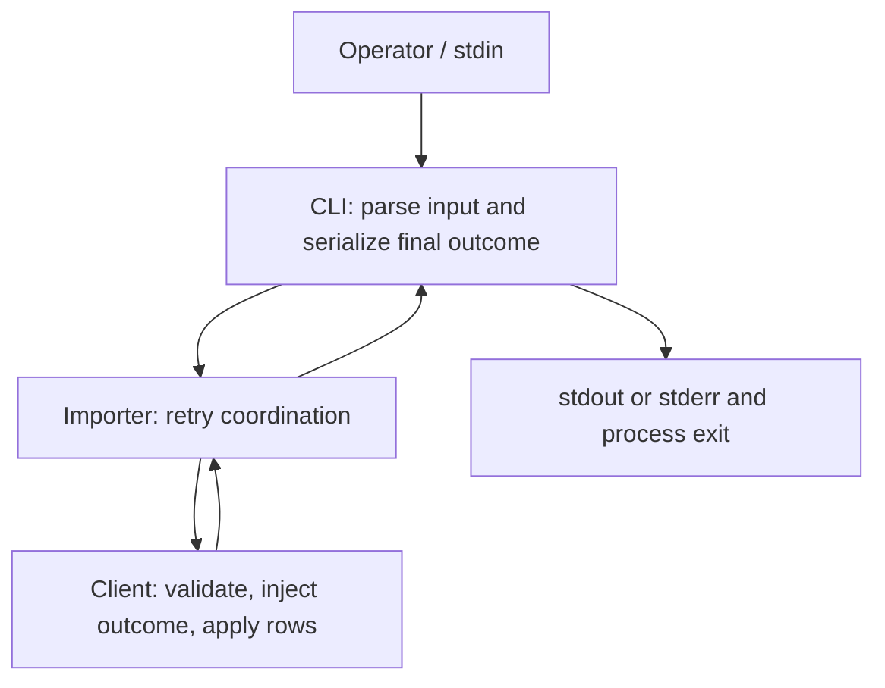
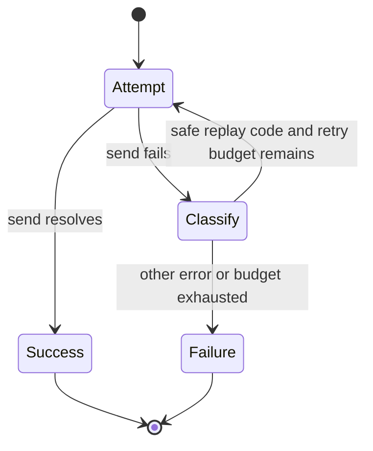

# Safe Order Import Retries - Plan

## Goal Capsule

- **Objective:** Operators can complete an order import despite recoverable failures before transmission.
- **Recommended approach:** Extend the existing importer with bounded, invocation-local retries using the supplied client's explicit safe-replay error.
- **Authority:** The preserved Product Contract owns product behavior. The supplied synthetic contract and executable source constrain implementation. Planning choices do not establish production guarantees.
- **Decision focus:** Retry eligibility, attempt accounting, error preservation, and CLI compatibility.
- **Verification focus:** Exact call counts, application counts, final error identity, invocation isolation, and process-visible output.
- **Largest risk:** Replaying an operation after rows were already applied.
- **Stop conditions:** A changed client contract invalidates safe replay; a required product decision becomes unresolved; or implementation would affect assets outside the assigned fixture.
- **Execution profile:** Standard-depth, characterization-led implementation within the synthetic fixture.
- **Tail ownership:** This response supplies the complete plan for parent-mediated saving. The parent owns persistence and any later implementation authorization. No implementation, test execution, independent review, or filesystem write occurred during this planning run.

**Target repository:** `spec-first`.

**Implementation boundary:** `docs/validation/ce-skill-optimization-2026-10-29/remaining-27-acceptance/follow-up-20261031/plan-inputs/`.

**Plan target:** `docs/validation/ce-skill-optimization-2026-10-29/remaining-27-acceptance/follow-up-20261031/plan-inputs/docs/plans/2026-07-31-001-feat-order-import-plan.md`.

The original plan date is retained from its supplied filename. This enrichment uses fixture evidence supplied on 2026-10-31.

---

<!-- PRODUCT_CONTRACT_START -->
## Product Contract

### Problem Frame

批量订单导入在一次临时网络错误后整体失败，运营人员只能手工重跑整批任务。

### Requirements

- **R1:** 临时网络错误最多重试 3 次。
- **R2:** 校验错误必须立即失败，不得重试。
- **R3:** 保持现有 CLI 成功与失败输出兼容。

### Actors

- **A1:** 运行批量导入的运营人员。

### Key Flows

- **F1:** 运营人员提交有效订单；首次请求遇到临时网络错误；系统重试并成功返回。

### Acceptance Examples

- **AE1:** 给定前两次请求返回临时网络错误，第三次成功时，导入成功且总调用次数为 3。
- **AE2:** 给定输入校验失败时，导入立即失败且只调用一次。

### Scope Boundaries

- 不引入持久化队列或后台任务系统。
- 不改变 CLI 输出字段。
<!-- PRODUCT_CONTRACT_END -->

---

## Planning Contract

Product Contract unchanged (byte-preserved upstream source slice)

The plan covers the complete supplied Product Contract within the synthetic fixture. Readiness describes the completeness of these implementation instructions, not implementation success or production readiness.

### Evidence & Limitations

The following source paths are relative to the target repository.

| Evidence | Observed fact | Planning consequence |
|---|---|---|
| `docs/validation/ce-skill-optimization-2026-10-29/remaining-27-acceptance/follow-up-20261031/plan-inputs/src/order-importer.js` | `importOrders` returns one `client.send(rows)` call. | Extend this owner; retries do not exist yet. |
| `docs/validation/ce-skill-optimization-2026-10-29/remaining-27-acceptance/follow-up-20261031/plan-inputs/src/client.js` | Validation and `TRANSIENT_BEFORE_SEND` precede application; `OUTCOME_UNKNOWN` follows application. | Exact error classification is necessary to prevent duplicate application. |
| `docs/validation/ce-skill-optimization-2026-10-29/remaining-27-acceptance/follow-up-20261031/plan-inputs/src/cli.js` | The CLI awaits the importer and owns argument parsing, JSON input, serialization, streams, and exit status. | Preserve this adapter and test actual child-process behavior. |
| `docs/validation/ce-skill-optimization-2026-10-29/remaining-27-acceptance/follow-up-20261031/plan-inputs/CONTRACT.md` | Only one error code permits replay; the budget is the initial attempt plus three retries. | Resolves retry count and replay permission for this fixture. |
| `docs/validation/ce-skill-optimization-2026-10-29/remaining-27-acceptance/follow-up-20261031/plan-inputs/tests/order-importer.test.js` | Existing importer coverage checks forwarding only. | Add behavioral coverage for recovery, exhaustion, and propagation. |
| `docs/validation/ce-skill-optimization-2026-10-29/remaining-27-acceptance/follow-up-20261031/plan-inputs/tests/client-cli.test.js` | Tests characterize client side effects, single-send behavior, and CLI outputs. | Preserve safety checks; replace expectations intentionally superseded by retries. |
| `docs/validation/ce-skill-optimization-2026-10-29/remaining-27-acceptance/follow-up-20261031/plan-inputs/research-return.md` | Parent inspection reports no retry loop and a synthetic decision to keep imports caller-owned. | Direct source confirms the missing loop. Keep the foreground invocation; do not infer a synchronous JavaScript return contract. |
| `docs/validation/ce-skill-optimization-2026-10-29/remaining-27-acceptance/follow-up-20261031/plan-contract-verification.json` | Parent receipt records `exit_code: 0` for the two characterization test files. | Establishes parent-reported baseline characterization only. |

The client and CLI are newly authored synthetic inputs, not historical production evidence. The client sequence is a failure injector, not a network transport. Its diagnostics expose local application state; they do not establish remote idempotency.

The parent receipt is **transcribed execution evidence**. It names a command and log reference but contains no final-source fingerprint. This planner read the receipt and source, did not run its command, and did not independently inspect its referenced log. A passing baseline does not prove the proposed retries.

Git identity, dirty state, broader consumers, and production deployment were not inspected under the bounded assignment. Source observations describe the supplied files at read time. An implementation owner must recheck their identity before mutation.

Research was inline. Delegation and external access were prohibited; `worker_dispatch_outcome: dispatch_authorization_missing`. No external evidence is required for the fixture-local decisions.

### Key Technical Decisions

- KTD1. **Extend the importer; reuse the client and CLI.** Governs R1–R3. The importer already owns the caller-to-client invocation boundary. Add retry coordination there without a reusable retry framework, wrapper module, or client-side duplicate policy. Validation and application timing remain client-owned; serialization remains CLI-owned.

- KTD2. **Retry only `TRANSIENT_BEFORE_SEND`, with at most four total attempts.** Governs R1 and R2. The supplied contract explicitly permits replay after this code and excludes all others. Evaluate the error from each failed attempt independently. An authentication, validation, ambiguous, unclassified, or uncoded failure terminates the invocation immediately, including after an earlier transient failure. Do not infer retryability from message text, timeout-like names, or broad network categories.

- KTD3. **Keep attempts serial and state local to each invocation.** Governs R1 and F1. Await each attempt before deciding whether another is allowed. Reuse the supplied client and original rows without modifying the input or introducing shared retry counters. Return the successful result unchanged; on terminal failure propagate the final error unchanged. No attempt follows a successful result.

- KTD4. **Keep CLI output ownership and shape unchanged.** Governs R3. The existing CLI continues to serialize only the final outcome. The recovered transient scenario intentionally changes from failure to success under R1. Permanent and exhausted failures retain their original code and message, stderr-only output, newline, and exit status. The importer emits no retry messages to either stream.

- KTD5. **Use immediate bounded retries for this fixture.** Governs R1; based on Assumption A-Plan-1. No delay, backoff, jitter, scheduling, configuration option, or new dependency is needed for the local failure injector. This choice provides a bounded call count, not a wall-clock timeout or production load-control guarantee.

- KTD6. **Verify through the existing test surfaces.** Governs R1–R3. Importer tests own attempt and error-object assertions. Existing client/CLI tests own application-state and process-output assertions. Where the CLI cannot select an exhaustion sequence, use test-local child-process dependency substitution before loading the actual CLI. Do not add a production flag or alternate CLI implementation solely for testing.

The supplied research return's KD-1 is attributed fixture-owner context. It is not recorded as a session-settled user decision or production-owner approval.

### High-Level Technical Design

The component boundary is:



The invocation lifecycle follows KTD2 and KTD3:



Each retry remains within the original foreground import. There is no durable state transition, background worker, or compensating write.

### Interface Contracts

**Importer/client boundary — evolution.** The canonical fixture contract is `docs/validation/ce-skill-optimization-2026-10-29/remaining-27-acceptance/follow-up-20261031/plan-inputs/CONTRACT.md`, backed by the client and importer source cited above. The known consumers are the CLI and fixture tests.

The input remains the caller's rows and client. Successful values remain unchanged. Terminal errors preserve identity, code, and message. Retry behavior is a compatible feature change for the supplied async client; compatibility with unobserved synchronous clients or exact Promise identity is not claimed. U1 owns implementation and verification.

**CLI boundary — evolution.** The same contract and CLI source own the observable interface. U2 owns consumer verification. Success remains `{"imported":N}\n` on stdout, empty stderr, exit 0. Failure remains `{"error":{"code":"CODE","message":"MESSAGE"}}\n` on stderr, empty stdout, exit 1. No output fields, flags, or error wrappers are added.

The existing `node:test` suites provide executable contract checks. No schema parser, interface version bump, migration window, or consumer removal is needed within this fixture. A production consumer inventory would be a separate adoption prerequisite.

### Assumptions

- **A-Plan-1 — Immediate retry timing is sufficient for this fixture.** This is a planning-owned HOW choice, based on the local injector and absence of a timing contract. It avoids timers and dependencies. Invalidate it if a real provider, retry-after requirement, or operational rate limit enters scope.
- **A-Plan-2 — Rows remain caller-stable during an invocation.** Existing forwarding behavior supplies the same object to the client. This plan does not add copying, locking, or a new concurrent-mutation contract. Revisit if source or consumers require mutation during an in-flight import.
- **A-Plan-3 — Implementation remains confined to the named synthetic package.** Broader repository or production integration would require fresh source evidence and an expanded owner boundary.

These assumptions do not represent user approval and do not resolve missing product decisions. No unresolved product blocker was found in the supplied inputs.

### Implementation Scope Boundaries

In scope: importer retry coordination, focused tests, and compatibility verification of the supplied client and CLI.

Considered and not built:

- Persistent queues and background execution: excluded by the Product Contract.
- Remote idempotency keys, deduplication storage, and automatic compensation: the client provides no such contract. Avoid replaying ambiguous outcomes instead. Reconsider only with service-owner evidence and authorized scope.
- Generic timeout retries: unsafe because the fixture explicitly demonstrates apply-then-error.
- New telemetry fields or progress output: unnecessary for fixture proof and incompatible with R3.
- Backoff configuration and reusable retry infrastructure: no demonstrated consumer or load requirement in the assigned source.

Generated host runtime assets and the surrounding spec-first CLI are outside this implementation boundary.

### Risks and Operational Boundary

The dominant failure mode is duplicate application caused by replaying `OUTCOME_UNKNOWN`. U1 must prove this stops after one application, including when preceded by transient failures.

The attempt budget bounds calls, not duration: a client Promise that never settles remains pending as before. Introducing cancellation or transport timeouts would need a separate contract.

Retry counters must not leak between invocations. Both sequential and interleaved tests are required; the fixture client's own diagnostics are separate from importer retry state.

There is no production rollout in this plan. The future fixture implementation owner accepts the change only after the required checks pass. A safety or output regression triggers restoration of the prior importer behavior and corresponding expectations. Reverting code does not undo applied orders. An ambiguous external outcome would require operator reconciliation before any manual replay; no automated recovery is authorized here.

---

## Implementation Units

### U1. Implement bounded safe retries in the existing importer

**Goal:** Recover from the declared pre-send transient failure without replaying any other failure.

**Requirements:** R1, R2, R3; F1, AE1, AE2; KTD1–KTD5.

**Dependencies:** The supplied client contract remains valid at implementation time.

**Files:**

- Modify `docs/validation/ce-skill-optimization-2026-10-29/remaining-27-acceptance/follow-up-20261031/plan-inputs/src/order-importer.js`.
- Extend `docs/validation/ce-skill-optimization-2026-10-29/remaining-27-acceptance/follow-up-20261031/plan-inputs/tests/order-importer.test.js`.
- Update superseded baseline expectations in `docs/validation/ce-skill-optimization-2026-10-29/remaining-27-acceptance/follow-up-20261031/plan-inputs/tests/client-cli.test.js`.

**Approach:**

1. Keep the existing export and caller/client ownership.
2. Add serial invocation-local retry coordination under KTD2 and KTD3.
3. Preserve validation in the client, successful result values, and terminal error identity.
4. Replace the test asserting the importer always makes one transient attempt with recovery coverage.
5. Change only the transient CLI baseline to expect recovery. Preserve direct client characterization and non-retryable failure expectations.

**Patterns to follow:** CommonJS modules, `node:test`, strict assertions, the current forwarding test, and the client's `attempts`/`applied` diagnostics.

**Execution note:** Establish failing recovery and budget-boundary assertions before changing the importer. Preserve the existing safety characterization throughout.

**Test scenarios:**

1. Immediate success makes one call, forwards the same rows, and returns the same successful result object.
2. Covers F1 / AE1. Two transient failures followed by success produce three calls and exactly one application of each input row.
3. Three transient failures followed by success succeed on call four.
4. Four transient failures exhaust the budget at four calls. A fifth scripted success is never reached; nothing is applied.
5. Distinct transient error objects on each attempt demonstrate that exhaustion propagates the fourth error object unchanged.
6. Covers AE2. Invalid rows fail with `INVALID_ORDER` after one client call and no application, even when the configured outcome is transient.
7. Authentication, unknown, uncoded, and ambiguous errors each terminate immediately. For the real ambiguous client, rows are applied once and no replay follows.
8. A transient failure followed by authentication, unknown, or ambiguous failure stops on call two. The final error is preserved; ambiguous application occurs only once.
9. Empty rows retain successful `{ imported: 0 }` behavior.
10. Repeated sequential invocations each receive their full budget. Interleaved invocations with separate controlled clients do not share counters.
11. A pending attempt does not overlap another attempt for that invocation.
12. The existing transient CLI scenario now produces exactly the ordinary success output with no retry noise.

**Verification:** The updated tests prove attempt boundaries, safe application counts, terminal error identity, and call isolation. No existing permanent-error or direct-client characterization is weakened.

### U2. Complete CLI compatibility and exhaustion proof

**Goal:** Prove that R3 holds across recovery and terminal failures through the actual CLI serialization path.

**Requirements:** R3; R1 and R2 integration coverage; A1; KTD4 and KTD6.

**Dependencies:** U1.

**Files:**

- Extend `docs/validation/ce-skill-optimization-2026-10-29/remaining-27-acceptance/follow-up-20261031/plan-inputs/tests/client-cli.test.js`.
- Read-only integration target: `docs/validation/ce-skill-optimization-2026-10-29/remaining-27-acceptance/follow-up-20261031/plan-inputs/src/cli.js`.
- Read-only contract owner: `docs/validation/ce-skill-optimization-2026-10-29/remaining-27-acceptance/follow-up-20261031/plan-inputs/CONTRACT.md`.

**Approach:**

1. Retain process-based assertions for exact stdout, stderr, newline, and exit status.
2. Keep the real CLI unchanged.
3. Add a test-local child bootstrap that substitutes the client factory before loading the real CLI for multi-failure sequences. Keep valid process arguments and real stdin parsing.
4. Distinguish this injected exhaustion proof from an ordinary CLI scenario run; neither establishes real-network behavior.

**Patterns to follow:** Existing `spawnSync` characterization and JSON-string equality assertions.

**Test scenarios:**

1. Default success and multiple valid rows emit the expected imported count, empty stderr, and exit 0.
2. Recovered transient failure emits one final success line and no error or progress text.
3. Authentication, ambiguous, and unknown scenarios retain their exact code/message JSON, empty stdout, and exit 1.
4. Invalid rows, invalid JSON, and unsupported arguments retain their existing error codes, messages, streams, and exit status.
5. Empty valid input remains a successful zero-row import.
6. Four injected transient outcomes produce the exact terminal `TRANSIENT_BEFORE_SEND` / `Request not sent` error on stderr and exit 1.
7. A transient followed by a permanent error emits only that final permanent error.
8. Malformed argument shapes and an unknown scenario remain `USAGE` failures.

**Verification:** The two test suites pass together, including child-process assertions against the real CLI. No new production flag, output field, logging behavior, or duplicate serializer is introduced.

---

## Verification Contract

### Authority and Current Evidence

**Product Contract confirmation:** `inherited`, from the supplied requirements-only plan. No fresh human approval or production-owner attestation is claimed.

**Largest unproven risk:** The future retry implementation could replay an already-applied operation or exceed its budget.

**Current result:** Retry implementation verification is `not_run`. The parent characterization receipt predates implementation and is not reusable as evidence that U1 or U2 passes.

The same producer authored and self-reviewed this plan. Independent review coverage is unknown.

### Required Proof Intents

| Intent | Status | Required evidence | Owner |
|---|---|---|---|
| R1 / AE1 recovery and maximum budget | Required; not run | One-, three-, and four-call success cases; four-call exhaustion with no fifth call | U1 |
| R2 / AE2 immediate validation failure | Required; not run | One call, unchanged validation error, no applied rows | U1 |
| No replay after ambiguous application | Required; not run | Actual client diagnostics for direct and transient-then-ambiguous cases | U1 |
| Final error and successful result preservation | Required; not run | Identity assertions and exact code/message checks | U1 |
| Invocation isolation and serial attempts | Required; not run | Sequential and controlled interleaved execution assertions | U1 |
| R3 process compatibility | Required; not run | Actual CLI stdout/stderr/exit assertions, including injected exhaustion | U2 |
| Product Contract byte preservation after saving | Required; pending parent save | Exact comparison of the marker-delimited source slice and saved response | Parent |
| Production network safety and deployment | Not applicable to fixture acceptance | Separate provider and deployment evidence required before broader adoption | Future adoption owner |

### Execution-Time Commands

From the target repository root, the focused verification command is:

```text
node --test docs/validation/ce-skill-optimization-2026-10-29/remaining-27-acceptance/follow-up-20261031/plan-inputs/tests/order-importer.test.js docs/validation/ce-skill-optimization-2026-10-29/remaining-27-acceptance/follow-up-20261031/plan-inputs/tests/client-cli.test.js
```

The fixture's package-level equivalent is:

```text
npm --prefix docs/validation/ce-skill-optimization-2026-10-29/remaining-27-acceptance/follow-up-20261031/plan-inputs test
```

These are planned commands, not commands executed by this planner. One complete focused run is sufficient when it covers the final changed test set. Broaden checks only if implementation changes the declared scope.

Record the actual command, exit code, log, and final source revision or fingerprint. Keep execution authority separate from source binding: a command reported by another actor remains attributed to that actor.

Before declaring implementation complete, reconcile every required proof intent with an actual result. Missing coverage remains a failure to establish completion even when other tests pass. This reconciliation is a workflow-level semantic check, not a claimed runtime-enforced gate.

### Plan Review Status

- `review_source: producer-self-review`
- `review_status: degraded`
- `reason_code: spec_doc_review_capability_unavailable`
- `independent_review: not_run`
- `mutation_policy: report-only`
- `fixes_applied: 0`
- `known_blocking_findings: none identified in the bounded self-review`
- `reviewer_only_counts: unknown`

The confidence check found the fixture-local decisions sufficiently grounded; no further research was needed. The bounded producer self-review checked traceability, attempt accounting, failure timing, CLI expectations, unit dependencies, and scope. Independent model invocation was prohibited. No file was written or mechanically checked by this planner, so post-save byte comparison remains with the parent.

---

## Definition of Done

The future fixture implementation is complete when:

- U1 satisfies its retry, propagation, application-state, and invocation-isolation scenarios.
- U2 satisfies exact CLI process-output scenarios, including exhaustion through the real CLI path.
- Every required implementation proof intent has recorded evidence bound to the final changed source.
- Existing client validation and application semantics remain authoritative.
- The marker-delimited Product Contract is byte-identical after parent-mediated saving and any later authorized edits.
- Changes remain within the named fixture and authorized repository bookkeeping; generated runtime assets are untouched.
- Abandoned experiments and test-only production hooks are removed.
- Completion reporting distinguishes fixture verification from production behavior, independent review, and deployment.

This planning delivery is the Markdown response itself. Persistence, post-save validation, implementation, and implementation acceptance remain unperformed.

---

## Sources

- `docs/validation/ce-skill-optimization-2026-10-29/remaining-27-acceptance/follow-up-20261031/plan-inputs/docs/plans/2026-07-31-001-feat-order-import-plan.md`
- `docs/validation/ce-skill-optimization-2026-10-29/remaining-27-acceptance/follow-up-20261031/plan-inputs/CONTRACT.md`
- `docs/validation/ce-skill-optimization-2026-10-29/remaining-27-acceptance/follow-up-20261031/plan-inputs/src/order-importer.js`
- `docs/validation/ce-skill-optimization-2026-10-29/remaining-27-acceptance/follow-up-20261031/plan-inputs/src/client.js`
- `docs/validation/ce-skill-optimization-2026-10-29/remaining-27-acceptance/follow-up-20261031/plan-inputs/src/cli.js`
- `docs/validation/ce-skill-optimization-2026-10-29/remaining-27-acceptance/follow-up-20261031/plan-inputs/tests/order-importer.test.js`
- `docs/validation/ce-skill-optimization-2026-10-29/remaining-27-acceptance/follow-up-20261031/plan-inputs/tests/client-cli.test.js`
- `docs/validation/ce-skill-optimization-2026-10-29/remaining-27-acceptance/follow-up-20261031/plan-inputs/package.json`
- `docs/validation/ce-skill-optimization-2026-10-29/remaining-27-acceptance/follow-up-20261031/plan-inputs/research-return.md`
- `docs/validation/ce-skill-optimization-2026-10-29/remaining-27-acceptance/follow-up-20261031/plan-contract-verification.json`
