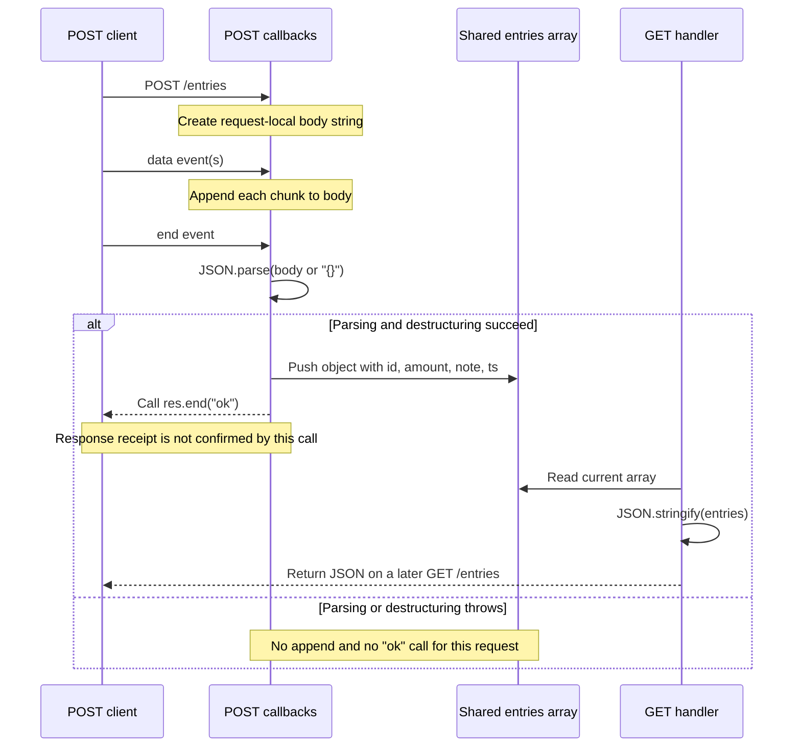

# From POST /entries to visible ledger state

A successful `POST /entries` adds an object to a shared, in-memory array **after the request body finishes arriving and before the server calls `res.end('ok')`**. A subsequent `GET /entries` serializes that array. The GET handler does not read the POST response or reload data from storage.

This explanation comes from static inspection of the supplied fixture. The application was not executed or tested. References below are relative to the fixture root, `docs/validation/ce-skill-optimization-2026-10-29/remaining-27-acceptance/wave1/fixtures/explain/`. No commit identity or working-tree status was inspected, so the references identify supplied file contents, not a verified repository revision. This artifact is returned for the parent to save; no file was written here.

## The trigger and the ownership boundary

The server listens on port `3000` and routes on the exact request method and URL (`src/server.js:5–6,16,25`). Only `POST` with `req.url === '/entries'` enters the append branch. Other unmatched requests receive `404` and `not found` (`src/server.js:21–22`).

Two different lifetimes matter:

| Value | Owner and lifetime | Consequence |
|---|---|---|
| `body` | One POST handler invocation, captured by its event callbacks | Each POST accumulates its own request body. |
| `entries` | Module-level array, shared by the server's handlers | Every successful append becomes available to later GET handlers in that server instance. |
| `req` and `res` | The individual HTTP exchange | Ending one response does not clear the shared array. |

The array is created once at module initialization (`src/server.js:3`). The POST-local string is created when that branch is entered (`src/server.js:7`).

## The ordering: receive, parse, append, respond

The POST route registers callbacks and returns. That `return` prevents fall-through into the remaining routing code; it does **not** mean the body has been parsed or the entry added (`src/server.js:8–15`).



The mutation and response occur together in the `end` callback:

```javascript
req.on('end', () => {
  const { amount, note } = JSON.parse(body || '{}');
  entries.push({ id: entries.length + 1, amount, note, ts: Date.now() });
  res.end('ok');
});
```

Source: `src/server.js:9–13`.

The ordering establishes three useful facts:

1. **Receiving some body bytes is insufficient.** The append occurs only when the `end` callback runs.
2. **Parsing precedes mutation.** A parse failure cannot leave a partially appended object through this code path.
3. **Mutation precedes response completion signaling.** Calling `res.end('ok')` happens after the array has changed; it does not establish that the client received the response.

Within this callback there is no asynchronous wait between parsing and pushing. Under ordinary Node.js callback execution, another request handler does not interrupt those statements. Across multiple POST requests, append order follows execution of their `end` callbacks, not necessarily request arrival order.

A GET handled while a POST is still accumulating body chunks sees the array without that pending entry. A GET handled after its append sees the new entry, provided the same server instance is still running.

## What gets stored, and what GET exposes

For a body such as:

```json
{"amount":12.5,"note":"Lunch"}
```

the POST code selects `amount` and `note`, then generates:

- `id`: current array length plus one;
- `ts`: `Date.now()` at append time.

It does not validate the amount, require a note, or preserve other submitted fields (`src/server.js:10–11`). This fixture has no deletion path; within one uninterrupted instance, successful appends therefore receive increasing IDs.

GET converts the current array to a JSON string and sets its response content type:

```javascript
res.setHeader('content-type', 'application/json');
res.end(JSON.stringify(entries));
```

Source: `src/server.js:16–18`.

That response is a snapshot produced when `JSON.stringify` runs. It is not a subscription: later appends do not update an already-created response.

An empty POST body is a notable edge case. Because the parser receives `body || '{}'`, an empty string becomes `{}`. The server then appends an object whose `amount` and `note` are `undefined`. JSON serialization omits those object properties, so GET exposes only the generated `id` and `ts` for that entry. A whitespace-only body is nonempty and is not replaced by `{}`; it fails JSON parsing.

## Malformed JSON is not a handled API error

For malformed JSON, `JSON.parse` throws inside the `end` callback. There is no `try/catch`, error response, or local recovery branch (`src/server.js:9–13`).

Consequently, this request reaches neither `entries.push(...)` nor `res.end('ok')`. The source does not implement a structured `400` response.

Valid JSON is also not equivalent to a valid expense. For example, JSON `null` parses successfully but throws when destructured into `{ amount, note }`; an object missing those fields can still be appended. The code supplies parsing, not a business-data validation boundary.

In a standard Node.js process, an uncaught exception normally terminates the process. That is a runtime expectation, not an observed result from this trial. The fixture supplies no process-level exception handler or supervisor configuration, so it cannot establish what an actual deployment would do afterward.

## Cancellation and recovery: where certainty ends

There are no explicit handlers for request abortion, request errors, response errors, or cancellation (`src/server.js:5–23`). The code does not establish a cancellation protocol.

| Situation | What the source supports | What it does not establish |
|---|---|---|
| The POST never reaches its `end` callback | Its append statement does not execute. | The exact events, cleanup, or client-visible error after a disconnect. |
| The append executes, then the response is lost | The entry has already been added; there is no rollback branch. | Whether the client knows the append succeeded. |
| The client retries after an uncertain result | A retry that reaches a successful append creates another object. | Deduplication, idempotency, or exactly-once recording. |
| The server starts a fresh process | `entries` starts as `[]`. | Restoration of earlier entries or continuity of IDs. |

A cancelled client request cannot be assumed to cancel a mutation that has already happened. Equally, a missing `"ok"` response does not prove that no entry was stored.

The README explicitly says data is kept in memory (`README.md:6`), and the supplied implementation contains no persistence or recovery loader. A fresh process therefore loses the old array and begins ID assignment again. An external recovery mechanism might exist elsewhere, but none is supplied here.

## Rationale: documented purpose versus inferred benefit

The README calls MiniLedger “a tiny personal expense-tracking demo app” and identifies the add/list endpoints and in-memory storage (`README.md:3–6`). That documents its scope and behavior.

Using one shared array makes the request-to-state relationship short and directly visible. That is a supported explanation of the implementation's effect, **not evidence of the original author's reason for choosing it**. The supplied files contain no decision record explaining why persistence, validation, or cancellation handling was omitted.

One README statement should not be mistaken for a verified input contract: it says adding an entry requires five fields typed by hand (`README.md:8`). The supplied server reads only `amount` and `note`, generates `id` and `ts`, and enforces no required-field check. No UI is supplied to reconcile that statement. For this server's behavior, the implementation is the direct evidence.

## Check yourself

Answer these before reading the explanations below.

1. A POST has delivered one body chunk, but its `end` callback has not run. Must a GET include its entry?
2. A client receives no `"ok"` and retries. Can that produce two entries?
3. Does malformed JSON result in a controlled `400` response?

---

**1. No.** Body accumulation is request-local. Shared state changes only at the push inside the `end` callback.

**2. Yes.** The first append may have succeeded before its response was lost. A successful retry appends again; there is no idempotency check.

**3. No such response is implemented.** Parsing throws before mutation and before `"ok"`. The exception is unhandled locally; the fixture does not prove the deployment's resulting response, process supervision, or recovery behavior.
