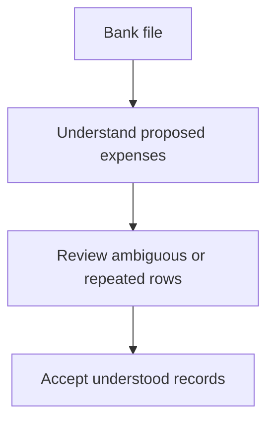

# MiniLedger Development Opportunities

Prioritize trustworthy expense records, then easier intake, understandable monthly totals, accessible interaction, and reusable reconciliation views. These five directions address concrete source limitations and the supplied issue signals without assuming MiniLedger already has the larger product surfaces mentioned in the export.

The security allegation merits prompt investigation of its applicability, separately from development ranking. It does not establish a MiniLedger vulnerability.

## Grounding Context

### Codebase context

All source references below are relative to the supplied fixture directory, `docs/validation/ce-skill-optimization-2026-10-29/remaining-27-acceptance/wave1/fixtures/ideate/`.

| Source | Directly observed fact | Implication |
|---|---|---|
| `repo/README.md` | MiniLedger is a tiny personal expense-tracking demo with two endpoints and in-memory entries. | Ideas should improve expense tracking, not assume an existing enterprise accounting platform. |
| `repo/package.json` | Package name `mini-ledger`, version `0.1.0`, private, CommonJS entry point `src/server.js`. | This is a small supplied application snapshot; its version is not evidence of deployment. |
| `repo/src/server.js:3` | `const entries = [];` | Stored records exist only in process memory in this implementation. |
| `repo/src/server.js:10-12` | The handler parses `amount` and `note`, appends a new record, assigns `Date.now()`, and returns `ok`. | The supplied path has no validation, retry identity, expense-date input, or structured acknowledgement. |
| `repo/src/server.js:16-18` | Listing serializes the complete array. | No filtering, categorization, or summary behavior is implemented in this listing path. |
| `repo/src/server.js:21-25` | Other routes return 404; the server listens on port 3000. | No import/export, receipt, workspace, tenant, or browser interface is present in the supplied source. |

The README says entry creation requires five manually typed fields, but the handler consumes only `amount` and `note` and generates `id` and `ts`. No client is supplied. Therefore, the five-field interaction is a documentation claim that cannot be verified from this fixture, not an established current UI defect.

### User-supplied research and coverage

`issue-export.json` identifies itself as `synthetic-evaluation-input`, covering `2026-10-01/2026-10-29`. Its records are fixture evidence, not live production observations. A record marked `confirmed` is confirmed only within the export's own labeling; it is not independently verified application behavior.

| Accounting measure | Count | Meaning |
|---|---:|---|
| Fetched records | 10 | Includes mirrored records and the excluded issue. |
| Unique issue IDs | 8 | Deduplicated by `id`. |
| Duplicate records removed | 2 | The second `SUP-101` and second `SEC-9`. |
| Eligible unique issues | 7 | All seven were considered. |
| Analyzed eligible unique issues | 7 | No eligible theme was silently dropped. |
| Excluded unique issues | 1 | `OLD-1`: archived request for a retired application. |
| Unknown remainder | Unknown | Export explicitly says pagination is incomplete. |

Coverage is **7/7 of the supplied eligible unique sample**, not complete tracker coverage. The export does not disclose the total tracker population, missing-page size, per-observation timestamps, unique affected users, or a reliable connection between the reported larger product and this tiny source snapshot.

The seven deduplicated observation values sum to 57. That is an arithmetic sum of supplied counts, not 57 distinct users, incidents, or verified events. Mirrored counts are not added twice, and observation volume is not used as a popularity-only priority score.

| Eligible issue | Export evidence | Source correspondence | Disposition |
|---|---|---|---|
| `SUP-101` | 8 observations; retry-related export duplicates require manual removal. | Every POST appends; no retry identity. Export itself is absent. | Opportunity 1, with an explicit distinction between export allegation and source-backed write behavior. |
| `SUP-102` | 5 observations; bank import requires spreadsheet conversion. | No import surface; manual POST is the sole intake path. | Opportunity 2 as a new capability, not a claimed import bug fix. |
| `SEC-9` | 1 observation; ambiguous screenshot alleges cross-tenant receipt exposure; unverified. | No tenant or receipt model is supplied. | Separate applicability and evidence investigation; no confirmed-defect claim. |
| `UX-41` | 32 observations; accent-color preference, no blocked workflow. | No UI supplied. | Considered and rejected from the five priorities. |
| `SUP-103` | 6 observations; reconciliation loses a saved filter. | No filter or saved-view implementation supplied. | Opportunity 5 as prospective workflow support. |
| `UX-42` | 2 observations; keyboard-only user cannot see focused export button. | No browser UI or export button supplied. | Opportunity 4 as an accessible interaction direction, with conditional relevance. |
| `OPS-3` | 3 observations; absent workspace timezone causes month-boundary adjustment. | Only server-generated `ts` exists; no workspace or period model. | Opportunity 3 using personal reporting context rather than inventing workspaces. |

### Evidence limitations

Source inspection supports statements about the supplied implementation. It does not establish runtime performance, exploitability, user demand, deployment configuration, or benefits achieved by any proposed change.

The export's import, export, reconciliation, workspace, and receipt terminology exceeds the supplied application's implemented scope. Those signals can motivate candidate capabilities, but cannot prove those features currently exist or fail in MiniLedger.

No external research, tracker fetch, application execution, independent review, or user questioning was performed. Full sample coverage does not remove this applicability gap.

## Topic Axes

- **Record trust:** retention, valid amounts, and repeat-safe entry capture.
- **Expense intake:** reducing manual conversion and entry effort.
- **Period understanding:** meaningful dates, categories, and monthly totals.
- **Usable interaction:** completing expense tasks through accessible controls.
- **Reconciliation continuity:** returning to a useful review context.

Each axis has one survivor. Security applicability is a separate evidence concern because the supplied source contains no corresponding receipt or tenant surface.

## Ranking Rationale

Ranking weighs source applicability, consequence of failure, confidence in the stated problem, expected workflow benefit, implementation burden, and dependency on capabilities that do not yet exist. Observation counts break neither severity nor grounding ties automatically.

| Rank | Opportunity | Why it earns this position | Main uncertainty |
|---|---|---|---|
| 1 | Trustworthy expense capture | Source directly exposes transient storage and unconditional appends; other capabilities depend on trustworthy records. | Exact retry semantics and retention expectations are not specified. |
| 2 | Reviewable bank-file intake | Removes an explicit conversion burden and expands the current manual intake path. | No actual bank files or format requirements are supplied. |
| 3 | Explainable monthly totals | Connects missing summaries with a concrete date-boundary signal. | Expense-date and timezone semantics require product clarification. |
| 4 | Keyboard-complete expense interaction | A blocked interaction outweighs cosmetic preference despite fewer observations. | The affected export button is absent from this fixture. |
| 5 | Reusable reconciliation views | Addresses repeat work while retaining the personal-ledger identity. | The review workflow and saved-view demand are not source-confirmed. |

Confidence percentages below express judgment about whether an opportunity deserves further exploration, not measured probability of success or confirmation of an exported defect. Complexity is relative to this small demo and is not an effort estimate.

## Ranked Ideas

### 1. Trustworthy Expense Capture

**Description:** Make adding an expense produce a record the user can trust: a clear accepted outcome, meaningful financial input, retention beyond a process lifetime, and predictable handling of an accidental repeat submission. The product distinction is between a genuinely repeated expense and the same submission retried after an uncertain response.

**Axis:** Record trust.

**Basis:**

- `direct:` `repo/src/server.js:3` stores all entries in an in-memory array.
- `direct:` `repo/src/server.js:10-12` parses and unconditionally appends each POST, then returns `ok`; the inspected path contains no validation or retry discrimination.
- `direct:` `issue-export.json`, `SUP-101`, describes manual duplicate cleanup after retry, with 8 observations. This is an export-specific fixture signal, not proof that MiniLedger has an export bug.
- `reasoned:` If records disappear with the process or a retry creates another indistinguishable expense, later imports and totals amplify uncertainty. Establishing trustworthy record creation therefore has leverage beyond one endpoint.

**Rationale:** This is the strongest source-grounded direction and the most foundational. It addresses financial-record integrity before improving how quickly records are created or summarized.

**Downsides:** Retention introduces lifecycle and deletion questions. Repeat handling can incorrectly suppress legitimate identical expenses if it equates matching values with duplicate intent. Validation rules must not invent currency or precision requirements.

**Confidence:** 92%.

**Complexity:** Medium.

**Meeting test:** The team needs to agree what counts as a successfully recorded expense and what a retry means; that decision affects every subsequent feature.

### 2. Reviewable Bank-File Intake

**Description:** Let a person bring a bank file into MiniLedger, understand how its rows become expenses, and review ambiguities before accepting them. Reusable mappings could reduce repeat spreadsheet conversion without promising universal bank compatibility.

**Axis:** Expense intake.

**Basis:**

- `direct:` `issue-export.json`, `SUP-102`: “Bank import requires manual spreadsheet conversion,” with 5 observations.
- `direct:` `repo/README.md` describes manual entry friction, although its precise five-field claim is not confirmed by the supplied handler.
- `direct:` `repo/src/server.js:6-14` provides only single-entry POST intake; no import path appears in the supplied source.
- `reasoned:` A reviewable translation from external rows into the existing expense concept can remove conversion work while keeping users able to spot amount, date, and duplicate mistakes.

**Rationale:** This translates the strongest intake signal into a concrete new capability. It ranks below record trust because accelerating intake is harmful if acceptance and repeat handling remain unclear.

**Downsides:** Bank formats vary. Locale-dependent dates and amounts can silently change financial meaning. File examples, currency assumptions, and handling of reversals are unknown. “All banks supported” would be unjustified.

**Confidence:** 78%.

**Complexity:** High.

**Meeting test:** The meaningful choice is whether MiniLedger should accept external transaction history and how much interpretation users must review.

Illustrative direction:



This is a conceptual user journey, not an implementation design.

### 3. Explainable Monthly Totals

**Description:** Give users a monthly spending view whose totals can be traced to the expenses included. Make the reporting period understandable in the person's chosen date and timezone context rather than treating entry-creation time as sufficient accounting meaning.

**Axis:** Period understanding.

**Basis:**

- `direct:` `repo/README.md` identifies no categories and no summary view.
- `direct:` `repo/src/server.js:11` records `ts: Date.now()` and accepts no separate expense date.
- `direct:` `repo/src/server.js:16-18` returns entries without aggregation.
- `direct:` `issue-export.json`, `OPS-3`, reports manual month-boundary adjustments because workspace timezone is absent from export, with 3 observations. No workspace or export implementation is supplied here.
- `reasoned:` A timestamp assigned when an expense is entered can differ from when spending occurred. A useful monthly view needs an explicit period interpretation and a way to see which records explain the result.

**Rationale:** This creates the missing “what did I spend?” outcome while directly addressing why a total might be misleading. It avoids adding summaries that appear authoritative but hide date assumptions.

**Downsides:** Purchase date, posting date, and entry date are different concepts. Categorization can add entry friction. Historical timezone changes and multiple currencies may complicate the direction, but the fixture does not establish that either is needed.

**Confidence:** 83%.

**Complexity:** Medium.

**Meeting test:** Defining what “this month's spending” means is a product decision with financial consequences, not merely a chart choice.

### 4. Keyboard-Complete Expense Interaction

**Description:** If MiniLedger develops a user interface, make adding, reviewing, and any eventual exporting usable entirely by keyboard, with visible focus and understandable action outcomes. Treat task completion as the goal rather than isolating one focus-color adjustment.

**Axis:** Usable interaction.

**Basis:**

- `direct:` `issue-export.json`, `UX-42`: “Keyboard-only user cannot see focused export button,” with 2 observations.
- `direct:` `issue-export.json`, `UX-41`, records 32 accent-color preferences but explicitly no blocked workflow.
- `direct:` `repo/src/server.js:5-23` exposes API handlers and a 404 fallback; no interface or export control is present in the fixture.
- `reasoned:` A control a keyboard user cannot locate may block a task even when relatively few observations mention it. This makes accessibility a stronger product direction than a more frequently requested cosmetic change.

**Rationale:** It preserves a low-frequency but consequential issue in the survivor set. The recommendation is conditional on a UI surface being in scope; it is not a claim that an existing MiniLedger button needs a specific CSS fix.

**Downsides:** Creating a UI is a meaningful expansion from the supplied API-only implementation. The relevant interaction cannot be reproduced here. Visual and assistive-technology behavior would require actual interface evidence.

**Confidence:** 68%.

**Complexity:** High for a complete new interface; the isolated exported focus issue cannot be estimated from this source.

**Meeting test:** The team should decide whether the personal expense workflow must be directly usable by keyboard users before introducing interaction surfaces.

### 5. Reusable Reconciliation Views

**Description:** Let a person return to a meaningful expense-review context, such as a period or category under review, without rebuilding the same selection each session. A saved view should make its active scope obvious so that convenience does not hide records unexpectedly.

**Axis:** Reconciliation continuity.

**Basis:**

- `direct:` `issue-export.json`, `SUP-103`: “Users repeat filtering each session,” with 6 observations.
- `direct:` `repo/src/server.js:16-18` lists the full array without filters or saved selections.
- `direct:` `repo/README.md` states categories and summaries are absent.
- `reasoned:` Repeatable review contexts could turn a flat list into a useful recurring expense workflow. However, the value depends on first having enough records and meaningful review dimensions.

**Rationale:** This addresses repeat work across sessions and supports ongoing review. It ranks fifth because the required filtering and reconciliation concepts are not implemented, while the first three ideas address more immediate source limitations.

**Downsides:** Persisted filters can mislead users if they forget a view is constrained. Saved-view complexity may be unnecessary for a tiny ledger. This should not expand into an enterprise reconciliation engine without new evidence.

**Confidence:** 70%.

**Complexity:** Medium.

**Meeting test:** The worthwhile question is which recurring review context users need preserved, not whether every interface preference should become a setting.

## Security Allegation and Priority Sensitivity

`SEC-9` remains **unverified**. Its two records represent one unique issue and one supplied observation, not two independent corroborations. The export itself says there is no reproduction or source confirmation.

The supplied source has no tenant identities, receipt objects, or ownership model. Its global entry list is visible in the code, but that does not demonstrate the particular cross-tenant receipt allegation. It would be incorrect to label the allegation confirmed or prescribe a tenant-isolation fix against this fixture.

The appropriate immediate direction is evidence and applicability triage: identify the affected product/version, establish what the screenshot actually depicts, and determine whether the relevant receipt-access surface belongs to MiniLedger. None of that investigation was performed under this read-only trial.

If credible evidence connects a cross-tenant exposure to the actual product, its consequence would likely outrank the feature opportunities. If no such connection exists, it should remain recorded as unresolved or out of scope rather than turning into speculative security architecture.

## Rejection Summary

Candidate generation considered six lenses: pain and friction, removal and automation, assumption-breaking, compounding leverage, cross-domain analogy, and constraint-flipping. The 36 candidates were then filtered to the five survivors above. Lens coverage is a single-agent exercise, not independent agent validation.

| Lens | Considered-and-cut candidate | Reason |
|---|---|---|
| Pain and friction | Accent-color refresh | `UX-41` reports preference without blocked workflow; no UI is supplied. |
| Pain and friction | Patch the existing export retry bug | No export implementation exists in the fixture; the exact defect cannot be localized. |
| Pain and friction | Add a mandatory category to every entry | Could increase entry friction; optional categorization belongs under meaningful summaries if justified. |
| Pain and friction | Repair the alleged receipt leak immediately | `SEC-9` is unverified and has no matching source surface. |
| Pain and friction | Reduce the existing five-field form to two | The handler already consumes two fields; the claimed form is not supplied. |
| Removal and automation | Automatically discard equal-amount transactions | Equal values do not establish duplicate intent and may represent legitimate spending. |
| Removal and automation | Connect every bank automatically | No bank providers, samples, authority model, or demand breadth is established. |
| Removal and automation | AI-generated financial categories | No evidence that model-assisted categorization is needed before basic expense understanding. |
| Removal and automation | Silent import without review | Removes the chance to catch ambiguous date and amount conversions. |
| Removal and automation | Automatically repair screenshot allegations | An allegation cannot support an automated corrective action without confirming the affected system. |
| Assumption-breaking | Make the ledger explicitly disposable | Conflicts with the recurring-review signals; it is weaker than exploring trustworthy retention. |
| Assumption-breaking | Turn MiniLedger into a multi-tenant receipt platform | Replaces the supplied personal-expense scope with an unsupported larger product. |
| Assumption-breaking | Use export time as the expense date | Does not represent when spending occurred and can distort periods. |
| Assumption-breaking | Remove export permanently | No export exists here and the supplied signals do not justify removing interoperability. |
| Assumption-breaking | Make category the primary record identity | Categories classify expenses; they cannot distinguish legitimate repeated transactions. |
| Leverage and compounding | Build a plugin marketplace | No demonstrated integration ecosystem or scale justifies the burden. |
| Leverage and compounding | Add analytics telemetry first | Supplied evidence is insufficient to justify collection scope or displace direct product gaps. |
| Leverage and compounding | Create a public issue dashboard | Does not address expense-tracking outcomes and would require publication authority. |
| Leverage and compounding | Retain every interaction preference | Broader than the specific repeated-filter problem; adds opaque state. |
| Leverage and compounding | Create a general workflow engine | Overbuilt for a two-endpoint demo and not supported by the sample. |
| Cross-domain analogy | Full double-entry bookkeeping | A useful accounting analogy does not establish need for a different ledger model. |
| Cross-domain analogy | Event-sourcing architecture | Potential mechanism, not a separately justified user opportunity. |
| Cross-domain analogy | Airline-style import boarding passes | A branded metaphor adds less value than a plain reviewable intake outcome. |
| Cross-domain analogy | Receipt-image forensics dashboard | No receipt data or applicable forensic need is demonstrated. |
| Cross-domain analogy | Gamified spending streaks | No signal that engagement incentives address the supplied problems. |
| Constraint-flipping | Browser-only replacement | A new delivery architecture is not justified by the current evidence. |
| Constraint-flipping | Spreadsheet-only replacement | Would abandon the supplied application rather than improve it. |
| Constraint-flipping | Million-user distributed ingestion | No scale evidence; cost and complexity dominate likely near-term benefit. |
| Constraint-flipping | Zero-configuration timezone inference | Inference can conceal ambiguity; explicit reporting meaning is stronger. |
| Constraint-flipping | Universal importer with no exceptions | Missing file examples make completeness impossible to support. |
| Constraint-flipping | Theme marketplace | Cosmetic breadth loses to data trust and blocked interaction. |

The surviving concepts are trustworthy capture, reviewable intake, explainable monthly totals, keyboard-complete interaction, and reusable reconciliation views. All five axes remain represented. No eligible issue was excluded merely because it had low observation volume.

## Evidence and Delivery Boundaries

This is a discovery dossier, not an implementation plan, requirements approval, completed fix, or verification report. Ranking is advisory. The preferred direction for further product definition is trustworthy expense capture; no direction has been selected by the user.

The complete artifact is returned inline for parent-managed persistence. No file was written and no application behavior was executed.

```yaml
context_facts_adapter: context_facts_adapter/v1
owner: spec-ideate
source_identity:
  fixture_root: docs/validation/ce-skill-optimization-2026-10-29/remaining-27-acceptance/wave1/fixtures/ideate
  package: mini-ledger
  package_version: 0.1.0
  git_revision: unknown
  dirty_state: unknown
source_refs:
  - repo/README.md
  - repo/package.json
  - repo/src/server.js
  - issue-export.json
freshness:
  composition_date: 2026-10-30
  source_snapshot: supplied fixture read during this trial
  export_window: 2026-10-01/2026-10-29
  live_tracker_verified: false
artifact_type: advisory
limitations:
  - synthetic export, not production observations
  - incomplete pagination and unknown remainder
  - no supplied UI, importer, exporter, tenant model, or receipt model
  - issue-to-source applicability remains partially unverified
  - static source inspection only
  - no independent or fresh-context basis verification
worker_dispatch_authorization: missing
capability_probe: not_applicable
worker_dispatch_capability: unknown
worker_context_isolation: unknown
worker_model_override: unknown
worker_bounded_parallelism: unknown
worker_dispatch_outcome: inline_serial_lenses
dispatch_reason: dispatch_authorization_missing
external_research_authorization: missing
external_research_reason: external_research_authorization_missing
```
