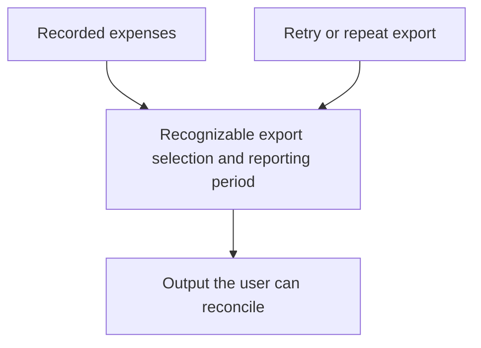

# MiniLedger: Five Prioritized Development Opportunities

The strongest development direction is **trustworthy, repeatable financial export**, followed by bank import, keyboard-accessible interaction, and saved reconciliation views. A fifth opportunity is a bounded investigation of the alleged receipt exposure: its potential consequence deserves attention, but the supplied evidence does not justify calling it a confirmed defect or prescribing a tenant-security redesign.

These are development opportunities, not implementation commitments. Several reports describe features absent from the supplied MiniLedger source. Their usefulness is therefore conditional on establishing which application or missing product surface they describe.

## Grounding Context

### Source and evidence boundaries

All source references below are relative to:

`docs/validation/ce-skill-optimization-2026-10-29/remaining-27-acceptance/wave1/fixtures/ideate/`

The complete supplied material consists of:

- `repo/README.md`: describes a tiny personal expense-tracking demo with two endpoints, in-memory entries, and rough edges around entry creation, categories, and summaries.
- `repo/package.json`: identifies `mini-ledger`, version `0.1.0`, a private package whose entry point is `src/server.js`.
- `repo/src/server.js`: implements `POST /entries` and `GET /entries`.
- `issue-export.json`: explicitly identifies itself as `synthetic-evaluation-input`, covering the stated window `2026-10-01/2026-10-29`.

The code accepts `amount` and `note`, assigns an ID and timestamp, and appends the entry to an in-memory array (`repo/src/server.js:3`, `:10`, `:11`). The list endpoint serializes that array (`:16`–`:18`). Other routes return 404 (`:21`–`:22`).

No export, bank import, reconciliation interface, receipt model, workspace timezone, tenant identity, or browser UI appears in the supplied implementation. Consequently, the issue export is evidence of **supplied concerns**, not proof that these defects exist in this code.

There is also a documentation discrepancy: the README says entry creation requires five manually typed fields, while the handler reads two and supplies its own ID and timestamp. No client was supplied to reconcile that difference. A five-field onboarding problem cannot be treated as source-confirmed.

### Coverage accounting

| Measure | Count | Interpretation |
|---|---:|---|
| Supplied records read | 10 | Every supplied record was considered. |
| Unique issue IDs | 8 | Deduplicated by `id`. |
| Duplicate mirror records | 2 | Second occurrences of `SUP-101` and `SEC-9`. |
| Eligible unique issues | 7 | All seven were analyzed; none silently dropped. |
| Excluded unique issues | 1 | `OLD-1`, explicitly ineligible because it concerns a retired application. |
| Eligible issues marked confirmed in the export | 6 | An export label, not independent verification or a production observation. |
| Eligible issues marked unverified | 1 | `SEC-9`. |
| Unseen remainder | Unknown | Pagination is incomplete; no total-population coverage can be calculated. |

Coverage is **7 of 7 eligible unique issues in this supplied sample**, not 100% of the tracker.

The deduplicated eligible records contain 57 reported observations. That arithmetic is not a count of distinct users, sessions, or independent incidents; the export does not define the observation methodology or possible overlap. Mirror counts are not added again.

### Complete eligible issue disposition

| Issue | Reported observations | Evidence label in export | Disposition |
|---|---:|---|---|
| `SUP-101` | 8 | Confirmed | Opportunity 1: repeatable export without duplicate re-entry. |
| `SUP-102` | 5 | Confirmed | Opportunity 2: import without manual spreadsheet conversion. |
| `SEC-9` | 1 | Unverified | Opportunity 5: evidence-led receipt-boundary investigation. |
| `UX-41` | 32 | Confirmed | Considered and deferred: accent preference has no reported workflow blockage. |
| `SUP-103` | 6 | Confirmed | Opportunity 4: saved reconciliation views. |
| `UX-42` | 2 | Confirmed | Opportunity 3: visible keyboard focus and accessible completion. |
| `OPS-3` | 3 | Confirmed | Opportunity 1: explicit reporting timezone and month boundaries. |

`SUP-101` appears in support and a feedback mirror; `SEC-9` appears in security triage and a support mirror. Each remains one issue, not corroboration from two independent incidents.

No per-record timestamps, historical comparison, customer counts, revenue exposure, deployment information, reproduction attachments, or complete pagination were supplied. Recurrence and business impact beyond the stated descriptions remain unknown.

### Provenance and limitations

```yaml
context_facts_adapter/v1:
  owner: spec-ideate
  source_identity:
    project: mini-ledger
    package_version: 0.1.0
    revision: unknown
    dirty_state: unknown
    evidence_artifact: synthetic-evaluation-input
  source_refs:
    - repo/README.md
    - repo/package.json
    - repo/src/server.js
    - issue-export.json
  freshness:
    composition_date: 2026-10-30
    export_window: 2026-10-01/2026-10-29
    live_tracker_verified: false
  artifact_type: advisory
  limitations:
    - Only the supplied fixture was examined.
    - Export pagination is incomplete.
    - Several reported product surfaces are absent from supplied source.
    - Application behavior was not executed or tested.
    - Candidate verification was an inline source check, not independent review.
```

Research and candidate evaluation used inline lenses only. No workers or external research were authorized; capability probing was unnecessary. The applicable reasons are `dispatch_authorization_missing` and `external_research_authorization_missing`. No files were written, application code executed, trackers fetched, or questions asked.

---

## Topic Axes

1. **Financial output correctness:** repeatability, traceability, and accounting-period interpretation.
2. **Expense intake:** reducing conversion and manual entry without corrupting records.
3. **Keyboard task completion:** making essential actions discoverable and operable.
4. **Reconciliation continuity:** retaining useful working context between sessions.
5. **Receipt confidentiality:** establishing whether the alleged boundary failure exists and where it belongs.

Accent styling was considered as an interaction variant. Its high observation count does not give it the same consequence as inaccessible controls or incorrect financial output.

---

## Ranking Rationale

Ranking weighs the consequence of the reported problem, strength and applicability of its evidence, likely workflow benefit, implementation burden, and overlap with other opportunities. Observation counts are secondary signals.

| Rank | Opportunity | Why it earns this position | Main qualification |
|---|---|---|---|
| 1 | Trustworthy, repeatable export | Addresses manual duplicate cleanup and month-boundary adjustments in one financial-output direction. | Export functionality is absent from the supplied source. |
| 2 | Bank import without spreadsheet conversion | Removes an entire preparation step and could reduce repeated manual entry. | Actual bank formats and import code are unavailable. |
| 3 | Keyboard-accessible completion | An essential action can become inaccessible despite only two reported observations. | No UI is supplied, so the focus defect is not source-verified. |
| 4 | Saved reconciliation views | Reduces repeated setup across sessions with relatively bounded product scope. | Reconciliation and user preferences are not implemented in the fixture. |
| 5 | Evidence-led receipt-boundary investigation | Converts a potentially serious allegation into a defensible development decision. | It is an investigation opportunity, not a confirmed vulnerability fix. |

**Investigation urgency is separate from build ranking.** `SEC-9` merits prompt bounded triage because of its alleged consequence. Fifth place does not mean postponing investigation until four features ship. If reproducible cross-user exposure is established, the resulting remediation should be reprioritized above convenience improvements.

Confidence percentages below are judgmental estimates of whether the proposed direction deserves further development under the supplied evidence. They are not measured probabilities that a defect exists or that a feature will deliver a particular return.

---

## Ranked Ideas

### 1. Make financial exports repeatable and explicit about reporting periods

**Description:** Explore an export experience where retrying or re-entering an export does not create ambiguous duplicates, and the reporting period states its timezone. The user should be able to understand whether an output repeats prior work and why transactions fall inside a particular month.

**Axis:** Financial output correctness.

**Basis:**

- `direct:` `issue-export.json`, `SUP-101`: “Users manually remove duplicate rows after retry.” Eight observations are reported once after deduplication.
- `direct:` `issue-export.json`, `OPS-3`: “Month-boundary totals need manual adjustment.” Three observations are reported.
- `direct:` `repo/src/server.js:11` assigns `id: entries.length + 1` and `ts: Date.now()`; `:18` returns the current collection.
- `reasoned:` Repeat identity and period interpretation are both prerequisites for trusting a financial output. Addressing them as one product direction can reduce two kinds of downstream cleanup.

**Rationale:** These reports describe work that users must perform to correct output, rather than a preference about presentation. The source provides entries and timestamps that could support an output capability, but it does not establish that an export retry bug exists. This may be a new capability for MiniLedger or a repair to an omitted application surface.

**Downsides:** Export identity, re-export semantics, and accounting-period meaning can become more complex than a simple download. The supplied evidence cannot tell whether duplication occurs during file generation, append, download retry, or downstream import. A broad “exactly once” promise would be premature.

**Confidence:** 80% that this is the strongest supplied opportunity; current-code defect attribution remains unverified.

**Complexity:** Medium, potentially High if durable identity or existing external workflows are involved.

**Meeting test:** The team needs a shared definition of a trustworthy financial export, not merely a renamed button.

**Evidence that would change the recommendation:** Establish which export surface the report concerns and distinguish duplicate file generation from duplicate downstream ingestion. Confirm the intended reporting timezone before deciding how month boundaries should behave.

Illustrative direction:



### 2. Replace spreadsheet conversion with a reviewable bank-import experience

**Description:** Explore importing a supported bank file directly, showing users how its contents map to expenses and which rows need attention before acceptance. Begin with formats actually represented in the reported workflow rather than promising universal bank compatibility.

**Axis:** Expense intake.

**Basis:**

- `direct:` `issue-export.json`, `SUP-102`: “Bank import requires manual spreadsheet conversion.” Five observations are reported.
- `direct:` `repo/src/server.js:10` reads only `amount` and `note`; `:11` assigns the timestamp at entry creation.
- `reasoned:` A bank-import feature must preserve the meaning of transaction values and dates, rather than simply turn arbitrary rows into the existing POST payload. A reviewable import could remove conversion work while making uncertainty visible.

**Rationale:** Removing manual file transformation changes an entire recurring workflow step. The source offers a small expense model, making the mismatch with richer bank data explicit and worth exploring before committing to an import design.

**Downsides:** Dates, signs, currency, headers, and duplicate statements may vary. None of those formats or failure cases is supplied here. Preview and supported-format boundaries add work, and a generic parser could produce misleading success.

**Confidence:** 75%.

**Complexity:** Medium for a deliberately supported format; High for broad compatibility.

**Meeting test:** The team must decide which financial meaning import preserves and how users resolve uncertain rows.

**Evidence that would change the recommendation:** Representative, appropriately sanitized source files and the current manual conversion steps. No bank-specific format, parser, or mapping is assumed.

### 3. Make essential expense actions usable without a mouse

**Description:** Explore a keyboard-complete path through essential entry and export actions, with visible focus and understandable action feedback. Treat visible focus as part of task completion rather than folding it into an accent-color redesign.

**Axis:** Keyboard task completion.

**Basis:**

- `direct:` `issue-export.json`, `UX-42`: “Keyboard-only user cannot see focused export button.” Two observations are reported.
- `direct:` `issue-export.json`, `UX-41`: accent color is a “Preference only; no blocked workflow observed.”
- `direct:` The supplied `repo/src/server.js` exposes HTTP responses but contains no UI or focus styling.
- `reasoned:` A control whose focus is invisible can prevent reliable keyboard operation. That consequence can outweigh a larger volume of cosmetic preferences.

**Rationale:** This is the clearest example in the sample of why raw frequency is a poor priority rule. The report describes an interaction barrier, whereas the 32-observation accent issue explicitly lacks observed workflow blockage.

**Downsides:** The reported UI may belong to code outside this fixture. It is not possible to name a defective CSS selector, claim accessibility conformance, or prescribe a component change from the server alone. A larger UI redesign would exceed the evidence.

**Confidence:** 80% in prioritizing the reported barrier over cosmetic styling; source-level attribution is unverified.

**Complexity:** Low for a verified local focus regression; Medium for an end-to-end interaction pass. The fixture cannot settle which applies.

**Meeting test:** The product decision is whether essential financial work is reliably available to keyboard users.

**Evidence that would change the recommendation:** The relevant interface and a reproducible keyboard path. The allegation should be tied to a specific control before a repair is scoped.

### 4. Let reconciliation resume from a recognizable saved view

**Description:** Explore named or clearly identified saved reconciliation views so users can return to the filters they deliberately chose. Make the active filter visible and easy to reset so convenience does not hide relevant expenses.

**Axis:** Reconciliation continuity.

**Basis:**

- `direct:` `issue-export.json`, `SUP-103`: “Users repeat filtering each session.” Six observations are reported.
- `direct:` `repo/src/server.js:16`–`:18` returns entries without a filtering implementation; `:3` stores entries only in memory.
- `reasoned:` A remembered reconciliation context can remove repeated setup, but invisible persistence can mislead users about which expenses they are viewing. Recognizable saved views address both concerns.

**Rationale:** The benefit accumulates over repeated sessions. This direction is more focused than a general analytics dashboard and directly matches the supplied friction.

**Downsides:** The fixture has no user identity, preferences, reconciliation model, or persistent store. The ownership and lifetime of a saved view are unresolved. Preserving a stale filter may also conceal new records.

**Confidence:** 70%.

**Complexity:** Medium, depending on the missing interface and persistence model.

**Meeting test:** The team needs to decide what working context should survive a session and how users recognize its effect.

**Evidence that would change the recommendation:** The filter dimensions used in practice, session behavior, and whether preferences are personal or shared. No assumption of an existing workspace model is made.

### 5. Turn the receipt-exposure allegation into a verified boundary decision

**Description:** Explore a narrow evidence-led security investigation that establishes the affected product surface, intended access boundary, and whether the alleged receipt exposure is reproducible. Development should follow the verified outcome: targeted remediation if supported, or an explicit unresolved/refuted finding if not.

**Axis:** Receipt confidentiality.

**Basis:**

- `direct:` `issue-export.json`, `SEC-9`: “One ambiguous screenshot alleges another studio receipt; no reproduction or source confirmation.”
- `direct:` The record is marked `unverified` and has one observation. Its mirror contributes no independent corroboration.
- `direct:` The supplied server contains one process-local entries array and no receipt or tenant model (`repo/src/server.js:3`, `:10`, `:11`, `:18`).
- `reasoned:` Potential cross-user disclosure has a high consequence, but an ambiguous allegation cannot determine the necessary architecture change. Investigation has value because it can materially change priorities while preventing unsupported remediation.

**Rationale:** The sample should not lose a security concern merely because its count is low, nor should severity erase uncertainty. The correct opportunity at this evidence level is to establish whether and where a boundary failed.

**Downsides:** The relevant receipt and identity surfaces may not be available. Investigation may remain inconclusive. Adding tenant infrastructure to a personal demo without establishing product scope would be costly and potentially irrelevant.

**Confidence:** 90% that bounded investigation is warranted; no numerical estimate is assigned to the probability of an actual exposure.

**Complexity:** Low to Medium for bounded triage; remediation complexity is unknown.

**Meeting test:** The outcome could change both release priorities and the product’s access model.

**Evidence that would change the recommendation:** A reproducible scenario, clear ownership expectations, and the actual receipt retrieval path. The absent tenant model in this fixture is neither proof of the allegation nor proof that another application surface is safe.

---

## Candidate Generation and Rejection Summary

Candidate generation preceded filtering. Six lenses were applied inline, producing 36 initial variants:

| Lens | Initial variants |
|---|---|
| Pain and friction | Duplicate cleanup removal; direct bank import; remembered filters; visible focus; correct month boundaries; accent redesign. |
| Inversion, removal, or automation | Retry without a second output effect; automatic format recognition; last-used reconciliation context; automatic color personalization; automatic duplicate merging; automatic receipt quarantine. |
| Assumption-breaking and reframing | Export as a repeatable financial result; import as reviewed interpretation; reconciliation as a saved view; keyboard use as a primary path; security allegation as a verification problem; multi-tenant conversion. |
| Leverage and compounding | Stable financial record identity; reusable import mappings; persistent personal ledger; reusable accessible controls; categories and summaries; a receipt-boundary evidence record. |
| Cross-domain analogy | Export batch manifests; import inspection station; reconciliation bookmarks; visible navigation landmarks; security chain of evidence; financial undo history. |
| Constraint-flipping | Narrow supported-file import; keyboard-only essential workflow; personal offline ledger; zero-manual-adjustment export; severity-led one-report triage; popularity-led roadmap. |

Overlapping variants were consolidated into the five surviving directions. Export identity and batch-manifest concepts remain variants of opportunity 1; import inspection and mappings belong to opportunity 2; keyboard-first controls belong to opportunity 3; bookmarks belong to opportunity 4; evidence-chain and severity-led triage belong to opportunity 5. They are not independent recommendations or settled requirements.

The remaining distinct alternatives were cut or deferred as follows:

| Alternative | Reason rejected or deferred |
|---|---|
| Accent redesign or automatic color personalization | `UX-41` has the highest observation count but explicitly reports preference without workflow blockage. Lower expected benefit than the retained opportunities. |
| Automatic duplicate merging | The export-retry report does not establish that duplicate ledger entries exist. Automatic merging could remove legitimate repeated expenses. |
| Automatic format recognition as the central import promise | No bank files or format distribution were supplied. A bounded, reviewable import is better supported than universal inference. |
| Invisible restoration of the last reconciliation state | Can conceal records through stale filters. The stronger surviving direction makes saved context recognizable and resettable. |
| Automatic receipt quarantine | Assumes an actual exposure, a receipt implementation, and a safe quarantine mechanism, none of which is established. |
| Convert MiniLedger into a multi-tenant product | The README identifies a personal demo. One unverified “studio” allegation cannot justify a product and architecture expansion. |
| Persistent or offline personal ledger as the top priority | In-memory storage is source-confirmed, but no supplied report establishes restart loss or offline demand. Worth revisiting without displacing the sample’s clearer workflow concerns. |
| Categories and a summary dashboard | The README names these gaps, but the supplied eligible issues give stronger reasons for the five retained directions. |
| Financial undo history | Potentially useful, but no supplied record describes accidental changes or recovery needs. |
| Popularity-led roadmap | Would elevate accent styling above correctness and accessibility while treating uncertain observation counts as comparable user impact. |
| Implement `OLD-1` | Explicitly excluded: archived request for a retired application. |
| Fix an assumed existing export, import, or tenant module | No such module appears in the supplied source. Recommendations remain conditional until product applicability is established. |

All five topic axes have a survivor. No eligible issue was excluded from analysis because it was inconvenient, unverified, or lower priority.

## Decision Boundary

The recommended first development exploration is trustworthy export, with prompt, bounded investigation of `SEC-9` treated separately from feature build order. Before turning any export-derived concern into a repair, establish its connection to the supplied MiniLedger application or the omitted product surface.

This dossier is complete as an advisory comparison of the supplied sample. It does not establish live production defects, measured customer benefit, tested behavior, security clearance, approved requirements, or an implementation plan.
