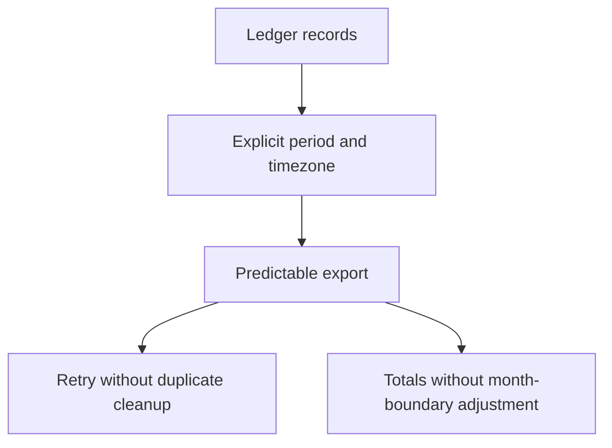
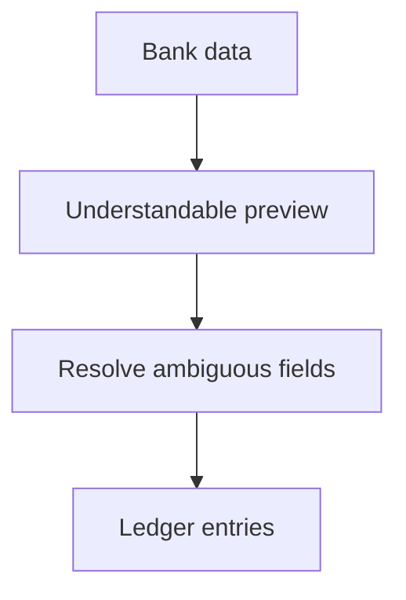

# MiniLedger: Five Prioritized Development Opportunities

Prioritize trustworthy data movement, followed by evidence-gated security investigation, accessible interaction, and reusable reconciliation views. These directions address all seven eligible issue identities without treating repeated export records as additional demand or treating the synthetic export as production evidence.

The strongest development opportunity is a retry-safe, timezone-explicit export experience. The security allegation deserves prompt investigation alongside that opportunity, but the supplied material does not establish a security defect or justify building a tenant system.

## Grounding Context

### Codebase Context

The supplied MiniLedger repository is a small personal expense-tracking demo, version `0.1.0`, using Node.js and CommonJS.

References below use paths relative to the supplied `fixtures/ideate/` directory.

| Reference | Observed evidence | Implication |
|---|---|---|
| `repo/README.md` | “A tiny personal expense-tracking demo app” | Opportunities should remain proportionate to a small expense ledger. |
| `repo/src/server.js:3` | `const entries = [];` | Entries are held in process memory; durable recovery is not implemented in this source. |
| `repo/src/server.js:6` | Only `POST /entries` handles creation. | There is no supplied bank-import route. |
| `repo/src/server.js:10` | `const { amount, note } = JSON.parse(body || '{}');` | The implemented input consumes two fields. |
| `repo/src/server.js:11` | Entries receive an incremented ID and `Date.now()` timestamp. | Repeated POST requests append entries; the source has no visible deduplication or user-selected transaction date. This does not reproduce the export issue. |
| `repo/src/server.js:16` | `GET /entries` lists entries. | There is no supplied export, reconciliation, receipt, tenant, or UI implementation. |
| `repo/README.md` | “adding an entry requires five fields typed by hand; no categories; no summary view” | Documentation suggests capture and understanding problems, but the five-field statement conflicts with the supplied API implementation. No UI is available to resolve that discrepancy. |

The issue export describes richer workflows than this source implements. Its themes are development signals, not proof that those features or defects exist in this MiniLedger revision. Each opportunity below separates the directly checked source from the proposed extension.

No application code was executed. Git revision, dirty state, deployment identity, and correspondence between issue records and source version are unknown.

### User-Supplied Research and Coverage

`issue-export.json` identifies itself as `synthetic-evaluation-input`, covering `2026-10-01/2026-10-29`. Its `source_limitation` explicitly says it is a local evaluation export, not live tracker data.

| Accounting measure | Count or disposition |
|---|---|
| Fetched records | 10 |
| Unique issue identities | 8 |
| Eligible unique issues | 7 |
| Excluded unique issues | 1 |
| Duplicate records | 2: the second occurrences of `SUP-101` and `SEC-9` |
| Eligible identities examined | 7 of 7 |
| Eligible identities unexamined | 0 |
| Excluded identity | `OLD-1`: archived request for a retired application |
| Unfetched remainder | Unknown; pagination is incomplete |

Deduplication uses issue ID. The mirrored `SUP-101` record does not increase its eight observations to sixteen; the mirrored `SEC-9` record does not create a second allegation.

Observation counts are retained as supplied, not interpreted as unique users, independent incidents, or population prevalence. Their collection method and cross-issue overlap are unknown. Complete coverage of the eligible supplied sample does not establish complete tracker coverage.

| Eligible issue | Supplied observations | Export confidence | Concrete signal | Disposition |
|---|---:|---|---|---|
| `SUP-101` | 8 | Confirmed within fixture | “Users manually remove duplicate rows after retry.” | Opportunity 1 |
| `SUP-102` | 5 | Confirmed within fixture | “Bank import requires manual spreadsheet conversion.” | Opportunity 2 |
| `SEC-9` | 1 | Unverified | “One ambiguous screenshot alleges another studio receipt; no reproduction or source confirmation.” | Opportunity 3, investigation hypothesis only |
| `UX-41` | 32 | Confirmed within fixture | “Preference only; no blocked workflow observed.” | Considered and rejected from the top five |
| `SUP-103` | 6 | Confirmed within fixture | “Users repeat filtering each session.” | Opportunity 5 |
| `UX-42` | 2 | Confirmed within fixture | “Keyboard-only user cannot see focused export button.” | Opportunity 4 |
| `OPS-3` | 3 | Confirmed within fixture | “Month-boundary totals need manual adjustment.” | Opportunity 1 |

“Confirmed within fixture” preserves the export's label; it does not assert independent reproduction or production truth.

## Topic Axes

- **Data movement and accounting meaning:** import, export, retries, and month boundaries.
- **Privacy and data ownership:** whether records belong to the person permitted to see them.
- **Accessible interaction:** completing important actions through keyboard interaction.
- **Repeat-session continuity:** preserving useful reconciliation context.
- **Everyday capture and presentation:** entering, organizing, and understanding expenses.

The fifth axis has candidates but no independent survivor. Its source-grounded improvements remain useful alternatives; the supplied eligible issues provide stronger reasons for the selected five.

## Ranking Rationale

Ranking weighs consequence, workflow blockage, recurrence in the eligible sample, source fit, confidence in the evidence, and implementation burden. Observation volume is a secondary signal, not a vote count.

| Rank | Opportunity | Main reason for placement | Principal uncertainty |
|---|---|---|---|
| 1 | Trustworthy exports across retries and month boundaries | Combines repeated cleanup with accounting-correctness concerns in one coherent data-transfer experience. | No export implementation is supplied. |
| 2 | Bank import without spreadsheet preparation | Removes a repeated prerequisite to getting expenses into the ledger. | Supported formats and transaction semantics are unknown. |
| 3 | Resolve the receipt-ownership allegation before expanding sharing | Potential privacy impact merits prompt evidence gathering despite low confidence. | No receipt or tenant surface exists in the supplied source. |
| 4 | Keyboard-complete expense workflows | A blocked interaction outweighs a higher-volume cosmetic preference. | No UI is supplied for inspection. |
| 5 | Reusable reconciliation views | Addresses recurring work with comparatively bounded product scope. | Reconciliation and persistent preferences are absent from this source. |

Rank 3 is an investigation priority, not permission to postpone a potentially serious security signal until two features ship. If corroborated, its remediation priority would rise above routine development. If unrelated to MiniLedger or refuted, it should leave this product's development queue.

Confidence percentages below express judgment that a direction merits further exploration under these constraints. They are not measured success probabilities or confidence that a production defect exists.

## Ranked Ideas

### 1. Trustworthy Exports Across Retries and Month Boundaries

**Description:** Make transferring ledger data a predictable accounting action: retrying should not force duplicate cleanup, and a month should mean the same thing to the ledger and the exported data. Present the reporting period and timezone explicitly so users can understand what the export includes.

**Axis:** Data movement and accounting meaning.

**Basis:**

- `direct:` `issue-export.json`, `SUP-101`: “Users manually remove duplicate rows after retry.”
- `direct:` `issue-export.json`, `OPS-3`: “Month-boundary totals need manual adjustment.”
- `direct:` `repo/src/server.js:11` generates a timestamp with `Date.now()`; lines 16–18 return the entries as JSON. No reporting timezone or export operation appears in the supplied source.
- `reasoned:` Duplicate cleanup and month-boundary adjustment both undermine trust in transferred ledger records. A shared product direction can address their common user outcome while preserving separate causes.

**Rationale:** This combines two eligible signals without pretending they are duplicate reports of one defect. It prioritizes confidence in financial outputs over cosmetic preference. A stable transfer experience could also support later reconciliation.

**Downsides:** A combined direction could become too broad. Retry behavior, record identity, transaction dates, reporting periods, and timezone interpretation need separate clarification. An export cannot guarantee how arbitrary downstream tools handle repeated files.

**Evidence check:** Quotes and source were read directly. The export problem was not reproduced, and the source's append behavior is not evidence of its root cause.

**Confidence:** 80%.

**Complexity:** Medium.

**Discussion value:** Establishes what users should be able to trust when ledger data leaves the application.

Illustrative relationship, not an implementation design:



### 2. Bank Import Without Spreadsheet Preparation

**Description:** Let people bring bank data into MiniLedger without first reshaping it in a spreadsheet. A useful direction is an understandable import preview that exposes unsupported fields or ambiguous dates before the ledger changes.

**Axis:** Data movement and accounting meaning.

**Basis:**

- `direct:` `issue-export.json`, `SUP-102`: “Bank import requires manual spreadsheet conversion.”
- `direct:` `repo/src/server.js:10` accepts only `amount` and `note`; line 11 supplies the current timestamp.
- `reasoned:` A bank-import experience must preserve the meaning of imported transactions, not merely move rows faster. Using receipt time as transaction time could undermine historical expense interpretation; the desired treatment requires clarification.

**Rationale:** Removes recurring preparation work and makes the ledger more useful for existing expense records. It is more firmly connected to a blocked workflow than category automation or a generic dashboard.

**Downsides:** Format proliferation, date ambiguity, amount conventions, and duplicate records can turn convenience into incorrect data. Start by exploring the actual bank formats represented by the signal; universal compatibility is unsupported.

**Evidence check:** The friction is directly stated in the fixture. No bank files, parser, supported-format list, or import screen were supplied.

**Confidence:** 75%.

**Complexity:** Medium.

**Discussion value:** Changes the product from a manually populated demo toward a ledger that can accept existing financial records.

Illustrative direction:



### 3. Resolve the Receipt-Ownership Allegation Before Expanding Sharing

**Description:** Treat receipt ownership as an evidence-gated development opportunity. First establish whether `SEC-9` concerns this product and a real unauthorized access path; only corroborated evidence should determine whether an ownership or isolation improvement belongs in MiniLedger.

**Axis:** Privacy and data ownership.

**Basis:**

- `direct:` `issue-export.json`, `SEC-9`: “One ambiguous screenshot alleges another studio receipt; no reproduction or source confirmation.”
- `direct:` The supplied `repo/src/server.js` exposes expense entry creation and listing; it contains no tenant, studio, receipt, identity, or authorization model.
- `reasoned:` Potential disclosure can carry high consequences even when its frequency is low. Investigating the allegation is warranted, but introducing a multi-tenant architecture into a personal demo would be an unjustified response without establishing relevance.

**Rationale:** Retains the highest-consequence hypothesis instead of burying it beneath popular feedback. Separating investigation from implementation prevents both dismissal and speculative security engineering.

**Downsides:** Evidence collection may show that the report belongs to another application or concerns an expected display. Receipt evidence may itself contain sensitive information. There is no basis here to estimate a remediation design.

**Evidence check:** The allegation and its uncertainty were verified as export contents. Neither the alleged exposure nor its applicability to this source was verified.

**Confidence:** 85% that targeted investigation is warranted; confidence in an actual cross-tenant defect is not estimable from this material.

**Complexity:** Low for initial relevance assessment; remediation complexity unknown.

**Discussion value:** Determines whether a potentially serious privacy concern should change the development agenda.

### 4. Keyboard-Complete Expense Workflows

**Description:** Make essential expense actions usable with a keyboard, with visible focus throughout the action path. The export-button report provides a concrete starting point; the broader opportunity is a coherent accessible interaction experience rather than a one-off visual adjustment.

**Axis:** Accessible interaction.

**Basis:**

- `direct:` `issue-export.json`, `UX-42`: “Keyboard-only user cannot see focused export button.”
- `direct:` The supplied source is an HTTP server, with no UI files to inspect.
- `reasoned:` When users cannot see where keyboard input will act, an otherwise available feature becomes difficult or unsafe to operate. That consequence outranks a purely aesthetic preference even when fewer observations were recorded.

**Rationale:** Restores access to meaningful actions and can improve the quality of future import, export, and reconciliation screens. Two fixture observations do not imply low importance.

**Downsides:** Visible focus alone does not establish full accessibility. Keyboard order, control semantics, and real user interaction remain unexamined. The proposal is conditional on identifying the relevant UI.

**Evidence check:** The reported blocker is directly quoted. No focus behavior was tested or visually verified.

**Confidence:** 80%.

**Complexity:** Medium for a coherent workflow; the cost of the specific reported control is unknown.

**Discussion value:** Treats keyboard interaction as part of completing financial work, not as cosmetic polish.

### 5. Reusable Reconciliation Views

**Description:** Let people return to the expense view they need without rebuilding its filters every session. Keep saved criteria understandable and visible so returning users know which records they are viewing.

**Axis:** Repeat-session continuity.

**Basis:**

- `direct:` `issue-export.json`, `SUP-103`: “Users repeat filtering each session.”
- `direct:` `repo/src/server.js:16–18` returns all entries without filtering, and line 3 stores entries only in memory.
- `reasoned:` Remembered reconciliation criteria can eliminate repeated setup, but persisting a view is distinct from preserving the underlying ledger. The product should not imply durable accounting continuity while its records remain process-local.

**Rationale:** Addresses six supplied observations of repeated work. It creates a focused improvement in returning-user experience without requiring speculative analytics.

**Downsides:** Saved filters can conceal records or become stale. The absence of persistent data and user preferences makes this more than a small patch to the supplied implementation.

**Evidence check:** The recurring friction is directly stated in the fixture. No filter implementation, saved-view behavior, or session model was available.

**Confidence:** 75%.

**Complexity:** Medium.

**Discussion value:** Decides whether MiniLedger should support a recurring reconciliation routine rather than isolated entry listing.

## Candidate Breadth and Rejection Summary

Candidates were generated before the final cut using six serial perspectives: pain and friction; removal and automation; assumption-breaking; leverage and compounding; cross-domain analogy; and constraint-flipping. The analogies were reasoning devices, not externally verified prior art.

The candidate pool included the five survivors and the following alternatives. Related candidates were merged where they represented the same user outcome.

| Considered direction | Perspective | Disposition and reason |
|---|---|---|
| Export duplicate-cleanup relief | Pain and friction | Merged into opportunity 1; not counted as an additional survivor. |
| Timezone-visible monthly exports | Pain and friction | Merged into opportunity 1 while retaining `OPS-3` as a distinct signal. |
| Automatic import column mapping | Removal and automation | Merged into opportunity 2 as a possible variant; actual bank formats are unknown. |
| Remember the last filter silently | Removal and automation | Rejected in favor of opportunity 5's visible criteria; silent state can hide records. |
| Never export; require in-app viewing | Assumption-breaking | Rejects the reported need rather than solving it; no evidence users can abandon transfers. |
| Make import errors reviewable before changes | Leverage and compounding | Merged into opportunity 2 as a product direction, without prescribing implementation. |
| Export manifest inspired by a packing list | Cross-domain analogy | Merged into opportunity 1's explicit period and timezone; a separate subsystem is unjustified. |
| Read-back confirmation inspired by safety checklists | Cross-domain analogy | Folded into understandable previews; mandatory ceremony for every small action may add friction. |
| Saved views inspired by bookmarks | Cross-domain analogy | Merged into opportunity 5; the analogy does not supply independent evidence. |
| One-bank, one-format import only | Constraint-flipping | Retained as a possible scope variant of opportunity 2, not a separate opportunity. |
| Zero-configuration exports | Constraint-flipping | Rejected if this hides timezone or period assumptions; convenience cannot erase accounting meaning. |
| Universal bank-format compatibility | Constraint-flipping | Rejected for unsupported breadth and high maintenance burden. |
| Rebuild around multi-tenant receipts | Assumption-breaking | Rejected: `SEC-9` does not establish relevance or justify replacing the personal-ledger model. |
| Ship a security fix immediately | Pain and friction | Rejected as a conclusion: no defect, affected surface, or root cause has been established. |
| Accent-color redesign | Pain and friction | `UX-41` has 32 observations but explicitly no blocked workflow; lower consequence than selected directions. |
| Categories and a summary dashboard | Leverage and compounding | Source-grounded in the README, but weaker than selected eligible workflow signals for this top-five cut. |
| Reduce five manual fields to two | Removal and automation | Rejected as stated: source already consumes two input fields, and no UI explains the README discrepancy. |
| Durable local ledger storage | Leverage and compounding | A credible source-grounded foundation, but not an additional top-five user opportunity; its need must inform the selected directions. |
| Safer malformed-input handling | Pain and friction | Visible source concern, but this dossier does not establish runtime impact and the requested cut prioritizes the supplied issue sample. |
| axis: Everyday capture and presentation | Coverage review | No independent survivor; candidates were considered, with cosmetic popularity and uncertain documentation claims explicitly discounted. |

The five selected opportunities address six eligible issue identities. The seventh, `UX-41`, is explicitly considered and rejected. No eligible supplied identity disappears from the assessment.

## Evidence Limits and Decision Boundary

The direct bases above were checked against the supplied files by the same reader who generated and ranked the ideas. This was serial analysis, not independent agent review or fresh-context verification. No tracker, external research, application execution, UI inspection, or user validation was performed.

The source/issue mismatch is material: export, import, reconciliation, UI, tenants, and receipts are not implemented in the supplied source. These proposals are opportunities to explore, not verified repairs. The artifact establishes neither live incidence nor expected business benefit.

For downstream use, the evidence context is:

```yaml
schema: context_facts_adapter/v1
owner: spec-ideate
source_identity:
  repository: supplied MiniLedger fixture
  package_version: 0.1.0
  revision: unknown
  dirty_state: unknown
source_refs:
  - repo/README.md
  - repo/package.json
  - repo/src/server.js
  - issue-export.json
freshness:
  reviewed_on: 2026-10-30
  export_window: 2026-10-01/2026-10-29
  live_tracker_verified: false
artifact_type: advisory
limitations:
  - Synthetic export; not live production observations
  - Incomplete pagination; unknown unfetched remainder
  - Issue-to-source correspondence unverified
  - SEC-9 is an unverified allegation
  - Static source reading only
  - Same-reader basis checking; no independent verification
```

The execution boundary was read-only, with delegation and external calls prohibited. Consequently, `worker_dispatch_authorization: missing`, `capability_probe: not_applicable`, `worker_dispatch_capability: unknown`, `worker_context_isolation: unknown`, `worker_model_override: unknown`, and `worker_bounded_parallelism: unknown`; the outcome was serial inline analysis with `dispatch_authorization_missing`. External research authorization was missing, recorded as `external_research_authorization_missing`.

The recommended direction for further definition is opportunity 1, while promptly resolving the relevance of `SEC-9`. This is an advisory choice, not a user-approved requirement or implementation plan. The full dossier is returned inline for parent-managed persistence; no file save, follow-on workflow, or implementation is claimed.
