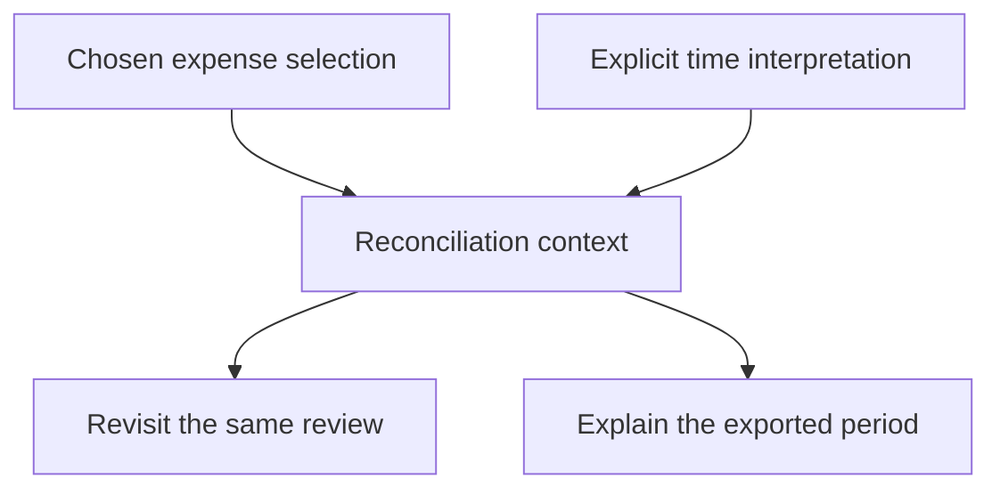

# Ideation: MiniLedger Development Opportunities

Prioritize trustworthy expense transfers, investigate the privacy allegation without treating it as proven, make financial actions keyboard-accessible, remove import conversion work, and preserve reconciliation context.

These recommendations cover all seven eligible issue identities. They are grounded in a synthetic evaluation fixture, not live production observations. The supplied application is substantially smaller than the workflows described in the export; recommendations involving import, export, reconciliation, receipts, workspaces, or UI are conditional development directions, not confirmed fixes to existing MiniLedger features.

## Grounding Context

### Source evidence and boundaries

References below use paths relative to the supplied `fixtures/ideate/` directory, located at `docs/validation/ce-skill-optimization-2026-10-29/remaining-27-acceptance/wave1/fixtures/ideate/`.

| Reference | Read evidence | What it establishes |
|---|---|---|
| `repo/README.md:3–6` | “A tiny personal expense-tracking demo app”; two endpoints; in-memory data | MiniLedger’s current identity and intentionally small scope |
| `repo/README.md:8` | “adding an entry requires five fields typed by hand; no categories; no summary view” | Documented rough edges, with a capture discrepancy described below |
| `repo/package.json` | `mini-ledger`, version `0.1.0`, `main: src/server.js` | Package identity; no test scripts or dependencies declared in this file |
| `repo/src/server.js:6–12` | `const { amount, note } = JSON.parse(body || '{}');` followed by unconditional `entries.push(...)` | Creation accepts two named input fields, generates the identifier and timestamp, and contains no explicit validation or retry identity handling |
| `repo/src/server.js:16–18` | `res.end(JSON.stringify(entries));` | Listing returns the in-memory collection without visible filtering or summary logic |
| `issue-export.json:2–8,89` | Synthetic input, dated window, coverage metadata, and explicit limitations | The evidence is a bounded local export with incomplete pagination |

The README’s five-field claim is not corroborated by the handler, which reads `amount` and `note` and generates `id` and `ts`. No form is supplied. Consequently, “reduce five fields to two” is not a verified current improvement.

The three supplied application files contain no import/export implementation, receipt model, tenant identity, reconciliation UI, saved filters, or focus styling. Their absence from this fixture does not establish their absence from a larger product. It does prevent attributing the export’s reports to a demonstrated MiniLedger implementation.

The source directly exposes opportunities around entry integrity, volatile storage, and basic reporting. It does not reproduce any exported issue. In particular, the unscoped `GET /entries` response is not proof of cross-tenant receipt exposure: the fixture has neither tenants nor receipts.

### Complete sample accounting

| Measure | Count or boundary |
|---|---|
| Records supplied and inspected | 10 |
| Unique issue identities | 8 |
| Eligible unique issues analyzed | 7 of 7 |
| Excluded unique issues | 1: `OLD-1`, explicitly archived and for a retired application |
| Duplicate records removed | 2: the `SUP-101` feedback mirror and `SEC-9` support mirror |
| Export window | 2026-10-01 through 2026-10-29 |
| Additional records | Unknown; pagination is incomplete |
| Live tracker requests | None |

Deduplication uses stable issue identity. `SUP-101` contributes eight reported observations, not sixteen; `SEC-9` contributes one, not two. The deduplicated eligible records contain 57 observation units, but their definition and independence are unspecified. They are not counts of distinct users or a valid production prevalence denominator.

Six eligible issues carry the export’s `confirmed` label; `SEC-9` carries `unverified`. Those labels describe the fixture records. They do not establish independent verification, current deployment state, or live product impact.

| Eligible issue | Source; observations | Evidence and significance | Disposition |
|---|---|---|---|
| `SUP-101` | Support; 8 | “Users manually remove duplicate rows after retry.” (`issue-export.json:11–16`) | Opportunity 1 |
| `SUP-102` | Support; 5 | “Bank import requires manual spreadsheet conversion.” (`:19–24`) | Opportunity 4 |
| `SEC-9` | Security triage; 1 | Ambiguous screenshot alleging another studio’s receipt, explicitly without reproduction or source confirmation (`:27–32`) | Opportunity 2, investigation hypothesis |
| `UX-41` | Feedback; 32 | Color preference; explicitly “no blocked workflow observed” (`:35–40`) | Deferred despite the largest observation count |
| `SUP-103` | Support; 6 | “Users repeat filtering each session.” (`:43–48`) | Opportunity 5 |
| `UX-42` | Feedback; 2 | Keyboard-only user cannot see the focused export button (`:51–56`) | Opportunity 3 |
| `OPS-3` | Operations; 3 | “Month-boundary totals need manual adjustment.” (`:59–64`) | Opportunity 5 |

The source categories are preserved as recorded; human versus automated authorship is unknown. Issue lifecycle, workflow status, individual creation dates, resolution history, affected-user totals, and request volumes are absent. Trends and recurrence rates therefore remain unknown. Retry duplication is a described repeat-action failure, not evidence of reopening after a deployed fix.

### Topic axes and theme synthesis

| Axis | Eligible issues | Source mix | Leverage and limitation |
|---|---|---|---|
| Expense transfer integrity | `SUP-101`, `SUP-102` | Two support issues | Repeated cleanup and conversion suggest a coherent transfer workflow opportunity; a shared root cause is unproven |
| Privacy and ownership boundaries | `SEC-9` | One security-triage issue | Potential severity warrants investigation despite weak evidence; receipt and tenancy surfaces are missing |
| Keyboard operation and presentation | `UX-42`, `UX-41` | Two feedback issues | Task access outranks aesthetic preference; neither UI is supplied |
| Reconciliation continuity | `SUP-103`, `OPS-3` | One support and one operations issue | Retained filters and explicit time context could reduce repeated month-close work; their causes may be independent |

Counts sum to seven, with no cross-theme double counting. Trend is unknown for every theme. These are systemic opportunity groupings, not verified causal clusters.

### Evidence quality and execution limits

All supplied application files and all export records were read. Basis checking was performed serially by the same reader; there was no independent verifier or delegated coverage. No application code or tests were run, no external sources were accessed, and no files were written.

```yaml
context_facts_adapter/v1:
  owner: spec-ideate
  source_identity: supplied MiniLedger 0.1.0 fixture and synthetic issue-export.json
  source_refs:
    - repo/README.md
    - repo/package.json
    - repo/src/server.js
    - issue-export.json
  freshness:
    read_date: 2026-10-30
    export_window: 2026-10-01/2026-10-29
    source_revision: unknown
    dirty_state: unknown
  artifact_type: advisory
  limitations:
    - synthetic observations, not live production evidence
    - incomplete export pagination
    - reported product surfaces absent from supplied application
    - no execution or independent verification
worker_dispatch_authorization: missing
capability_probe: not_applicable
worker_dispatch_capability: unknown
worker_context_isolation: unknown
worker_model_override: unknown
worker_bounded_parallelism: unknown
worker_dispatch_outcome: inline_serial
reason_codes:
  - dispatch_authorization_missing
  - external_research_authorization_missing
external_research_authorization: missing
```

## Ranking Rationale

Ranking favors consequential task failures, repeated manual work, and reusable improvements over raw mention counts. Confidence qualifies the response: weak evidence can justify a small investigation, but cannot justify declaring a defect or committing to a large replacement architecture.

| Rank | Opportunity | Why it earns this position |
|---|---|---|
| 1 | Trustworthy expense transfers | Retry cleanup has eight reported observations and a financially consequential failure mode; unconditional entry creation provides a related, directly visible design concern |
| 2 | Evidence-backed privacy boundaries | Possible exposure has high potential consequence; prioritize establishing whether a problem exists rather than speculative remediation |
| 3 | Keyboard-complete financial actions | A reported barrier to operating a core action outranks cosmetic dissatisfaction, even with only two observations |
| 4 | Import with a reusable, reviewable mapping | Five observations describe manual conversion; removing that repeated work can make capture substantially easier |
| 5 | Reconciliation that remembers its context | Two complementary issues describe nine observation units of repeated filtering and month-boundary adjustment; benefits are plausible but require a larger missing product surface |

The privacy investigation is an urgent evidence decision, not a claim that its eventual implementation should precede all other development. If exposure were reproduced in the relevant product, its remediation priority would rise. If the allegation belongs elsewhere, it should leave MiniLedger’s development scope.

Confidence percentages below are qualitative judgments about pursuing each bounded direction using this fixture. They are not measured success probabilities or estimates of defect truth. Complexity is similarly provisional.

## Ranked Ideas

### 1. Trustworthy Expense Transfers

**Description:** Make repeat attempts produce an understandable financial outcome: users should know whether a transfer already succeeded and should not have to repair duplicate entries after retrying. For MiniLedger, the immediate conceptual foundation is distinguishing another attempt at the same expense operation from a genuinely new expense. Export or re-entry behavior should be defined only once the actual transfer surface is available.

**Axis:** Expense transfer integrity.

**Basis:**

- `direct:` `SUP-101` reports that “Users manually remove duplicate rows after retry,” with eight observations (`issue-export.json:11–16`).
- `direct:` every handled creation request reaches `entries.push({ id: entries.length + 1, amount, note, ts: Date.now() })` in the supplied handler (`repo/src/server.js:10–12`), without a visible operation identity check.
- `reasoned:` when people cannot distinguish an uncertain response from an unsuccessful operation, retrying is rational. A recoverable outcome and explicit repeat-operation semantics can remove the need for manual financial cleanup.

**Rationale:** This addresses consequential rework and can support both manual capture and future imports. It earns priority through repeat-action safety rather than by assuming that the export issue originates in this HTTP handler.

**Downsides:** Legitimate expenses may share an amount and note. Automatic content-based deletion could destroy real transactions. Transfer scope, operation identity, and recovery behavior need clarification before implementation.

**Confidence:** 80% for the direction; the reported export failure’s connection to this source is unverified.

**Complexity:** Medium for a bounded operation model; broader transfer implementation remains unknown.

**Basis check:** Source quotation and issue record verified by inspection. No retry scenario was executed.

**Decision worth discussing:** What should users recognize as the same operation, and what evidence should remain when an attempt is repeated?

### 2. Evidence-Backed Privacy Boundaries

**Description:** Establish whether MiniLedger is intended to remain a personal application or acquire shared-workspace behavior, while investigating the receipt exposure allegation against the actual affected product. The development opportunity is an explicit ownership promise backed by evidence—not the immediate construction of an enterprise permissions system.

**Axis:** Privacy and ownership boundaries.

**Basis:**

- `direct:` `SEC-9` says, “One ambiguous screenshot alleges another studio receipt; no reproduction or source confirmation” (`issue-export.json:27–32`).
- `direct:` the export explicitly calls this “an allegation requiring investigation, not a confirmed defect” (`issue-export.json:89`).
- `direct:` MiniLedger describes itself as personal and stores a single in-memory collection (`repo/README.md:3–6`; `repo/src/server.js:3,16–18`).
- `reasoned:` potential exposure warrants preserving the signal and identifying its actual system boundary. Missing tenant and receipt models make an immediate MiniLedger-specific remediation claim unjustified.

**Rationale:** One uncertain security signal can have greater decision value than many low-impact preferences. The proportionate investment is to resolve applicability and reproduce or refute the behavior before selecting a development response.

**Downsides:** The allegation may refer to a different product or be a misunderstanding. Investigation may produce no MiniLedger change. Premature tenancy work would expand this tiny demo’s identity and maintenance burden.

**Confidence:** 85% that a bounded investigation is warranted; the truth of the alleged exposure remains unknown.

**Complexity:** Low for evidence scoping; remediation complexity is unknown.

**Basis check:** The allegation and its uncertainty are verified as fixture content. Exposure is not verified.

**Decision worth discussing:** Does the product actually promise separated workspaces, and what evidence would establish that the reported receipt crossed that boundary?

### 3. Keyboard-Complete Financial Actions

**Description:** Treat keyboard completion of capture and transfer tasks as a product capability. When a UI exists or is introduced, users should be able to locate the current action, understand its state, and complete it without a pointer. The reported export focus problem supplies a concrete task to investigate.

**Axis:** Keyboard operation and presentation.

**Basis:**

- `direct:` `UX-42` describes a keyboard-only user who “cannot see focused export button” (`issue-export.json:51–56`).
- `direct:` the supplied application contains HTTP handlers but no UI implementation (`repo/src/server.js:5–23`).
- `reasoned:` invisible focus removes orientation during keyboard operation; restoring a coherent task path has more functional value than changing a disliked accent color alone.

**Rationale:** This opportunity prioritizes access to a financial action over aesthetic popularity. Two observations can identify a meaningful barrier; they need not outnumber 32 preference reports to deserve higher priority.

**Downsides:** A focus-style adjustment alone may not address focus order, reachable controls, or understandable results. The relevant UI is absent, so the exact scope and effort are unverified.

**Confidence:** 75% for prioritizing the reported task barrier.

**Complexity:** Medium for a complete task experience; a local styling correction might be smaller but cannot be inferred here.

**Basis check:** Report verified by inspection; no keyboard interaction or visual audit performed.

**Decision worth discussing:** Which financial tasks must be independently completable by keyboard, and how will completion be observed in the actual interface?

### 4. Import With a Reusable, Reviewable Mapping

**Description:** Let users explain a bank file’s format once, preview its interpretation, and reuse that understanding on later imports. This could replace repetitive spreadsheet conversion while keeping ambiguous amounts, dates, and notes visible before they become ledger entries.

**Axis:** Expense transfer integrity.

**Basis:**

- `direct:` `SUP-102` reports “Bank import requires manual spreadsheet conversion,” with five observations (`issue-export.json:19–24`).
- `direct:` the current source accepts `amount` and `note` and generates a timestamp; it has no import surface or supplied transaction-date handling (`repo/src/server.js:10–11`).
- `reasoned:` repeated conversion often reflects a recurring mismatch between source fields and destination meaning. Reusable mapping can amortize that work, provided interpretation is reviewable rather than silently guessed.

**Rationale:** This is more useful than merely adding a generic upload button. It targets the conversion burden while exposing a relevant source gap: recording import time is not necessarily equivalent to preserving the expense’s original date.

**Downsides:** Supported formats, sign conventions, currencies, date ambiguity, and corrections may make this expensive. The export supplies no sample bank file, so mapping reuse is a hypothesis rather than an established solution.

**Confidence:** 70%.

**Complexity:** Medium for a deliberately narrow format scope; High for broad bank compatibility.

**Basis check:** Report and current entry shape verified by inspection; no import data or parser behavior evaluated.

**Decision worth discussing:** Which recurring format mismatch is worth supporting first, and what must users review before imported entries become authoritative?

### 5. Reconciliation That Remembers Its Context

**Description:** Make a reconciliation view retain the user’s chosen filter and expose the time context used for period totals and exports. The aim is a repeatable month-close view that users can revisit without reconstructing their selection or manually correcting boundary dates.

**Axis:** Reconciliation continuity.

**Basis:**

- `direct:` `SUP-103` reports that “Users repeat filtering each session,” with six observations (`issue-export.json:43–48`).
- `direct:` `OPS-3` reports that “Month-boundary totals need manual adjustment,” with three observations (`issue-export.json:59–64`).
- `direct:` MiniLedger has “no summary view” (`repo/README.md:8`), and its listing endpoint returns the full collection (`repo/src/server.js:16–18`).
- `reasoned:` a financial view is defined by both selection and time interpretation. Preserving those together can make repeated review more consistent, although the two issue symptoms need not share a technical cause.

**Rationale:** This combines complementary user needs into one direction without claiming a common defect. It offers greater recurring value than isolated filter persistence or an unlabeled monthly total.

**Downsides:** Remembered filters can hide new data unless their active state is clear. The current timestamp records creation time, which may be insufficient for transaction-period reporting. Workspace concepts should not be imported into a personal app without confirming the intended product scope.

**Confidence:** 75%.

**Complexity:** Medium to High, because reporting and reconciliation surfaces are absent.

**Basis check:** Both records and the source’s limited listing behavior verified by inspection; no totals or timezone calculations executed.

**Decision worth discussing:** What context must remain visible for users to trust that two visits to a reconciliation view are comparable?

Illustrative relationship, not an implementation design:



## Candidate Generation and Rejection Summary

The candidate pool was generated before the final cut using six serial lenses: pain, removal, reframing, compounding leverage, analogy, and constraint-flipping. Each lens contributed six candidates. One synthesis combined saved reconciliation views and explicit period context, yielding 37 considered candidates and five survivors.

Analogies below are reasoning devices, not claims of researched external precedent. The table accounts for all 32 candidates not retained as standalone opportunities.

| Lens | Candidate | Basis considered | Reason not retained separately |
|---|---|---|---|
| Pain | Saved reconciliation filters | `SUP-103` | Incorporated into opportunity 5; preserving filters alone omits time interpretation |
| Pain | Explicit export timezone | `OPS-3` | Incorporated into opportunity 5; a timezone label alone may not resolve period selection |
| Removal | Automatic duplicate deletion | `SUP-101` | Risks removing legitimate repeated expenses; opportunity 1 preserves intent |
| Removal | Automatic bank-format detection | `SUP-102` | Silent guessing is less defensible than reviewable mapping without sample files |
| Removal | Remove all manual capture fields | README rough edge | README’s field count conflicts with the handler; full automation lacks evidence |
| Removal | Always restore the last filter | `SUP-103` | Hidden state can conceal entries; opportunity 5 includes visible context |
| Removal | Disable retry after submission | `SUP-101` | Removes a recovery action without resolving uncertain success |
| Removal | Avoid date problems by reporting everything in UTC | `OPS-3` | Does not establish the user’s intended accounting period |
| Reframing | Turn MiniLedger into a bank aggregator | `SUP-102` | Unsupported expansion beyond a tiny personal ledger |
| Reframing | Build a multi-tenant receipt platform | `SEC-9` | Treats an unverified allegation as a mandate for an absent product |
| Reframing | Define a reproducible reconciliation view | `SUP-103`, `OPS-3` | Merged into opportunity 5 |
| Reframing | Treat capture as intent plus outcome | Creation handler, `SUP-101` | Merged into opportunity 1 |
| Reframing | Replace spreadsheet export with a read-only reporting portal | Export-related reports | Assumes users can abandon an existing workflow; no evidence supports that replacement |
| Reframing | Introduce a category-first budgeting product | README lacks categories | Plausible adjacent feature, but weaker evidence than the retained task failures |
| Leverage | Reusable import mappings | `SUP-102` | Merged into opportunity 4 |
| Leverage | A full transaction event history | Unconditional creation, retry report | Broader infrastructure than needed to explore bounded operation safety |
| Leverage | Reusable keyboard interaction primitives | `UX-42` | Potential means within opportunity 3, not a separate user outcome |
| Leverage | Durable expense storage | In-memory array | Real source-grounded gap, but no observed restart-loss report; requires revisiting if personal ongoing use replaces demo scope |
| Leverage | Basic monthly summaries | README lacks summary | Subsumed by the more context-aware opportunity 5 |
| Leverage | Capture validation and recoverable errors | Unprotected parse and unchecked inputs | Valuable source-grounded engineering work, but narrower than the five selected development directions |
| Analogy | Parcel-style transfer receipts | `SUP-101`, reasoned analogy | Outcome visibility is incorporated into opportunity 1 |
| Analogy | A customs desk for imported rows | `SUP-102`, reasoned analogy | Preview and exception handling belong within opportunity 4 |
| Analogy | A cockpit-style keyboard action strip | `UX-42`, reasoned analogy | Prescribes an ungrounded interface; opportunity 3 stays task-focused |
| Analogy | Named bookmarks for reconciliation | `SUP-103`, reasoned analogy | Incorporated into opportunity 5 |
| Analogy | Chain-of-custody receipt tracking | `SEC-9`, reasoned analogy | Too much mechanism before applicability or exposure is established |
| Analogy | A personal-ledger financial close ritual | `OPS-3`, reasoned analogy | A useful discussion variant of opportunity 5, not a separate investment |
| Constraint-flipping | Zero-click automatic bank ingestion | `SUP-102` | Requires absent integration and authorization evidence |
| Constraint-flipping | A keyboard-only interface | `UX-42` | Solving keyboard exclusion does not justify excluding pointer interaction |
| Constraint-flipping | A strictly single-user product forever | Personal-app README | Product-positioning alternative, not a demonstrated resolution of the allegation |
| Constraint-flipping | A million-entry distributed backend | In-memory array | No scale or concurrency evidence supports the complexity |
| Constraint-flipping | Export nothing; remain entirely local | Transfer-related reports | Avoids rather than addresses the requested financial workflow |
| Constraint-flipping | User-selectable accent themes | `UX-41` | Largest observation count, but explicitly no blocked workflow; lower leverage than task access and financial correctness |

The four retained pain-lens candidates are retry-safe transfers, privacy investigation, keyboard-complete actions, and reviewable import. The reconciliation synthesis is the fifth survivor. Every axis has at least one survivor; no recovery generation was necessary.

`UX-41` remains explicitly accounted for and deferred. `OLD-1` is excluded by the export’s eligibility marker, not rejected as a current product idea. The duplicated `SUP-101` and `SEC-9` records add provenance but no independent issue count or observation weight.

## Decision Boundary

The strongest development direction is trustworthy expense transfers. The highest-consequence uncertainty is `SEC-9`, which warrants a bounded applicability and evidence check without a breach claim.

Before any chosen direction becomes requirements, the missing product surfaces and fixture-to-product relationship need confirmation. The supplied evidence supports prioritization and hypotheses; it does not support promised savings, production defect counts, measured accessibility outcomes, or a delivery estimate.

This is the complete inline dossier. No file was saved, no implementation was performed, and no user selection of a direction is assumed.
