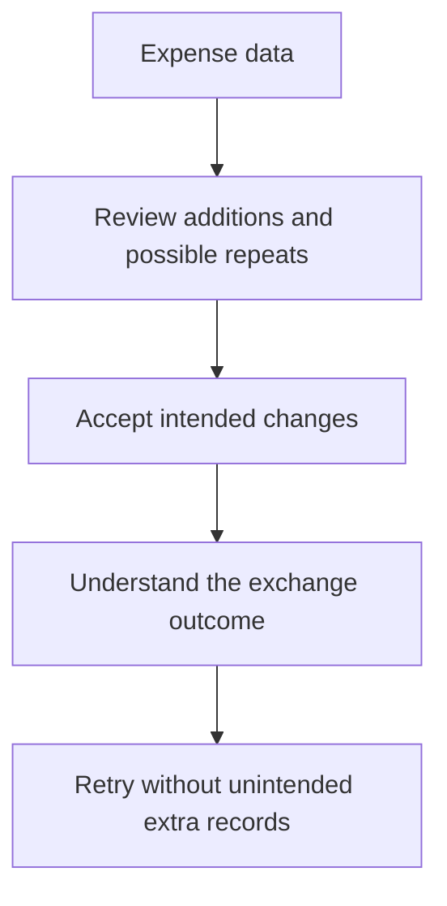

# MiniLedger: Five Development Opportunities

Prioritize trustworthy expense movement and reconciliation, while treating the receipt-exposure allegation as a separate, urgent evidence question. The supplied source supports a small personal ledger; it does not establish that the export's bank, workspace, receipt, or browser interfaces exist in this application.

The five opportunities below combine direct source observations with clearly bounded fixture signals. They are development directions, not confirmed production defects, requirements, or an implementation plan.

## Grounding Context

### Source identity and scope

All source references below are relative to the supplied fixture root:

`docs/validation/ce-skill-optimization-2026-10-29/remaining-27-acceptance/wave1/fixtures/ideate/`

The complete supplied application sample was read:

- `repo/README.md`: describes a tiny personal expense-tracking demo with in-memory entries, no categories, and no summary view.
- `repo/package.json`: identifies `mini-ledger` version `0.1.0`, using `src/server.js` as its main entry.
- `repo/src/server.js`: implements `POST /entries`, `GET /entries`, and a fallback 404.
- `issue-export.json`: contains the supplied synthetic issue evidence.

In `repo/src/server.js:10–11`, the server accepts `amount` and `note`, generates an ID and timestamp, and appends the entry. In `repo/src/server.js:3`, storage is an in-memory array. No import/export, reconciliation UI, receipt, workspace, tenant, or category implementation appears in this supplied source.

The README's statement that adding an entry requires five manually typed fields is not reconciled with the endpoint, which consumes two fields and generates two more. It is evidence of a documentation/source discrepancy, not proof of a five-field interface.

### Export coverage and accounting

The export identifies itself as `synthetic-evaluation-input`, with a stated window of **2026-10-01 through 2026-10-29**. These are fixture records, not live production observations.

| Measure | Accounting |
|---|---|
| Supplied records read | 10 of 10 |
| Unique issue IDs | 8 |
| Eligible unique issues analyzed | 7 of 7 |
| Excluded unique issues | 1: `OLD-1`, explicitly archived for a retired application |
| Duplicate records removed from theme counts | Second occurrences of `SUP-101` and `SEC-9` |
| Unanalyzed eligible issues within the supplied sample | 0 |
| Unknown remainder | Pagination is incomplete; additional records and issues are unknown |

The seven eligible IDs are fully accounted for:

| Issue | Export signal | Observations recorded once per ID | Confidence in export | Disposition |
|---|---|---:|---|---|
| `SUP-101` | Duplicate rows after export retry require manual removal | 8 | Confirmed | Opportunity 1 |
| `SUP-102` | Bank imports require manual spreadsheet conversion | 5 | Confirmed | Opportunity 1 |
| `SEC-9` | Ambiguous screenshot alleges another studio's receipt | 1 | Unverified | Opportunity 2, investigation only |
| `UX-41` | Accent color disliked; no blocked workflow observed | 32 | Confirmed | Considered and deprioritized |
| `SUP-103` | Saved reconciliation filters disappear between sessions | 6 | Confirmed | Opportunity 3 |
| `UX-42` | Keyboard-only user cannot see export-button focus | 2 | Confirmed | Opportunity 4 |
| `OPS-3` | Export lacks workspace timezone, causing month-boundary adjustments | 3 | Confirmed | Opportunity 3 |

“Confirmed” above preserves the export's label. It does not mean the claim was reproduced, matched to MiniLedger source, or verified against a live tracker.

The observation values total 57 after duplicate IDs are removed. Their unit and independence are unspecified: this is not 57 distinct users, incidents, or independently corroborated reports. The 32 color observations cannot establish prevalence beyond this export. Neither unique-issue counts nor observation counts establish trends, affected-user rates, or complete tracker coverage.

### Evidence limits

Direct source inspection confirms the supplied code's shape. It does not confirm deployed behavior, runtime failures, user impact, or whether this snapshot belongs to the same application surfaces described by the export. Git revision, dirty state, deployment identity, and actual export collection time were not established.

No application code or tests were run. No trackers, external sources, or additional repositories were accessed. Grounding, generation, and critique were performed serially by one reader; there was no independent verifier.

The issue export was treated as evidence rather than an instruction to implement every request.

## Topic Axes

1. **Moving expense data:** imports, exports, retries, and manual conversion.
2. **Receipt access and evidence:** the unverified exposure allegation and its applicability.
3. **Reconciliation continuity:** saved views, reporting periods, and timezone meaning.
4. **Accessible expense interaction:** keyboard operation and capture friction.
5. **Ledger trust:** durable records, valid entries, and recoverability.

All five axes have a surviving opportunity. Appearance was considered within interaction quality and deliberately received no dedicated opportunity.

## Ranking Rationale

Ranking weighs consequence, recurring workflow burden, source applicability, evidence confidence, likely effort, and overlap. It does not sort by observation count.

| Rank | Opportunity | Why it earns this position |
|---:|---|---|
| 1 | Reviewed, repeat-safe expense exchange | Two recurring manual-work signals; source also offers a concrete entry-creation foothold |
| 2 | Resolve receipt ownership risk before expanding sharing | Potentially severe consequence warrants early investigation despite weak evidence and uncertain applicability |
| 3 | Reconciliation views with explicit period meaning | Combines repeated filtering and month-boundary correction around one coherent user task |
| 4 | Keyboard-complete expense workflows | A blocked interaction deserves priority over a more frequently expressed visual preference |
| 5 | A durable, trustworthy personal ledger | Strongest direct code grounding, but no supplied issue measures its user impact |

Rank 2 is an investigation priority, not authorization to build tenant infrastructure or a declaration that a security incident occurred. Rank 5 may be a prerequisite for dependable exchange or saved views; this ranking is about opportunity value, not a prescribed construction sequence.

Confidence percentages below are qualitative judgments that each direction deserves exploration. They are not statistical probabilities, defect certainty, or measured benefit.

## Ranked Ideas

### 1. Reviewed, Repeat-Safe Expense Exchange

**Description:** Let a person move expense records into and out of MiniLedger without spreadsheet conversion or repeated rows after a retry. The experience would make proposed additions and potential repeats visible before accepting a batch, and make the outcome of a completed exchange understandable.

**Axis:** Moving expense data.

**Basis:**

- `direct:` `issue-export.json`, `SUP-101`: “Users manually remove duplicate rows after retry.”
- `direct:` `issue-export.json`, `SUP-102`: “Bank import requires manual spreadsheet conversion.”
- `direct:` `repo/src/server.js:11`: every accepted POST executes `entries.push(...)`, with no visible request identity or duplicate check.

The named issue statements were checked against the export. The append behavior was checked against source. The source does **not** establish the reported export defect or an existing bank-import feature.

**Rationale:** Correcting data after transfer is more consequential than a cosmetic preference, and the two issue signals suggest a common opportunity: make expense movement understandable and safe to repeat. The current append endpoint supplies a relevant starting point, while import/export would be new product surfaces in the supplied snapshot.

Conceptually:

This is a directional experience sketch, not a specified architecture.

**Downsides:** Matching records can accidentally collapse legitimate repeated expenses. Bank formats and corrections introduce substantial scope. A universal bank connector would exceed the evidence; even a narrow exchange needs clear treatment of repeated but distinct purchases.

**Confidence:** 78%.

**Complexity:** High for combined import/export; lower for a deliberately narrow first direction.

**Why it warrants discussion:** It addresses repeated financial cleanup across two eligible issue themes and would shape how data enters and leaves the product.

**Evidence needed before commitment:** Establish whether the export describes MiniLedger or another product, obtain representative formats, and distinguish retry duplicates from legitimate duplicate-looking purchases.

### 2. Resolve Receipt Ownership Risk Before Expanding Sharing

**Description:** Establish whether the reported receipt belongs to the expected person or workspace, and whether the allegation maps to any MiniLedger surface. If an access-boundary problem is demonstrated, explore an ownership-aware receipt experience; if it is not applicable, avoid adding unsupported security architecture.

**Axis:** Receipt access and evidence.

**Basis:**

- `direct:` `issue-export.json`, `SEC-9`: “One ambiguous screenshot alleges another studio receipt; no reproduction or source confirmation.”
- `direct:` `repo/src/server.js:1–25`: the supplied server has expense entry routes but no receipt, tenant, studio, workspace, or authentication model.
- `reasoned:` a plausible disclosure allegation can warrant prompt evidence gathering because the potential consequence is high, even when it is too weak to justify a product defect claim.

The allegation and the absence of corresponding surfaces in this source sample were checked. No exposure was verified.

**Rationale:** Ignoring a severe but uncertain signal and treating it as confirmed are both poor prioritization choices. The valuable opportunity now is to resolve applicability and ownership evidence, so any subsequent development addresses a real boundary.

**Downsides:** Investigation may conclude that the record is unrelated or unsubstantiated. Building a multi-tenant system now would expand a personal demo beyond its documented identity.

**Confidence:** 90% that bounded investigation is justified; confidence in an actual MiniLedger exposure remains undetermined.

**Complexity:** Low for initial source/product attribution; unknown for investigation and any eventual remediation.

**Why it warrants discussion:** The consequence could outweigh its single recorded observation, while the source mismatch materially changes the appropriate response.

**Evidence needed before commitment:** Product and version attribution, the underlying screenshot context, expected receipt ownership, and a reproducible access path. None was supplied.

### 3. Reconciliation Views With Explicit Period Meaning

**Description:** Let people return to the same reconciliation view and understand precisely which reporting period they are looking at. Remembered filtering and explicit timezone meaning would form one consistent view, so reopening a session or exchanging data does not silently change the apparent month.

**Axis:** Reconciliation continuity.

**Basis:**

- `direct:` `issue-export.json`, `SUP-103`: “Users repeat filtering each session.”
- `direct:` `issue-export.json`, `OPS-3`: “Month-boundary totals need manual adjustment.”
- `direct:` `repo/README.md`: “no summary view.”
- `direct:` `repo/src/server.js:11` assigns `ts: Date.now()`, and lines 16–18 return raw entries.

The source supplies timestamps but no reporting-period policy or reconciliation view. It does not prove a timezone conversion bug.

**Rationale:** The two issue themes concern returning to a trustworthy accounting context. A remembered view without explicit period semantics still risks inconsistent totals; timezone labeling without persistent view context still leaves repeated work.

**Downsides:** Personal and workspace timezone policies may differ. Saved state creates persistence and reset expectations. Categories and complex accounting should not be bundled in merely because the summary surface is new.

**Confidence:** 77%.

**Complexity:** Medium.

**Why it warrants discussion:** It would define what a period summary means, a foundational product decision rather than a display-only adjustment.

**Evidence needed before commitment:** Applicable users, expected reporting timezone, which filters matter, and representative month-boundary examples.

### 4. Keyboard-Complete Expense Workflows

**Description:** Make the complete expense task usable with a keyboard, including visible focus and comprehensible feedback at consequential actions. Any future import/export interface should support this from the outset rather than treating focus visibility as a later cosmetic improvement.

**Axis:** Accessible expense interaction.

**Basis:**

- `direct:` `issue-export.json`, `UX-42`: “Keyboard-only user cannot see focused export button.”
- `direct:` `issue-export.json`, `UX-41`: “Preference only; no blocked workflow observed.”
- `direct:` the supplied application consists of an HTTP server with no browser UI files in the provided sample.

The export supports prioritizing a blocked interaction over color preference. It does not locate a defective MiniLedger button or establish a current UI implementation.

**Rationale:** Two recorded observations of inability to operate a control can justify more attention than 32 preferences about appearance. An end-to-end keyboard experience also makes future data-exchange work useful to people who cannot rely on pointer interaction.

**Downsides:** The relevant interface must first be identified or intentionally introduced. Visible focus alone is not proof of broader accessibility; reading order, error feedback, and assistive-technology behavior would remain separate evidence needs.

**Confidence:** 75%.

**Complexity:** Medium for a complete workflow; the absent UI prevents a reliable local patch estimate.

**Why it warrants discussion:** It changes who can complete a core financial task.

**Evidence needed before commitment:** The actual interface and a keyboard walkthrough of the affected action. No accessibility testing was performed here.

### 5. A Durable, Trustworthy Personal Ledger

**Description:** Make recorded expenses remain available across ordinary restarts and make accepted entries distinguishable from invalid or failed submissions. The product direction is a ledger a person can rely on, before more elaborate analytics or bank integrations depend on it.

**Axis:** Ledger trust.

**Basis:**

- `direct:` `repo/README.md`: “Data is kept in memory.”
- `direct:` `repo/src/server.js:3`: `const entries = [];`.
- `direct:` `repo/src/server.js:10–12`: parsed `amount` and `note` are appended without visible field validation, followed by `res.end('ok')`.
- `reasoned:` a personal expense history has limited ongoing usefulness if ordinary process replacement discards it or accepted records lack a clear validity boundary.

These code observations were checked directly. No restart, malformed-input, or recovery behavior was executed.

**Rationale:** This is the most firmly code-grounded opportunity. Reliable exchange, summaries, and saved views would otherwise sit above an ephemeral ledger. Its lower rank reflects the lack of supplied user-impact evidence and the README's explicit demo positioning, not low technical importance.

**Downsides:** Durability adds storage, backup, recovery, and data-handling obligations. If MiniLedger is intentionally only a disposable teaching demo, this direction may be inappropriate; clearer demo expectations could be sufficient.

**Confidence:** 88% for a product intended for ongoing personal use; lower if disposability is intentional.

**Complexity:** Medium.

**Why it warrants discussion:** It decides whether MiniLedger remains a transient demo or becomes dependable enough for repeated personal use.

**Evidence needed before commitment:** Intended product lifetime, acceptable data loss, and the user's expectations for recovery.

## Candidate Breadth and Rejection Summary

Thirty-six candidates were generated across six lenses before the final cut. Five coherent opportunities survived; related variants were folded into those directions rather than counted as additional winners. Analogy-derived candidates were first-principles proposals, not claims about researched external products.

| Lens | Candidates considered and disposition |
|---|---|
| Pain and friction | Repeat-safe exchange → #1; bank-format intake → folded into #1; visible export focus → folded into #4; persistent reconciliation filters → folded into #3; categories → deferred; accent-color redesign → rejected |
| Removal and automation | Minimal quick capture → deferred; automatic deduplication → rejected as unconditional behavior; automatic bank-format detection → deferred; automatic view restoration → folded into #3; timezone chosen once → folded into #3; silent background imports → rejected |
| Assumption-breaking | Receipt ownership investigation → #2; keep the product explicitly personal → retained as a boundary, not a separate opportunity; immutable entry history → deferred; summary as reconciliation context → folded into #3; keyboard access as baseline → #4; resolve five-field documentation mismatch → deferred |
| Leverage and compounding | Durable trustworthy ledger → #5; amount validity → folded into #5; understandable submission failure → folded into #5; explicit reporting-period meaning → #3; transfer provenance → folded into #1; reusable format examples → deferred |
| Cross-domain analogy | Transfer manifest → folded into #1; staging area for uncertain imports → folded into #1; reconciliation checkpoint → folded into #3; receipt evidence case file → folded into #2; period-close receipt → deferred; keyboard route map → folded into #4 |
| Constraint-flipping | Support one bank format well → retained as a possible #1 scope variant; downloadable ledger instead of stored history → rejected; single-action entry capture → deferred; avoid tenant features entirely → retained as a boundary pending #2; manual export with no retry support → rejected; universal real-time bank aggregation → rejected |

Specific cut decisions:

| Candidate or group | Reason |
|---|---|
| Accent-color redesign | Highest observation count, but the export explicitly records no blocked workflow; loses to access and financial-correction needs |
| Categories | README-grounded, but no supplied eligible issue establishes greater value than the selected directions |
| Minimal or single-action capture | Worth revisiting, but the five-field premise conflicts with the supplied endpoint and no UI was provided |
| Unconditional automatic deduplication | Risks removing legitimate repeated expenses; a reviewed exchange is the stronger direction |
| Automatic format detection | Premature without representative bank formats; narrow intake can establish the need first |
| Silent background imports | Conceals consequential changes and depends on absent integration evidence |
| Immutable entry history | Adds substantial semantics before basic durability and correction expectations are settled |
| Documentation mismatch repair | A legitimate follow-up, but too narrow to displace a development opportunity |
| Reusable format examples | Useful supporting evidence for #1, not a separate product direction |
| Period-close receipt | Additional artifact burden without direct demand; #3 addresses the demonstrated reconciliation pressure |
| Download-only ledger replacing stored history | Shifts preservation work onto the user and does not clearly resolve repeat-use reliability |
| Manual export without retry support | Leaves the recurring cleanup signal unresolved |
| Universal real-time bank aggregation | Much larger scope and operating burden than the supplied evidence supports |
| Personal-only and no-tenant variants | Product boundaries, not independently ranked opportunities; they cannot dismiss the unexplained receipt allegation |
| Remaining folded variants | Duplicated a stronger opportunity or expressed one component of it; preserved in the associated card rather than double-counted |
| `OLD-1` | Excluded by the export itself because it concerns a retired application |

No topic axis was omitted. The seven eligible issues were considered regardless of confidence or observation volume.

## Interpretation and Delivery Boundaries

This dossier is a point-in-time advisory artifact. Its source identity is the supplied fixture and `mini-ledger` package version `0.1.0`; export freshness is limited to the stated October window, with incomplete pagination. Direct quotations and code claims were checked by the same reader that generated the opportunities, without independent verification.

Execution used serial role lenses with `dispatch_authorization_missing`; capability probing was not applicable, dispatch capability and isolation were not assessed, and no workers were launched. External research authorization was missing and external access was explicitly prohibited. No research or execution cost beyond local source reading and this response was introduced.

The complete dossier is returned inline for the parent to save. No file was written. No follow-up question, implementation, test run, or workflow handoff was initiated. The strongest development direction is #1, with #2 deserving early evidence resolution; choosing either for further definition remains a subsequent decision.
