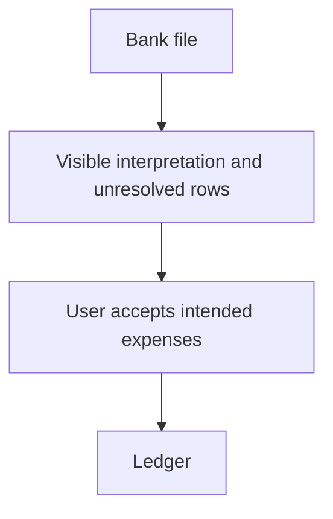

# MiniLedger: Five Development Opportunities

MiniLedger’s strongest opportunity is a dependable expense ledger, followed by easier intake, trustworthy monthly review, accessible interaction, and bounded investigation of a possible privacy concern. The supplied issues suggest useful directions, but several describe features absent from the supplied application. Those reports support hypotheses to investigate; they do not establish defects in this source.

## Grounding Context

### Source and evidence boundaries

All references below are relative to `docs/validation/ce-skill-optimization-2026-10-29/remaining-27-acceptance/wave1/fixtures/ideate/`.

- [`repo/README.md`](repo/README.md) describes a “tiny personal expense-tracking demo app” using Node.js and CommonJS, with two endpoints and in-memory entries. It lists manual entry, missing categories, and no summary view as rough edges.
- [`repo/src/server.js`](repo/src/server.js) contains the complete supplied server. `POST /entries` parses `amount` and `note`, assigns an ID and timestamp, and appends to an array. `GET /entries` returns that array.
- [`repo/package.json`](repo/package.json) identifies private package `mini-ledger`, version `0.1.0`. It supplies no test scripts or application dependencies.
- [`issue-export.json`](issue-export.json) is explicitly a `synthetic-evaluation-input`, covering the declared window `2026-10-01/2026-10-29`. Its `confirmed` labels describe fixture records, not independently verified production behavior.

The README says entry requires five fields typed by hand, but the server reads only `amount` and `note` and generates `id` and `ts`. No supplied UI explains the discrepancy. Manual-entry friction is a documented signal; a five-field interface is not source-confirmed.

No import, export, reconciliation, receipt, workspace, tenant, or UI implementation appears in the supplied source. Their existence elsewhere remains unknown. Reading all supplied files provides complete fixture coverage, not complete coverage of an actual deployed product.

### Export coverage

| Measure | Accounted result |
|---|---|
| Fetched records | 10 |
| Unique issue IDs | 8 |
| Duplicate records | 2: mirrored `SUP-101` and `SEC-9` |
| Eligible unique issues | 7 |
| Analyzed eligible issues | 7 of 7 |
| Excluded unique issues | 1: `OLD-1`, explicitly ineligible because it concerns a retired application |
| Unanalyzed eligible issues within this export | 0 |
| Unknown remainder | Pagination is incomplete; additional records and their themes are unknown |

The seven eligible IDs are a lower bound on the unknown wider population. The export supports neither a population prevalence estimate nor a claim that these are the product’s five largest problems.

Observation counts are retained once per unique ID. Their meaning, collection method, and overlap between users are unspecified; they are not counts of distinct users and are not summed into an impact score.

| Eligible issue | Observations | Evidence interpretation | Disposition |
|---|---:|---|---|
| `SUP-101`: export re-entry duplicates | 8 | Fixture-confirmed manual cleanup after retries; export/re-entry path absent from source | Opportunity 1, with attribution caveat |
| `SUP-102`: import format mismatch | 5 | Fixture-confirmed conversion work; importer absent from source | Opportunity 2 |
| `SEC-9`: possible cross-tenant receipt exposure | 1 | Unverified allegation; no reproduction or source confirmation | Opportunity 5, investigation only |
| `UX-41`: accent color disliked | 32 | Preference signal; no blocked workflow reported | Considered and deferred |
| `SUP-103`: reconciliation loses saved filter | 6 | Fixture-confirmed repeat filtering; reconciliation UI absent from source | Opportunity 3 |
| `UX-42`: keyboard focus missing | 2 | Fixture-confirmed keyboard barrier on an export button; UI absent from source | Opportunity 4 |
| `OPS-3`: timezone absent from export | 3 | Fixture-confirmed manual month-boundary adjustment; export absent from source | Opportunity 3 |

### Confidence and limitations

This dossier uses static source inspection and the supplied export only. No application code or tests were run, no tracker was fetched, and no production observation was made. Generation and basis checks were performed serially by one evaluator; there is no independent reviewer or multi-agent coverage.

The grounding record follows `context_facts_adapter/v1`: owner `spec-ideate`; source identity MiniLedger `0.1.0` fixture, revision and dirty state unknown; source references listed above; freshness limited to the supplied files and declared export window; artifact type advisory. Source quotations are checked against the supplied files, while opportunity value, ranking, confidence, and complexity remain judgments.

Worker dispatch was prohibited: authorization `missing`, capability probe `not_applicable`, dispatch capability/context isolation/model override/bounded parallelism `unknown`, and outcome `inline_serial` with reason `dispatch_authorization_missing`. External research authorization was `missing`; no external research was performed.

## Topic Axes

1. **Ledger integrity:** dependable records and safe repeated submissions.
2. **Expense intake:** reducing manual typing and conversion.
3. **Monthly review:** meaningful totals and reusable views.
4. **Interaction access:** completing expense workflows with a keyboard.
5. **Privacy boundaries:** establishing whether sensitive records and access boundaries exist.

All five axes have a surviving direction. Color preference was examined within interaction access and did not displace the stronger workflow barrier.

## Ranking Rationale

Ranking weighs verified source fit, consequence of the problem, strength of the supplied signal, likely leverage, and burden. Counts inform the discussion without deciding it. Confidence percentages express confidence that a direction deserves exploration, not measured probabilities of success.

| Rank | Opportunity | Main reason for placement | Confidence | Complexity |
|---|---|---|---:|---|
| 1 | Make expense records dependable under restart and retry | Direct source support and foundational value | 90% | Medium |
| 2 | Replace spreadsheet preparation with guided expense intake | Specific friction signal and a plausible extension of the current entry model | 75% | Medium |
| 3 | Make monthly review reproducible | Combines documented missing summaries with two related review burdens | 80% | Medium |
| 4 | Make expense workflows usable by keyboard | Functional exclusion outweighs cosmetic popularity, though the relevant UI is missing | 70% | Medium |
| 5 | Establish the privacy facts before proposing receipt isolation | Potentially serious allegation, but minimal evidence and no matching source surface | 85% for investigation | Low initially; remediation unknown |

The fifth rank is a development-investment ranking, not permission to ignore a potential security incident. If this allegation were associated with a real deployment, bounded security triage could proceed promptly alongside higher-ranked discovery. The fixture alone does not establish such a deployment or incident.

## Ranked Ideas

### 1. Make Expense Records Dependable Under Restart and Retry

**Description:** Explore a ledger that retains accepted expenses and distinguishes a retried submission from a genuinely repeated purchase. This would let users trust that their expenses remain available without making every retry a possible duplicate.

**Axis:** Ledger integrity.

**Basis — direct:** The README states, “Data is kept in memory.” The server declares `const entries = [];` and appends with `entries.push({ id: entries.length + 1, amount, note, ts: Date.now() });`. There is no supplied persistence or retry identity. `SUP-101` reports, “Users manually remove duplicate rows after retry.”

**Rationale:** An expense tracker’s later summaries and imports depend on reliable underlying records. The supplied server provides a concrete basis for exploring retention and repeat-submission behavior. `SUP-101` strengthens the relevance of retry friction, but its export re-entry incident cannot be attributed to this endpoint from the available evidence.

**Downsides:** Retention introduces storage, recovery, and data-handling responsibilities. Treating matching amounts and notes as duplicates could discard legitimate purchases. Retry identity needs a deliberate product distinction between “send again” and “record another expense.”

**Confidence:** 90% that this is worth exploring; the exact relationship to `SUP-101` is unverified.

**Complexity:** Medium.

### 2. Replace Spreadsheet Preparation with Guided Expense Intake

**Description:** Explore a small, guided intake experience that accepts a supported bank file, makes field interpretation visible, and lets users resolve uncertain rows before recording expenses. Keep ordinary manual entry available.

**Axis:** Expense intake.

**Basis — direct:** `SUP-102` says, “Bank import requires manual spreadsheet conversion.” The README independently identifies manual-entry friction. The server’s current expense model includes `amount`, `note`, and a generated `ts`, giving a concrete destination model but no import implementation.

**Basis — reasoned:** Moving repeated conversion into an explicit intake experience could reduce preparation work. Showing interpretations before acceptance would expose ambiguity in amounts and dates rather than silently transferring it into the ledger.

**Rationale:** This targets a named workaround and could make MiniLedger useful for more than individual hand-entered expenses. It ranks below record integrity because faster intake amplifies the cost of incorrect or duplicated entries.

**Downsides:** Bank formats vary, and a broad compatibility promise could overwhelm a tiny demo. Transaction dates may differ from entry creation time; currency and amount conventions are unspecified. The first supported format should be selected from actual examples, which the fixture does not include.

**Confidence:** 75%.

**Complexity:** Medium for a bounded format; broad bank coverage could be High.

This is a conceptual direction, not a committed interface or implementation design.

### 3. Make Monthly Review Reproducible

**Description:** Explore a monthly review experience that combines meaningful totals, explicit time interpretation, and a reusable filter selection. Users should be able to return to the same review and understand why entries fall into a particular month.

**Axis:** Monthly review.

**Basis — direct:** The README lists “no summary view.” `SUP-103` reports, “Users repeat filtering each session.” `OPS-3` says, “Month-boundary totals need manual adjustment.” The server stores `ts: Date.now()` and returns the full entry array without aggregation.

**Basis — reasoned:** A summary is most useful when returning to it preserves its meaning. Filter selection and month boundaries both affect which expenses contribute to a total, so addressing them together offers a coherent review direction.

**Rationale:** This extends a source-confirmed missing capability while accounting for two separate eligible issue signals. It could reduce repeated work and improve interpretability without inventing a larger accounting platform.

**Downsides:** The source records creation time, not necessarily purchase time. Personal versus workspace timezone semantics remain unresolved because the supplied application has no workspace model. Remembering a filter can also confuse users unless the active selection remains visible.

**Confidence:** 80% for the review direction; lower for any specific workspace or export behavior.

**Complexity:** Medium.

### 4. Make Expense Workflows Usable by Keyboard

**Description:** Explore a keyboard-complete experience for the expense interactions MiniLedger actually intends to expose, including visible focus and clear completion feedback. If an export interface is subsequently located, investigate the reported focus failure in that actual interface.

**Axis:** Interaction access.

**Basis — direct:** `UX-42` reports, “Keyboard-only user cannot see focused export button.” By contrast, `UX-41` reports an accent-color preference with “no blocked workflow observed.” The supplied repository contains an HTTP server and no front-end files.

**Rationale:** A functional access barrier can prevent task completion even when its observation count is lower than a cosmetic preference. The opportunity therefore outranks a color refresh, while remaining conditional on establishing the relevant interaction surface.

**Downsides:** No supplied UI can be inspected or repaired, and the fixture does not show whether export is keyboard-operable despite invisible focus. A broad accessibility redesign would exceed the present evidence. A real evaluation needs the actual interface and task flow.

**Confidence:** 70% that this deserves product exploration; no confidence claim about a reproduced source defect.

**Complexity:** Medium for an accessible interaction experience; the reported focus defect’s actual repair cost is unknown.

### 5. Establish the Privacy Facts Before Proposing Receipt Isolation

**Description:** Treat `SEC-9` as a bounded investigation opportunity: establish what system the screenshot concerns, whether receipts and tenant boundaries exist, and whether unauthorized access can be demonstrated. Only substantiated findings should motivate a receipt-isolation development direction.

**Axis:** Privacy boundaries.

**Basis — direct:** `SEC-9` is explicitly `unverified` and says, “One ambiguous screenshot alleges another studio receipt; no reproduction or source confirmation.” Its second appearance is a mirror, not independent corroboration. The supplied server contains neither receipts nor tenants.

**Basis — reasoned:** The possible consequence is serious enough to justify clarifying the facts. The absence of matching source means a proposed architectural repair would currently depend on invented mechanisms.

**Rationale:** Investigation creates a decision boundary: a reproduced privacy failure changes priorities, while a misattributed or unsupported report should not force a personal-expense demo into a multi-tenant redesign.

**Downsides:** Investigation may require access to the actual system and original evidence, neither supplied nor authorized here. It may conclude that the allegation belongs to another product. Its high investigation confidence must not be interpreted as high confidence that exposure occurred.

**Confidence:** 85% that bounded investigation is appropriate; occurrence of a privacy defect remains unverified.

**Complexity:** Low for initial attribution and evidence review; reproduction and remediation are unknown.

## Rejection Summary

The candidate set was generated before filtering using six serial lenses: pain and friction; removal and automation; reframing; leverage; cross-domain analogy; and constraint-flipping. Eighteen distinct candidates were considered. Five survived; thirteen were cut or folded into stronger directions below. Analogies were used as reasoning aids, not as externally validated prior art.

| Considered candidate | Decision and reason |
|---|---|
| Accent-color refresh | Deferred: `UX-41` has the largest observation count but no reported workflow blockage; no supplied UI establishes the affected surface |
| Standalone category feature | Deferred: README supports the gap, but dependable records and useful review offer stronger immediate leverage |
| Raw transaction list redesign | Deferred: no supplied UI evidence identifies a list interaction problem; review totals address a clearer gap |
| Automatically delete matching amount/note entries | Rejected: repeated legitimate purchases could be lost; folded only the retry-safety objective into opportunity 1 |
| Universal bank importer | Rejected: `SUP-102` supports conversion pain, not the cost or feasibility of all-bank compatibility |
| Remember filters as an isolated patch | Folded into opportunity 3: filter retention is more valuable in a clearly defined review experience |
| Build tenant isolation immediately | Rejected: `SEC-9` is an allegation and the matching source surface is absent |
| Replace expense tracking with a receipt-management product | Rejected: changes the subject and lacks a source-grounded user need |
| Natural-language expense entry | Deferred: plausible typing reduction, but no evidence that language parsing is preferable to simpler intake |
| Add persistent storage without considering retry behavior | Folded into opportunity 1: retention alone would preserve duplicate entries more reliably |
| General-purpose analytics engine | Rejected: disproportionate to the tiny source and the narrower missing-summary signal |
| Undo every financial action through a full event-history system | Deferred: potentially useful analogy, but unsupported recovery requirements and substantial burden |
| Build a million-user cloud accounting platform | Rejected: hypothetical scale and scope expansion do not follow from this demo or export |

No eligible issue was omitted. `OLD-1` was excluded from opportunity generation because the export explicitly marks it ineligible; it is not counted as a rejected development candidate.

The recommended direction to explore first is dependable expense records. This dossier remains an ideation artifact: it selects no implementation, changes no files, and claims no tested or production outcome.
