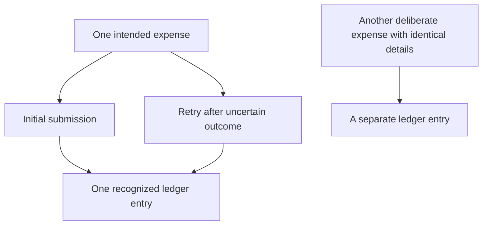

# Ideation: MiniLedger Development Opportunities

Prioritize **retry-safe expense capture**, followed by **reviewable bank import**, **timezone-explicit summaries**, **keyboard-complete interaction**, and **remembered reconciliation views**.

These priorities balance financial correctness, blocked workflows, repeated effort, source support, and development burden. They are recommendations for exploration, not validated requirements or a claim that the supplied server implements the application described by every issue.

The possible receipt exposure allegation warrants prompt evidence gathering alongside this prioritization. It does not establish a confirmed vulnerability or justify inventing a tenant architecture absent from the supplied source.

## Grounding Context

### Codebase Context

The supplied MiniLedger is a small Node.js CommonJS personal expense-tracking demo, version `0.1.0`.

Evidence references below use these aliases, relative to the enclosing repository:

- **README:** `docs/validation/ce-skill-optimization-2026-10-29/remaining-27-acceptance/wave1/fixtures/ideate/repo/README.md`
- **Package:** `docs/validation/ce-skill-optimization-2026-10-29/remaining-27-acceptance/wave1/fixtures/ideate/repo/package.json`
- **Server:** `docs/validation/ce-skill-optimization-2026-10-29/remaining-27-acceptance/wave1/fixtures/ideate/repo/src/server.js`
- **Export:** `docs/validation/ce-skill-optimization-2026-10-29/remaining-27-acceptance/wave1/fixtures/ideate/issue-export.json`

The complete supplied server has two endpoints: `POST /entries` and `GET /entries`. Entries live in an in-memory array at Server line 3. The write handler extracts `amount` and `note`, then unconditionally appends an entry with a generated ID and timestamp at lines 10–11. The read handler returns the entire array at lines 16–18.

The supplied source contains no import/export workflow, browser UI, reconciliation filters, receipt handling, tenant identity, or authorization model. Issue references to those surfaces therefore identify possible development directions or missing context; they do not prove defects in this server.

README says that adding an entry requires “five fields typed by hand.” The handler accepts two named input fields and generates `id` and `ts`. This discrepancy is unresolved. The README supports investigating capture friction, but it does not establish a five-field UI in the supplied implementation.

### User-Supplied Research and Coverage

The export explicitly identifies itself as `synthetic-evaluation-input`, covering the labeled window **2026-10-01 through 2026-10-29**. Its contents are evaluation evidence, not live production observations.

| Coverage measure | Result | Interpretation |
|---|---:|---|
| Supplied records | 10 | All ten records were read. |
| Unique issue IDs | 8 | `SUP-101` and `SEC-9` each appear twice. |
| Eligible records before deduplication | 9 | Excludes the one `OLD-1` record. |
| Eligible unique issues | 7 | All seven were considered in ranking and disposition. |
| Excluded unique issues | 1 | `OLD-1` concerns a retired application. |
| Eligible unique issues analyzed | 7 of 7 | Complete coverage of the supplied eligible sample. |
| Additional records outside the export | Unknown | Pagination is incomplete; no tracker-wide completeness claim is possible. |

Mirror records do not count as additional issues or independent corroboration. The eight observations attached to `SUP-101` are counted once, not twice; likewise the one observation attached to `SEC-9`.

Observation counts are attributes of the synthetic export. Their counting method, independence, and relationship to unique users are unspecified. They cannot establish prevalence, affected-user percentages, or trends. The window alone supplies no time series.

| Eligible issue | Export evidence | Source relationship | Disposition |
|---|---|---|---|
| `SUP-101` | Export re-entry duplicates; 8 observations; labeled confirmed | Server line 11 appends every accepted submission, but no export path exists | Opportunity 1; transfer the retry-safety concern without asserting the export defect is reproduced |
| `SUP-102` | Bank import requires spreadsheet conversion; 5; labeled confirmed | No import path exists; current write shape is narrow | Opportunity 2 as a new capability |
| `SEC-9` | Possible cross-tenant receipt exposure; 1; explicitly unverified | No receipts or tenant model supplied | Investigation disposition; no confirmed vulnerability or speculative isolation rewrite |
| `UX-41` | Accent color disliked; 32; labeled confirmed | No UI supplied; export says preference only and no blocked workflow | Considered and rejected from the top five |
| `SUP-103` | Saved reconciliation filter lost; 6; labeled confirmed | No filter or reconciliation surface supplied | Opportunity 5, conditional on establishing that workflow |
| `UX-42` | Keyboard-only user cannot see focused export button; 2; labeled confirmed | No UI or export button supplied | Opportunity 4; existing defect location remains unverified |
| `OPS-3` | Workspace timezone absent from export; 3; labeled confirmed | Server records `Date.now()` but has no period-summary or export semantics | Opportunity 3; do not mistake an epoch timestamp for a timezone bug |

“Confirmed” above reproduces the export’s label. It does not mean independently reproduced or confirmed in production.

### Evidence Boundaries

Grounding consisted of static reads of the supplied source and export. No application code or tests were run, and no trackers or external sources were fetched. The six ideation lenses and subsequent basis checks were applied inline by one reader; there was no independent reviewer or multi-agent corroboration.

For downstream reuse, the evidence follows `context_facts_adapter/v1`: owner `spec-ideate`; source identity MiniLedger `0.1.0` fixture plus the supplied synthetic export; source references as listed above; freshness limited to this read and the export’s labeled window; artifact type advisory. Git revision, dirty state, correspondence to a deployed application, and actual production behavior are unknown.

## Topic Axes

- **Entry integrity:** whether a deliberate expense entry becomes one trustworthy ledger record.
- **Data interchange:** bringing external expense records into MiniLedger without manual conversion.
- **Period understanding:** interpreting and comparing expense totals across time boundaries.
- **Interaction access:** completing expense workflows through usable keyboard interaction.
- **Reconciliation continuity:** retaining the context of recurring review work.

Possible receipt exposure is treated as a cross-cutting evidence and safety question, rather than an assumed product surface.

## Ranking Rationale

The ranking uses one qualitative rubric: strength of the supplied basis, consequence of failure, repeated workflow cost, fit with the current source, future leverage, implementation burden, and overlap with other candidates. Novelty helps when it improves the outcome; it does not compensate for unsupported premises.

| Rank | Opportunity | Principal reason for placement | Main uncertainty |
|---|---|---|---|
| 1 | Retry-safe expense capture | Strongest connection between an integrity concern and directly observed write behavior; useful foundation for later import | The reported export retry flow is absent |
| 2 | Reviewable bank import | Addresses explicit manual conversion work and extends the existing expense-entry purpose | No sample bank files or format requirements |
| 3 | Timezone-explicit summaries | Combines a README-confirmed missing summary with financially meaningful period-boundary evidence | Expense date and timezone policy are unspecified |
| 4 | Keyboard-complete interaction | A blocked interaction outweighs higher-volume cosmetic preference | No UI is available to inspect |
| 5 | Remembered reconciliation views | Repeated filtering is a concrete efficiency opportunity | Requires a reconciliation surface not present in the fixture |

Ranks 3 and 4 are close. The summary opportunity ranks slightly higher because the README and server provide more direct product grounding. A confirmed keyboard blocker in a corresponding deployed UI would justify moving accessibility ahead.

Confidence percentages below express judgment that a direction merits further exploration **under the stated scope**. They are not measured probabilities, estimates of production incidence, or confidence that a reported defect has been reproduced.

## Ranked Ideas

### 1. Make Retried Expense Capture Preserve One Intended Entry

**Description:** Make expense creation understandable and safe when a user repeats a submission because the outcome was unclear. The opportunity is to distinguish a retry of one action from two legitimate expenses with identical amounts and notes. Apply the same principle to import or export re-entry only if those workflows are subsequently established.

**Axis:** Entry integrity.

**Basis — direct:** Server lines 10–11 read `amount` and `note` and execute `entries.push(...)` without any representation of submission identity. Export `SUP-101` says, “Users manually remove duplicate rows after retry.”

**Basis — reasoned:** A repeated accepted POST follows the same unconditional append path. Distinguishing submission intent would help prevent accidental duplicate creation, while comparing only expense contents risks collapsing real repeat purchases. This is a source-based inference about the supplied handler, not a reproduced explanation of `SUP-101`.

**Rationale:** Financial records should first represent what the user intended to record. This direction addresses an integrity problem and establishes a useful foundation for retries in future import workflows. It deserves team discussion because defining a retry versus a new expense changes the product’s financial meaning.

**Downsides:** Reliable retry behavior introduces identity and retention choices. The current in-memory storage also limits any guarantee across restarts; a narrowly stated session-level guarantee and durable behavior are different scopes. Automatic content-based deduplication could discard legitimate expenses.

**Confidence:** 88%.

**Complexity:** Medium; potentially High if durable cross-restart behavior is included.

**Evidence that would change the ranking:** Establishing that a real client already provides reliable submission identity would narrow this opportunity. Finding that `SUP-101` belongs to a different product would remove its corroborating value but leave the observed append behavior relevant.

Conceptually, the desired distinction is:

### 2. Replace Spreadsheet Conversion with Reviewable Bank Import

**Description:** Explore a bank-import experience that lets users translate unfamiliar columns into expense records, inspect the proposed result, and resolve ambiguity before accepting it. Repeated use could retain a known format’s interpretation, reducing conversion effort without promising universal bank compatibility.

**Axis:** Data interchange.

**Basis — direct:** Export `SUP-102` states, “Bank import requires manual spreadsheet conversion.” Server line 10 accepts only `amount` and `note`; line 11 assigns the current time. README describes a personal expense tracker and identifies manual entry friction.

**Basis — reasoned:** A reviewable interpretation step would move repetitive spreadsheet work into the expense workflow while preserving human control over ambiguous amounts and dates. Imported transaction time must not silently become ingestion time.

**Rationale:** This is an expansion of MiniLedger’s existing expense-entry purpose with a concrete effort-reduction basis. It could compound with retry-safe capture, but import has its own value: helping users see whether source data has been interpreted correctly before it affects their ledger.

**Downsides:** Bank formats, delimiters, amount conventions, dates, and currencies introduce significant scope. No sample files were supplied. A universal importer, bank connector marketplace, or autonomous AI parser would exceed the present evidence.

**Confidence:** 75%.

**Complexity:** High relative to this small demo.

**Evidence that would change the ranking:** Representative files and a clear statement of which formats matter could narrow the burden substantially. If conversion is rare or belongs to an unrelated application, the ranking would fall.

### 3. Explain Monthly Totals with Explicit Date and Timezone Meaning

**Description:** Explore a summary view that makes the period boundary visible and explains which expenses contribute to a total. If export is later added, its date and timezone meaning should agree with the summary so users can compare totals without manual month-boundary adjustments.

**Axis:** Period understanding.

**Basis — direct:** README explicitly lists “no summary view.” Server line 11 stores `ts: Date.now()`, and lines 16–18 return raw entries. Export `OPS-3` says, “Month-boundary totals need manual adjustment.”

**Basis — reasoned:** An epoch timestamp identifies an instant; it does not by itself choose a reporting timezone or establish whether the instant means purchase time or capture time. Making those meanings explicit would support understandable period totals. The supplied code does not demonstrate an existing timezone conversion bug.

**Rationale:** This direction adds a missing core expense-tracking capability while addressing a specific reporting ambiguity. Its benefit is explainable totals, not merely a chart. It warrants discussion because differing date meanings can change which month an expense belongs to.

**Downsides:** The product must distinguish transaction date, capture time, and reporting timezone. Existing entries contain only capture timestamps, so historical purchase dates cannot be reconstructed from this fixture. Currency handling is also unspecified and should not be silently invented.

**Confidence:** 84%.

**Complexity:** Medium.

**Evidence that would change the ranking:** Clarifying the intended meaning of an expense date and supplying a representative month-boundary example would strengthen this direction. Demonstrating that summaries already exist elsewhere would shift the focus from creation to consistency.

### 4. Make the Expense Workflow Fully Usable by Keyboard

**Description:** Treat visible keyboard focus and an understandable interaction order as part of any MiniLedger interface used for capture, review, or future export. If the reported interface is located, first establish the exact blocked path rather than assuming a global redesign is necessary.

**Axis:** Interaction access.

**Basis — direct:** Export `UX-42` states, “Keyboard-only user cannot see focused export button.” The supplied server has no HTML or frontend controls, so the alleged button cannot be inspected here.

**Basis — reasoned:** A control that can receive keyboard focus without visibly indicating it can prevent a user from confidently completing an action. That functional obstruction carries more decision weight than a larger number of purely cosmetic preferences.

**Rationale:** Accessibility can determine whether a workflow is usable at all. This opportunity therefore outranks the accent-color request despite its smaller observation count. It deserves discussion as a product interaction requirement, not just a visual polish item.

**Downsides:** The current fixture provides no UI or design system. Creating an entire frontend solely to address this record would be excessive; the opportunity is conditional on the intended UI surface. Visible focus alone also cannot establish complete keyboard or assistive-technology accessibility.

**Confidence:** 76% that the direction merits investigation; the location and scope of an actual defect remain unverified.

**Complexity:** Low for an isolated focus defect in an existing UI; Medium or higher for an entire interaction flow.

**Evidence that would change the ranking:** A corresponding UI and reproducible blocked path would make this a much more concrete, potentially higher-priority opportunity.

### 5. Let Reconciliation Resume with a Visible, Remembered View

**Description:** Explore a reusable reconciliation view that retains the user’s chosen filtering context and clearly shows what is active when they return. The goal is to reduce repeated setup without hiding transactions behind invisible remembered state.

**Axis:** Reconciliation continuity.

**Basis — direct:** Export `SUP-103` says, “Users repeat filtering each session.” Server lines 16–18 return the entire entry array, with no supplied filtering or preference behavior.

**Basis — reasoned:** Retaining a deliberate view can eliminate repeated setup. Making the retained filters visible is essential because silent persistence could create the misleading impression that excluded expenses do not exist.

**Rationale:** This addresses recurring work with a focused product concept. It ranks fifth because the fixture lacks both reconciliation and a persistence model; it is a conditional extension, not a demonstrated filter-storage bug in the server.

**Downsides:** Preferences can become stale or confusing. Shared workspaces would raise ownership questions, but workspace support must not be assumed from the export. Building a broad reporting engine would exceed this opportunity.

**Confidence:** 68%.

**Complexity:** Medium once a filtering interface exists; larger if that prerequisite is included.

**Evidence that would change the ranking:** Evidence that reconciliation is a frequent primary workflow would increase its priority. If the reported surface is unrelated to MiniLedger, this should remain deferred.

## Security Allegation Disposition

`SEC-9` alleges possible cross-tenant receipt exposure from one ambiguous screenshot. Its mirror supplies neither a second incident nor independent corroboration. The export explicitly says there is no reproduction or source confirmation.

Potential severity makes **prompt investigation appropriate**, independently of the five development rankings. The useful next evidence would establish which application the screenshot depicts, which receipt and identity boundaries are involved, and whether the behavior is reproducible. None of that evidence is present here, and no investigation was executed.

If cross-tenant exposure is confirmed, containment and correction should supersede ordinary feature work. Until then, neither “confirmed breach” nor “safe because there is no tenant code in this fixture” is justified. The supplied server’s lack of a tenant model cannot settle an allegation about an unidentified receipt surface.

A tenant-isolation rewrite is therefore excluded from the development shortlist. That is an evidence decision, not a dismissal of the allegation.

## Candidate Generation and Rejection Summary

Thirty-six candidates were generated across six lenses before the final cut. Each lens considered multiple axes. Five survived, with one survivor on each axis; the other thirty-one are accounted for below.

| Lens | Candidates considered |
|---|---|
| Pain and friction | Retry-safe capture; reviewable bank import; timezone-explicit summaries; keyboard-complete interaction; remembered reconciliation views; accent-color redesign |
| Inversion, removal, or automation | Delete identical entries automatically; remove bank import entirely; remembered bank-format mapping; automatic timezone guessing; restore filters invisibly; replace entry forms with natural-language capture |
| Assumption-breaking and reframing | Inspectable totals instead of dashboard-only charts; local single-user positioning instead of tenant expansion; receipt-security investigation; merchant-format marketplace; treat capture time as purchase time; show everything instead of preserving filters |
| Leverage and compounding | Durable ledger history; shared date meaning for reports and export; reusable keyboard interaction conventions; batch provenance; cross-device view synchronization; automated categorization |
| Cross-domain analogy | Retry acknowledgement like a delivery receipt; import preview like a staging area; visible filter scope like a saved search; explain totals like a calculator tape; tenant isolation by sealed compartments; theme voting like a popularity contest |
| Constraint-flipping | Spreadsheet-only product; offline-first rewrite; zero-retention ledger; production-scale tenancy immediately; one-action repeat expense entry; zero-configuration reporting in the viewer's timezone |

The first five candidates survived in sharpened form. Rejections include both genuinely rejected directions and useful concepts folded into a stronger opportunity rather than promoted as separate priorities.

| Candidate cut | Reason |
|---|---|
| Accent-color redesign | `UX-41` has the largest count but explicitly reports preference rather than workflow obstruction; no UI is supplied. |
| Delete identical entries automatically | Identical details do not prove duplicate intent; this could remove legitimate expenses. |
| Remove bank import entirely | Avoids the development cost by preserving the conversion burden described in `SUP-102`. |
| Remembered bank-format mapping | Useful component of opportunity 2, not a separate priority. |
| Automatic timezone guessing | Could silently produce the wrong reporting period; explicit meaning is stronger. |
| Restore filters invisibly | Could hide expenses without explaining why; folded into opportunity 5 only with visible scope. |
| Natural-language capture | No evidence that language interpretation is the principal entry barrier; adds ambiguity. |
| Inspectable totals instead of dashboard-only charts | Incorporated into opportunity 3; not independently ranked. |
| Local single-user positioning instead of tenant expansion | Consistent with the demo identity, but insufficient evidence supports a positioning change as a development priority. |
| Receipt-security investigation | Retained as a separate investigation disposition; not presented as a confirmed development fix. |
| Merchant-format marketplace | No evidence supports the ecosystem cost; a bounded import experience is stronger. |
| Treat capture time as purchase time | Imported or delayed entries make that equivalence unsafe to assume. |
| Show everything instead of preserving filters | The server already returns everything; this does not address repeated filtering work. |
| Durable ledger history | A source-grounded concern, but a standalone storage project would displace more specific opportunities; cross-restart guarantees remain an explicit boundary of opportunity 1. |
| Shared date meaning for reports and export | Incorporated into opportunity 3, conditional on an export surface. |
| Reusable keyboard interaction conventions | Incorporated into opportunity 4; no separate design-system initiative is justified. |
| Batch provenance | A useful import concept, but insufficient as a separate user-facing priority at this stage. |
| Cross-device view synchronization | Extends saved views into identity and synchronization without evidence of cross-device demand. |
| Automated categorization | README establishes no categories, but does not justify automation or its accuracy costs over the selected workflows. |
| Retry acknowledgement like a delivery receipt | Reasoned analogy incorporated into opportunity 1; no external precedent is claimed. |
| Import preview like a staging area | Reasoned analogy incorporated into opportunity 2. |
| Visible filter scope like a saved search | Reasoned analogy incorporated into opportunity 5. |
| Explain totals like a calculator tape | Reasoned analogy incorporated into opportunity 3. |
| Tenant isolation by sealed compartments | An analogy cannot establish the missing tenant architecture or confirm `SEC-9`. |
| Theme voting like a popularity contest | Would elevate observation volume over workflow impact and evidence quality. |
| Spreadsheet-only product | Replaces the subject rather than improving the supplied expense-tracking application. |
| Offline-first rewrite | No offline requirement supports a rewrite of this scope. |
| Zero-retention ledger | The source already lacks durable storage; making that a product goal would undermine ongoing expense tracking. |
| Production-scale tenancy immediately | Speculative expansion unsupported by the personal demo or the unverified allegation. |
| One-action repeat expense entry | Potentially useful, but repeated-expense demand is absent and easy repetition should follow reliable intent handling. |
| Zero-configuration reporting in the viewer's timezone | Viewer timezone may not match the intended accounting period, reproducing the ambiguity behind `OPS-3`. |

Basis verification was an inline check against the supplied evidence, not an independent review. No axis was omitted from the survivor set.

## Recommended Decision

The strongest first direction to explore is **retry-safe expense capture**: it connects the clearest source behavior to a financial-integrity concern and supports later import work. The immediate scoping distinction is whether the intended guarantee covers only a running session or also survives restarts.

Keep receipt-security evidence gathering separate and urgent enough to resolve uncertainty; escalate if the allegation is substantiated. Do not let the high-volume color preference displace correctness or access blockers.

This dossier is the complete inline deliverable. No files were written, no application behavior was tested, and no implementation or subsequent workflow was started.
