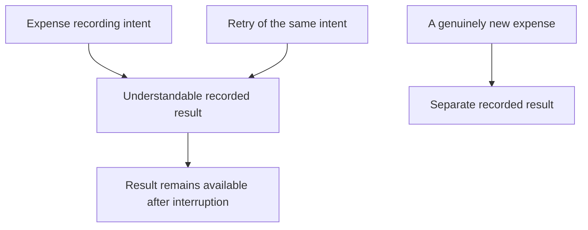
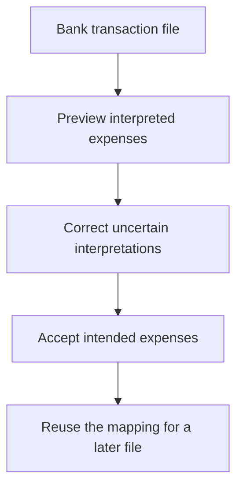

# Ideation: MiniLedger Development Opportunities

Prioritize a recoverable, retry-safe ledger, followed by trustworthy month-end reconciliation, easier bank-data intake, keyboard-accessible workflows, and evidence-led assessment of the alleged receipt exposure.

The first direction has the strongest combination of source support and reported workflow harm. The security allegation deserves prompt investigation, but it does not establish a confirmed vulnerability or justify building a multi-tenant security architecture.

## Grounding Context

### Source identity and evidence boundaries

The supplied project is MiniLedger `0.1.0`, a small Node.js/CommonJS personal expense-tracking demo.

All paths below are relative to the enclosing repository. For compact citations, `F` means:

`docs/validation/ce-skill-optimization-2026-10-29/remaining-27-acceptance/wave1/fixtures/ideate`

| Reference | What was directly read | What it establishes |
|---|---|---|
| S1 | `F/repo/README.md`, lines 3–8 | Personal expense demo; two endpoints; memory-only storage; documented gaps in categories and summaries. |
| S2 | `F/repo/package.json` | Package identity, version `0.1.0`, CommonJS entrypoint; no application test script supplied. |
| S3 | `F/repo/src/server.js`, lines 3–12 | One in-memory array; JSON parsing; unconditional append; generated ID and current timestamp; plain `ok` acknowledgement. |
| S4 | `F/repo/src/server.js`, lines 16–22 | List-all endpoint and fallback 404; no dedicated import, export, reconciliation, receipt, or tenant routes in this supplied server. |
| E1 | `F/issue-export.json`, metadata and all records | Synthetic issue evidence, declared sample coverage, issue confidence labels, duplicate records, and explicit limitations. |

The source does not contain a browser interface, bank import/export implementation, saved filters, workspace settings, receipt model, or tenant model. Consequently, the export cannot demonstrate defects in those nonexistent supplied surfaces. Its records inform possible development directions; they do not prove that this source implements the reported product.

There is also a documentation discrepancy: the README says entry creation requires five fields typed by hand, while the server reads only `amount` and `note` and generates `id` and `ts`. No supplied interface resolves that mismatch. A five-field form must not be treated as an observed fact.

The source was inspected statically. No application code or tests ran. Git revision and worktree state were not established within the permitted fixture-only scope.

### Complete sample accounting

The export identifies itself as `synthetic-evaluation-input` and declares the window `2026-10-01/2026-10-29`.

| Coverage measure | Count or limitation |
|---|---|
| Fetched records supplied | 10 |
| Unique issue IDs supplied | 8 |
| Duplicate records | 2: the additional `SUP-101` and `SEC-9` mirror records |
| Eligible unique issues | 7 |
| Eligible unique issues analyzed | 7 |
| Excluded unique issues | 1: `OLD-1`, explicitly ineligible because it concerns a retired application |
| Eligible issues omitted from analysis | 0 |
| Unknown remainder | Pagination incomplete; additional records unknown |
| Coverage conclusion | Complete analysis of the supplied eligible sample; incomplete knowledge of the underlying issue population |

Duplicates were collapsed by issue ID. The mirrored eight observations for `SUP-101` and mirrored one observation for `SEC-9` were not added again.

The `observations` field is not established as unique users, incidents, affected accounts, or independent confirmations. The values therefore provide sample context, not prevalence estimates. No trend can be established from one aggregate window without comparable periods and record-level dates.

### Disposition of every eligible issue

“Confirmed” below preserves the export’s own label. It does not mean independently reproduced, verified against this source, or observed in production.

| Issue | Export confidence | Observations | Evidence and disposition |
|---|---|---:|---|
| `SUP-101` | Confirmed | 8 | “Users manually remove duplicate rows after retry.” Supports opportunity 1; the specific export/re-entry defect is absent from the supplied source. |
| `SUP-102` | Confirmed | 5 | “Bank import requires manual spreadsheet conversion.” Supports opportunity 3 as a prospective intake capability. |
| `SEC-9` | Unverified | 1 | “One ambiguous screenshot alleges another studio receipt; no reproduction or source confirmation.” Supports opportunity 5 as investigation, not a confirmed exposure fix. |
| `UX-41` | Confirmed | 32 | “Preference only; no blocked workflow observed.” Considered and deferred despite the largest observation count. |
| `SUP-103` | Confirmed | 6 | “Users repeat filtering each session.” Combined into opportunity 2, with saved-view applicability still unverified. |
| `UX-42` | Confirmed | 2 | “Keyboard-only user cannot see focused export button.” Supports opportunity 4; no corresponding UI was supplied. |
| `OPS-3` | Confirmed | 3 | “Month-boundary totals need manual adjustment.” Combined into opportunity 2; no timezone-aware reporting surface was supplied. |

## Topic Axes

1. **Ledger continuity and repeated transfers:** whether recording or moving expenses preserves a trustworthy result.
2. **Bank-data intake:** whether outside transactions can enter MiniLedger without repeated manual conversion.
3. **Month-end interpretation:** whether time periods, totals, and reconciliation context remain understandable and repeatable.
4. **Interaction access:** whether people can complete expense workflows with their available input method.
5. **Financial-data boundaries:** whether allegations about visibility can be investigated and matched to an actual product surface.

All five axes have a surviving direction. Coverage does not imply that every direction has equal evidential strength or should become a feature.

## Ranking Rationale

The ranking weighs concrete workflow harm, direct source support, strength of the reported basis, likely reuse across future capabilities, implementation burden, and overlap. Observation count is secondary.

Confidence percentages express judgment that a direction merits further product exploration from these materials. They are not measured probabilities of a defect or expected commercial success.

| Rank | Opportunity | Primary reason for placement | Confidence | Complexity |
|---:|---|---|---:|---|
| 1 | A recoverable, retry-safe ledger | Source exposes a foundational continuity gap; `SUP-101` supplies an adjacent repeated-transfer pain signal. | 85% | Medium |
| 2 | A repeatable month-end view | Combines incorrect-boundary and repeated-filter work around one coherent user outcome; README independently identifies missing summaries. | 75% | Medium |
| 3 | Bank-data intake with a reviewable preview | Removes a reported manual conversion step, but requires a new source surface and representative bank files. | 70% | Medium |
| 4 | Keyboard-complete expense workflows | Addresses blocked access rather than visual preference; applicable UI is not supplied. | 65% | Medium |
| 5 | Evidence-led receipt-boundary assessment | Potential severity warrants discovery, while unverified evidence and missing receipt/tenant surfaces prevent a confident feature commitment. | 65% for investigation | Low initially; remediation unknown |

The fifth position is a development-confidence ranking, not a recommendation to delay possible security triage until four features ship. If the allegation maps to an actual supported product, evidence collection should be prompt. A reproduced exposure would materially change priorities.

## Ranked Ideas

### 1. A recoverable, retry-safe ledger

**Description:** Make an expense a record users can trust after a restart, an uncertain acknowledgement, or a repeated transfer. The opportunity is to reduce reconciliation work by preserving an understandable outcome for each recording action, including distinguishing a retry from a genuinely repeated expense.

**Axis:** Ledger continuity and repeated transfers.

**Basis:**

- `direct:` S3 contains `const entries = [];` and unconditionally executes `entries.push({ id: entries.length + 1, amount, note, ts: Date.now() });`.
- `direct:` S1 explicitly says, “Data is kept in memory.”
- `direct:` E1, `SUP-101`, reports, “Users manually remove duplicate rows after retry.”
- `reasoned:` A ledger that forgets records on restart or cannot distinguish repeated submission intent cannot provide a dependable foundation for imports, summaries, or exports. This is supported by the source shape, although the reported export workflow is not present here.

**Rationale:** This direction addresses a source-visible foundation and the export’s highest-observation operational problem. Reliability improvements would also reduce ambiguity for later bank intake and month-end views. It is a stronger first investment than adding a dashboard over potentially transient or repeated entries.

**Conceptual outcome:**

The diagram expresses a product direction, not a chosen storage or deduplication design.

**Downsides:** Recovery introduces storage and lifecycle obligations beyond the current demo. Retry recognition can suppress legitimate identical purchases if designed around amount and note alone. The export issue could have a different root cause from entry creation.

**Confidence:** 85% that the direction is worth exploring; the specific `SUP-101` root cause remains unverified.

**Complexity:** Medium.

**Why it warrants discussion:** It changes whether MiniLedger can be trusted as a ledger rather than merely demonstrate entry creation.

**Evidence needed before commitment:** The intended persistence expectations and a concrete retry scenario from the relevant transfer surface.

### 2. A repeatable month-end view

**Description:** Give users a consistent way to answer “What belongs in this month?” and return to the same reconciliation context later. A clear period interpretation, a summary of included expenses, and reusable filtering would reduce both manual adjustment and repeated setup.

**Axis:** Month-end interpretation.

**Basis:**

- `direct:` S1 lists “no summary view.”
- `direct:` S3 stores `ts: Date.now()`; S4 returns entries without report-period or timezone metadata.
- `direct:` E1, `OPS-3`, reports, “Month-boundary totals need manual adjustment.”
- `direct:` E1, `SUP-103`, reports, “Users repeat filtering each session.”
- `reasoned:` A summary and its reusable context should agree on which entries belong to the period. Saving a filter without clarifying period interpretation could make a wrong or surprising result easier to repeat.

**Rationale:** This combines two supplied problems around one outcome: repeatable reconciliation. It also fits the README’s explicit summary gap. Correct interpretation ranks above convenience alone because a fast report that assigns expenses to unexpected months can mislead users.

**Downsides:** The current timestamp represents recording time, not necessarily the purchase date. A trustworthy monthly view therefore requires clarification of which date matters. Saved settings introduce persistence and ownership decisions; the personal-demo source does not justify assuming workspaces.

**Confidence:** 75%.

**Complexity:** Medium.

**Why it warrants discussion:** It turns the existing list of entries into a useful financial answer while making the meaning of that answer visible.

**Evidence needed before commitment:** Representative month-boundary examples, the desired expense-date semantics, and the actual reconciliation workflow behind the two records.

### 3. Bank-data intake with a reviewable preview

**Description:** Let users bring bank transactions into MiniLedger with an understandable preview of recognized amounts, dates, and descriptions before accepting them. Reusable mappings could reduce repeated spreadsheet conversion when the same bank format returns.

**Axis:** Bank-data intake.

**Basis:**

- `direct:` E1, `SUP-102`, reports, “Bank import requires manual spreadsheet conversion.”
- `direct:` S3 accepts individual `amount` and `note` values.
- `direct:` S4 confirms the supplied server has no dedicated import surface.
- `reasoned:` An explicit preview gives users a chance to detect mistaken field interpretation before it changes their ledger. Reusing a known mapping can remove recurring conversion work without promising support for every bank format.

**Rationale:** This is a concrete expansion from manual entry into a repeated expense-tracking workflow. It ranks below ledger continuity and reporting meaning because faster intake compounds errors if accepted records cannot be retained reliably or interpreted correctly.

**Conceptual outcome:**

**Downsides:** Date, decimal, currency, and encoding differences create a wider support surface than the present API. No bank samples or format distribution were supplied. Importing a previously accepted file overlaps with the retry and duplicate concerns in opportunity 1.

**Confidence:** 70%.

**Complexity:** Medium.

**Why it warrants discussion:** It could remove an entire manual preparation step, rather than merely make that step prettier.

**Evidence needed before commitment:** A small, permission-appropriate set of representative input formats and the desired behavior for repeated files. No universal format-support claim is justified yet.

### 4. Keyboard-complete expense workflows

**Description:** Treat keyboard completion as a capability of the future expense interface: users should be able to locate their current focus, reach essential actions, and understand the result without depending on a pointer. The reported export action is a specific example, not evidence that this fixture already contains such a screen.

**Axis:** Interaction access.

**Basis:**

- `direct:` E1, `UX-42`, says, “Keyboard-only user cannot see focused export button.”
- `direct:` E1, `UX-41`, distinguishes accent-color preference from a blocked workflow.
- `direct:` S1 and S4 describe and expose an HTTP API; no browser controls were supplied.
- `reasoned:` An essential action that a keyboard user cannot reliably locate represents a stronger access problem than a disliked accent color, even when fewer observations mention it.

**Rationale:** The reported consequence is inability to use an action confidently, not aesthetic dissatisfaction. This earns a place ahead of broad cosmetic customization. It also creates a useful design constraint for any future capture, import-preview, or reconciliation interface.

**Downsides:** There is no supplied UI to inspect or fix. Expanding immediately into a complete accessibility redesign would exceed the evidence. A focus indicator alone would not establish that the entire flow is keyboard-complete.

**Confidence:** 65%.

**Complexity:** Medium for the workflow direction; the size of any specific UI correction is unknown.

**Why it warrants discussion:** It affects who can complete an expense workflow, rather than how attractive the workflow appears.

**Evidence needed before commitment:** The actual UI and the relevant keyboard journey. No accessibility test or browser observation was performed here.

### 5. Evidence-led receipt-boundary assessment

**Description:** Resolve whether the alleged cross-studio receipt belongs to MiniLedger, another application, a misleading screenshot, or a real visibility failure. The useful development opportunity is a bounded diagnostic capability that makes financial-data ownership and visibility explainable before choosing any remediation.

**Axis:** Financial-data boundaries.

**Basis:**

- `direct:` E1, `SEC-9`, explicitly states, “One ambiguous screenshot alleges another studio receipt; no reproduction or source confirmation.”
- `direct:` The export labels this issue `unverified` and warns that it is “an allegation requiring investigation, not a confirmed defect.”
- `direct:` S3–S4 contain a shared in-memory expense list, but no receipt objects, identity, workspace, or tenant model.
- `reasoned:` Potential financial-data exposure can be important even when reported once. Its severity justifies checking the allegation; its uncertainty and mismatch with the supplied source do not justify asserting a vulnerability or prescribing a tenant-isolation rewrite.

**Rationale:** This direction prevents two mistakes: ignoring a potentially serious report because it is rare, and treating ambiguous evidence as permission to build unrelated security architecture. Its output would be a better-supported product decision, not a predetermined vulnerability fix.

**Downsides:** The work may conclude that the report is unrelated or insufficient. The supplied fixture cannot resolve it. Investigation may require access to another product and carefully handled evidence, neither of which is part of this task.

**Confidence:** 65% that bounded investigation is worthwhile; confidence in the allegation itself is not numerically estimated.

**Complexity:** Low for initial applicability assessment; any remediation is unknown.

**Why it warrants discussion:** It separates the importance of a possible consequence from confidence that the consequence actually occurred.

**Evidence needed before commitment:** Product identity, the relevant receipt surface, an appropriately handled original report, and reproducible visibility expectations. None was fetched or verified during this run.

## Rejection Summary

Candidates were generated across pain/friction, removal/automation, reframing, leverage, analogy, and constraint-flipping lenses before filtering. The six lenses were applied serially by one reader, not by independent agents. The candidate set included the five retained directions and the alternatives below.

| Candidate considered | Basis or motivation | Reason not retained separately |
|---|---|---|
| Accent-color refresh | `UX-41` | Highest observation count, but explicitly a preference without blocked workflow; weaker than correctness and access needs. |
| Theme marketplace | `UX-41` | Large scope increase from a narrow aesthetic preference. |
| One-click removal of matching rows | `SUP-101` | Equal-looking expenses can be legitimate; automatic deletion could damage the ledger. |
| Duplicate-warning view | `SUP-101` | Useful variant of opportunity 1, but weaker as a separate direction because it leaves users cleaning up consequences. |
| Retry-result acknowledgement | S3 and `SUP-101` | Folded into opportunity 1 rather than ranked as a narrowly technical feature. |
| Durable storage alone | S1 and S3 | Folded into opportunity 1; persistence alone does not resolve repeated-intent ambiguity. |
| Manual recovery checklist | S1 | A workaround with less user value than a recoverable product outcome. |
| Permanent transaction audit history | S3 and transfer ambiguity | Potential extension of opportunity 1; retention and audit requirements are not supplied. |
| Error-tolerant entry validation | S3 parses and accepts input directly | Relevant supporting concern for trustworthy recording, but too narrow for a separate top-five direction here. |
| Bank-format converter download | `SUP-102` | Moves conversion work outside the product rather than removing the recurring burden. |
| Reviewless automatic import | `SUP-102` | Offers speed without sufficient protection against incorrect field interpretation. |
| Universal bank-format support | `SUP-102` | Unsupported breadth; no representative format corpus exists in the fixture. |
| Reusable import mappings alone | `SUP-102` | Folded into opportunity 3; reuse should follow understandable initial interpretation. |
| Live bank synchronization | `SUP-102` | Introduces integrations and data-access obligations not justified by a conversion complaint. |
| AI receipt extraction | Expense domain | No receipt-upload or OCR demand is supplied; the security allegation does not establish a receipt-ingestion need. |
| Saved filters alone | `SUP-103` | Folded into opportunity 2 so reusable context and period meaning remain coherent. |
| UTC-only reporting policy | `OPS-3` | A universal convention does not necessarily match the user’s accounting month. |
| Timezone label only | `OPS-3` | A label alone cannot establish correct period grouping or export interpretation. |
| Categories-first redesign | README | Categories are a documented gap, but no category-specific user impact is supplied; weaker than the retained workflow evidence. |
| Spending dashboard alone | README | Folded into opportunity 2; visual summaries without clear period semantics risk misleading users. |
| Automated financial advice | Expense domain | Requires reliable financial context and user demand beyond the provided materials. |
| Focus-indicator patch | `UX-42` | No target UI exists in the fixture; retained as part of opportunity 4’s conditional direction rather than claimed as an identified patch. |
| Keyboard shortcuts alone | `UX-42` | Shortcuts do not replace discoverable focus and accessible essential actions. |
| Full interface redesign | UI-related records | Broad intervention unsupported by a supplied interface or usability study. |
| Voice-first entry | Entry-friction claim in README | Speculative input-mode expansion; the documented five-field workflow is itself unresolved. |
| Automatic five-field completion | README | Premise conflicts with the supplied two-input handler; needs clarification before becoming a direction. |
| Cross-tenant authorization rewrite | `SEC-9` | No confirmed vulnerability or tenant model; disproportionate to available evidence. |
| Receipt-access audit dashboard | `SEC-9` | Assumes receipt infrastructure and recurring audit demand not present in the supplied source. |
| Delete all receipt data | `SEC-9` | Destructive, unsupported, and unrelated to a verified root cause. |
| Multi-studio product pivot | Studio language in `SEC-9` | Replaces the personal-demo identity based on a single unverified record. |
| Rebuild the retired application | `OLD-1` | Explicitly outside the eligible sample and current product. |

The final five cover every axis, while the coverage table accounts for all seven eligible unique issues. A rejected direction is not an unexamined issue.

## Limitations and Decision Boundary

This is a point-in-time ideation dossier, not requirements, an implementation plan, a security finding, or a release decision.

The local export is synthetic. Its confidence labels and observation counts were preserved without promoting them to live production facts. Complete analysis of seven supplied eligible issues does not establish complete tracker coverage. The relationship between several reported workflows and this minimal source remains unresolved.

Source inspection and basis checking were performed by the same reader. There was no independent verification, application execution, external research, tracker access, delegation, or user questioning. No files were written; the complete dossier is returned here for the parent to preserve.

The source context carried forward is `context_facts_adapter/v1`, owned by `spec-ideate`: source identity is the supplied MiniLedger `0.1.0` fixture; source references are S1–S4 and E1; freshness is local reading on `2026-10-30` of an export declaring the preceding October window; artifact type is advisory; limitations are synthetic provenance, unknown revision/worktree state, incomplete pagination, absent reported surfaces, and static-only verification.

The recommended exploration choice is opportunity 1. Opportunity 5 remains a prompt, conditional evidence question rather than a commitment to a security implementation. No direction has been selected or approved by the user, and no downstream workflow has been started.
