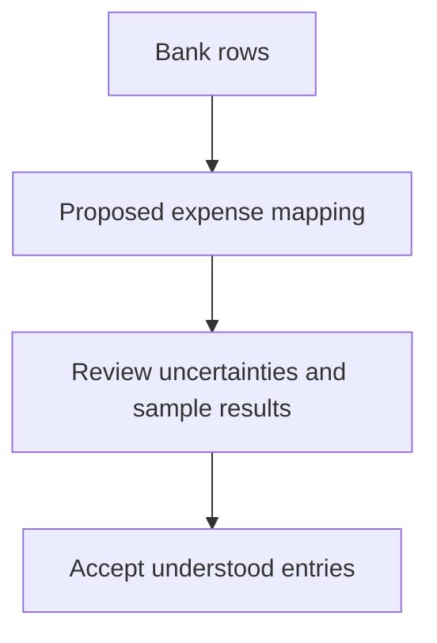

# Ideation: MiniLedger Development Opportunities

Prioritize trustworthy entry capture, investigate the potentially serious receipt-isolation allegation, and then explore easier import, accessible interaction, and reliable reconciliation views. The strongest immediate development direction is trustworthy entry capture because the supplied source directly exposes its limitations. Export-specific and multi-tenant proposals remain conditional: those surfaces do not exist in the supplied MiniLedger implementation.

This dossier analyzes the entire eligible supplied sample. It does not represent live production observations, a confirmed defect inventory, or an implementation plan.

## Grounding Context

### Codebase Context

All paths below are relative to the supplied fixture root:

`docs/validation/ce-skill-optimization-2026-10-29/remaining-27-acceptance/wave1/fixtures/ideate/`

The complete supplied code sample contains:

- `repo/README.md`: describes MiniLedger as “A tiny personal expense-tracking demo app (Node.js, CommonJS).” It identifies in-memory storage and says there are no categories or summary view.
- `repo/package.json`: identifies the private `mini-ledger` package at version `0.1.0`.
- `repo/src/server.js`: implements only `POST /entries` and `GET /entries`, with a fallback 404.

Specific source observations:

| Evidence | What the supplied source establishes | What it does not establish |
|---|---|---|
| `repo/src/server.js:3` — `const entries = [];` | Entries live in a process-local array. | The frequency or impact of actual data loss. |
| `repo/src/server.js:10` — `JSON.parse(body || '{}')` | Request parsing has no local error handling or field validation. | A reproduced application crash or measured invalid-input rate. |
| `repo/src/server.js:11` — unconditional `entries.push(...)` | Each handled request appends a new entry; there is no retry identity check on this path. | The cause of the export duplication described in `SUP-101`. |
| `repo/src/server.js:11` — `ts: Date.now()` | Entry time is assigned on receipt; the record carries no transaction-date or timezone field. | A reproduced month-boundary reporting error. |
| `repo/src/server.js:16–18` | Listing returns the entire array without filtering or aggregation. | An existing reconciliation screen or saved-view feature. |
| `repo/src/server.js:5–23` | The supplied server has no receipt, tenant, import, export, or UI implementation. | Whether those surfaces exist in a different application or omitted repository. |

There is an unresolved documentation discrepancy: the README says entry creation requires five manually typed fields, while the server reads only `amount` and `note` and generates `id` and `ts`. No client was supplied. Consequently, the dossier treats manual-entry friction as a documentation signal, not a verified five-field interaction.

### Supplied Research and Coverage

`issue-export.json` is labeled `synthetic-evaluation-input`, covers `2026-10-01/2026-10-29`, and explicitly says it is a local evaluation export rather than live tracker data.

| Coverage measure | Result |
|---|---:|
| Supplied records read | 10 |
| Distinct issue identities | 8 |
| Duplicate record occurrences removed | 2 |
| Eligible unique issues | 7 |
| Eligible unique issues analyzed | 7 |
| Excluded unique issues | 1 |
| Eligible supplied sample coverage | 7/7 |
| Additional records beyond the export | Unknown |

`SUP-101` appears twice, once through a feedback mirror. `SEC-9` also appears twice, once through a support mirror. Neither mirror adds an independent issue or independent corroboration.

`OLD-1` is excluded because the export explicitly marks it ineligible: “Archived request for retired application.”

The export reports incomplete pagination. Seven analyzed eligible issues are the known eligible sample, not the complete underlying issue population. The `observations` values are retained as fixture metadata; they are not counts of independently verified users, incidents, or affected organizations. They are not summed across mirrors or interpreted as prevalence.

The export supplies no issue lifecycle states, individual observation timestamps, deployment evidence, affected versions, reproduction steps, or links tying its product surfaces to MiniLedger. Trends, reopenings, and whether a reported problem remains active are therefore unknown.

### Complete Eligible-Sample Accounting

| Unique issue | Source after deduplication | Reported observations | Signal and confidence boundary | Disposition |
|---|---|---:|---|---|
| `SUP-101` | support; feedback-mirror | 8 | Export re-entry duplicates; marked confirmed within the synthetic export. | Opportunity 1, as transfer signal; source confirms only append behavior. |
| `SUP-102` | support | 5 | Bank import requires manual spreadsheet conversion; marked confirmed within the export. | Opportunity 3; import is a proposed new MiniLedger capability. |
| `SEC-9` | security-triage; support-mirror | 1 | Possible cross-tenant receipt exposure; explicitly unverified and unreproduced. | Opportunity 2, bounded investigation rather than assumed remediation. |
| `UX-41` | feedback | 32 | Accent-color preference; explicitly no blocked workflow. | Considered and deferred despite the largest observation count. |
| `SUP-103` | support | 6 | Saved reconciliation filter lost; marked confirmed within the export. | Opportunity 5; no corresponding UI exists in the supplied source. |
| `UX-42` | feedback | 2 | Keyboard-only user cannot see the focused export button; marked confirmed within the export. | Opportunity 4; applicability to MiniLedger requires a client surface. |
| `OPS-3` | ops | 3 | Workspace timezone absent from export; manual adjustment at month boundaries. | Opportunity 5; source provides a narrower temporal-model concern. |

These signals form five issue themes: transfer reliability and interoperability (`SUP-101`, `SUP-102`), isolation assurance (`SEC-9`), reconciliation continuity and time meaning (`SUP-103`, `OPS-3`), keyboard access (`UX-42`), and visual preference (`UX-41`). Their unique-issue counts are 2 + 1 + 2 + 1 + 1 = 7.

Theme grouping is semantic, not proof of a shared root cause. All theme trends remain unknown. Source labels are preserved; the export does not establish human-versus-bot authorship.

### Evidence Boundaries

The source and the issue export have an important scope mismatch. The export mentions studios, receipts, workspaces, exports, imports, and reconciliation; the supplied app is a minimal personal-expense HTTP server. These reports inform candidate directions but cannot establish defects in absent MiniLedger features.

Grounding and critique were performed serially from the supplied files. No application code, tests, network requests, independent reviewers, or delegated workers were used. Git revision and dirty state were not established. Confidence below concerns the usefulness of exploring a direction on this evidence, not an empirical probability of success.

## Topic Axes

1. **Entry integrity:** whether recorded expenses remain valid, recoverable, and free of accidental repetition.
2. **Data isolation:** whether sensitive records have a clearly understood ownership boundary.
3. **Data movement:** whether users can move existing expense data into the ledger without manual conversion.
4. **Keyboard access:** whether core actions are usable without a pointing device.
5. **Reconciliation continuity:** whether views preserve both user intent and consistent time meaning.

Visual preference was considered within interaction quality but did not justify a separate surviving direction.

## Ranking Rationale

The ranking weighs potential harm and blocked work first, direct source support second, then breadth, leverage, complexity, and overlap. Reported frequency informs the judgment but does not determine it. Novelty helps distinguish alternatives only when the basis and likely usefulness are comparable.

| Rank | Opportunity | Main reason for position | Confidence | Complexity |
|---:|---|---|---:|---|
| 1 | Trustworthy entry capture | Strongest direct source basis; protects the ledger's core purpose. | 90% | Medium |
| 2 | Establish receipt ownership and isolation applicability | Potentially serious harm warrants early clarification despite weak evidence. | 60% | Low for investigation; remediation unknown |
| 3 | Previewable bank-data intake | Concrete manual-work signal and a useful extension of the existing capture path. | 70% | Medium |
| 4 | Keyboard-complete expense workflows | A blocked interaction outweighs cosmetic preferences, but no UI was supplied. | 65% | Medium |
| 5 | Reusable reconciliation views with explicit time meaning | Two complementary workflow signals; larger distance from the current app. | 70% | Medium |

Rank 2 is investigation priority, not authorization to build tenant infrastructure. A verified ownership failure would change the implementation order; evidence that the issue belongs to an unrelated product would remove it from MiniLedger's development backlog.

## Ranked Ideas

### 1. Trustworthy Entry Capture

**Description:** Make adding an expense a dependable operation: accepted entries have meaningful values, remain recoverable beyond the current process, and do not multiply solely because the same submission is retried. Treat durable capture and recognizable outcomes as the foundation for later import or export features.

**Axis:** Entry integrity.

**Basis:**

- `direct:` `repo/src/server.js:3` stores entries in `const entries = [];`.
- `direct:` `repo/src/server.js:10–12` parses the request, appends without validation or retry identity, and replies with `'ok'`.
- `direct:` `issue-export.json`, `SUP-101`: “Users manually remove duplicate rows after retry.” This is a report about export re-entry, not confirmation of the server's root cause.
- `reasoned:` A ledger becomes less useful if valid records disappear or repeated requests create accidental extra expenses. Strengthening the capture boundary benefits manual entry and future bulk intake alike.

**Rationale:** This opportunity has the closest fit to the supplied implementation and protects correctness before adding richer ways to enter data. It deserves team discussion because it defines what an accepted expense means.

**Downsides:** Recovery and retry semantics introduce durable-state decisions. Identical legitimate purchases must remain distinct; matching `amount` and `note` alone would risk suppressing real expenses. The export issue still needs its own affected-path evidence.

**Confidence:** 90% that this is worth exploring; no runtime failure or production impact has been verified.

**Complexity:** Medium.

**Evidence that could change the ranking:** A confirmed intentionally disposable demo boundary would reduce the value of persistence, although validation and clear submission outcomes would remain relevant.

### 2. Establish Receipt Ownership and Isolation Applicability

**Description:** Resolve whether the alleged cross-tenant receipt exposure concerns MiniLedger or another application, and whether a meaningful ownership boundary exists in that affected system. Preserve the possibility of a serious issue without treating an ambiguous screenshot as an established defect.

**Axis:** Data isolation.

**Basis:**

- `direct:` `issue-export.json`, `SEC-9`: “One ambiguous screenshot alleges another studio receipt; no reproduction or source confirmation.”
- `direct:` The export explicitly labels `SEC-9` unverified.
- `direct:` `repo/src/server.js:5–23` contains no tenant, receipt, authentication, or ownership model.
- `reasoned:` Potential access to another party's sensitive records warrants a bounded evidence-gathering opportunity even when report count is low. Establishing applicability avoids both dismissing serious harm and adding unrelated infrastructure.

**Rationale:** Severity can justify early investigation without high confidence. The two mirrored records do not strengthen the allegation. The useful development decision is whether isolation work belongs on this product's roadmap at all.

**Downsides:** Investigation may conclude that the report is unrelated or inconclusive. Implementing multi-tenancy now would add substantial complexity to a personal demo with no demonstrated need.

**Confidence:** 60% that resolving the allegation deserves attention; confidence that a cross-tenant MiniLedger defect exists is undetermined.

**Complexity:** Low for bounded applicability investigation; remediation cannot be estimated from this sample.

**Evidence needed:** The affected product and version, receipt ownership context, expected access policy, and an authorized reproduction or source trace. None is present here.

### 3. Previewable Bank-Data Intake

**Description:** Explore an import experience that shows how bank rows will become expenses before the user accepts them. Make unsupported fields and uncertain mappings visible so users can resolve exceptions instead of manually converting entire spreadsheets.

**Axis:** Data movement.

**Basis:**

- `direct:` `issue-export.json`, `SUP-102`: “Bank import requires manual spreadsheet conversion.”
- `direct:` `repo/README.md` identifies manually entered fields as a rough edge, although its field count conflicts with the server.
- `direct:` `repo/src/server.js:10–11` accepts `amount` and `note` and assigns the current time; it does not model imported transaction dates.
- `reasoned:` A preview turns format mismatch into a reviewable mapping problem. A repeatable mapping could reduce repeated conversion work while keeping ambiguous rows under user control.

**Rationale:** This addresses a concrete workflow burden and expands an existing core operation rather than inventing a separate product. It ranks below reliable capture because faster intake would amplify weak storage or duplicate handling.

**Downsides:** Bank formats, date conventions, and amount signs vary. A preview can still mislead if it hides uncertainty. Import support is a proposed capability, not a repair to an existing MiniLedger importer.

**Confidence:** 70%.

**Complexity:** Medium for a deliberately bounded format set; broad bank coverage is not justified by this evidence.

**Conceptual direction:**

**Evidence needed:** Representative input files and the transformations currently performed by hand. Their absence prevents any claim about format coverage or time saved.

### 4. Keyboard-Complete Expense Workflows

**Description:** Treat keyboard operation and visible focus as part of completing an expense workflow, including any future import or export review. The direction is a coherent usable interaction path, not an isolated focus-color adjustment.

**Axis:** Keyboard access.

**Basis:**

- `direct:` `issue-export.json`, `UX-42`: “Keyboard-only user cannot see focused export button.”
- `direct:` `UX-41` describes accent-color dislike as “Preference only; no blocked workflow observed.”
- `direct:` No client interface is included in the supplied fixture.
- `reasoned:` A workflow that cannot be navigated confidently by keyboard excludes some users from core actions. Its importance is not proportional to the number of cosmetic preferences elsewhere in the sample.

**Rationale:** Two reported observations of a blocked interaction can justify more attention than 32 preference observations. This warrants team discussion about functional access across the actual interaction sequence.

**Downsides:** A UI surface must first be identified or proposed. A source-level focus style alone would not establish keyboard usability, focus order, or assistive-technology compatibility.

**Confidence:** 65% as a direction for an applicable client; no MiniLedger UI defect is verified.

**Complexity:** Medium for a complete interaction path; the cost of a specific focus repair is unknown.

**Evidence needed:** The affected UI, its keyboard sequence, and direct observation of focus visibility and action completion. No accessibility or visual testing was performed.

### 5. Reusable Reconciliation Views with Explicit Time Meaning

**Description:** Explore a reconciliation view that remembers the user's selected filters and makes the meaning of a reporting month explicit. A saved view should preserve enough context for a user to return to the same interpretation of their expenses, including the relevant reporting timezone and transaction-date semantics.

**Axis:** Reconciliation continuity.

**Basis:**

- `direct:` `issue-export.json`, `SUP-103`: “Users repeat filtering each session.”
- `direct:` `OPS-3`: “Month-boundary totals need manual adjustment.”
- `direct:` `repo/src/server.js:11` stores only a server-assigned `ts`; `repo/src/server.js:16–18` lists all entries without a view model.
- `direct:` `repo/README.md` identifies the absence of a summary view.
- `reasoned:` Remembering filters without preserving how dates are interpreted could restore the controls but change the result. These are complementary parts of a repeatable reconciliation experience, not evidence of one shared bug.

**Rationale:** This direction combines recurring setup work with financial interpretation. It ranks fifth because a useful reporting experience depends on more trustworthy records and clearer transaction-date meaning than the current sample provides.

**Downsides:** “Month” can mean transaction date, entry date, or another accounting convention. The export's workspace concept must not be imposed on a personal app without justification. Persisted views can also preserve settings that users later forget.

**Confidence:** 70%.

**Complexity:** Medium.

**Evidence needed:** The intended date convention, example month-boundary records, and the filters users repeatedly recreate. A reporting timezone should be derived from actual needs rather than guessed from the machine clock.

## Rejection Summary

Candidates were generated across pain and friction, removal and automation, assumption-breaking, compounding leverage, cross-domain analogy, and constraint-flipping before the final cut. Analogy-based candidates used explicit reasoning rather than unverified external prior art. The 24 distinct candidates produced five survivors and the 19 dispositions below.

| Candidate considered | Reason not retained separately |
|---|---|
| Replace the accent palette | `UX-41` reports preference without a blocked workflow; lower expected leverage than integrity or access. |
| Add unrestricted theme customization | Expands a cosmetic preference into a maintenance surface without supporting demand. |
| Add expense categories immediately | README supports the absence, but stronger opportunities protect data correctness and workflow completion first. |
| Add a spending summary without date semantics | Risks presenting persuasive totals whose period meaning is unclear; narrower benefit folded into opportunity 5. |
| Remember reconciliation filters only | Useful but incomplete; folded into opportunity 5 with time interpretation. |
| Add a timezone label only | A label alone would not establish consistent period calculations; folded into opportunity 5. |
| Repair the export duplicate bug immediately | No export implementation or reproduction is supplied; the claimed root cause is unverified. |
| Delete matching expense rows automatically | Identical legitimate purchases are possible; unsupported deletion risks data loss. |
| Make every repeated request create a new expense | Preserves the accidental-retry problem exposed by the source; weaker than explicit intent. |
| Replace in-memory storage only | Valuable but leaves invalid and accidental duplicate records intact; folded into opportunity 1. |
| Add request validation only | A narrower part of trustworthy capture; folded into opportunity 1. |
| Build a universal bank connector | One import-format signal does not justify broad provider coverage or integration cost. |
| Silently infer every imported field | Removes review where ambiguity can alter financial meaning; weaker than previewable intake. |
| Publish spreadsheet-conversion instructions only | Could help temporarily, but preserves the manual work described by `SUP-102`. |
| Introduce OCR receipt capture | No receipt ingestion code or explicit capture demand exists in the supplied MiniLedger material. |
| Implement multi-tenant authorization immediately | Assumes the applicability and root cause of `SEC-9`; investigation must establish both first. |
| Dismiss `SEC-9` because it is unverified | Low confidence limits the claim, not the potential severity; retain bounded investigation. |
| Fix only the export button focus style | No affected UI is available, and one style change may not restore an entire keyboard workflow. |
| Replace the HTTP workflow with a keyboard-only CLI | Source compatibility is plausible, but this would not address the reported UI barrier and lacks user-demand evidence. |

All five topic axes have a surviving candidate. Cosmetic preference is deliberately deferred, and `OLD-1` remains excluded rather than counted as a rejected eligible opportunity.

## Limitations and Decision Boundary

The direct bases were checked against the supplied source and export text. Source-level observations establish what this sample contains; they do not establish runtime behavior, deployed defects, adoption, or realized benefit.

The evidence supports selecting a direction for further definition. It does not support claims that:

- The seven issues describe live MiniLedger users.
- The export covers the full issue population.
- The mirrored records are independent corroboration.
- The alleged receipt exposure is confirmed.
- Any issue is increasing, reopened, fixed, or deployed.
- The proposed opportunities have been implemented or tested.

The recommendation is to define trustworthy entry capture first while resolving the applicability of `SEC-9` early. No direction has been user-approved, and no requirements, code, or saved artifact was created by this read-only run. The full dossier is returned inline for the parent to preserve.
