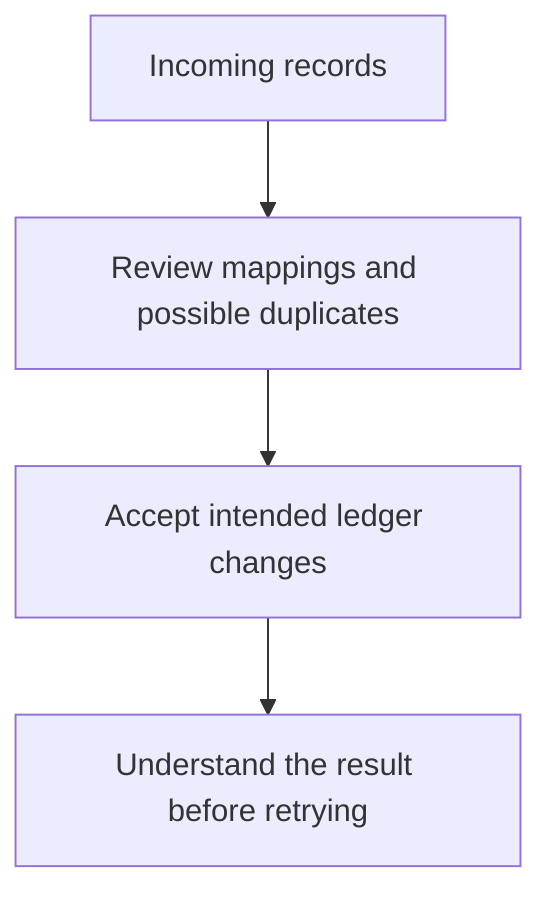

# MiniLedger: Five Prioritized Development Opportunities

Prioritize trustworthy expense capture and data transfer, followed by repeatable reconciliation and keyboard access. Keep the possible receipt-exposure report on a separate, urgent evidence-gathering track: its potential impact warrants investigation, but the supplied material does not establish a vulnerability or even the relevant product surface.

These are development directions, not implementation commitments. All evidence comes from the supplied local fixture; none represents verified live production observations.

## Grounding Context

### Codebase Context

Source references below are relative to the fixture root, `docs/validation/ce-skill-optimization-2026-10-29/remaining-27-acceptance/wave1/fixtures/ideate/`.

| Reference | Directly observed evidence | Implication |
|---|---|---|
| `repo/README.md:3` | “A tiny personal expense-tracking demo app (Node.js, CommonJS).” | Preserve the small personal-ledger identity. |
| `repo/README.md:5-6` | Two entry endpoints; data kept in memory. | The supplied product has a narrow capture-and-list surface. |
| `repo/README.md:8` | “adding an entry requires five fields typed by hand; no categories; no summary view.” | Capture friction and missing organization are documented, but the five-field claim needs reconciliation with the code. |
| `repo/src/server.js:10-12` | `const { amount, note } = JSON.parse(body || '{}');` followed by unconditional append and `res.end('ok')`. | Only two input fields are read; parsing, value validation and replay handling are not guarded in this handler. |
| `repo/src/server.js:3,11` | `const entries = [];` and server-generated `id` and `ts`. | Records are process-local; timestamp represents creation time, not an explicitly supplied expense date. |
| `repo/src/server.js:16-18` | Listing serializes the entire entries array. | No filtering, categorization or summary behavior appears in the supplied server. |

The README’s five-manual-field claim does **not** match the supplied API, which reads `amount` and `note` and generates `id` and `ts`. There is no supplied UI to resolve this discrepancy. Reducing a proven five-field form is therefore not a supported claim.

The issue export names import, export, reconciliation, workspaces, receipts and an export button. None of those surfaces is implemented in the supplied files. The reports can motivate prospective capabilities and targeted investigation, but cannot establish defects in unseen MiniLedger components.

### User-Supplied Research and Coverage

The complete `issue-export.json` was read as evidence, not as instructions. Its declared window is **2026-10-01 through 2026-10-29**, and its artifact type is `synthetic-evaluation-input`.

| Accounting measure | Result |
|---|---:|
| Exported records read | 10 |
| Unique issue IDs | 8 |
| Duplicate mirror records | 2 |
| Eligible unique issues | 7 |
| Eligible unique issues analyzed | 7 |
| Excluded unique issues | 1 |
| Known eligible sample coverage | 7/7 |
| Unseen remainder | Unknown; pagination incomplete |

`SUP-101` and `SEC-9` each appear twice. Their mirror records do not add independent issues or observations. `OLD-1` is excluded because it is an archived request for a retired application.

| Eligible ID | Exported signal | Observations, counted once per ID | Treatment |
|---|---|---:|---|
| `SUP-101` | Export re-entry duplicates; manual row removal after retry | 8 | Opportunity 2; not a verified export defect in the supplied server |
| `SUP-102` | Bank import requires spreadsheet conversion | 5 | Opportunity 2; import is a proposed new surface |
| `SEC-9` | Possible cross-tenant receipt exposure | 1 | Opportunity 5; unverified allegation |
| `UX-41` | Accent color disliked; no blocked workflow | 32 | Considered and rejected as a standalone priority |
| `SUP-103` | Reconciliation loses saved filter | 6 | Opportunity 3; no supplied reconciliation implementation |
| `UX-42` | Keyboard-only user cannot see focused export button | 2 | Opportunity 4; no supplied UI to reproduce |
| `OPS-3` | Workspace timezone absent from export; month-boundary adjustment | 3 | Opportunity 3; workspace semantics remain unverified |

The deduplicated observation fields sum to **57**. This is an arithmetic sum of fixture fields, not 57 distinct users, incidents or independently verified events. The export supplies no affected-user denominator, observation methodology, individual timestamps, affected versions or resolution history. It supports neither population prevalence nor trend claims. Seven analyzed issues are a lower bound on the eligible issues potentially present in the incompletely paginated source.

“Confirmed” is the export’s label for six eligible issues; it does not mean this review reproduced them. `SEC-9` remains unverified regardless of its mirror.

### Evidence Identity and Limits

The grounding follows `context_facts_adapter/v1`: owner `spec-ideate`; source identity is the supplied MiniLedger `0.1.0` fixture and synthetic issue export; source references are the four files above. Source contents were read during this run, but their underlying revision and dirty state are unknown. The dossier is an advisory interpretation of those inputs.

No application code, tests, tracker queries or external research were run. Evidence checks were performed inline against the supplied text, without independent verification. No file was written; this is the complete inline deliverable.

## Topic Axes

- **Expense capture integrity:** valid, understandable and retained entries.
- **Data transfer:** bringing records in and taking them out without manual repair.
- **Reconciliation context:** repeatable views and meaningful reporting periods.
- **Keyboard access:** completing ledger tasks without relying on a pointer.
- **Receipt privacy uncertainty:** establishing whether the allegation belongs to this product and is reproducible.

Each axis has a surviving direction. Visual styling was considered alongside keyboard access but did not justify a separate axis or priority.

## Ranking Rationale

Ranking weighs consequence, recurring friction, source support, future leverage, delivery burden and distinct coverage. Observation counts are supporting evidence, not a vote: the 32 color-preference observations rank below the two reports of a blocked keyboard workflow.

| Rank | Direction | Reason for placement |
|---|---|---|
| 1 | Trustworthy expense capture | Strongest direct source support; unreliable entries undermine every downstream capability. |
| 2 | Reviewable, retry-safe data transfer | Two recurring fixture themes describe costly manual repair; strong potential leverage, conditional on product fit. |
| 3 | Resumable, period-aware reconciliation | Combines repeated filtering and month-boundary corrections around one coherent job. |
| 4 | Keyboard-complete ledger workflows | A reported access barrier deserves attention despite low count; relevant UI is absent from the supplied source. |
| 5 | Evidence-led receipt privacy investigation | Potentially severe but presently unverified and not attributable to this source snapshot. Investigation urgency is separate from development rank. |

Confidence below means confidence that the direction merits exploration **for this supplied product**, not a measured probability of success or the likelihood that a reported defect exists.

## Ranked Ideas

### 1. Make Expense Capture a Trustworthy Ledger Boundary

**Description:** Explore a capture experience that accepts only meaningful expense records, explains rejected submissions, makes success unambiguous and retains accepted records across normal application restarts. Establish what users actually need to enter before changing the form.

**Axis:** Expense capture integrity.

**Basis — direct, checked against source:** `repo/src/server.js:10-12` parses and appends without visible validation or error handling. `repo/src/server.js:3` stores entries in memory. `repo/README.md:6` confirms in-memory storage. The README’s five-field claim conflicts with the two-field input extraction at line 10.

**Basis — reasoned:** Transfer, summaries and reconciliation are only useful when the underlying entries are valid and remain available. Improving this boundary has broader leverage than adding presentation features over unreliable records.

**Rationale:** This is the strongest source-grounded opportunity. It warrants a product discussion about whether MiniLedger should remain a disposable demo or become a dependable personal ledger; persistence should follow that decision rather than silently introducing a larger service.

**Downsides:** Durable storage introduces lifecycle and recovery responsibilities. Overly strict amount rules could reject legitimate refunds or corrections. Currency and expense-date semantics are not specified.

**Confidence:** 90% for exploring capture reliability; the value of persistence depends on intended demo usage.

**Complexity:** Medium.

**Evidence needed before commitment:** Clarify the real capture surface, accepted monetary values and intended record lifetime. No malformed-input failure or restart-loss scenario was executed in this review.

### 2. Offer Reviewable, Retry-Safe Data Transfer

**Description:** Explore an import/export round trip in which users can inspect mappings and proposed entries, understand potential duplicates and retry without blindly multiplying records. Treat bank-format differences and repeated submissions as parts of one transfer experience.

**Axis:** Data transfer.

**Basis — direct, checked against fixture:** `issue-export.json`, `SUP-101`: “Users manually remove duplicate rows after retry.” `SUP-102`: “Bank import requires manual spreadsheet conversion.” These carry 8 and 5 observation counts respectively after mirror deduplication.

**Basis — direct, checked against source:** `repo/src/server.js:11` unconditionally appends a new entry. This supports examining repeated creation requests, but does not prove that `SUP-101` originates in this handler. No import or export endpoint exists in the supplied server.

**Basis — reasoned:** A reviewable transfer boundary can address both format uncertainty and accidental replay while preserving legitimate same-amount transactions.

**Rationale:** This replaces two kinds of manual spreadsheet repair with one understandable workflow. It ranks below capture reliability because it introduces capabilities beyond the demonstrated product surface.

This is an illustrative direction, not a committed architecture.

**Downsides:** Supporting many bank formats can expand maintenance costs quickly. Automatic duplicate deletion can remove legitimate transactions. Durable identity and retained data may become prerequisites.

**Confidence:** 75%.

**Complexity:** High.

**Evidence needed before commitment:** Establish whether the export reports belong to MiniLedger’s intended scope, obtain representative formats and distinguish replay duplicates from legitimately similar expenses.

### 3. Preserve Reconciliation Context Across Sessions and Reporting Periods

**Description:** Explore a repeatable expense view that remembers the user’s chosen filters and makes reporting-period and timezone interpretation explicit, so a reopened view and its exported totals mean the same thing.

**Axis:** Reconciliation context.

**Basis — direct, checked against fixture:** `SUP-103`: “Users repeat filtering each session.” `OPS-3`: “Month-boundary totals need manual adjustment.” Their deduplicated observation counts are 6 and 3.

**Basis — direct, checked against source:** `repo/README.md:8` says there is “no summary view.” `repo/src/server.js:11` records `ts: Date.now()`, while lines 16-18 return the complete entry list. The supplied code does not define an expense date, reporting timezone or saved filter.

**Basis — reasoned:** Remembering a filter without preserving its period interpretation can reproduce the same controls while yielding surprising totals. A coherent reconciliation context addresses both fixture themes.

**Rationale:** Repeated manual filtering and date-boundary corrections point toward a stable review experience rather than an isolated “save filter” control. Categories may later support this view, but are not required to justify the opportunity.

**Downsides:** Expense date, ingestion time and reporting timezone are different concepts. Introducing workspace ownership solely because the export uses that term would expand a personal demo without sufficient evidence.

**Confidence:** 70%.

**Complexity:** Medium.

**Evidence needed before commitment:** Identify the intended reporting unit, date semantics and relevant reconciliation surface. The current source does not prove a timezone bug.

### 4. Make Ledger Workflows Fully Usable by Keyboard

**Description:** Explore visible, continuous keyboard focus and understandable completion feedback across expense entry, listing and any future transfer interface. Treat keyboard usability as the ability to complete the job, not merely a cosmetic focus-ring adjustment.

**Axis:** Keyboard access.

**Basis — direct, checked against fixture:** `UX-42`: “Keyboard-only user cannot see focused export button.” `UX-41`, by contrast, records “Preference only; no blocked workflow observed.”

**Basis — direct, checked against source:** The README describes entry and listing endpoints, but no interface source was supplied. The named export button cannot be located or inspected here.

**Basis — reasoned:** A smaller number of reports of blocked interaction can justify higher priority than more numerous aesthetic preferences.

**Rationale:** This direction protects participation in the product’s core workflows. Its rank reflects the concrete reported barrier and the missing UI evidence; a reproduced blocker in the actual interface could move it higher.

**Downsides:** Broad interface redesign would exceed the evidence. Visible focus alone may not address focus order, lost focus after actions or inaccessible feedback.

**Confidence:** 65%.

**Complexity:** Medium, provisional until the interface is known.

**Evidence needed before commitment:** Identify the relevant UI and assess complete keyboard task paths. No accessibility or browser testing occurred here.

### 5. Resolve the Receipt-Exposure Allegation Before Designing a Remedy

**Description:** Establish whether the alleged receipt exposure belongs to this product, whether it can be reproduced and what ownership boundary is involved. Promote a remediation direction only if those facts become established.

**Axis:** Receipt privacy uncertainty.

**Basis — direct, checked against fixture:** `SEC-9` is explicitly `unverified`. Its impact text says: “One ambiguous screenshot alleges another studio receipt; no reproduction or source confirmation.” Its mirrored record repeats the same allegation.

**Basis — direct, checked against source:** The supplied server has no receipt handling, tenant model or authentication layer. Its entry model contains only `id`, `amount`, `note` and `ts`; this does not explain the alleged screenshot.

**Basis — reasoned:** Potential cross-owner exposure has enough consequence to merit prompt investigation even when confidence is low. Guessing a tenant-isolation patch in a personal demo would confuse an allegation with an established defect.

**Rationale:** This is a discovery-led development opportunity with urgent triage value, not a confirmed security remediation. Fifth in development priority does not mean “wait until four features ship” before investigating.

**Downsides:** Investigation may find that the report is unrelated, mistaken or impossible to establish from retained evidence. Adding a multi-tenant architecture preemptively would be disproportionate.

**Confidence:** 35% that this leads to a development change in the supplied MiniLedger; sufficient concern to investigate promptly if relevant evidence becomes available.

**Complexity:** Medium for investigation; remediation complexity is unknown.

**Evidence needed before commitment:** Product/version attribution, original screenshot context, expected ownership and a reproducible access path. None was available or fetched.

## Candidate Generation and Rejection Summary

Candidates were generated before final selection using six inline lenses. The 36 initial sketches below are exploratory variants, not 36 independently validated opportunities.

| Lens | Six initial sketches |
|---|---|
| Pain and friction | Explain rejected entries; prevent retry duplicates; remove bank-conversion work; restore filters; show keyboard focus; offer accent choices |
| Inversion, removal and automation | Reduce manual capture; preview format mapping; recognize transfer replay; reopen prior review context; retain entries automatically; automate receipt classification |
| Assumption-breaking and reframing | Treat capture as a trust boundary; investigate before declaring exposure; separate expense date from ingestion time; prefer task access over color voting; verify the five-field claim; question whether workspace concepts belong |
| Leverage and compounding | Durable records; reusable transfer identity; reusable import mappings; shared reporting context; category-based summaries; complete keyboard task paths |
| Cross-domain analogy | Treat transfers like checkable delivery receipts; stage imports like a receiving inspection; preserve review context like a bookmark; investigate exposure like incident triage; make capture rejection resemble a correctable form; add an audit journal |
| Constraint-flipping | Keep a disposable demo; offer a local-only durable ledger; support only one import format; remove the need for pointer input; build a multi-tenant receipt platform; add a universal bank connector |

Overlapping variants were merged into the five directions above. Cross-domain analogies are reasoned design aids; no external prior art was researched.

| Candidate or group | Disposition and reason |
|---|---|
| Validation feedback, trust-boundary capture, correctable forms and durable-record variants | Merged into opportunity 1; separate initiatives would split one reliability decision. |
| Retry recognition, transfer identity, checkable transfer receipts and import-mapping variants | Merged into opportunity 2; they address one transfer job with complementary failure modes. |
| Saved filters, bookmarks, shared reporting context and expense-date distinction | Merged into opportunity 3; persistence without stable period meaning is incomplete. |
| Visible focus, full keyboard paths and pointer-free interaction | Merged into opportunity 4; the outcome is task completion. |
| Investigate-before-fixing and incident-triage analogy | Merged into opportunity 5; both preserve uncertainty while responding to potential consequence. |
| Accent customization | Rejected as a priority: 32 preference observations do not establish blocked work or outweigh integrity and access concerns. |
| Automatic receipt classification | Rejected: no receipt surface or classification demand is established. |
| Universal bank connector | Rejected: maintenance burden exceeds support from one format-mismatch theme. |
| Multi-tenant receipt platform | Rejected: unjustified expansion from an unverified allegation. |
| Standalone audit journal | Deferred: useful in some ledgers, but direct demand and product-scale justification are absent. |
| Standalone category summary | Deferred: README support exists, but trustworthy capture and coherent period review offer stronger immediate leverage. |
| Five-field form reduction | Withheld: the claimed form is absent and contradicts the two-input API; verify before treating it as a confirmed opportunity. |
| Disposable-demo positioning, local-only persistence and one-format import | Retained as scope alternatives within the surviving directions, not extra ranked opportunities. |
| Workspace model expansion | Rejected for now: terminology in the export does not establish that a personal ledger needs workspace ownership. |

The resulting five directions cover every eligible issue through a retained opportunity, explicit hypothesis or documented rejection. They do not establish production severity, implementation readiness or expected measured benefit.
