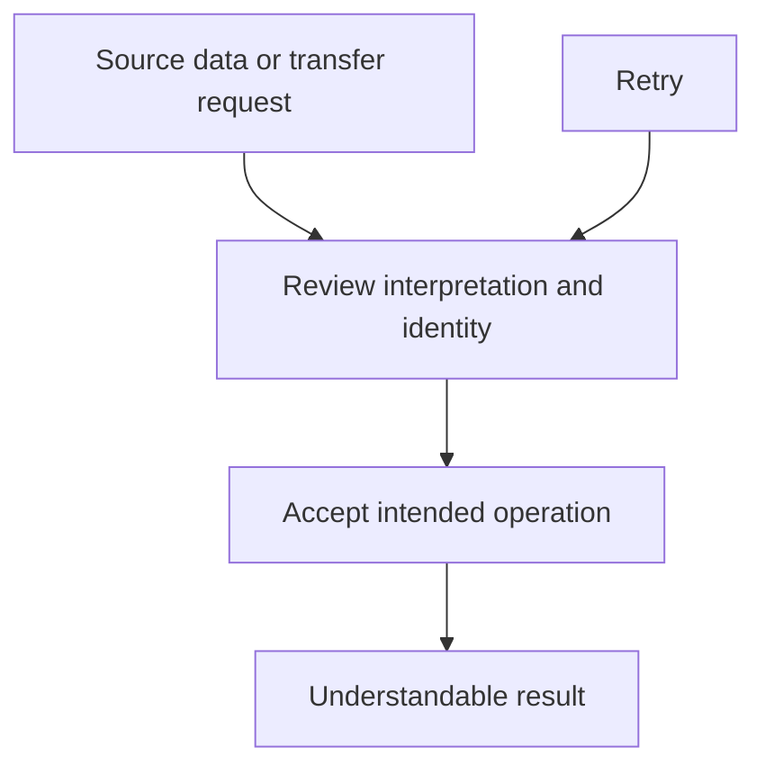

# MiniLedger: Five Development Opportunities

Prioritize trustworthy data transfer and reproducible month-end review, while preserving keyboard access and investigating the security allegation without treating it as a confirmed vulnerability. Improve reliable expense capture as the strongest opportunity directly supported by the supplied implementation.

These are development directions, not approved requirements or an implementation plan. Several export signals describe functionality absent from the supplied MiniLedger source; those opportunities remain conditional on establishing that the reported workflows belong to this product.

## Grounding Context

### Evidence boundary

All paths below are relative to:

`docs/validation/ce-skill-optimization-2026-10-29/remaining-27-acceptance/wave1/fixtures/ideate/`

The complete supplied evidence consists of:

- `repo/README.md`: MiniLedger is a “tiny personal expense-tracking demo app.”
- `repo/package.json`: private CommonJS package, version `0.1.0`.
- `repo/src/server.js`: the complete 25-line HTTP server.
- `issue-export.json`: a synthetic evaluation export covering `2026-10-01/2026-10-29`.

The source supports only adding and listing entries. It stores entries in an in-memory array (`server.js:3`), reads `amount` and `note` from JSON, assigns an ID and timestamp, and appends the result (`server.js:10–12`). Listing serializes the array (`server.js:16–18`).

No import, export, reconciliation, receipt, tenant, workspace, category, or browser UI implementation appears in the supplied source. The issue export therefore cannot establish defects in those implementations or prove their relationship to MiniLedger.

There is also a documentation discrepancy: the README says adding an entry requires “five fields typed by hand,” while the supplied endpoint accepts two fields and generates `id` and `ts`. No client is supplied to reconcile those statements. Reducing a confirmed five-field form is consequently not a supported claim.

### Coverage accounting

| Measure | Result | Interpretation |
|---|---:|---|
| Supplied fetched records | 10 | The export's stated count matches its record array. No tracker was fetched during this analysis. |
| Unique issue IDs | 8 | `SUP-101` and `SEC-9` each appear twice. |
| Eligible unique issues | 7 | All seven were read and considered. |
| Analyzed eligible unique issues | 7 | Full coverage of the supplied eligible sample. |
| Excluded unique issues | 1 | `OLD-1` explicitly has `eligible: false`: “Archived request for retired application.” |
| Duplicate records | 2 | Feedback/support mirrors do not establish additional issues or independent corroboration. |
| Unknown remainder | Unknown | The export states: “Pagination incomplete; additional records unknown.” |

Coverage is **7 of 7 supplied eligible unique issues**, not complete coverage of a tracker or user population. The observed eligible count is only a lower bound on the unknown larger collection.

The `observations` values are copied below once per unique issue. Their unit, independence, collection method, and denominator are unspecified. They cannot establish affected-user counts, prevalence, statistical confidence, or a temporal trend. A single export window does not establish whether any theme is increasing.

### Complete eligible-sample ledger

| Issue | Export evidence | Observations | Treatment |
|---|---|---:|---|
| `SUP-101` | “Users manually remove duplicate rows after retry.” Export labels it `confirmed`. | 8 | Opportunity 1; count mirrored ID once. |
| `SUP-102` | “Bank import requires manual spreadsheet conversion.” Export labels it `confirmed`. | 5 | Opportunity 1; retain the distinct import problem. |
| `SEC-9` | “One ambiguous screenshot alleges another studio receipt; no reproduction or source confirmation.” Export labels it `unverified`. | 1 | Opportunity 4; investigation hypothesis only. |
| `UX-41` | “Preference only; no blocked workflow observed.” Export labels it `confirmed`. | 32 | Considered and rejected as a top-five priority. |
| `SUP-103` | “Users repeat filtering each session.” Export labels it `confirmed`. | 6 | Opportunity 2; preserve context between sessions. |
| `UX-42` | “Keyboard-only user cannot see focused export button.” Export labels it `confirmed`. | 2 | Opportunity 3; workflow access outweighs raw popularity. |
| `OPS-3` | “Month-boundary totals need manual adjustment.” Export labels it `confirmed`. | 3 | Opportunity 2; explicit reporting-time context. |

Here, `confirmed` describes the fixture's label. It does not mean a production observation, independent verification, or an executed reproduction.

### Limitations

The source and export were read directly; no application code or tests were run. Git revision and dirty state were not inspected under the assigned read boundary. No external research, tracker access, delegation, or independent verification occurred. Basis checking and ranking were performed serially against the supplied files.

No scratch files or deliverable files were written. This complete dossier is returned inline for parent-owned persistence.

## Topic Axes

1. **Moving expense data:** import compatibility and repeatable transfer.
2. **Reviewing a reporting period:** saved scope and month-boundary meaning.
3. **Operating without a mouse:** visible focus and usable task completion.
4. **Keeping financial information private:** alleged receipt exposure and its applicability.
5. **Retaining trustworthy entries:** valid capture and durable personal records.

Accent preference belongs to interaction quality but does not create an additional axis or displace blocked task access.

## Ranking Rationale

Ranking weighs consequence, recurrence within the supplied sample, breadth of benefit, evidence strength, fit to the actual code, implementation burden, and overlap. It does not rank by observation count alone.

| Rank | Opportunity | Why it earns this position | Principal uncertainty |
|---:|---|---|---|
| 1 | Trustworthy import and repeatable transfer | Addresses two distinct manual repair/conversion burdens and protects the usefulness of financial records. | Transfer functionality and affected product identity are absent from the source. |
| 2 | Reproducible month-end review | Connects repeated filtering with potentially misleading period totals in one coherent review experience. | No reconciliation or workspace implementation is supplied. |
| 3 | Keyboard-complete expense workflows | The reported issue impairs access to a task, despite only two recorded observations. | No UI is available to inspect or reproduce. |
| 4 | Evidence-led receipt privacy investigation | Potential consequence is high enough to warrant prompt investigation despite weak evidence. | The allegation is unverified and may not apply to MiniLedger. |
| 5 | Reliable expense capture and retention | Strongest direct source fit; gives the demo a dependable foundation. | No supplied issue reports restart loss or malformed-entry failures. |

Rank 4 is a **development-investment ranking**, not a recommendation to postpone security triage until three features ship. Its small initial investigation should be prompt. A reproduced exposure would materially change this ordering; a disproven product association would remove it from MiniLedger's development agenda.

The 32 observations attached to accent preference do not outweigh a blocked keyboard workflow, repeated financial cleanup, or an allegation with potentially serious consequences.

Confidence percentages below are subjective confidence that a direction merits further exploration within this evidence boundary. They are not defect probabilities, calibrated forecasts, or estimates of production prevalence.

## Ranked Ideas

### 1. Trustworthy Import and Repeatable Transfer

**Description:** Make moving expenses into and out of MiniLedger an understandable, reviewable operation. Users should be able to recognize what a transfer represents, spot format problems before accepting data, and understand whether a retry is repeating an existing operation or adding new records. Import compatibility and export retry safety remain separate concerns within this shared direction.

**Axis:** Moving expense data.

**Basis:**

- `direct:` `issue-export.json`, `SUP-101`: “Users manually remove duplicate rows after retry.”
- `direct:` `issue-export.json`, `SUP-102`: “Bank import requires manual spreadsheet conversion.”
- `direct:` `repo/src/server.js:10–12` appends every accepted POST without a visible repeat-operation check. This is a separate source observation; it does **not** prove the root cause of the export allegation.
- `reasoned:` When a transfer has a recognizable identity and a reviewable interpretation, users can distinguish intentional repeated expenses from repeated processing. That distinction is more useful than deleting rows merely because their values look alike.

**Rationale:** The two supplied reports describe repair work surrounding data movement. A coherent transfer experience could reduce both entry friction and cleanup while protecting legitimate same-value transactions. This warrants product discussion because it determines what users can trust after import, retry, and export.

**Directional sketch:**

The sketch is conceptual, not an implementation design.

**Downsides:** Financial duplicate detection can erase legitimate repeated purchases if based on similarity alone. Supporting unspecified bank formats could expand scope sharply. The missing transfer code makes effort and root-cause estimates uncertain.

**Confidence:** 75% that this is a valuable export-derived direction; applicability to MiniLedger is unverified.

**Complexity:** High for the combined capability; confidence in that estimate is low until the actual transfer surface is identified.

**Evidence needed before commitment:** Confirm the affected product and transfer flow; obtain a representative retry sequence and a concrete format example. Determine whether duplication occurs during export, downstream re-entry, or another stage.

### 2. Reproducible Month-End Review

**Description:** Let users return to a recognizable review context: the reporting period, its timezone, and the filters that define included entries. A saved view should communicate its scope clearly enough that users can explain why an expense falls inside or outside a month.

**Axis:** Reviewing a reporting period.

**Basis:**

- `direct:` `issue-export.json`, `SUP-103`: “Users repeat filtering each session.”
- `direct:` `issue-export.json`, `OPS-3`: “Month-boundary totals need manual adjustment.”
- `direct:` `repo/README.md`: “no summary view.”
- `direct:` `repo/src/server.js:11` assigns `ts: Date.now()`; `server.js:16–18` returns raw entries without a summary or period interpretation.
- `reasoned:` A reporting period is meaningful only with a time interpretation and an inclusion scope. Preserving both makes a review reproducible rather than merely convenient.

**Rationale:** Saved filters and timezone clarity address different causes of repeated review work. Combining them at the level of a review context preserves that distinction while producing a more valuable direction than an isolated preference toggle.

**Downsides:** Remembered filters can silently hide entries unless their active scope remains visible. Timezone choice alone does not resolve whether an entry belongs to its occurrence date, recording date, or bank posting date. The source currently provides only a server-created timestamp.

**Confidence:** 75%; the missing summary view is source-grounded, while reconciliation and workspace details remain export-only.

**Complexity:** Medium, subject to clarifying date semantics and the actual review surface.

**Evidence needed before commitment:** Identify the real review flow and an illustrative month-boundary discrepancy. Clarify what the timestamp means and which timezone owns a report. Do not infer that storing an epoch timestamp is itself a timezone defect.

### 3. Keyboard-Complete Expense Workflows

**Description:** Make expense review and transfer usable with a keyboard, with visible focus throughout the task. Treat the export-button signal as a reason to inspect completion of the relevant task, including whether focus remains understandable after actions, rather than as a reason for a broad cosmetic redesign.

**Axis:** Operating without a mouse.

**Basis:**

- `direct:` `issue-export.json`, `UX-42`: “Keyboard-only user cannot see focused export button.”
- `direct:` `issue-export.json`, `UX-41`: “Preference only; no blocked workflow observed.”
- `direct:` The supplied `repo/src/server.js` contains HTTP handlers but no rendered interface. It cannot establish the current focus behavior.
- `reasoned:` A control may be technically reachable yet practically unusable when the user cannot identify where keyboard interaction will act. Visible task navigation therefore has functional value beyond visual taste.

**Rationale:** Two recorded observations can justify greater attention than 32 appearance preferences when the former obstruct use. This opportunity earns a distinct slot because transfer correctness does not make transfer accessible.

**Downsides:** The actual UI may be outside this repository or belong to another product. Fixing one button would not demonstrate complete keyboard usability; conversely, redesigning every visual surface would exceed the available evidence.

**Confidence:** 70% as an export-derived opportunity; no UI behavior has been verified.

**Complexity:** Medium for a task-level improvement; a narrowly reproduced focus issue could be smaller.

**Evidence needed before commitment:** Locate the affected UI and reproduce the keyboard path. Validate the complete relevant task, including focus visibility and continuity, before claiming accessibility improvement.

### 4. Evidence-Led Receipt Privacy Investigation

**Description:** Establish whether the alleged receipt exposure is real, belongs to MiniLedger, and crosses an intended privacy boundary. The immediate opportunity is a bounded investigation that can support either a targeted correction or a documented dismissal—not a speculative multi-tenant redesign.

**Axis:** Keeping financial information private.

**Basis:**

- `direct:` `issue-export.json`, `SEC-9`: “One ambiguous screenshot alleges another studio receipt; no reproduction or source confirmation.”
- `direct:` Both `SEC-9` records retain `confidence: unverified`; the second is a mirror, not an independent reproduction.
- `direct:` `repo/README.md` describes a personal demo. No receipt or tenant model appears in `repo/src/server.js`.
- `reasoned:` Potential exposure of another party's financial material has high consequence. That supports investigating a weak signal promptly, but does not convert it into proof or justify selecting a remedy before the affected boundary is known.

**Rationale:** Keeping this opportunity visible prevents popularity and certainty from excluding a potentially serious issue. Keeping the action investigative prevents the same signal from falsely becoming a confirmed security defect.

**Downsides:** Investigation consumes time and may conclude that the issue concerns a different application. Adding tenant machinery to this demo on the strength of one screenshot would create unsupported complexity.

**Confidence:** 85% that bounded investigation is warranted; no numerical probability is assigned to the allegation's truth or applicability.

**Complexity:** Low for initial evidence and applicability triage; remediation complexity is unknown.

**Evidence needed before commitment:** Establish screenshot provenance, affected product, intended access boundary, and a reproducible scenario. A confirmed exposure should trigger reprioritization; an unrelated or unsupported report should not drive MiniLedger architecture.

### 5. Reliable Expense Capture and Retention

**Description:** Give users a dependable distinction between an expense that was accepted and one that was not, and make accepted personal records available beyond the lifetime of the server process. Preserve MiniLedger's small scope while making “add an expense” a meaningful promise.

**Axis:** Retaining trustworthy entries.

**Basis:**

- `direct:` `repo/src/server.js:3`: `const entries = [];`.
- `direct:` `repo/src/server.js:10`: `const { amount, note } = JSON.parse(body || '{}');`.
- `direct:` `repo/src/server.js:11–12` appends those values and responds `'ok'`, without visible value validation or durable storage.
- `direct:` `repo/README.md` explicitly says data is kept in memory.
- `reasoned:` An expense record is useful only if its content is interpretable and its retention matches the user's expectations. An acknowledgement that does not distinguish invalid input or transient storage weakens that trust.

**Rationale:** This is the opportunity with the clearest connection to actual supplied code. It creates a stronger basis for later imports and summaries without assuming those features already exist. Its lower rank reflects the demo's stated scope and the absence of a corresponding issue report—not weak source evidence.

**Downsides:** Persistence brings backup and data-lifecycle obligations. Validation needs product decisions about zero, negative amounts, and currency; arbitrary restrictions could reject legitimate adjustments. The current transient behavior may be intentional for a demo.

**Confidence:** 90% that the source presents this opportunity; user demand and desired persistence guarantees remain unverified.

**Complexity:** Medium.

**Evidence needed before commitment:** Clarify whether MiniLedger should remain a transient demo or retain real personal expenses. Determine supported amount semantics. No crash, restart-loss scenario, or invalid-input behavior was executed in this analysis.

## Rejection Summary

Candidates were generated across pain/friction, removal/automation, reframing, compounding leverage, cross-domain analogy, and constraint-flipping before the final cut. The five opportunities above survived. The alternatives below were rejected as standalone priorities or absorbed into stronger directions.

Analogy candidates are reasoned comparisons, not claims about externally researched products.

| Candidate | Disposition and reason |
|---|---|
| Accent palette refresh | Cut: `UX-41` is a preference signal with no blocked workflow; 32 observations do not establish greater value than functional access. |
| Automatic removal of similar-looking entries | Cut: identical values can represent legitimate expenses; the export does not justify destructive deduplication. |
| Automatic retry of every failed transfer | Cut: retry behavior could amplify the duplication signal before operation identity is understood. |
| Automatic bank-format guessing | Narrowed into opportunity 1: reviewable interpretation is preferable to silently accepting uncertain mappings. |
| Automatically restore all prior filters | Narrowed into opportunity 2: invisible restored filters could hide data; preserved context needs visible scope. |
| Automatically detect a workspace timezone | Cut as a default: no workspace model or authoritative timezone source is supplied. |
| Automatically repair arbitrary malformed amounts | Cut: financial intent cannot reliably be inferred from malformed input. |
| Restrict bank imports to one canonical format | Cut: it risks preserving `SUP-102`'s manual-conversion burden rather than addressing it. |
| Replace export with read-only sharing | Cut: no evidence establishes that sharing can replace the required data movement; it introduces new privacy questions. |
| Build a full multi-tenant receipt product | Cut: expands beyond the personal demo and treats an unverified allegation as an architectural requirement. |
| Replace expense tracking with receipt capture | Cut: abandons the demonstrated product surface without supporting demand. |
| Deliver a summary-only product | Cut: ignores the existing entry-capture purpose and reported workflow burdens. |
| Eliminate filters entirely | Cut: removes a capability the supplied report implies users need; it does not address context loss. |
| General-purpose bank connector marketplace | Cut: no format inventory, integration evidence, or operating capacity supports this scope. |
| Shared transfer history and operation identity | Absorbed into opportunity 1: potentially useful, but a separate priority would duplicate the same trust problem. |
| Saved reporting contexts | Absorbed into opportunity 2: combines well with explicit period interpretation. |
| Keyboard task review | Absorbed into opportunity 3: evidence gathering supports the user-facing direction rather than warranting another feature slot. |
| Central receipt-access audit system | Deferred: establish the affected product and privacy boundary first; `SEC-9` does not yet justify a new system. |
| Universal analytics event platform | Cut: disproportionate to a 25-line demo and not necessary to articulate the five opportunities. |
| Parcel-style transfer receipts | Absorbed as a conceptual aid to opportunity 1: operation identity and understandable outcomes matter more than the analogy. |
| Boarding-pass-style review context | Absorbed into opportunity 2: a clear period/filter/timezone context is the useful idea. |
| Wayfinding-inspired keyboard cues | Absorbed into opportunity 3: visible location and continuity matter; a new navigation metaphor is not required. |
| Chain-of-custody receipt tracking | Deferred: the analogy may aid a confirmed investigation, but no receipt lifecycle is present in source. |
| Checkpoint-style expense retention | Absorbed into opportunity 5: retaining accepted records is the useful outcome; no checkpoint architecture is selected. |
| Envelope-budgeting categories | Deferred: the README confirms no categories, but the supplied issues provide stronger immediate priorities. |
| Zero-setup automatic import of every bank | Cut: no evidence supports universal compatibility, and errors would be costly. |
| Million-user distributed ledger architecture | Cut: no scale signal supports the complexity. |
| Offline-first client application | Deferred: plausible for personal tracking, but no client or offline-use evidence is supplied. |
| Remove export to eliminate exposure and duplicates | Cut: destroys the reported workflow and assumes an unsupported connection between export and `SEC-9`. |
| Require manual approval for every expense | Cut: adds friction without a demonstrated need for a review gate on each entry. |
| Stateless server with user-managed ledger files | Deferred: an alternative retention model, but the export supplies no preference for that responsibility shift. |

All five topic axes retain a survivor. The excluded archived request and duplicate records create no additional development priorities.

The leading exploration choice is trustworthy transfer, conditional on confirming that the export belongs to the target product. If that association cannot be established, reliable capture and retention is the strongest starting point supported by MiniLedger's actual source.
