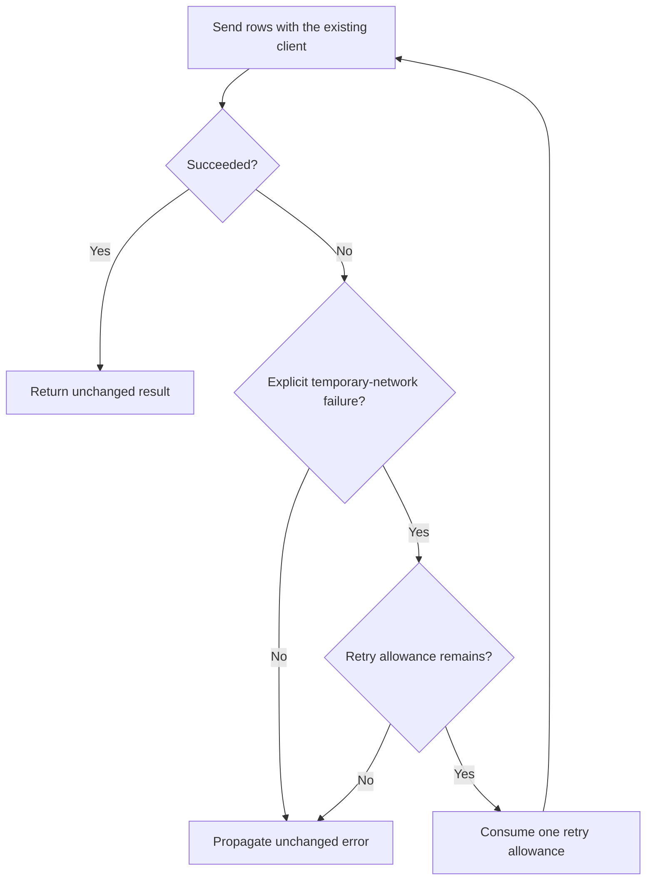

# Safe Order Import Retries - Plan

## Goal Capsule

Enable operators to recover from temporary order-import failures within the current import invocation.

Extend the existing importer with bounded, sequential retries. Preserve the upstream Product Contract and the fixture owner’s decision to keep execution caller-owned.

This plan targets the supplied `order-import-enrichment-fixture`. All paths below are relative to that fixture root. Readiness applies to implementing and verifying the bounded fixture change, not to deploying retries against an unidentified production service.

Verification focuses on recovery, retry exhaustion, immediate validation failure, and unchanged success/error values. The largest unproven risk outside the fixture is replaying an order request whose remote outcome is unknown.

The parent owns saving this mediated draft. This response does not authorize implementation, publication, or deployment.

---

<!-- PRODUCT_CONTRACT_START -->
## Product Contract

### Problem Frame

批量订单导入在一次临时网络错误后整体失败，运营人员只能手工重跑整批任务。

### Requirements

- **R1:** 临时网络错误最多重试 3 次。
- **R2:** 校验错误必须立即失败，不得重试。
- **R3:** 保持现有 CLI 成功与失败输出兼容。

### Actors

- **A1:** 运行批量导入的运营人员。

### Key Flows

- **F1:** 运营人员提交有效订单；首次请求遇到临时网络错误；系统重试并成功返回。

### Acceptance Examples

- **AE1:** 给定前两次请求返回临时网络错误，第三次成功时，导入成功且总调用次数为 3。
- **AE2:** 给定输入校验失败时，导入立即失败且只调用一次。

### Scope Boundaries

- 不引入持久化队列或后台任务系统。
- 不改变 CLI 输出字段。
<!-- PRODUCT_CONTRACT_END -->

---

## Planning Contract

Product Contract unchanged (byte-preserved upstream source slice)

### Summary

Add retries at the existing `importOrders` boundary, retaining the injected client and forwarding the same rows on each attempt. Extend the existing tests to distinguish recoverable failures from terminal failures and to prove the attempt limit.

### Key Technical Decisions

- KTD1. Preserve caller-owned execution. Carry forward fixture owner decision KD-1 from `research-return.md`: a background queue was rejected because persistent scheduling is outside this small retry change. This is an attributed synthetic fixture decision, not evidence of a new live project-owner approval. “Synchronous import” means that the calling operation owns and waits for completion; it does not mean blocking JavaScript execution or replacing asynchronous client calls.
- KTD2. Extend the current owner. `src/order-importer.js` already owns the `client.send(rows)` call. Add bounded retry coordination there rather than introducing another importer, generic retry framework, queue, or durable state model. The client remains responsible for sending and reporting failures. The importer owns retry counting and final propagation.
- KTD3. Preserve outward values. Return the successful client result without an envelope, additional fields, or logging. Propagate the terminal error object without replacing its message, code, or metadata. This supports R3 at the importer boundary; it does not establish compatibility of a CLI absent from the fixture.

### Assumptions

These are planning proposals for the bounded fixture, not observed client contracts or owner-confirmed production behavior.

- AS1. Interpret R1 as one initial attempt plus at most three retries: four calls maximum. AE1 remains three calls because its third attempt succeeds.
- AS2. Represent the synthetic client’s temporary-network failure using `error.code: TRANSIENT_NETWORK_ERROR`, and validation failure using `error.code: VALIDATION_ERROR`. These names are proposed fixture conventions. They were not found in the supplied source. Only the explicit temporary-network code is retryable; absent, unknown, or other codes fail immediately. Do not infer retryability from message text.
- AS3. Retry sequentially after the previous attempt fails, without adding a delay scheduler in this bounded fixture. This does not establish an acceptable production backoff or rate-limit policy.
- AS4. Synthetic client failures used for retry tests occur before any remote side effect. A real client requires separate evidence that retries cannot duplicate orders or partial batches.
- AS5. Preserve both immediate client results and Promise-based results supported by the current forwarding implementation. Do not turn every synchronous success into a Promise merely to simplify the loop. Treat synchronous throws and asynchronous rejections consistently for retry eligibility.

A real client whose error representation or replay semantics contradict these assumptions invalidates this plan’s applicability to that integration. Its owner must supply the contract before production adaptation; passing fixture tests cannot resolve that gap.

### Interface Contracts

**Interface:** `importOrders` export in `src/order-importer.js`; evolution of an existing CommonJS boundary.

**Consumers:** The directly observed consumer is `tests/order-importer.test.js`. R3 names a CLI, but no CLI implementation or output receipt is supplied.

**Canonical artifacts:** `src/order-importer.js` owns behavior; `tests/order-importer.test.js` will provide executable contract examples. No schema package or alternate contract registry is needed.

**Input and output:** Keep the existing arguments and client method boundary. Preserve row identity and method receiver binding. Successful results remain unwrapped. Terminal errors retain identity. The retryable error classification is the proposed fixture convention in AS2.

**Compatibility posture:** Preserve existing success and permanent-failure behavior while intentionally changing temporary-network failure behavior under R1. No export removal or migration is planned. Rolling back the importer change restores single-attempt behavior; it cannot undo orders created remotely.

**Verification owner:** The implementation owner extends the existing Node test suite and records results against the implemented source. CLI integration proof remains outside the supplied fixture.

### High-Level Technical Design

The importer handles each invocation independently. It starts one send attempt, returns success immediately, or classifies a failure. An eligible failure consumes one retry allowance before the next attempt; a terminal failure ends the invocation.

The same decision sequence applies to immediate throws and Promise rejections. No attempt overlaps another attempt from the same invocation.

### Evidence & Limitations

Direct source inspection confirms C-1 from `research-return.md`: `importOrders` directly returns `client.send(rows)`, and the supplied test checks row forwarding only. This finding motivates retry coverage and contract characterization; it is not a test execution result.

The attributed research producer is the parent’s inspection of this fixture. No independent research worker or external research was used. KD-1 remains attributed to the synthetic fixture owner.

`package.json` establishes the available test entrypoint and CommonJS source establishes the implementation style. No exact Node version, git revision, dirty-state receipt, production client, CLI renderer, or remote service contract was supplied or verified.

Product Contract confirmation is **inherited** from the supplied `spec-brainstorm` artifact. Independent human confirmation was not observed. Planning judgments and producer self-review are correlated evidence.

### Implementation Scope Boundaries

Active implementation is limited to the importer and its tests. Preserve the existing CommonJS export and injected-client seam.

Do not add input validation rules, mutate or split batches, introduce persistence, change CLI fields, or add retry progress output.

Production idempotency, concrete client error mapping, retry delays, and CLI integration verification require the corresponding source owner and evidence. They are not silently assigned invented implementation paths in this fixture.

---

## Implementation Units

### U1. Characterize the existing importer boundary

**Goal:** Make the compatibility surface visible before adding retries.

**Requirements:** R2, R3; supports KTD2 and KTD3.

**Dependencies:** None.

**Files:** `tests/order-importer.test.js`; read `src/order-importer.js`.

**Approach:** Extend the existing Node test style with controlled clients that record calls, inputs, receiver binding, and returned values. Preserve the existing forwarding test.

**Execution note:** Establish baseline behavior before changing the importer. Baseline characterization must not assume retries already exist.

**Test scenarios:**

- An asynchronous client receives the identical rows object once and returns an unchanged result object.
- A synchronous client returns an unchanged immediate value.
- A client method that uses its receiver continues to receive the original client as `this`.
- A synchronous terminal error is thrown unchanged after one call.
- An asynchronous terminal error rejects unchanged after one call.
- An empty rows array reaches the client unchanged; the importer adds no new validation behavior.

**Verification:** Existing behavior has executable characterization. Record actual baseline results during implementation; no baseline tests have been run for this plan.

### U2. Add bounded retries within the current invocation

**Goal:** Recover from explicitly classified temporary-network failures while maintaining terminal failure semantics.

**Requirements:** R1, R2, R3, A1, F1, AE1, AE2; governed by KTD1–KTD3.

**Dependencies:** U1.

**Files:** `src/order-importer.js`, `tests/order-importer.test.js`.

**Approach:**

1. Apply the bounded fixture conventions in AS1–AS5 without introducing a second sending abstraction.
2. Keep retry allowance local to each import invocation.
3. Use the existing client method and unchanged rows for every attempt.
4. Stop immediately after success or a non-retryable error.
5. On exhaustion, propagate the last client error unchanged.

**Patterns to follow:** CommonJS exports, the injected client, `node:test`, and `node:assert/strict`.

**Test scenarios:**

- Covers F1 / AE1. Two temporary-network failures followed by success produce the original successful result after exactly three calls.
- Covers AE2. A validation failure produces the original error after exactly one call.
- Three temporary-network failures followed by success complete on call four.
- Four temporary-network failures stop after call four and propagate the fourth error; no fifth call occurs.
- A temporary-network failure followed by a validation failure stops after call two.
- Unknown errors, errors without a code, and misleading network-related message text receive no retry.
- Immediate success causes one call.
- Both synchronous throws and asynchronous rejections follow the same retry policy.
- Two imports running concurrently have independent retry allowances.
- A controlled pending send prevents the next attempt from starting until that send rejects.

**Verification:** Retry scenarios distinguish the new behavior from the original single-call implementation, and all U1 compatibility checks continue to pass.

### U3. Verify contract coverage and document the evidence boundary

**Goal:** Reconcile the implementation against R1–R3 without overstating fixture proof.

**Requirements:** R1, R2, R3; KTD3.

**Dependencies:** U2.

**Files:** `tests/order-importer.test.js`, `docs/plans/2026-07-31-001-feat-order-import-plan.md`.

**Approach:** Check the complete test matrix against the source change. Keep the original Product Contract intact when the canonical plan is eventually updated. Record any remaining compatibility or production evidence gaps outside that region.

**Test scenarios:**

- Successful retry results retain the same value shape as first-attempt success.
- Validation and exhausted temporary-network failures retain the original terminal error’s identity, message, code, and custom metadata.
- The complete existing and added test suite passes together without relying on external services or real-time delays.

**Verification:** The execution report binds results to the final source and separates importer compatibility from unverified CLI and production behavior. No fabricated CLI test or production-safety receipt is acceptable.

---

## Verification Contract

The implementation owner must run the fixture’s `npm test` entrypoint, defined in `package.json` as `node --test tests/*.test.js`. These commands are future verification instructions; they were not executed during planning.

| Proof intent | Required evidence | Current status |
|---|---|---|
| R1 recovery and retry cap | AE1 plus fourth-attempt success and exhaustion tests | Required; not run |
| R2 immediate failure | AE2 plus temporary-then-validation and unknown-error cases | Required; not run |
| R3 importer compatibility | Unchanged input, result, error, and invocation behavior | Required; not run |
| Per-invocation isolation | Concurrent invocation and no-overlap cases | Required; not run |
| Product Contract preservation | Exact comparison of the marked source region with the saved draft | Required after parent save; not run |
| R3 actual CLI compatibility | Existing CLI success/failure output checks against the real CLI owner | Unverified; CLI source absent |
| Production replay safety | Concrete client/service evidence for idempotency or pre-commit failure semantics | Outside fixture applicability; unverified |

The largest unproven risk is duplicate remote effects after an ambiguous network failure. Do not infer replay safety from an error code alone.

At implementation closeout, reconcile every required proof intent with its actual result. A green test command without the named boundary cases is insufficient. Fixture evidence must not be reported as complete production acceptance of R3 or retry safety.

This reconciliation is a workflow-level semantic check. No runtime hard enforcement was established by this planning trial.

---

## Definition of Done

For the bounded fixture implementation:

- U1–U3 are implemented and their required verification passes against the final source.
- AE1 and AE2 have direct tests.
- The retry limit is enforced without off-by-one errors or shared retry state.
- Terminal errors and successful results retain their outward values.
- The original Product Contract region remains unchanged after saving.
- No persistent queue, background execution, new CLI fields, or unrelated refactor is introduced.
- Abandoned implementation attempts and temporary artifacts are removed.
- The execution report explicitly retains the missing CLI and production replay-safety evidence.

This draft does not mark any implementation unit complete.

---

## Sources

- `docs/plans/2026-07-31-001-feat-order-import-plan.md` — upstream requirements-only plan and preserved Product Contract.
- `src/order-importer.js` — current single-call forwarding implementation.
- `tests/order-importer.test.js` — existing forwarding test.
- `research-return.md` — attributed C-1 observation and synthetic KD-1 decision.
- `package.json` — available test command.
- `AGENTS.md` — fixture conventions and planning mutation boundary.

---

## Delivery and Review Record

Complete Markdown draft returned in chat for parent-owned persistence. No file was written, no implementation was executed, and no tests or external requests were run.

A bounded producer self-review checked requirement traceability, retry-count interpretation, source ownership, settled-decision attribution, and evidence limitations. Independent review was prohibited by the trial.

- `review_source: producer-self-review`
- `review_status: degraded`
- `reason_code: spec_doc_review_capability_unavailable`
- `independent_review: not_run`
- `mutation_policy: report-only`
- `fixes_applied: 0`
- `worker_dispatch_outcome: dispatch_authorization_missing`

Independent-review counts remain unknown. No independent reviewer findings or worker results are claimed.

The Product Contract is reproduced from the supplied source without intentional changes. A deterministic byte comparison of the parent-saved artifact has not occurred. Several bundled reference reads were truncated by tool output limits; therefore full reference-read compliance is not claimed.

Confidence is sufficient for the bounded fixture draft, with the explicitly proposed client conventions in Assumptions. CLI compatibility and real-service replay safety remain unverified. No autonomous publication, production readiness, or comparative trial acceptance is claimed.
