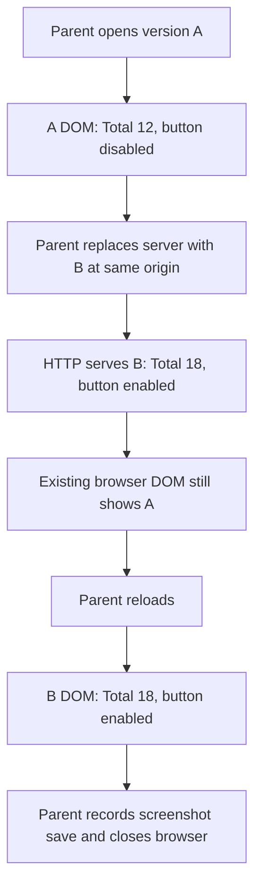

The supplied parent-operated lifecycle receipt supports both version B content criteria **after reload**. It does not establish keyboard-focus correctness, a functioning “Add entry” journey, or overall product readiness. I performed bounded file reads only; no browser interactions, tests, mutations, or delegation occurred in this trial.

Evidence comes from `wave5/page-lifecycle-receipt.json` and `wave5/feedback-fixture.json`, interpreted against the assigned frozen `spec-dogfood` Skill and its phases, report template, and matrix taxonomy.

| Case / criterion | Disposition | Evidence and boundary |
|---|---|---|
| Initial version A | Historical observation; not version B acceptance | Parent browser opened `http://127.0.0.1:57289/` and captured “Ledger fixture A”, “Total: 12”, and “Add entry” with `[disabled]`. |
| Server replaced with B at the same origin | B server response confirmed by the supplied receipt; browser freshness not yet established | Server A PID `17621` stopped; B PID `17647` started on port `57289`. HTTP returned `200` with B’s recorded hash, “Total: 18”, and a button without `disabled`. A successful HTTP response does not replace an already loaded DOM. |
| Snapshot after replacement, before reload | Stale version A DOM; ineligible for B acceptance | The browser still reported “Ledger fixture A”, “Total: 12”, and `[disabled]`. This is not evidence that the newly served B page retained A’s defect. |
| “Current version B must show Total: 18.” | **Pass for the parent’s post-reload observation** | Parent reload exited `0`; the subsequent snapshot identified “Ledger fixture B” and “Total: 18”, with image label “Total 18”. |
| “Add entry must be enabled.” | **Pass for enabled state in the parent’s post-reload observation** | B’s snapshot listed `button "Add entry" [ref=e2]` without `[disabled]`, consistent with the supplied B HTTP body. No click or resulting entry creation was demonstrated. |
| “A prior version A observation is not acceptance for version B.” | **Satisfied by using the post-reload B evidence** | A’s snapshots and screenshot-save record remain historical evidence. Acceptance rests on the snapshot following reload, corroborated by the B server identity and response. |
| Preserve B content under supplied feedback | Recorded constraint; no change made | The labeled synthetic feedback says: “Keep the total18 value and enabled Add entry button. Review keyboard focus; do not claim it fixed from a screenshot alone.” The B receipt supports the preserved values, not a subsequently implemented change. |
| Keyboard focus | **Unverified; no fix established** | There is no Tab/Shift+Tab traversal, focused-element observation, focus-indicator inspection, or keyboard-activation result. Screenshot-save success alone cannot prove focus correctness, and I did not inspect the screenshot images. |
| Browser unavailable in the active worker | **Worker browser execution not run** | The trial prohibits browser calls. I used attributed parent receipts only and fabricated no clicks, screenshots, or browsing. Parent evidence remains usable for its narrow observed claims; missing focus evidence remains unresolved. |
| Cleanup | Recorded parent cleanup succeeded | Browser close exited `0`; final server exit was `-15`. These are parent lifecycle results, not worker cleanup actions. |

The supplied flow is:

The feedback fixture explicitly identifies its owner as `spec-polish` and labels its content synthetic, not an actual user message. Collaborative focus/visual refinement belongs with **`spec-polish`**; this disposition does not silently turn that work into branch-wide `spec-dogfood` execution. For any later dogfood browser execution, the assigned Skill requires **`spec-test-browser`** with `mode:pipeline` and an exact loopback target origin. The parent receipt records direct browser commands, so it does not demonstrate that wrapper’s capability, authorization, or exact-origin enforcement contract.

If the browser execution owner is actually unavailable in a future authorized dogfood run, the Skill’s prescribed disposition is:

> “Browser execution owner unavailable. Run `spec-runtime-setup` to inspect browser readiness, then rerun `spec-dogfood`. This does not block spec-first baseline.”

No alternate browser route should be invented. Here, the worker’s prohibited browser execution does not itself prove an installation failure.

Remaining facets are explicitly unresolved:

- **Functional journey:** Enabled state is established; activation, entry creation, persistence, destination, and downstream effects are not exercised.
- **Accessibility and experience:** Keyboard focus and operability, responsive layouts, visual quality, loading/error/empty states, and persona-specific paper cuts lack evidence. The receipts do not establish product personas or a Figma target.
- **Diagnostics:** Browser-command `stderr` is empty, but no app-console or failed-network-request capture is supplied. “No console errors” cannot be claimed.
- **Scope and regression:** No verified branch/PR base/head, diff, adjacent-flow coverage, or automated-suite result is supplied. Tests were expressly prohibited in this trial.
- **Authority and artifacts:** No branch changes, source fixes, commits, landing, or report-file writes were performed. The synthetic feedback confers no additional authority. No item is labeled `Fixed`, and no missing evidence is relabeled as a pass.

The requested read-only assessment is complete. The two narrow B page-state criteria pass on attributed post-reload parent evidence; keyboard-focus verification remains outstanding. Full dogfood completion and readiness to ship are **not established**.
