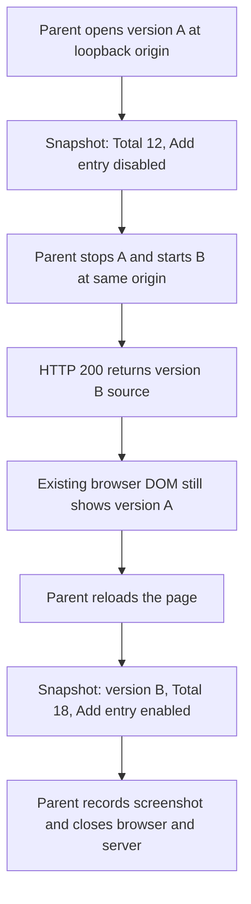

The parent-operated receipt supports both declared version B page-state criteria **after reload**: “Total: 18” is present and “Add entry” is enabled. The snapshot taken after server replacement but before reload still shows version A; it is stale evidence and cannot establish version B acceptance. Keyboard focus remains unverified. This is a bounded receipt assessment, not a completed product dogfood run or shipping-readiness verdict.

Evidence sources: `page-lifecycle-receipt.json` and `feedback-fixture.json` in `docs/validation/ce-skill-optimization-2026-10-29/remaining-27-acceptance/wave5/`. I read the assigned frozen `spec-dogfood` skill and its phases, report template, and matrix taxonomy. I did not browse, execute tests, modify files, or invoke another workflow.

The recorded lifecycle is:

| Case or criterion | Disposition | Evidence and boundary |
|---|---|---|
| Initial version A observation | Historical baseline only | The parent snapshot shows “Ledger fixture A”, “Total: 12”, and a disabled “Add entry” button. It does not satisfy the current B criteria. |
| Server replacement at the same origin | New served source established by the receipt | A used PID `17621`; B used PID `17647`, both on port `57289`. The subsequent HTTP 200 response contains B’s HTML and the recorded B source hash. A reused origin alone would not establish page freshness. |
| Snapshot after replacement, before reload | Stale DOM; not acceptance for B | It still reports “Ledger fixture A”, “Total: 12”, and the disabled button. This is not evidence that the newly served B page has those defects. |
| “Current version B must show Total: 18.” | **Honored after reload** | The parent’s successful reload is followed by a snapshot showing “Ledger fixture B” and “Total: 18”. The HTTP response also contains that value. |
| “Add entry must be enabled.” | **Honored after reload**, limited to enabled state | B’s HTML has no disabled attribute on the button, and the post-reload snapshot lists “Add entry” without the disabled marker present in A. No click or successful entry creation is recorded. |
| “A prior version A observation is not acceptance for version B.” | **Honored in this assessment** | Only the post-reload B observation supports B’s page-state passes. The earlier A observation is retained as stale historical evidence. |
| Screenshot evidence | Capture recorded; visual inspection not performed here | The receipt records successful `page-A.png` and `page-B.png` captures. I did not inspect those images and make no visual-quality judgment from their filenames or successful creation. |
| Cleanup | Parent-recorded cleanup completed | Browser close returned exit code `0`; final server exit is recorded as `-15`. This does not establish conformance with every browser-owner requirement. |

The feedback fixture explicitly labels itself **“Labeled synthetic owner feedback, not an actual user message”** and identifies `spec-polish` as workflow owner. Its exact feedback is:

> “Keep the total18 value and enabled Add entry button. Review keyboard focus; do not claim it fixed from a screenshot alone.”

The post-reload receipt supports retaining the total of 18 and the enabled button; nothing supplied justifies restoring A’s older state. The keyboard-focus request is **not-exercised**: there is no recorded keyboard traversal, focus-order observation, focus visibility inspection, or keyboard activation result. Neither an enabled button nor a screenshot establishes that focus is correct or fixed. No focus defect has been demonstrated, and no fix can be claimed.

This feedback is a collaborative polish concern, so its continuation belongs to **`spec-polish`**, as the fixture itself specifies. A future browser check must use the authorized browser execution owner, **`spec-test-browser`**, with an exact loopback target origin. I have not invoked either skill or transferred the task.

For the browser-unavailable branch, this worker uses only attributed parent receipts. I do not claim worker clicks, screenshots, reloads, or independent reproduction. The supplied parent evidence remains usable for its narrow recorded observations, while new interactive checks remain unrun. If the browser execution owner is unavailable in a subsequent execution, the assigned skill requires:

> “Browser execution owner unavailable. Run `spec-runtime-setup` to inspect browser readiness, then rerun `spec-dogfood`. This does not block spec-first baseline.”

There is no fallback to direct browser commands. The parent receipt contains direct `agent-browser` invocations; it proves the recorded local lifecycle observations, but it does **not** prove execution through `spec-test-browser mode:pipeline`, wrapper-enforced exact-origin conformance, or private-evidence handling.

Remaining facets are bounded as follows:

- **Keyboard accessibility:** not-exercised; needs current-B keyboard and focus evidence.
- **Button behavior and downstream effects:** not-exercised. Enabled state does not prove entry creation, persistence, validation, or any downstream result. Any future interaction needs effect classification and applicable authorization.
- **Visual experience, responsiveness, persona paper cuts, and product/Figma alignment:** unassessed. No actual product UI, persona evidence, real feedback, or Figma target is supplied.
- **Console/network cleanliness:** unassessed beyond the recorded successful HTTP response and command exit codes. Those are not a console-error audit.
- **Other error, empty, boundary, permission, and adjacent regression journeys:** not-exercised; the receipt covers the stale-tab/server-replacement/reload case, not a full application matrix.
- **Branch scope and resume identity:** no PR, verified base/head, relevant dirty-file identities, or product diff is supplied. The fixture’s server/source identity supports this lifecycle assessment only; it cannot establish branch-wide coverage.
- **Fixes, commits, and landing:** none performed or claimed. Synthetic feedback grants no mutation authority.
- **Automated suite and durable dogfood report:** not run or written, as required by this read-only trial. Consequently, the full skill’s completion conditions are unmet.

The defensible result is **two post-reload B page-state passes, explicit rejection of stale A evidence for B, and an outstanding keyboard-focus assessment**. The browser activity was real parent-operated interaction with a synthetic local page; the owner feedback was synthetic. Neither is evidence of real product acceptance or an overall ready-to-ship branch.
