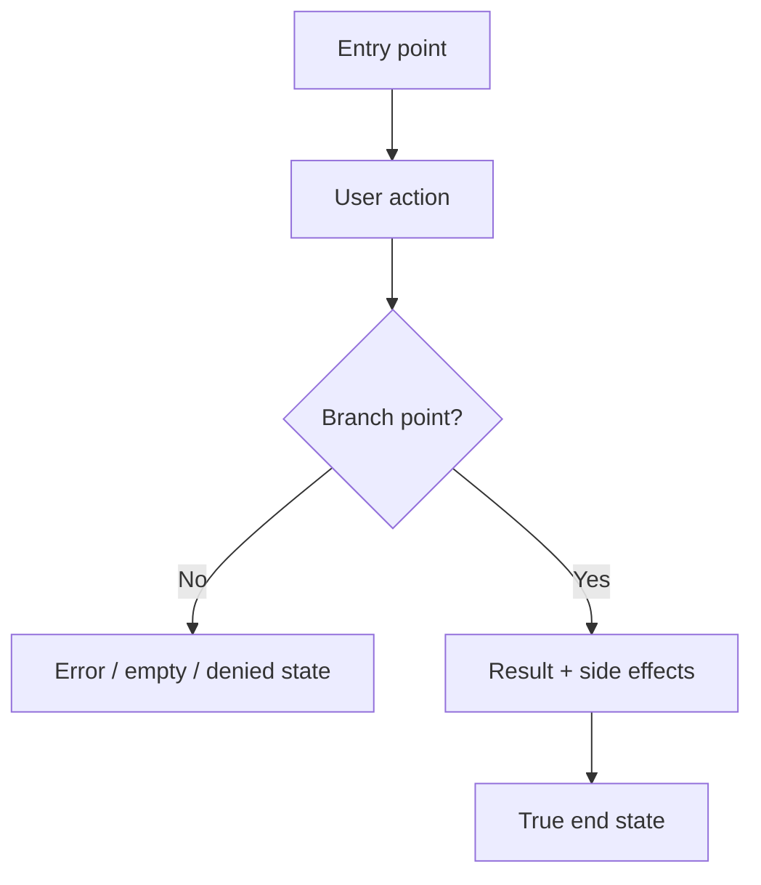

# Dogfood Report — <branch>

> Diff-scoped browser QA of `<branch>` vs `<verified-base-ref-or-PR-base>`. Generated by `spec-dogfood` on <YYYY-MM-DD>.

<!-- Use repo-relative paths throughout this doc, never absolute paths, so it stays portable. -->
<!-- This template is the source of truth for the report's sections; build the report to this shape rather than from memory. -->

## Readiness

<Lead with the change, the tested checkout or build, and what this run supports. Count distinct scenarios with current browser observations versus in scope; say how many were only partially exercised. Name the required suite result separately and give the first action that would change the decision. Before execution, report zero exercised and readiness not assessed. A green browser matrix cannot cancel a failing or unavailable required suite.>

## Diff Summary

<Record PR number when applicable, verified base/head and relevant dirty-file identities, served checkout/build identity or limitation, and what changed: new features, modified behavior, new/changed routes, views, components, data flows. 2-6 bullets.>

## Personas

<The primary personas the flows were judged against, and what each cares about. Note the source: STRATEGY.md "Users" (legacy "Who it's for"), PRODUCT.md "Users", VISION.md, a persona doc, or "inferred" if none existed.>

- **<Persona name>** — <job-to-be-done / what they care about>

## Flows in Scope

<One Mermaid flowchart per distinct user journey the diff touches. Include happy path and branch points (validation error, empty, permission-denied), side effects (emails, jobs, notifications), and the true end state — including click-through destinations.>

## Test Matrix & Results

| # | Flow | Journey / Scenario | Browser observation | Status | Issue / evidence | Fix | Commit |
|---|------|--------------------|---------------------|--------|------------------|-----|--------|
| 1 |      |                    | Not run | Pending | - | - | - |

Record what the browser observed separately from what needs to happen next. Use `Not run` if no scenario step was observed, `Partial` if only a prefix was observed, `Fail` for an observed mismatch, and `Pass` for a verified end state. A failed prerequisite or cleanup is not itself a product mismatch. Give the failed or last verified step and the evidence reference; count a rerun of the same scenario only once. Keep the original failure evidence when a verified replay changes the observation to `Pass` and the status to `Fixed`.

On resume, use `Unknown` for a prior observation whose evidence cannot be recovered for this build. It is neither evidence of zero execution nor current coverage.

Status values: `Pending`, `Pass`, `Fixed`, `Skipped`, `Blocked (fix authorization)`, `Blocked (needs human verify)`, `Blocked (human decision)`. Start every scenario at `Pending` so this table doubles as the resume checkpoint. Use `uncommitted` when a verified fix exists but commit authorization is missing.

### Applicable Criteria

<For each applicable current plan/project criterion, record source, scenario, observed result and honored/contradicted/not-exercised status. Preserve stale-rule conflicts and unknown coverage without declaring the product wrong by default.>

## What Was Fixed

For each issue found and fixed:

### <Short issue title> — `<commit-or-uncommitted>`
- **Symptom:** <what the user saw / what failed in the browser>
- **Root cause:** <why it happened>
- **Fix:** <what changed, repo-relative file paths>
- **Regression test:** <test added that fails before / passes after — or, for a pure copy/visual fix, the browser-replay/screenshot check used and why no automated test was meaningful>

## Paper Cuts (by persona)

<Experiential friction found while walking each flow as each persona. A scenario can `Pass` functionally and still carry paper cuts. Note the persona, severity, and whether it was fixed (sharp ones, via the Phase 5 loop) or deferred. "None" if clean.>

- **<Persona>** — <paper cut> — <severity> — <fixed `<commit-or-uncommitted>` / deferred>

## Console Errors

<Report console or network errors and their disposition. Say "None observed" only for an inspected scope; otherwise say "Not checked".>

## Human Verifications

<External-interaction legs (OAuth, real email delivery, payments, SMS): confirmed, pending, or not applicable.>

## Decisions for a Human

<Issues too big or ambiguous to fix autonomously — architectural/schema changes, product/UX trade-offs, competing solutions. One block each. The matrix marks these `Blocked (human decision)`. "None" if every issue was safely auto-fixed.>

### <Short title>
- **What's broken:** <symptom / failing scenario>
- **Why escalated:** <why it's not a safe autonomous fix — scope, risk, ambiguity, product trade-off>
- **Options:** <option A (trade-offs) / option B (trade-offs)>
- **Recommendation:** <the agent's suggested direction, for the human to confirm>

## Learnings

<Reusable lessons worth carrying forward — patterns, gotchas, product/UX insights. Feed substantial ones to `spec-compound`.>
